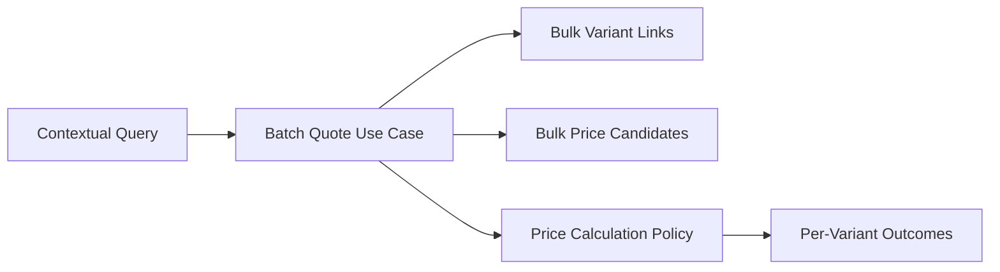
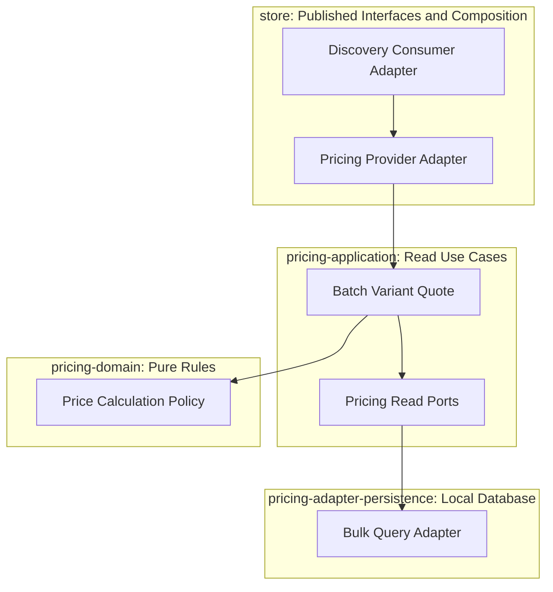
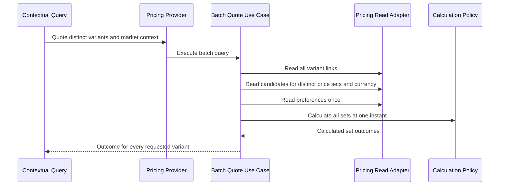

# Tech Specification: Batch Regional Pricing

> **Summary:** Quotes every distinct variant on a storefront page under one authoritative market context with bounded database reads.
> **Classification:** Architectural Pattern / Read Capability
> **Supporting Modules:** `pricing-domain` / `pricing-application` / `pricing-adapter-persistence` / `store/pricing`
> **Status:** Planned batch capability; existing four-tier calculation policy is reusable.
> **Related Features:** [Vectorized Batch Regional Pricing](../../features/feat_005-vectorized-batch-regional-pricing.md), [Storefront API Cutover & Response Contract Refactoring](../../features/feat_007-storefront-api-cutover-contract-refactoring.md)
> **Related Domain Specs:** [Pricing](../domain/pricing/architecture/pricing-domain-spec.md), [Region](../domain/region/architecture/region-domain-spec.md)
> **Related Workflow:** [Browse and Discover Products](../workflows/browse-and-discover-products-workflow.md)
> **System Design:** [SSD-001](../../system-design/001-multi_regional_contextual_discovery_system_design.md)

## 1. Why We Need It

### The Problem

`PricingQuoteQuery.quote` and `QuoteVariantPriceService` currently accept one variant. Repeating this operation for a page repeats link, candidate, and preference reads even though `CalculatePricesService` already supports multiple price-set IDs.

### Technology Decision & Alternatives

| Option | Decision | Rationale |
| :--- | :--- | :--- |
| Bulk variant links and candidate projections | Adopt | Reuses the policy while bounding persistence access for each page. |
| Loop over existing single-variant quote | Reject | Database access grows with variant count. |
| Materialize regional prices in discovery | Reject | Price changes amplify writes across channels and regions. |

Benefits are fewer repeated reads and explicit regional isolation. Request-time pricing adds a dependency to storefront reads; an operational pricing failure is not equivalent to an absent price.

## 2. What It Is

### Core Concept

The operation is stateless and creates no pricing aggregates or workflow lifecycle. One evaluation instant applies to every candidate in the batch.

### Selection Mechanics

| Priority | Required matching market rules | Selection scope |
| :--- | :--- | :--- |
| 1 | Channel and region | Most specific market tier. |
| 2 | Region | Includes region rules on a price or its price list. |
| 3 | Channel | Used only when no eligible regional tier exists. |
| 4 | Neither | Currency-matching base fallback. |

Candidates first satisfy currency, quantity, all price/list rules, list status, and the time window. Within the winning tier, existing rule-count, amount, price-ID, SALE/OVERRIDE, and tax-preference behavior remains authoritative.

## 3. How We Use It in This System

### Architecture & Layer Stacking

The public `PricingQuoteQuery` interface gains a batch operation with embedded transport records; its provider adapter delegates to an inbound batch use case under `@PricingReadTransactional`. Discovery defines its own outbound capability port and consumes the public interface from `store/storefrontquery/internal/adapter/`.

Identifiers in new application contracts use `Id`; provider transport mapping stays at the store boundary. No query loads write aggregates or accesses another module's database.

### Runtime Flow

## 4. Technical Specification & Contracts

### Normative Rules

- **BATCH-01:** A batch MUST accept distinctable variant IDs, channel ID, region ID, authoritative currency, and quantity; it MUST return an outcome keyed by every requested distinct variant ID.
- **BATCH-02:** Link lookup MUST be one bulk operation, candidate lookup MUST be bulk over distinct price sets, and preferences MUST be loaded once; SQL round trips MUST remain bounded independently of the number of variants within a supported page, including rule hydration, with no lazy per-candidate query loop.
- **BATCH-03:** Empty input MUST return an empty result without persistence calls; duplicate variant IDs and shared price sets MUST be evaluated once and mapped back correctly, using one evaluation time.
- **BATCH-04:** Eligible candidates MUST use the four-tier ordering above, including market rules attached to campaigns; two regions sharing USD MUST NOT receive one another's region-scoped candidates.
- **BATCH-05:** The implementation MUST preserve the existing quantity, operator, campaign, deterministic ranking, SALE/OVERRIDE, original-price, and tax-preference rules within the winning market tier.
- **BATCH-06:** Missing links or matching prices MUST return an unpriced outcome with null monetary values; zero MUST be retained only when it is an actual configured price, and currency substitution or automatic FX conversion MUST NOT occur.
- **BATCH-07:** Unit tests MUST cover selection and mapping; PostgreSQL integration tests MUST measure bounded SQL access for small and full-page batches, including rules and preferences.
- **BATCH-08:** Provider failures MUST propagate as operational errors; a failed read MUST NOT fabricate PRICE_UNAVAILABLE for every variant.

### Request and Result Contract

| Field | Contract |
| :--- | :--- |
| `variantIds` | Immutable set/list of requested variant identities, deduplicated internally. |
| `salesChannelId`, `regionId` | Required market identifiers supplied by resolved context. |
| `currencyCode` | Required currency supplied by Region. |
| `quantity` | Positive quantity; storefront browse/PDP uses one. |
| Evaluation instant | One time captured for the whole operation. |
| Per-variant result | Explicit priced/unpriced outcome with amount, original amount, currency and price-set reference when resolved. |

### Storage and Configuration

No new regional materialized-price table is required. The existing bulk link port and price query port are starting points; the new batch use case and published batch interface do not yet exist.

No batch-specific configuration binding or enforced maximum is currently implemented. Performance evidence MUST record actual page and variant counts rather than advertise an invented default or latency guarantee.
