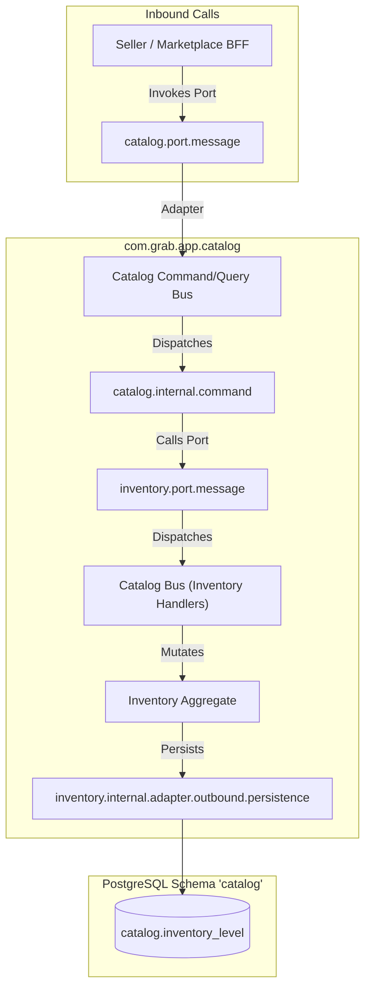
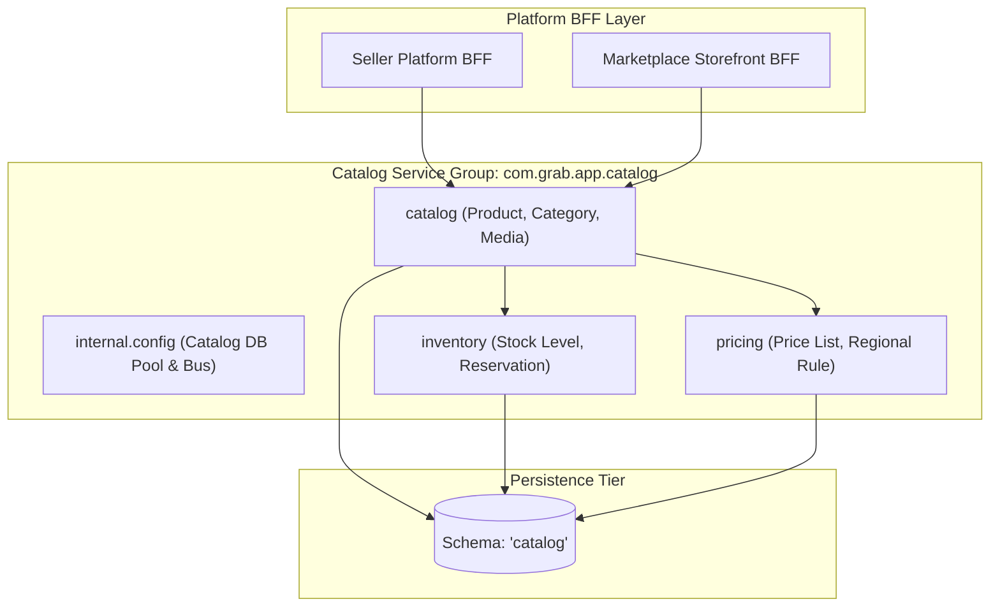
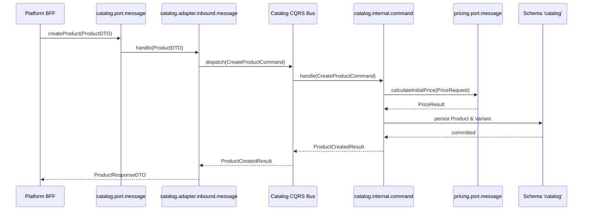

# Tech Spec: Catalog Service Group Hexagonal Packaging

- **Summary:** Defines the hexagonal package structure, ports, adapters, and CQRS pipelines for the Catalog Service Group (`catalog`, `inventory`, `pricing`) within `com.grab.app.catalog`.
- **Type:** Architecture Pattern
- **Feature Spec:** [Modular Hexagonal Package Structure](../../features/feat_009-modular-hexagonal-package-structure.md)

---

## 1. Problem & Decision

### What breaks without this?

The catalog group orchestrates high-velocity product listings, volatile inventory counts, and dynamic pricing rules. Without strict hexagonal package boundaries, pricing calculations pollute product catalog models, inventory updates bypass formal reservation policies, and external callers issue unconstrained database joins across product tables. This destroys bounded context autonomy and prevents extracting catalog capabilities into autonomous services.

### Decision

| Option | Decision | Why |
|:-------|:---------|:----|
| **Hexagonal Packaging per Bounded Context in `com.grab.app.catalog`** | Adopted | Strictly isolates `catalog`, `inventory`, and `pricing` behind public port contracts while allowing them to share group infrastructure in schema `'catalog'`. |
| Monolithic Public Catalog Package | Rejected | Couples distinct product lifecycles into a single shared namespace, encouraging circular dependencies and leaky data models. |
| Completely Disjoint Microservice Repositories | Deferred | Unnecessary operational overhead and network latency for closely aligned catalog contexts prior to independent scaling requirements. |

### Trade-offs

| Benefits | Trade-offs |
|:---------|:-----------|
| `catalog`, `inventory`, and `pricing` enforce strict encapsulation while sharing an optimized database pool. | Requires dedicated port interfaces and mapper classes for cross-context data exchange. |
| Invariant rules (e.g., inventory reservations) cannot be bypassed by external callers. | Inter-context queries require outbound message adapters rather than direct in-memory calls. |

---

## 2. How It Works

### Core Concept

The Catalog Service Group organizes `catalog`, `inventory`, and `pricing` as autonomous bounded contexts under `com.grab.app.catalog`. Each context exposes public ports (`port.message` and `port.event`), encapsulates CQRS handlers and persistence within `internal/`, and delegates to outbound adapters for outbox events, persistence, and cross-context lookups.



### How It Works Step by Step

| Step | What Happens | Why |
|:-----|:-------------|:----|
| 1 | External caller invokes `CatalogProductUseCase` via `catalog.port.message`. | Accesses catalog capabilities through a published public interface. |
| 2 | Inbound adapter (`catalog.internal.adapter.inbound.message`) maps request and publishes to `CatalogCommandBus`. | Isolates transport concerns from domain command records. |
| 3 | Command handler (`catalog.internal.command`) evaluates business rules against `Product` aggregate. | Ensures domain entity state transitions remain strictly governed. |
| 4 | If pricing or inventory data is needed, outbound adapter (`adapter.outbound.message`) invokes `pricing.port.message` or `inventory.port.message`. | Prevents direct access to peer internal packages. |
| 5 | Repository adapter (`catalog.internal.adapter.outbound.persistence`) saves entity state to schema `'catalog'` tables. | Encapsulates JPA persistence logic within the intra-domain boundary. |

---

## 3. How We Use It

### Where It Fits in Our System / Architecture & Layer Stacking



### Detailed Package Structure

```text
com.grab.app.catalog
  ├── internal/
  │   └── config/                                   # Shared Catalog DB Pool, Flyway, and Bus config
  │       ├── CatalogDatabaseConfig.java
  │       └── CatalogCqrsBusConfig.java
  ├── catalog/                                      # Catalog Bounded Context
  │   ├── port/
  │   │   ├── message/
  │   │   │   ├── CreateProductUseCase.java
  │   │   │   ├── UpdateProductVariantUseCase.java
  │   │   │   └── CatalogQueryPort.java
  │   │   └── event/
  │   │       └── ProductPublishedEventListener.java
  │   └── internal/
  │       ├── config/CatalogContextConfig.java
  │       ├── command/
  │       │   ├── CreateProductCommandHandler.java
  │       │   └── CreateProductCommand.java
  │       ├── query/
  │       │   ├── FindProductByIdQueryHandler.java
  │       │   └── FindProductByIdQuery.java
  │       └── adapter/
  │           ├── inbound/
  │           │   ├── message/CatalogInboundMessageAdapter.java
  │           │   └── event/ProductPublishedEventInboundAdapter.java
  │           └── outbound/
  │               ├── event/CatalogOutboxEventAdapter.java
  │               ├── message/InventoryQueryOutboundAdapter.java
  │               └── persistence/
  │                   ├── CatalogRepositoryAdapter.java
  │                   ├── entity/ProductJpaEntity.java
  │                   ├── repository/ProductJpaRepository.java
  │                   └── mapper/CatalogPersistenceMapper.java
  ├── inventory/                                    # Inventory Bounded Context
  │   ├── port/
  │   │   ├── message/
  │   │   │   ├── ReserveStockUseCase.java
  │   │   │   ├── AdjustInventoryUseCase.java
  │   │   │   └── InventoryQueryPort.java
  │   │   └── event/
  │   │       └── OrderCancelledEventListener.java
  │   └── internal/
  │       ├── config/InventoryContextConfig.java
  │       ├── command/ReserveStockCommandHandler.java
  │       ├── query/CheckStockAvailabilityQueryHandler.java
  │       └── adapter/
  │           ├── inbound/
  │           │   ├── message/InventoryInboundMessageAdapter.java
  │           │   └── event/OrderCancelledEventInboundAdapter.java
  │           └── outbound/
  │               ├── event/InventoryOutboxEventAdapter.java
  │               ├── message/CatalogQueryOutboundAdapter.java
  │               └── persistence/
  │                   ├── InventoryRepositoryAdapter.java
  │                   ├── entity/InventoryLevelJpaEntity.java
  │                   ├── repository/InventoryLevelJpaRepository.java
  │                   └── mapper/InventoryPersistenceMapper.java
  └── pricing/                                      # Pricing Bounded Context
      ├── port/
      │   ├── message/
      │   │   ├── ApplyPriceRuleUseCase.java
      │   │   └── PricingQueryPort.java
      │   └── event/
      │       └── CurrencyRateUpdatedEventListener.java
      └── internal/
          ├── config/PricingContextConfig.java
          ├── command/ApplyPriceRuleCommandHandler.java
          ├── query/CalculatePriceQueryHandler.java
          └── adapter/
              ├── inbound/
              │   ├── message/PricingInboundMessageAdapter.java
              │   └── event/CurrencyRateEventInboundAdapter.java
              └── outbound/
                  ├── event/PricingOutboxEventAdapter.java
                  ├── message/RegionQueryOutboundAdapter.java
                  └── persistence/
                      ├── PricingRepositoryAdapter.java
                      ├── entity/PriceListJpaEntity.java
                      ├── repository/PriceListJpaRepository.java
                      └── mapper/PricingPersistenceMapper.java
```

### Component Responsibilities

| Component | Role | What It Does |
|:----------|:-----|:-------------|
| `catalog.port.message` | Product Capability Port | Exposes product creation, catalog hierarchy, and search lookups to callers. |
| `inventory.port.message` | Inventory Capability Port | Exposes stock allocation, reservations, and inventory adjustment use cases. |
| `pricing.port.message` | Pricing Capability Port | Exposes dynamic pricing rules, price lists, and currency calculations. |
| `internal.config` | Group Shared Infra | Configures shared Hikari connection pool (`CatalogHikariPool`) and local command/query buses. |
| `catalog.internal.adapter.outbound.persistence` | Catalog Persistence | Manages JPA entities for products and variants targeting schema `'catalog'`. |
| `inventory.internal.adapter.outbound.persistence` | Inventory Persistence | Manages JPA entities for stock counts and reservations targeting schema `'catalog'`. |
| `pricing.internal.adapter.outbound.persistence` | Pricing Persistence | Manages JPA entities for price tiers and regional lists targeting schema `'catalog'`. |

### Runtime Flow



---

## 4. Implementation Rules

> These are **non-negotiable contracts**. An implementation is compliant only when **all** rules are satisfied.

| Rule | Requirement |
|:-----|:------------|
| **R-01** | All catalog services **MUST** reside within `com.grab.app.catalog` structured under `catalog`, `inventory`, or `pricing`. |
| **R-02** | Cross-context access between `catalog`, `inventory`, and `pricing` **MUST** pass through public `port/` interfaces; direct imports of peer `internal/` packages are **PROHIBITED**. |
| **R-03** | Repositories in `inventory` and `pricing` **MUST NOT** perform SQL joins or updates on `catalog_product` or foreign tables; table ownership **MUST** remain exclusive to each context. |
| **R-04** | All write mutations across the three contexts **MUST** use `@CatalogTransactional` to demarcate transactions on CQRS handlers. |
| **R-05** | Outbound integration events **MUST** be written to `catalog.outbox_record` within the same transaction as entity state changes. |
| **R-06** | Read models across context boundaries **MUST** be fetched via `adapter.outbound.message` using read-only view projections. |

