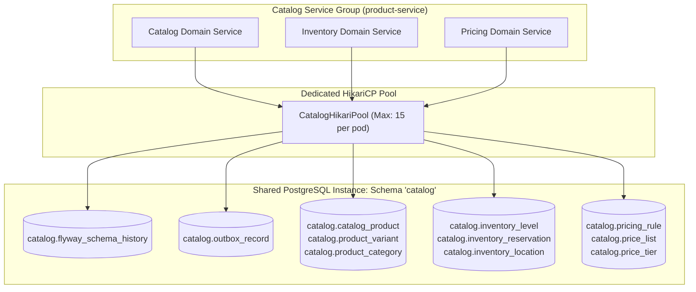
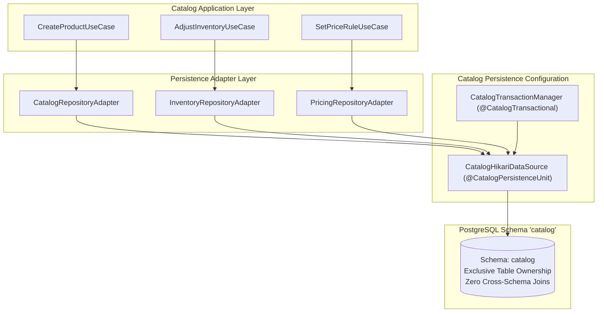
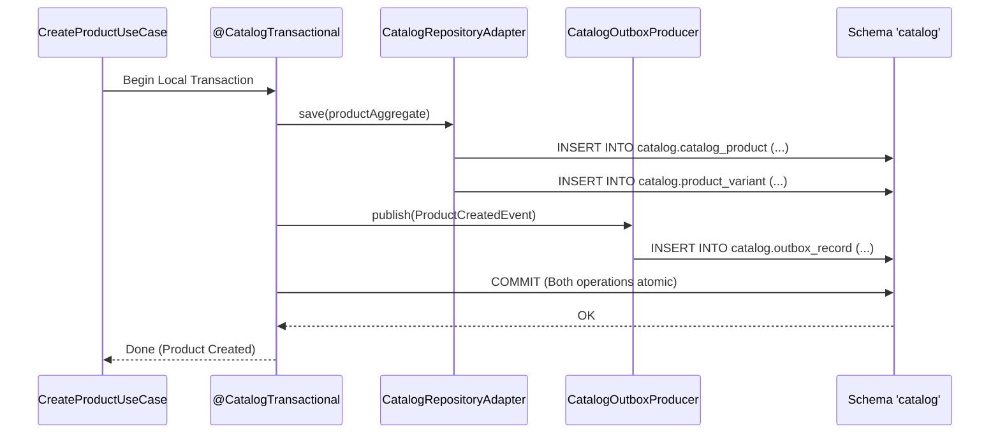

# Tech Spec: Catalog Service Group Persistence

- **Summary:** Defines the shared relational schema, connection pooling, and Flyway migration stream for the Catalog Service Group (`catalog`, `inventory`, `pricing`) on the shared database instance.
- **Type:** Platform Infrastructure
- **Feature Spec:** [Multi-Schema Database Isolation & Connection Budgeting](../../features/feat_010-multi-schema-database-isolation-connection-budgeting.md)

---

## 1. Problem & Decision

### What breaks without this?

If catalog, inventory, and pricing each maintained disjoint, uncoordinated persistence units or competed with unrelated checkout domains in a monolithic public schema, cross-module table contention and complex multi-database transactions would arise during sellable product provisioning. Conversely, allowing unconstrained cross-domain table joins between pricing and orders prevents independent schema optimization and extraction.

### Decision

| Option | Decision | Why |
|:-------|:---------|:----|
| **Shared Schema `'catalog'` across Catalog, Inventory, and Pricing** | Adopted | Closely related product capabilities share schema `'catalog'` on the shared PostgreSQL instance with a unified connection pool, simplifying atomic product and inventory updates while remaining encapsulated from other service groups. |
| Independent Database Instance per Bounded Context | Rejected | Unnecessary operational overhead and infrastructure cost for closely coupled catalog contexts at current scale. |
| Shared Public Monolith Schema | Rejected | Leaks table structures across unrelated domains (such as orders and accounts), preventing clean modular boundaries. |

### Trade-offs

| Benefits | Trade-offs |
|:---------|:-----------|
| `catalog`, `inventory`, and `pricing` share a single connection pool and Flyway stream, optimizing connection usage. | Internal bounded contexts within the group must enforce table ownership rules in code to prevent cross-context SQL joins. |
| High-velocity catalog and inventory operations are isolated from checkout connection spikes. | Bulk pricing updates or re-indexing operations share connection bandwidth with inventory adjustments. |

---

## 2. How It Works

### Core Concept

The Catalog Service Group (`com.grab.app.catalog`) consolidates three bounded contexts—`catalog`, `inventory`, and `pricing`—under a single logical PostgreSQL schema named `'catalog'`. The entire service group shares a dedicated `HikariDataSource` connection pool (`CatalogHikariPool`) and a unified Flyway migration stream targeting `classpath:db/migration/catalog`.



### How It Works Step by Step

| Step | What Happens | Why |
|:-----|:-------------|:----|
| 1 | Catalog Service initializes the shared `CatalogHikariPool` targeting PostgreSQL schema `'catalog'`. | Sets up isolated database connections with bounded capacity. |
| 2 | Flyway migrates SQL scripts from `db/migration/catalog` and records version history in `catalog.flyway_schema_history`. | Ensures reproducible and versioned DDL updates for all catalog, inventory, and pricing tables. |
| 3 | Use case services execute state changes via intra-domain repository adapters (e.g., `CatalogRepositoryAdapter`, `InventoryRepositoryAdapter`). | Each adapter queries only its own owned tables; cross-context joins are prohibited. |
| 4 | State changes and outbound domain events are committed within `@CatalogTransactional`. | Aggregate state mutations and outbox records are written atomically. |

### Schema Table Allocation & Ownership

| Bounded Context | Owned Tables | Description |
|:----------------|:-------------|:------------|
| **Catalog** | `catalog_product`, `product_variant`, `product_category`, `product_media` | Master product catalog, hierarchy, and presentation facts. |
| **Inventory** | `inventory_item`, `inventory_level`, `inventory_reservation`, `stock_location` | Stock counts, warehouse allocations, and checkout reservations. |
| **Pricing** | `price_list`, `pricing_rule`, `price_tier`, `regional_price_override` | Currency amounts, tiered pricing, and regional price adjustments. |
| **Shared Infrastructure** | `outbox_record`, `flyway_schema_history` | Transactional outbox log and Flyway schema version tracking. |

---

## 3. How We Use It

### Where It Fits in Our System / Architecture & Layer Stacking



### Component Responsibilities

| Component | Role | What It Does |
|:----------|:-----|:-------------|
| **`CatalogPersistenceConfig`** | Spring Configuration | Declares `DataSource`, `HikariConfig`, `EntityManagerFactory`, and `TransactionManager` scoped to `'catalog'`. |
| **`CatalogRepositoryAdapter`** | Outbound Adapter | Persists catalog product aggregates and variant definitions. |
| **`InventoryRepositoryAdapter`** | Outbound Adapter | Manages inventory levels and atomic stock reservation locks. |
| **`PricingRepositoryAdapter`** | Outbound Adapter | Persists regional price matrices and rule precedence configurations. |
| **`CatalogOutboxProducer`** | Outbox Infrastructure | Writes domain events (`ProductCreated`, `InventoryReserved`) to `catalog.outbox_record`. |

### Runtime Flow

> A product creation flow atomically updates catalog tables and commits an outbox record within schema `'catalog'`.



### Configuration Specification

```yaml
grab:
  catalog:
    datasource:
      jdbc-url: jdbc:postgresql://${DB_HOST:localhost}:${DB_PORT:5432}/${DB_NAME:grab_commerce}?currentSchema=catalog
      username: ${CATALOG_DB_USER:catalog_user}
      password: ${CATALOG_DB_PASSWORD:catalog_secret}
      hikari:
        maximum-pool-size: 15
        minimum-idle: 3
        connection-timeout: 30000
        idle-timeout: 600000
        max-lifetime: 1800000
        pool-name: CatalogHikariPool
    flyway:
      schemas: catalog
      default-schema: catalog
      table: flyway_schema_history
      locations: classpath:db/migration/catalog
```

---

## 4. Implementation Rules

> These are **non-negotiable contracts**. An implementation is compliant only when **all** rules are satisfied.

- **RULE-CAT-DB-01: Shared Schema Encapsulation**
  The `catalog`, `inventory`, and `pricing` bounded contexts MUST share schema `'catalog'`. They MUST NOT access tables in any other schema (such as `"order"` or `account`).

- **RULE-CAT-DB-02: Zero Cross-Context Joins**
  Even though `catalog_product` and `inventory_item` reside in the same schema `'catalog'`, cross-context SQL joins or JPA entity mappings between them are strictly prohibited. Relationships MUST be referenced via `Id` only.

- **RULE-CAT-DB-03: Shared Pool Budgeting**
  All three bounded contexts MUST share `CatalogHikariPool`. Total connections across replicas ($N \times O \times 15$) must stay within the budgeted allocation.

- **RULE-CAT-DB-04: Atomic Local Outbox Commit**
  All catalog, inventory, and pricing events MUST be written to `catalog.outbox_record` within the `@CatalogTransactional` boundary.
