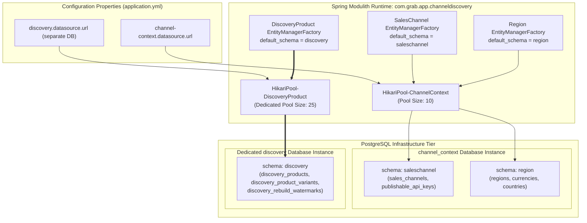
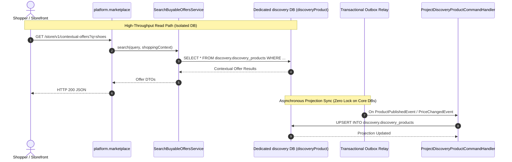

# Tech Spec: Channel & Discovery Database Configuration & Implementation Pattern

- **Summary:** Defines the database architecture for the Channel & Discovery domain cluster, where foundational channel context domains (`saleschannel`, `region`) share a consolidated database, while the `discoveryProduct` aggregate is architected with a dedicated, separate database to isolate high-throughput storefront read projections from operational channel metadata.
- **Type:** Infrastructure & Architecture Pattern
- **Feature Spec:** [Service-Level Database & Connection Pool Consolidation in Spring Modulith](../../features/feat_010-service-level-database-consolidation.md)

---

## 1. Problem & Decision

### What breaks without this?

The Channel & Discovery cluster combines two fundamentally different workload profiles:
1. **Operational Channel Context (`saleschannel`, `region`)**: Foundational, low-frequency write, high-security operational entities managing SHA-256 publishable API keys, channel permissions, and regional currencies/tax rules.
2. **Contextual Read Projections (`discoveryProduct` aggregate)**: Ultra-high-throughput, denormalized read model handling 95%+ of shopper traffic (search, filtering, browsing, contextual pricing) and massive write bursts during full catalog rebuilds.

If `discoveryProduct` shares a database instance and connection pool with `saleschannel` and `region` (or with core transactional write groups like Product Merchandising and Orders), flash sales and catalog projection rebuilds saturate connections and cause database locks, starving public ingress publishable key lookups and regional tax resolutions. Conversely, running separate databases for *every* individual module wastes resources on idle connection pools for static channel tables.

### Decision

| Option | Decision | Why |
|:-------|:---------|:----|
| **Dedicated Database for `discoveryProduct` Aggregate + Shared Database for `saleschannel` & `region`** | Adopted | Across the entire platform, only the Channel & Discovery group isolates an aggregate into a dedicated database. Foundational channel metadata (`saleschannel`, `region`) shares `channel_context` DB (10 connections), while `discoveryProduct` runs on a dedicated `discovery` database (25 connections) optimized for CQRS read projections and batch rebuilds. |
| Single Database for All Channel & Discovery Modules | Rejected | Allows storefront search surges and bulk projection rebuilds to compete for connection pools and I/O locks with critical publishable key security checks. |
| Separate Physical Databases for All 3 Modules | Rejected | Unnecessarily spins up an independent database instance and connection pool for `region`, which is static metadata with virtually zero write traffic. |

### Trade-offs

| Benefits | Trade-offs |
|:-----------|:-------------|
| Complete I/O and connection pool isolation for the high-volume `discoveryProduct` projection. | Requires two distinct DataSources within the `com.grab.app.channeldiscovery` cluster namespace. |
| Background catalog rebuild jobs cannot starve or lock publishable API key lookups. | `discoveryProduct` projection rebuilders cannot query `saleschannel` or `region` via SQL joins (must use public API ports or cached context). |
| `discovery` database can be independently scaled, read-replicated, or migrated to a search-optimized engine (e.g., PostgreSQL with pgvector, Elasticsearch) without touching channel auth tables. | Two database schemas/instances to provision and maintain in Docker Compose and CI pipelines. |

---

## 2. How It Works

### Core Concept

Unlike other domain groups (`product-merchandising`, `order-management`, `identity-account`) where all subdomains share a single consolidated database instance:
- **`saleschannel` and `region`** share the **`channel_context`** PostgreSQL database, partitioned into `saleschannel` and `region` schemas via a shared connection pool (`HikariPool-ChannelContext`).
- **`discoveryProduct` aggregate** (residing in `discovery` / `storefrontquery`) uses a **dedicated separate database instance (`discovery`)** with its own optimized connection pool (`HikariPool-DiscoveryProduct`).



---

### Database & Schema Separation

| Database Instance | Schemas | Aggregate / Modules | Workload Characteristics | Flyway History Table |
|:------------------|:--------|:--------------------|:-------------------------|:---------------------|
| **`channel_context`** | `saleschannel` | `SalesChannel`, `PublishableApiKey` | Low write, high-cache operational reads; sensitive SHA-256 keys. | `saleschannel.flyway_schema_history_saleschannel` |
| **`channel_context`** | `region` | `Region`, `Currency` | Near-static configuration data; regional market mappings. | `region.flyway_schema_history_region` |
| **`discovery`** *(Dedicated)* | `discovery` | **`DiscoveryProduct`**, `DiscoveryProductVariant` | **CQRS Read Projection**; ultra-high read volume, batch bulk rebuilds, vectorized pricing facts. | `discovery.flyway_schema_history_discovery` |

---

### Table Partitioning per Database

```text
Database: channel_context (Port 5435)
├── Schema: saleschannel
│   ├── sales_channels
│   ├── publishable_api_keys
│   ├── channel_memberships
│   └── flyway_schema_history_saleschannel
└── Schema: region
    ├── regions
    ├── currencies
    ├── countries
    ├── tax_jurisdictions
    └── flyway_schema_history_region

Database: discovery (Port 5436 - Dedicated Separate DB)
└── Schema: discovery
    ├── discovery_products
    ├── discovery_product_variants
    ├── discovery_rebuild_watermarks
    └── flyway_schema_history_discovery
```

---

### YAML Configuration Specification

In `app/src/main/resources/application.yml`:

```yaml
# ==============================================================================
# CHANNEL & DISCOVERY CLUSTER PERSISTENCE CONFIGURATION
# ==============================================================================

# 1. Shared Database for Channel Context (SalesChannel & Region)
channel-context:
  datasource:
    url: ${CHANNEL_CONTEXT_DATASOURCE_URL:jdbc:postgresql://localhost:5432/channel_context}
    username: ${CHANNEL_CONTEXT_DATASOURCE_USERNAME:admin}
    password: ${CHANNEL_CONTEXT_DATASOURCE_PASSWORD:123}
    driver-class-name: org.postgresql.Driver
    hikari:
      maximum-pool-size: ${CHANNEL_CONTEXT_HIKARI_MAX_POOL_SIZE:10}
      minimum-idle: ${CHANNEL_CONTEXT_HIKARI_MIN_IDLE:2}
      pool-name: HikariPool-ChannelContext

saleschannel:
  seed:
    enabled: ${SALESCHANNEL_SEED_ENABLED:true}
  datasource:
    schema: saleschannel
    url: ${channel-context.datasource.url}
    username: ${channel-context.datasource.username}
    password: ${channel-context.datasource.password}

region:
  seed:
    enabled: ${REGION_SEED_ENABLED:true}
  datasource:
    schema: region
    url: ${channel-context.datasource.url}
    username: ${channel-context.datasource.username}
    password: ${channel-context.datasource.password}

# 2. Dedicated Separate Database Exclusively for DiscoveryProduct Aggregate
discovery:
  seed:
    enabled: ${DISCOVERY_SEED_ENABLED:true}
  datasource:
    # Dedicated database instance apart from other groups
    url: ${DISCOVERY_DATASOURCE_URL:jdbc:postgresql://localhost:5432/discovery}
    username: ${DISCOVERY_DATASOURCE_USERNAME:admin}
    password: ${DISCOVERY_DATASOURCE_PASSWORD:123}
    driver-class-name: org.postgresql.Driver
    schema: discovery
    hikari:
      maximum-pool-size: ${DISCOVERY_HIKARI_MAX_POOL_SIZE:25}
      minimum-idle: ${DISCOVERY_HIKARI_MIN_IDLE:5}
      pool-name: HikariPool-DiscoveryProduct
      connection-timeout: 30000
      idle-timeout: 600000
      max-lifetime: 1800000
```

---

### Spring Java Implementation Pattern

#### 1. Channel Context Persistence Configuration (`saleschannel` & `region`)

```java
package com.grab.app.channeldiscovery.internal.config;

import com.zaxxer.hikari.HikariDataSource;
import jakarta.persistence.EntityManagerFactory;
import org.flywaydb.core.Flyway;
import org.springframework.beans.factory.annotation.Qualifier;
import org.springframework.boot.context.properties.ConfigurationProperties;
import org.springframework.context.annotation.Bean;
import org.springframework.context.annotation.Configuration;
import org.springframework.context.annotation.Primary;
import org.springframework.data.jpa.repository.config.EnableJpaRepositories;
import org.springframework.orm.jpa.JpaTransactionManager;
import org.springframework.orm.jpa.LocalContainerEntityManagerFactoryBean;
import org.springframework.orm.jpa.vendor.HibernateJpaVendorAdapter;
import org.springframework.transaction.PlatformTransactionManager;

import javax.sql.DataSource;
import java.util.HashMap;
import java.util.Map;

@Configuration
@EnableJpaRepositories(
        basePackages = "com.saleschannel.adapter.persistence.repository",
        entityManagerFactoryRef = "salesChannelEntityManagerFactory",
        transactionManagerRef = "salesChannelTransactionManager"
)
public class ChannelContextPersistenceConfiguration {

    // Shared connection pool for saleschannel & region
    @Bean("channelContextDataSource")
    @ConfigurationProperties("channel-context.datasource.hikari")
    public HikariDataSource channelContextDataSource() {
        return new HikariDataSource();
    }

    @Bean("salesChannelEntityManagerFactory")
    public LocalContainerEntityManagerFactoryBean salesChannelEntityManagerFactory(
            @Qualifier("channelContextDataSource") DataSource dataSource) {
        LocalContainerEntityManagerFactoryBean em = new LocalContainerEntityManagerFactoryBean();
        em.setDataSource(dataSource);
        em.setPackagesToScan("com.saleschannel.adapter.persistence");
        em.setPersistenceUnitName("saleschannel");
        em.setJpaVendorAdapter(new HibernateJpaVendorAdapter());

        Map<String, Object> props = new HashMap<>();
        props.put("hibernate.default_schema", "saleschannel");
        props.put("hibernate.dialect", "org.hibernate.dialect.PostgreSQLDialect");
        em.setJpaPropertyMap(props);
        return em;
    }

    @Bean("salesChannelTransactionManager")
    public PlatformTransactionManager salesChannelTransactionManager(
            @Qualifier("salesChannelEntityManagerFactory") EntityManagerFactory emFactory) {
        return new JpaTransactionManager(emFactory);
    }

    @Bean(initMethod = "migrate")
    public Flyway salesChannelFlyway(@Qualifier("channelContextDataSource") DataSource dataSource) {
        return Flyway.configure()
                .dataSource(dataSource)
                .schemas("saleschannel")
                .defaultSchema("saleschannel")
                .table("flyway_schema_history_saleschannel")
                .locations("classpath:db/migration/saleschannel")
                .baselineOnMigrate(true)
                .load();
    }
}
```

#### 2. Dedicated DiscoveryProduct Aggregate Persistence Configuration

```java
package com.grab.app.channeldiscovery.internal.config;

import com.zaxxer.hikari.HikariDataSource;
import jakarta.persistence.EntityManagerFactory;
import org.flywaydb.core.Flyway;
import org.springframework.beans.factory.annotation.Qualifier;
import org.springframework.boot.context.properties.ConfigurationProperties;
import org.springframework.context.annotation.Bean;
import org.springframework.context.annotation.Configuration;
import org.springframework.data.jpa.repository.config.EnableJpaRepositories;
import org.springframework.orm.jpa.JpaTransactionManager;
import org.springframework.orm.jpa.LocalContainerEntityManagerFactoryBean;
import org.springframework.orm.jpa.vendor.HibernateJpaVendorAdapter;
import org.springframework.transaction.PlatformTransactionManager;

import javax.sql.DataSource;
import java.util.HashMap;
import java.util.Map;

@Configuration
@EnableJpaRepositories(
        basePackages = "com.grab.discovery.adapter.persistence.repository.jpa",
        entityManagerFactoryRef = "discoveryProductEntityManagerFactory",
        transactionManagerRef = "discoveryProductTransactionManager"
)
public class DiscoveryProductPersistenceConfiguration {

    // Dedicated DataSource exclusively for the DiscoveryProduct aggregate
    @Bean("discoveryProductDataSource")
    @ConfigurationProperties("discovery.datasource.hikari")
    public HikariDataSource discoveryProductDataSource() {
        return new HikariDataSource();
    }

    @Bean("discoveryProductEntityManagerFactory")
    public LocalContainerEntityManagerFactoryBean discoveryProductEntityManagerFactory(
            @Qualifier("discoveryProductDataSource") DataSource dataSource) {
        LocalContainerEntityManagerFactoryBean em = new LocalContainerEntityManagerFactoryBean();
        em.setDataSource(dataSource);
        em.setPackagesToScan("com.grab.discovery.adapter.persistence.entity");
        em.setPersistenceUnitName("discovery");
        em.setJpaVendorAdapter(new HibernateJpaVendorAdapter());

        Map<String, Object> props = new HashMap<>();
        props.put("hibernate.default_schema", "discovery");
        props.put("hibernate.dialect", "org.hibernate.dialect.PostgreSQLDialect");
        em.setJpaPropertyMap(props);
        return em;
    }

    @Bean("discoveryProductTransactionManager")
    public PlatformTransactionManager discoveryProductTransactionManager(
            @Qualifier("discoveryProductEntityManagerFactory") EntityManagerFactory emFactory) {
        return new JpaTransactionManager(emFactory);
    }

    @Bean(initMethod = "migrate")
    public Flyway discoveryProductFlyway(@Qualifier("discoveryProductDataSource") DataSource dataSource) {
        return Flyway.configure()
                .dataSource(dataSource)
                .schemas("discovery")
                .defaultSchema("discovery")
                .table("flyway_schema_history_discovery")
                .locations("classpath:db/migration/storefrontquery", "classpath:db/migration/discovery")
                .baselineOnMigrate(true)
                .load();
    }
}
```

---

## 3. How We Use It

### CQRS Read/Write Separation Lifecycle



---

## 4. Implementation Rules

| Rule | Requirement |
|:-----|:------------|
| **R-CD01** | The `discoveryProduct` aggregate (`DiscoveryProductEntity`, `DiscoveryProductVariantEntity`) **MUST** connect to its own dedicated database instance (`discovery`), isolated from all other domain groups and from `channel_context`. |
| **R-CD02** | `saleschannel` and `region` **MUST** share the `channel_context` database instance, isolated via schemas `saleschannel` and `region`. |
| **R-CD03** | The `discoveryProduct` persistence layer **MUST NOT** perform SQL joins or foreign keys across databases into `saleschannel`, `region`, `catalog`, or `pricing`. All projection data **MUST** be pre-materialized facts. |
| **R-CD04** | Flyway migrations for `discoveryProduct` **MUST** target the dedicated `discovery` database and use `discovery.flyway_schema_history_discovery`. |
| **R-CD05** | The connection pool `HikariPool-DiscoveryProduct` **MUST** be sized to handle high-concurrency read queries (e.g. 25 connections), while `HikariPool-ChannelContext` is capped at 10 connections. |
| **R-CD06** | In the event of full projection rebuilds via `RebuildDiscoveryProductsCommand`, batch writes **MUST** only write to the `discovery` database, ensuring zero transaction lock contention on operational tables. |
