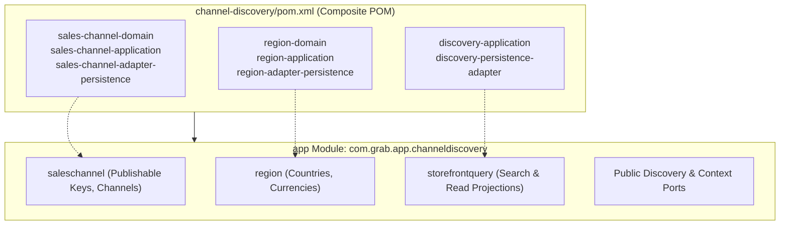
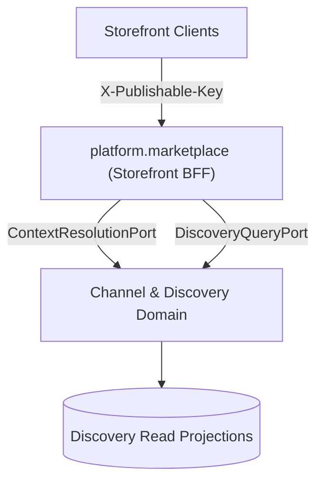

# Tech Spec: Channel & Discovery Domain Namespace

- **Summary:** Defines the Maven composite aggregation, Spring Modulith module boundaries, package architecture, and isolation rules for the Channel & Discovery domain cluster.
- **Type:** Architecture Pattern
- **Feature Spec:** [Industrial Project Structure Organization & Runnable App Module](../../features/feat_009-industrial-project-structure-organization.md)

---

## 1. Problem & Decision

### What breaks without this?

Storefront queries (search, browse, category navigation) require sub-50ms read latency and must resolve multi-regional contexts (currency, tax rules, publishable API keys). If discovery read queries execute directly against write-heavy, normalized relational tables in `catalog` and `inventory`, database connection pools quickly saturate, lock contention spikes, and public traffic slows down critical seller operations. Without a dedicated Channel & Discovery boundary, read-side optimizations become entangled with write-side transactional rules.

### Decision

| Option | Decision | Why |
|:-------|:---------|:----|
| **Composite Maven POM & Spring Modulith Namespace (`com.grab.app.channeldiscovery`)** | Adopted | Groups `saleschannel`, `region`, and `discovery` (read projections and storefront query coordinators) into a dedicated high-throughput edge discovery cluster. |
| Physical Directory Restructuring | Rejected | Moving module directories risks breaking build paths, git histories, and deployment scripts with no architectural advantage. |
| Coupling Discovery with Catalog Domain | Rejected | Violates CQRS principles; catalog is an authoritative write-master PIM, whereas discovery is a high-concurrency read projection optimized for shopper browsing. |

### Trade-offs

| Benefits | Trade-offs |
|:-----------|:-------------|
| Complete read/write separation (CQRS) isolating shopper queries from seller product edits | Read projections are eventually consistent; updates reconcile asynchronously via outbox events |
| High-performance publishable key (SHA-256) and regional context resolution at the ingress boundary | Discovery projections require idempotent event handlers and reconciliation workers |
| Ready to absorb future presentation domains (`storefront-config`, `search-index`, `cms-content`) | Write operations (e.g. creating a sales channel) remain distinct from read-query coordinators |

---

## 2. How It Works

### Core Concept

The Channel & Discovery domain cluster is aggregated via a composite Maven POM (`channel-discovery/pom.xml`) at the repository root. In the runnable application (`app`), all ingress filters, publishable key resolvers, and discovery projection listeners reside within `com.grab.app.channeldiscovery`.



### Package Layout & Internal Namespaces

```text
channel-discovery/
└── pom.xml                                           # Composite Service POM

app/src/main/java/com/grab/app/channeldiscovery/
├── package-info.java                                 # @org.springframework.modulith.ApplicationModule
├── saleschannel/                                     # Sales Channels & Ingress Keys
│   ├── SalesChannelConfiguration.java                # Spring @Configuration
│   ├── internal/                                     # SHA-256 key verifiers, channel repo
│   └── api/                                          # Public Channel & Key Ports
├── region/                                           # Regional Localization & Currencies
│   ├── RegionConfiguration.java                      # Spring @Configuration
│   ├── internal/                                     # Country-currency mappings
│   └── api/                                          # Public Region Ports & DTOs
└── storefrontquery/                                  # Read Projections & Search Coordinators
    ├── StorefrontQueryConfiguration.java             # Spring @Configuration
    ├── internal/                                     # Event reconciliation listeners
    └── api/                                          # Public Discovery Query Ports
```

### How It Works Step by Step

| Step | What Happens | Why |
|:-----|:-------------|:----|
| 1 | `app/pom.xml` imports `channel-discovery` composite dependency | Transitively includes sales channel, region, and discovery libraries |
| 2 | Spring Modulith bootstraps `com.grab.app.channeldiscovery` module | Validates namespace encapsulation and package visibility |
| 3 | Public storefront client makes request with `X-Publishable-Key` header | `SalesChannelKeyPort` resolves channel and authorized regional scope |
| 4 | Client queries `/store/v1/products` | Handled by `DiscoveryQueryPort` querying denormalized read-optimized tables |
| 5 | Catalog publishes `ProductPublishedEvent` via Outbox | Discovery projection listener updates the search read model asynchronously |

---

## 3. How We Use It

### Where It Fits in Our System



### Component Responsibilities

| Component | Role | What It Does |
|:----------|:-----|:-------------|
| `channel-discovery/pom.xml` | Maven Aggregator | Aggregates sales-channel, region, and discovery modules with `<type>pom</type>`. |
| `com.grab.app.channeldiscovery` | Domain Cluster Namespace | Houses sales channel lifecycle, regional currency mapping, and search read models. |
| `SalesChannelConfiguration` | Spring Bean Registrar | Exposes sales channel retrieval, creation, and publishable key authentication beans. |
| `RegionConfiguration` | Spring Bean Registrar | Exposes regional configuration, tax preferences, and country-to-currency mappings. |
| `StorefrontQueryConfiguration` | Spring Bean Registrar | Exposes high-throughput discovery search, filter, and projection reconciliation listeners. |

---

## 4. Implementation Rules

| Rule | Requirement |
|:-----|:------------|
| **R-01** | The `app/pom.xml` module **MUST** depend on `channel-discovery` and **MUST NOT** import individual modules (`discovery-application`, `region-domain`, etc.) directly. |
| **R-02** | The package `com.grab.app.channeldiscovery` **MUST** be annotated with `@org.springframework.modulith.ApplicationModule` or declared as an application module in `package-info.java`. |
| **R-03** | Discovery read projections **MUST NOT** perform write mutations back into catalog, inventory, or order relational tables. |
| **R-04** | All projection updates **MUST** be triggered asynchronously by consuming domain integration events from the Transactional Outbox. |
| **R-05** | Future channel and presentation domains (`storefront-config`, `search-index`, `localization`, `cms-content`) **MUST** reside under the `channel-discovery` composite POM and package namespace. |
