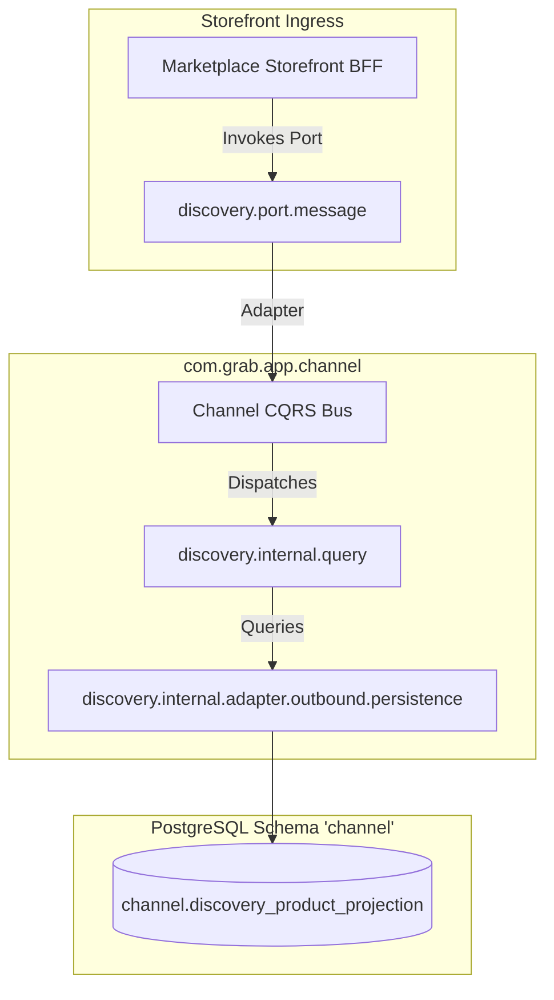
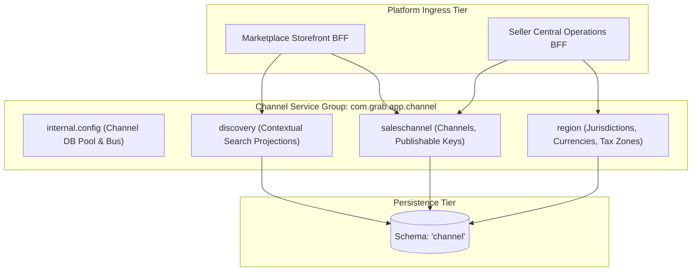
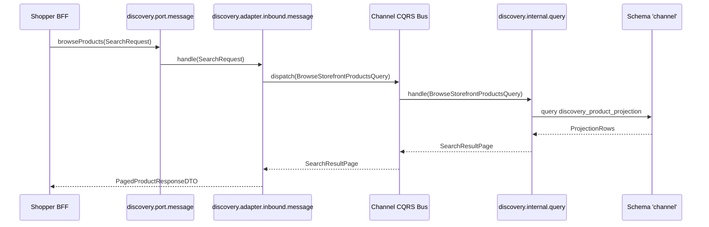

# Tech Spec: Channel Service Group Hexagonal Packaging

- **Summary:** Defines the hexagonal package structure, ports, adapters, and CQRS boundaries for the Channel Service Group (`saleschannel`, `region`, `discovery`) within `com.grab.app.channel`.
- **Type:** Architecture Pattern
- **Feature Spec:** [Modular Hexagonal Package Structure](../../features/feat_009-modular-hexagonal-package-structure.md)

---

## 1. Problem & Decision

### What breaks without this?

The channel service group manages commercial storefront channels, regional tax and currency zones, publishable API security keys, and high-throughput product discovery search projections. Without explicit hexagonal packaging boundaries, heavy discovery projection rebuilds lock relational sales channel tables, publishable key validation logic entangles with product search algorithms, and external callers bypass regional market restrictions. This leads to search degradation, broken multi-tenancy isolation, and security vulnerabilities.

### Decision

| Option | Decision | Why |
|:-------|:---------|:----|
| **Hexagonal Packaging per Bounded Context in `com.grab.app.channel`** | Adopted | Strictly separates commercial governance (`saleschannel`, `region`) from read-optimized contextual search projections (`discovery`) behind explicit ports. |
| Single Channel and Search Monolithic Package | Rejected | Blurs write transactions with read projection indexing, causing connection starvation and unconstrained table joins. |
| Separate Elasticsearch Microservice Immediately | Deferred | Introduces distributed syncing complexity prematurely when facts-only projections in PostgreSQL fulfill current search throughput. |

### Trade-offs

| Benefits | Trade-offs |
|:---------|:-----------|
| Read-heavy `discovery` projections are isolated from transactional `saleschannel` and `region` mutations. | Projection updates require asynchronous integration event listeners rather than synchronous writes. |
| Publishable key lifecycle and security validations are encapsulated within `saleschannel`. | Cross-context resolution (e.g. validating region before projecting discovery offers) requires outbound adapters. |

---

## 2. How It Works

### Core Concept

The Channel Service Group structures `saleschannel`, `region`, and `discovery` under `com.grab.app.channel`. `saleschannel` and `region` govern commercial configuration and API credentials. `discovery` consumes integration events via `port.event` to maintain read-optimized facts-only projection tables in schema `'channel'` without executing write domain logic.



### How It Works Step by Step

| Step | What Happens | Why |
|:-----|:-------------|:----|
| 1 | Shopper requests regional catalog via `BrowseStorefrontProductsUseCase` in `discovery.port.message`. | External request targets the read-optimized discovery port. |
| 2 | Inbound adapter (`discovery.internal.adapter.inbound.message`) publishes query record to `ChannelQueryBus`. | Converts transport parameters into immutable query objects. |
| 3 | Query handler (`discovery.internal.query`) applies regional visibility and channel filters. | Decouples search filtering from underlying sales channel write models. |
| 4 | Outbound persistence adapter reads materialized rows from `channel.discovery_product_projection`. | Executes zero-join high-speed queries against pre-computed facts. |
| 5 | When channel or product facts change, `discovery.port.event` receives integration events and updates projections asynchronously. | Guarantees eventual consistency without impacting write transactions. |

---

## 3. How We Use It

### Where It Fits in Our System / Architecture & Layer Stacking



### Detailed Package Structure

```text
com.grab.app.channel
  ├── internal/
  │   └── config/                                   # Shared Channel DB Pool, Flyway, and Bus config
  │       ├── ChannelDatabaseConfig.java
  │       └── ChannelCqrsBusConfig.java
  ├── saleschannel/                                 # Sales Channel Bounded Context
  │   ├── port/
  │   │   ├── message/
  │   │   │   ├── CreateSalesChannelUseCase.java
  │   │   │   ├── GeneratePublishableKeyUseCase.java
  │   │   │   └── SalesChannelQueryPort.java
  │   │   └── event/
  │   │       └── ChannelStatusChangedEventListener.java
  │   └── internal/
  │       ├── config/SalesChannelContextConfig.java
  │       ├── command/CreateSalesChannelCommandHandler.java
  │       ├── query/ValidatePublishableKeyQueryHandler.java
  │       └── adapter/
  │           ├── inbound/
  │           │   ├── message/SalesChannelInboundMessageAdapter.java
  │           │   └── event/ChannelStatusEventAdapter.java
  │           └── outbound/
  │               ├── event/SalesChannelOutboxEventAdapter.java
  │               ├── message/RegionQueryOutboundAdapter.java
  │               └── persistence/
  │                   ├── SalesChannelRepositoryAdapter.java
  │                   ├── entity/SalesChannelJpaEntity.java
  │                   ├── repository/SalesChannelJpaRepository.java
  │                   └── mapper/SalesChannelPersistenceMapper.java
  ├── region/                                       # Region Bounded Context
  │   ├── port/
  │   │   ├── message/
  │   │   │   ├── DefineRegionUseCase.java
  │   │   │   ├── AssignCurrencyUseCase.java
  │   │   │   └── RegionQueryPort.java
  │   │   └── event/
  │   │       └── RegionDeactivatedEventListener.java
  │   └── internal/
  │       ├── config/RegionContextConfig.java
  │       ├── command/DefineRegionCommandHandler.java
  │       ├── query/FindRegionByIdQueryHandler.java
  │       └── adapter/
  │           ├── inbound/
  │           │   ├── message/RegionInboundMessageAdapter.java
  │           │   └── event/RegionDeactivatedEventAdapter.java
  │           └── outbound/
  │               ├── event/RegionOutboxEventAdapter.java
  │               ├── message/CountryLookupOutboundAdapter.java
  │               └── persistence/
  │                   ├── RegionRepositoryAdapter.java
  │                   ├── entity/RegionJpaEntity.java
  │                   ├── repository/RegionJpaRepository.java
  │                   └── mapper/RegionPersistenceMapper.java
  └── discovery/                                    # Discovery Bounded Context
      ├── port/
      │   ├── message/
      │   │   ├── BrowseStorefrontProductsUseCase.java
      │   │   └── DiscoveryQueryPort.java
      │   └── event/
      │       ├── ProductUpdatedEventListener.java
      │       ├── PriceChangedEventListener.java
      │       └── InventoryUpdatedEventListener.java
      └── internal/
          ├── config/DiscoveryContextConfig.java
          ├── command/ReconcileDiscoveryProjectionCommandHandler.java
          ├── query/BrowseStorefrontProductsQueryHandler.java
          └── adapter/
              ├── inbound/
              │   ├── message/DiscoveryInboundMessageAdapter.java
              │   └── event/
              │       ├── ProductUpdatedDiscoveryEventAdapter.java
              │       └── PriceChangedDiscoveryEventAdapter.java
              └── outbound/
                  ├── event/DiscoveryReconciledOutboxAdapter.java
                  ├── message/SalesChannelValidationOutboundAdapter.java
                  └── persistence/
                      ├── DiscoveryProjectionRepositoryAdapter.java
                      ├── entity/DiscoveryProductProjectionJpaEntity.java
                      ├── repository/DiscoveryProductProjectionJpaRepository.java
                      └── mapper/DiscoveryProjectionPersistenceMapper.java
```

### Component Responsibilities

| Component | Role | What It Does |
|:----------|:-----|:-------------|
| `saleschannel.port.message` | Sales Channel Port | Exposes channel provisioning, domain bindings, and publishable key issuance. |
| `region.port.message` | Region Port | Exposes geographical market configurations, tax rates, and currency assignments. |
| `discovery.port.message` | Discovery Search Port | Exposes multi-attribute search and contextual storefront product listings. |
| `internal.config` | Group Shared Infra | Configures `ChannelHikariPool` and initializes isolated `ChannelCommandBus`/`ChannelQueryBus`. |
| `saleschannel.internal.adapter.outbound.persistence` | Channel Persistence | Manages sales channel and publishable key JPA entities in schema `'channel'`. |
| `region.internal.adapter.outbound.persistence` | Region Persistence | Manages regional market and territory JPA entities in schema `'channel'`. |
| `discovery.internal.adapter.outbound.persistence` | Discovery Persistence | Manages denormalized facts-only projection tables in schema `'channel'`. |

### Runtime Flow



---

## 4. Implementation Rules

> These are **non-negotiable contracts**. An implementation is compliant only when **all** rules are satisfied.

| Rule | Requirement |
|:-----|:------------|
| **R-01** | All channel capabilities **MUST** reside within `com.grab.app.channel` under `saleschannel`, `region`, or `discovery`. |
| **R-02** | `discovery` **MUST NOT** perform write operations against `saleschannel` or `region` entities; all projection updates **MUST** originate from integration event listeners in `discovery.port.event`. |
| **R-03** | Publishable API key verification **MUST** execute strictly through `saleschannel.port.message` query contracts. |
| **R-04** | All write operations in `saleschannel` and `region` **MUST** be annotated with `@ChannelTransactional` demarcated on CQRS handlers. |
| **R-05** | Discovery projection reads **MUST** use `@ChannelReadTransactional` and query denormalized projection tables without relational joins. |
| **R-06** | Outbound adapters in `discovery.internal.adapter.outbound.message` **MUST** be used if cross-context metadata lookup is strictly required. |

