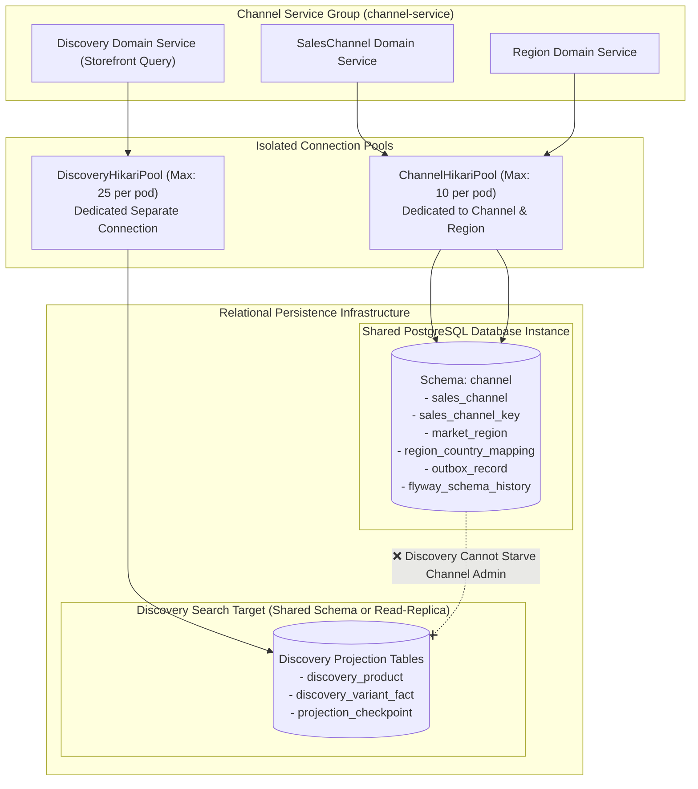
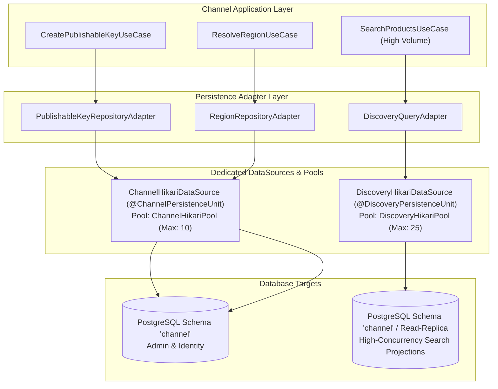
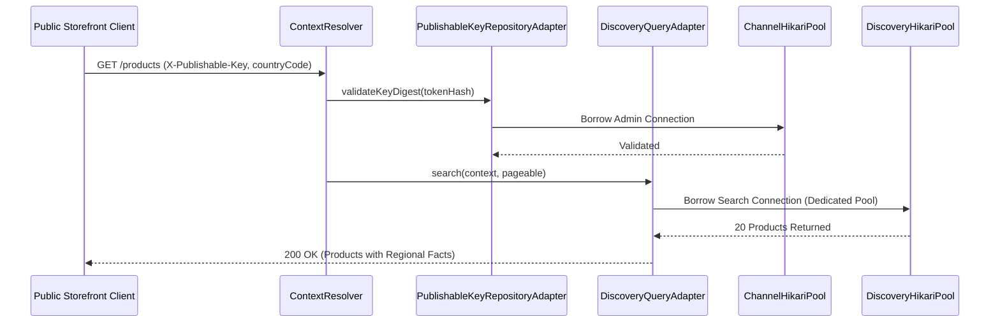

# Tech Spec: Channel Service Group Persistence

- **Summary:** Defines persistence architecture for the Channel Service Group, where `saleschannel` and `region` share schema `'channel'` while `discovery` operates on a dedicated separate database connection for search projection isolation.
- **Type:** Platform Infrastructure
- **Feature Spec:** [Multi-Schema Database Isolation & Connection Budgeting](../../features/feat_010-multi-schema-database-isolation-connection-budgeting.md)

---

## 1. Problem & Decision

### What breaks without this?

The Channel Service Group combines transactional administrative management (`saleschannel` key provisioning and `region` boundary rules) with high-throughput public storefront browsing (`discovery`). If `discovery` queries shared the same database connection pool as sales channel administrative writes, massive public search and browsing traffic during peak events (flash sales, marketing campaigns) would saturate the connection pool. This would starve merchant administrators from rotating publishable keys or updating regional settings, and risk bringing down the entire channel configuration authority.

### Decision

| Option | Decision | Why |
|:-------|:---------|:----|
| **Shared Schema `'channel'` for SalesChannel & Region, with Dedicated Database Connection for Discovery** | Adopted | `saleschannel` and `region` share schema `'channel'` with a conservative pool (`ChannelHikariPool`), while `discovery` operates on a dedicated, high-concurrency database connection (`DiscoveryHikariPool`) targeting read-optimized search projections or read replicas. |
| Single Shared Pool across SalesChannel, Region, and Discovery | Rejected | High vulnerability: public storefront search spikes would exhaust connection pools and starve critical merchant channel key lifecycle operations. |
| Split All Three Bounded Contexts into Disjoint Databases | Rejected | Premature complexity; `saleschannel` and `region` are tightly coordinated administrative domains that logically belong in schema `'channel'`. |

### Trade-offs

| Benefits | Trade-offs |
|:---------|:-----------|
| Public browsing queries on `discovery_product` cannot starve sales channel administration or key rotation connections. | Requires managing two separate `DataSource` and `HikariPool` configurations within the Channel Service Group. |
| `discovery` connection can easily be redirected to a dedicated PostgreSQL read-replica or Elasticsearch cluster without impacting channel management. | Asynchronous projection reconciliation listeners must manage database write connections independently from public read queries. |

---

## 2. How It Works

### Core Concept

The Channel Service Group (`com.grab.app.channel`) establishes a **hybrid persistence model**:
1. **Administrative Core (Shared Schema `'channel'`)**: `saleschannel` and `region` bounded contexts share schema `'channel'` on the shared PostgreSQL instance, using `ChannelHikariPool` for channel setup, cryptographic publishable keys, and country-to-region territorial mappings.
2. **Discovery Read Engine (Dedicated Database Connection)**: `discovery` bounded context operates on a dedicated `DataSource` and connection pool (`DiscoveryHikariPool`). It queries denormalized catalog presentation facts (`discovery_product`) and can target the primary instance or a dedicated read-replica.



### How It Works Step by Step

| Step | What Happens | Why |
|:-----|:-------------|:----|
| 1 | Channel Service context boots and creates `ChannelHikariDataSource` (schema `'channel'`) for saleschannel and region contexts. | Provides isolated connection headroom for administrative channel management and key rotation. |
| 2 | Channel Service context separately creates `DiscoveryHikariDataSource` for the discovery bounded context. | Allocates a dedicated high-capacity pool for public storefront browsing and search projection queries. |
| 3 | Flyway applies channel migrations from `db/migration/channel` and discovery projection migrations from `db/migration/discovery`. | Maintains independent schema evolution for core channel configuration and read-model tables. |
| 4 | Inbound storefront search queries route strictly through `DiscoveryQueryAdapter` via `DiscoveryHikariPool`. | Protects administrative channels from storefront browsing traffic spikes. |
| 5 | Domain events (`ProductPublished`, `InventoryAdjusted`) trigger background projection reconciliation via `DiscoveryProjectionListener`. | Updates `discovery_product` tables asynchronously without blocking online transactions. |

### Schema Table Allocation & Ownership

| Bounded Context | Connection Pool | Owned Tables | Description |
|:----------------|:----------------|:-------------|:------------|
| **SalesChannel** | `ChannelHikariPool` | `sales_channel`, `sales_channel_key` | Sales channel records, scopes, and SHA-256 hashed publishable keys. |
| **Region** | `ChannelHikariPool` | `market_region`, `region_country_mapping` | Territorial markets, legal currencies, and country-to-region routing rules. |
| **Discovery** | **`DiscoveryHikariPool` (Separate)** | `discovery_product`, `discovery_variant_fact` | Denormalized product presentation facts for fast multi-regional browsing. |
| **Shared Infrastructure** | `ChannelHikariPool` | `outbox_record`, `flyway_schema_history` | Channel event outbox and Flyway version tracking for schema `'channel'`. |

---

## 3. How We Use It

### Where It Fits in Our System / Architecture & Layer Stacking



### Component Responsibilities

| Component | Role | What It Does |
|:----------|:-----|:-------------|
| **`ChannelPersistenceConfig`** | Spring Configuration | Configures `ChannelHikariDataSource` and `ChannelTransactionManager` scoped to administrative schema `'channel'`. |
| **`DiscoveryPersistenceConfig`** | Spring Configuration | Configures `DiscoveryHikariDataSource` with dedicated pool sizing and optional read-replica URL targeting discovery tables. |
| **`PublishableKeyRepositoryAdapter`** | Outbound Adapter | Persists and validates cryptographic SHA-256 publishable key digests. |
| **`RegionRepositoryAdapter`** | Outbound Adapter | Resolves ISO country codes to legal currency and market region entities. |
| **`DiscoveryQueryAdapter`** | Outbound Query Adapter | Executes contextual product searches and filters over `discovery_product` records using `DiscoveryHikariPool`. |

### Runtime Flow

> A public storefront browse request executes via `DiscoveryHikariPool`, leaving `ChannelHikariPool` completely untouched for administrative key validation.



### Configuration Specification

```yaml
grab:
  channel:
    # 1. Administrative Channel & Region Datasource (Schema 'channel')
    datasource:
      jdbc-url: jdbc:postgresql://${DB_HOST:localhost}:${DB_PORT:5432}/${DB_NAME:grab_commerce}?currentSchema=channel
      username: ${CHANNEL_DB_USER:channel_user}
      password: ${CHANNEL_DB_PASSWORD:channel_secret}
      hikari:
        maximum-pool-size: 10
        minimum-idle: 2
        connection-timeout: 30000
        idle-timeout: 600000
        max-lifetime: 1800000
        pool-name: ChannelHikariPool
    flyway:
      schemas: channel
      default-schema: channel
      table: flyway_schema_history
      locations: classpath:db/migration/channel

    # 2. Dedicated Discovery Connection (Separate Database Connection / Pool)
    domains:
      discovery:
        datasource:
          # Can target the primary database, a read replica, or dedicated search instance
          jdbc-url: jdbc:postgresql://${DISCOVERY_DB_HOST:localhost}:${DISCOVERY_DB_PORT:5432}/${DISCOVERY_DB_NAME:grab_commerce}?currentSchema=channel
          username: ${DISCOVERY_DB_USER:discovery_user}
          password: ${DISCOVERY_DB_PASSWORD:discovery_secret}
          hikari:
            maximum-pool-size: 25
            minimum-idle: 5
            connection-timeout: 10000
            idle-timeout: 300000
            max-lifetime: 1800000
            pool-name: DiscoveryHikariPool
            read-only: ${DISCOVERY_READ_ONLY:false}
        flyway:
          schemas: channel
          default-schema: channel
          table: flyway_discovery_history
          locations: classpath:db/migration/discovery
```

---

## 4. Implementation Rules

> These are **non-negotiable contracts**. An implementation is compliant only when **all** rules are satisfied.

- **RULE-CHAN-DB-01: Dedicated Discovery Connection Pool Required**
  The `discovery` domain service MUST NOT use `ChannelHikariPool`. It MUST use its own dedicated `DiscoveryHikariPool` to guarantee complete connection isolation between public storefront browsing and administrative channel operations.

- **RULE-CHAN-DB-02: Shared Schema Encapsulation for SalesChannel and Region**
  The `saleschannel` and `region` bounded contexts MUST share schema `'channel'`. They MUST NOT access tables in any other service group schema.

- **RULE-CHAN-DB-03: Zero Cross-Context Foreign Keys**
  Foreign key constraints between `sales_channel` and `discovery_product` are prohibited. Discovery projections MUST treat channel and region associations as denormalized scalar attributes (`sales_channel_id`, `region_id`).

- **RULE-CHAN-DB-04: Independent Connection Budget Compliance**
  Both `ChannelHikariPool` ($N \times O \times 10$) and `DiscoveryHikariPool` ($N \times O \times 25$) MUST be accounted for separately in the global connection budget formula.

- **RULE-CHAN-DB-05: Read-Replica Readiness**
  `DiscoveryHikariDataSource` MUST be configured so that it can be pointed to a read-replica endpoint via environment variable override (`DISCOVERY_DB_HOST`) without code modification.
