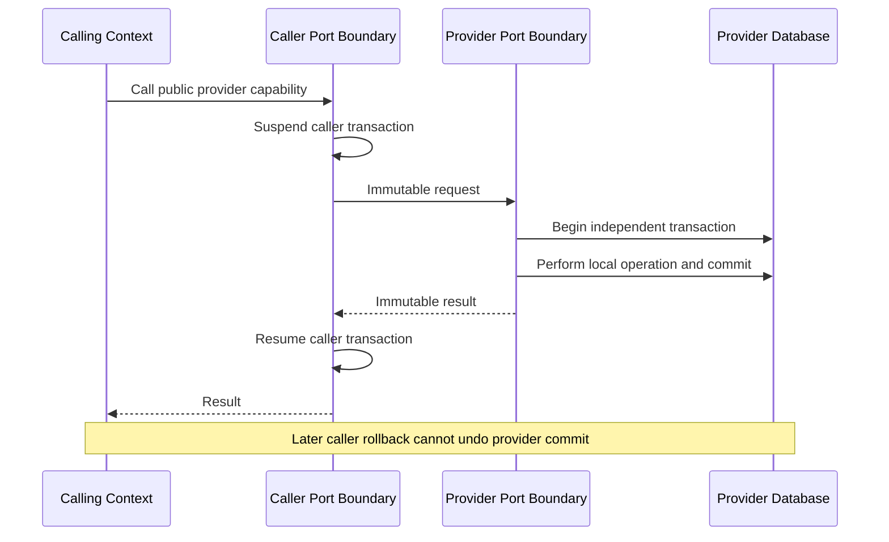

# Tech Spec: Consumer Inbox and Port Transaction Isolation

- **Summary:** Apply each event once per consumer transaction and give public Java ports independent transaction ownership.
- **Type:** Architecture pattern / infrastructure.
- **Feature:** [Reliable event consumption and isolated Java ports](../features/feat_reliable-event-consumption-and-port-isolation.md).
- **Status:** Listener-owned inbox implemented in the active app. Provider port isolation and replay policy remain proposed.
- **Review date:** 2026-11-15.

## 1. Problem & Decision

An outbox can retry after a consumer commits but before publication is acknowledged. Separately, a local Java method call can inherit transactional state that a future remote call would not have.

Adopt a transactional consumer inbox and explicit provider transaction boundaries. This guarantees at most one committed local application per retained `(consumer, eventId)` receipt; it does not guarantee exactly-once delivery, external side effects, or atomic cross-context work.

### Baseline source review

This review uses the current working tree, including the pre-existing uncommitted change to `OutboxDeliveryEngine`. That change moves dispatch outside the engine's source transaction; the committed baseline previously wrapped dispatch and acknowledgement together.

| Priority | Finding and evidence | Consequence / action |
|:---|:---|:---|
| P1 | Inbox coverage is optional: [customer listener](../../../app/src/main/java/com/grab/app/account/customer/internal/adapter/inbound/event/UserRegisteredIntegrationEventListener.java#L35) accepts missing metadata and [handler](../../../app/src/main/java/com/grab/app/account/customer/internal/command/handler/RegisterCustomerCommandHandler.java#L36) skips deduplication when it is null. | Durable delivery must fail closed when metadata is absent; separate event ingress from ordinary interactive commands. |
| P1 | [Sales-channel provisioning handler](../../../app/src/main/java/com/grab/app/channel/saleschannel/internal/command/handler/ProvisionMerchantWebsiteChannelCommandHandler.java) and [discovery listener](../../../app/src/main/java/com/grab/app/channel/discovery/internal/adapter/inbound/event/BuyableOfferProjectionEventListener.java) do not carry generic inbox identity. | Inventory every consumer; natural-key provisioning and projection reconciliation help but do not establish universal event receipt coverage. |
| P1 | [AccessAssignmentPortAdapter](../../../app/src/main/java/com/grab/app/account/identity/internal/adapter/inbound/message/AccessAssignmentPortAdapter.java#L55) lacks an explicit provider transaction boundary, and its handlers use their module defaults. | Separate managers currently provide independent local transactions on many paths, but independence is not a port contract and can disappear when contexts share a manager. |
| P1 | [Merchant's identity adapter](../../../app/src/main/java/com/grab/app/account/merchant/internal/adapter/IdentityAccessManagementPortAdapter.java#L29) constructs identity commands and dispatches the account bus directly. | A provider-port-only fix misses this route; migrate all such calls through public provider ports. |
| P1 | [Customer inbox cleanup](../../../app/src/main/java/com/grab/app/account/customer/internal/config/CustomerModuleOutboxConfig.java#L83) defaults to 14 days, while [dead replay](../../../outbox-infrastructure/src/main/java/com/grab/outbox/infrastructure/core/service/OutboxAdministrationService.java#L34) has no age gate. | An old replay can rerun completed work after its receipt expires. |
| P2 | [AccessAssignmentPortAdapter](../../../app/src/main/java/com/grab/app/account/identity/internal/adapter/inbound/message/AccessAssignmentPortAdapter.java) and `MerchantMembershipPortAdapter` inject both command and query buses. | Split read/write contracts and adapters as required by the repository's CQRS rules. |
| P2 | Transaction configuration uses names such as `identityTransactionManager`, `merchantTransactionManager`, and `salesChannelTransactionManager`; global rules specify group managers. | Build an explicit owner-to-manager mapping and reconcile the discrepancy before rollout; do not rename qualifiers without moving persistence units. |
| P2 | The canonical workflow runtime must classify participant outcomes before recording receipts or retrying work. | Keep transient delivery errors, confirmed business failures, and unknown outcomes distinct; never infer success from a timeout. |

Existing foundations worth retaining:

- The producer stores a stable UUID and the engine exposes it through [OutboxDeliveryContext](../../../framework/src/main/java/com/grab/framework/outbox/OutboxDeliveryContext.java); its `finally` restores nested context.
- [JpaProcessedEventRepository](../../../outbox-infrastructure/src/main/java/com/grab/outbox/infrastructure/inbox/jpa/JpaProcessedEventRepository.java#L47) inserts and flushes a unique `(consumer, event_id)` receipt before business work.
- Customer and merchant lifecycle handlers already put the receipt in their local transaction.
- [PostgreSQL inbox tests](../../../catalog-adapter-persistence/src/test/java/com/catalog/adapter/persistence/outbox/ProcessedEventInboxPostgresTest.java) cover sequential duplicates, consumer separation, and bounded cleanup; concurrent independent transactions and crash windows still need coverage.

These are source findings, not results of a running-system fault-injection test. Existing unrelated edits and the earlier `docs/outbox-implementation-review.md` are not changed by this plan.

### Alternatives

| Option | Decision | Reason |
|:---|:---|:---|
| Reuse inbox infrastructure in a listener superclass | Adopt | Keeps persistence atomicity visible and avoids replacing working foundations. |
| Deduplicate once around the entire publication | Reject | Consumers commit independently and must retry independently after partial success. |
| Make every command inspect ambient event context automatically | Reject | Nested operations can suppress each other and ordinary port calls can inherit the wrong identity. |
| Provider `REQUIRES_NEW`, internal handlers `REQUIRED` | Adopt | Separates public operation ownership while preserving one provider-local transaction. |
| Put `REQUIRES_NEW` on every internal handler | Reject | Splits the inbox from business effects and fragments multi-step provider operations. |
| `NESTED`, shared transactions, or JTA | Reject | Savepoints do not give independent commits, and distributed transactions violate repository rules. |
| Native PostgreSQL upsert for inbox acquisition | Defer | Existing JPA insert/flush safely arbitrates duplicates; no native-query exception is needed. |

## 2. Event Identity and Consumer Transaction

### Metadata contract

The relay binds the persisted outbox UUID in `OutboxDeliveryContext` for synchronous Spring event dispatch. Listeners use stable consumer keys representing independent operations. Customer registration keeps `customer.RegisterCustomer`, and merchant auto-approval keeps `merchant.ChangeMerchantLifecycle` so previously processed deliveries remain recognizable. Missing context fails before the listener opens a transaction.

### Local transaction scope

`AbstractIntegrationEventListener` starts a `REQUIRES_NEW` transaction on the destination persistence unit. It inserts and flushes the consumer receipt, then calls the listener's action only for a new receipt. The action dispatches through the owning group command bus. Local handlers use `REQUIRED` and join the receipt transaction. The outbox records the publication outcome after synchronous dispatch finishes. Workflow participants use the canonical runtime's signal-receipt and result-event contracts for receipt and result-signal transactions.

Identity manifest and role-declaration registration read the delivery UUID through an application metadata port. New audit records use that UUID as their event identity. Published event payloads retain their publication IDs and historical audit rows keep their existing keys. Revalidation uses the stored candidate ID and can run without an outbox delivery.

### Duplicate acquisition and failure behavior

| Situation | Required outcome |
|:---|:---|
| Receipt already committed | Skip the listener action and return successfully. |
| Concurrent inserts for the same key | Unique constraint arbitrates; the losing transaction rolls back and the relay retries it in a fresh transaction. |
| Winning transaction rolls back | Receipt and effects disappear together, allowing a subsequent attempt to apply. |
| Unique violation during flush | Do not catch it and continue inside PostgreSQL's aborted transaction. |
| Consumer commits, source acknowledgement fails | Retry with the same identity; committed consumers skip, unfinished consumers execute. |
| Another consumer fails after earlier consumers commit | Relay retries publication; each logical consumer independently checks its receipt. |
| One listener produces multiple independently committed operations | Give each operation a stable consumer identity, or use one local use case transaction for atomic local work. |

Do not stamp a receipt in `REQUIRES_NEW` and then execute business work in another transaction. A marker committed ahead of the effects permanently loses the operation after a crash.

Synchronous domain-to-integration translation currently republishes payloads, for example in `MerchantIntegrationEventPublisherAdapter`. Inventory these translators too: either preserve the original delivery identity for a pure translation, with distinct logical consumer keys, or persist a new integration event atomically and retain the original identity as causation.

A newly persisted output event gets a new event ID. A retry of that output keeps its ID; replay must not manufacture new IDs to bypass receipts.

For future brokers, carry metadata in the message envelope and bind it at ingress. A ThreadLocal is only an in-process bridge and must never be relied on to cross executors or transport boundaries.

## 3. Universal Port Transaction Isolation

### Two-sided boundary

| Boundary | Transaction policy | Responsibility |
|:---|:---|:---|
| BFF caller | No business transaction | Invoke public provider read/write ports. |
| Consumer outbound adapter during an active local transaction | Caller-owner meta-annotation with `NOT_SUPPORTED` | Suspend the caller's actual manager before invoking another context. |
| Provider write port adapter | Provider-owner meta-annotation with `REQUIRES_NEW` | Open one provider transaction around mapping, dispatch, and response assembly. |
| Provider read port adapter | Provider-owner read meta-annotation with `REQUIRES_NEW` | Use a separate read-only transaction and query projections. |
| Provider-local handlers/use cases | `REQUIRED` on handlers; no service transaction annotations | Join the provider operation rather than create an independent subtransaction. |
| Provider outbound call to another context | Repeat the caller suspension boundary | Do not allow nested calls to silently rejoin an ancestor transaction. |

Provider `REQUIRES_NEW` is necessary even when two contexts share a group manager. With different managers, the provider manager only manages its own resources; it does not automatically suspend every foreign persistence context on the thread.

Therefore caller-owned outbound port adapters suspend their own transaction through Spring's supported transaction interceptor. Do not manually clear transaction resource maps, use an unqualified/default manager, or assume a provider-side `NOT_SUPPORTED` annotation suspends the caller's distinct manager.

This design follows the independent-transaction semantics of [Spring transaction propagation](https://docs.spring.io/spring-framework/reference/data-access/transaction/declarative/tx-propagation.html). The per-persistence-unit resource handling is visible in [Spring's JpaTransactionManager implementation](https://github.com/spring-projects/spring-framework/blob/6.2.x/spring-orm/src/main/java/org/springframework/orm/jpa/JpaTransactionManager.java); the need for caller-owned suspension is a design inference from that behavior.

All boundaries must be reached through Spring proxies, not self-invocation or manually constructed objects. Audit handler-specific `REQUIRES_NEW` annotations when introducing the provider boundary; retain them only for genuinely independent event-entry operations.

### Expected behavior and limits

- A provider failure rolls back its own work. If the caller catches the failure it may continue; if the caller allows the exception to escape, its own transaction can also roll back through normal exception handling.
- Independent reads cannot see the caller's uncommitted changes. Use committed IDs and facts in port messages; never pass JPA entities, lazy proxies, persistence contexts, or transaction handles.
- Transaction suspension retains the caller's connection and locks. Bound synchronous call depth and concurrency, size pools for overlapping transactions, and reject cyclic write call chains that can wait on their own suspended locks.
- Independent transactions do not make a cross-context business operation atomic. Durable outbox choreography or a workflow with compensation must handle provider success followed by caller failure.
- A consumer receipt covers only its own local database. An independently committed provider call can survive consumer rollback and therefore needs provider-side request idempotency or durable event choreography.
- Preserve trace and causation across a port call, but never infer provider deduplication from the caller's ambient event identity.

For retryable synchronous writes, introduce explicit `requestId` metadata in the port's nested message records. The provider handler uses a local request-receipt store keyed by caller scope, operation, and request ID, saving the request fingerprint and replayable result atomically with business writes.

Repeated identical requests return the stored result; reuse of an ID with a different fingerprint is a conflict. Derive event-driven request IDs from a persisted operation identity or stable `(eventId, target, operation, step)` mapping, since one event can legitimately invoke multiple provider operations.

Do not overload the current Boolean event inbox contract to return command results. Port request retention must cover its advertised retry horizon, and externally visible side effects must use an outbox or the external provider's idempotency protocol.

## 4. Implementation Rules

| Rule | Requirement |
|:---|:---|
| R-01 | Delivery and replay MUST preserve the persisted event UUID. |
| R-02 | The listener MUST require the outbox UUID at ingress. Commands carry only operation input. |
| R-03 | Consumer identifiers MUST name stable logical operations, with independent identities for independently committed work. |
| R-04 | Inbox receipt, business mutation, and resulting outbox writes MUST use the same destination transaction and persistence unit. |
| R-05 | A unique `(consumer, event_id)` key MUST arbitrate concurrent delivery; failed acquisition MUST roll back before retry. |
| R-06 | Each consumer MUST deduplicate independently; the relay MUST acknowledge only after synchronous consumer completion. |
| R-07 | Public provider adapters MUST own isolated write/read transactions using the correct owner manager; internal handlers MUST join those transactions. |
| R-08 | Calls made from an active context transaction MUST cross a caller-owned suspension boundary; provider calls MUST NOT access caller persistence resources. |
| R-09 | Provider reads MUST remain read-only and use query ports/projections, with no visibility guarantee for uncommitted caller data. |
| R-10 | Cross-context calls MUST use public ports; write/read adapters MUST remain separate and scoped to their own CQRS buses. |
| R-11 | Retried synchronous writes MUST carry stable operation identity and atomically persist a replayable provider outcome. |
| R-12 | Receipt deletion MUST NOT precede the latest allowed automatic/manual redelivery, including safety margin and in-flight work. |
| R-13 | Transient failures MUST propagate to the relay; terminal workflow failure and its outgoing signal MUST commit atomically with its receipt. |
| R-14 | Delivery context MUST restore in `finally`; event-consumption metadata MUST NOT implicitly propagate into unrelated port commands. |
| R-15 | Transaction, lock, connection-acquisition, and call concurrency limits MUST bound nested resource use. |

Outbox listeners must remain synchronous and propagate errors; Spring's default event multicaster does this, whereas asynchronous listeners do not return failures to the publisher. See [Spring event multicaster documentation](https://docs.spring.io/spring-framework/docs/6.0.5/javadoc-api/org/springframework/context/event/SimpleApplicationEventMulticaster.html).

### Replay and retention

Current inbox cleanup uses the owning module’s retention setting and defaults to 14 days. Duplicate suppression covers the period in which a receipt exists. A future replay policy must coordinate that setting with the lifetime of replayable source events.

A later bounded policy must reject automatic and manual replay beyond an event's persisted replay deadline and retain receipts through that deadline plus operational margin. Apply it to every consumer route, backups/imports, and in-flight claims; extend deadlines only if receipt coverage still exists.

Pre-migration events and already-deleted receipts cannot be made safe retroactively by creating a new inbox table. Quarantine old dead events for reconciliation and define a cutover watermark per consumer; never backfill a processed marker without evidence that the corresponding effects committed.

## 5. Implementation Plan

| Phase | Concrete changes | Exit condition |
|:---|:---|:---|
| 1. Inventory and contract | Catalogue outbox listeners, translators, workflow steps, cross-context bus calls, public ports, persistence units, and consumer keys; map every route to its destination transaction owner. | Every route has a declared local unit of work and migration/test owner. |
| 2. Metadata and inbox foundation | Require the existing outbox UUID in the shared listener and keep JPA insert/flush arbitration. | T1–T4 pass against PostgreSQL with actual independent transactions. |
| 3. Consumer migration | Move transport deduplication from commands to consumer listeners. Add identity and discovery inbox mappings and migrations. Keep workflow step transactions in their existing runner. | No durable consumer silently bypasses receipt handling; T5 and T12 pass. |
| 4. Port boundaries | Split mixed read/write ports/adapters; add provider `REQUIRES_NEW` and caller `NOT_SUPPORTED`; replace merchant-to-identity and other direct bus bypasses; audit inner transaction annotations. | T6–T8 and T11 pass for both same-manager and distinct-manager topologies. |
| 5. Cross-context retry semantics | Add request identity/result storage for retryable synchronous writes; move workflows needing durable consistency to outbox steps with explicit compensation. | T9 passes and each migrated write route defines provider-success/caller-failure recovery. |
| 6. Operations and cutover | Disable unsafe inbox pruning, quarantine uncovered historical replay, add deadline-aware retention/replay where needed, expose metrics, and validate pool budgets. | T10/T13 pass and production rollout has coverage and rollback instructions. |

Phase 1 must reconcile rules R10/R16/R17 with the actual topology: group-level ownership remains the architectural target, while an explicit temporary mapping uses each real persistence-unit manager. Do not declare the implementation globally compliant until group manager/schema requirements are implemented or an explicit repository policy change is accepted.

Keep `store/` compatibility paths in the inventory even though current reactor modules center on `app/`; determine their supported runtime status before duplicating changes. Update the existing outbox spec and event rules to remove stale claims that dispatch runs inside a source publish transaction.

No native Spring Data queries, cross-schema joins, transaction annotations on services/controllers, domain framework dependencies, or repository access in listeners are required. Check the R21 invariants for follow-up changes.

### Rollout and observability

1. Deploy additive inbox/request-receipt migrations and verify owner persistence-unit mappings.
2. Drain or pause delivery workers during strict-consumer cutover; avoid overlapping older consumers that can still apply effects without receipts.
3. Enable required metadata and isolated port boundaries per fully migrated capability, with recovery handling in place before the switch.
4. Monitor duplicate counts, missing metadata, receipt conflicts, rollback/commit failures, dead-event age, pool waits, and boundary violations; use bounded consumer/owner labels rather than event IDs as metric labels.
5. Retain receipts through rollback and replay windows; rolling code back to a non-deduplicating consumer requires pausing delivery rather than dropping tables or deleting markers.

## 6. Verification Matrix

Database tests MUST use PostgreSQL Testcontainers and Spring proxies with explicitly controlled transactions. Test methods must not rely on a surrounding rollback-only test transaction to prove committed outcomes.

| Test | Scenario | Required assertion |
|:---|:---|:---|
| T1 | Retry, lease takeover, and manual replay | Same event ID and consumer key; newly emitted events have distinct IDs and source causation. |
| T2 | Missing metadata, nested dispatch, reused worker thread | Fail before side effects on missing ID; nested scope restores and unrelated work sees no stale identity. |
| T3 | Failure after receipt flush, after business mutation, and during commit | Receipt, business rows, and outgoing events either all commit or all disappear. |
| T4 | Two independent concurrent transactions with latch-controlled acquisition | One committed application; losing insert retries cleanly; if winner rolls back another attempt can apply. |
| T5 | Consumer A commits, B fails; source acknowledgement fails after all consumers commit | Retry skips A, eventually applies B once, and never duplicates outgoing events. |
| T6 | Shared-manager contexts: provider succeeds then caller rolls back; provider fails and caller catches | Provider survives the former; caller can commit the latter; provider-local substeps remain atomic. |
| T7 | Distinct-manager contexts and nested port calls | Caller resources are suspended/restored by their owner; callback chains cannot rejoin ancestor work; event metadata does not leak. |
| T8 | Caller holds uncommitted data; provider query runs | Provider cannot observe that data and runs through a separate read-only transaction and query port. |
| T9 | Provider commits, caller fails, same operation retries | Stored provider result is returned once; mismatched payload under reused key is rejected. |
| T10 | Old dead replay, deadline extension, cleanup, and concurrent in-flight delivery | Replay cannot escape retained receipt coverage; historical uncertain deliveries are quarantined. |
| T11 | ArchUnit and application-context wiring checks | No cross-context bus bypass, no mixed read/write adapter, correct managers, no async outbox consumers, and no forbidden layer dependencies. |
| T12 | Workflow transient database failure versus terminal business failure | Transient failure retries without a committed receipt; terminal failure receipt and failure signal commit together. |
| T13 | Bounded pools under concurrent nested calls and blocked locks | Completion or explicit timeout within limits; no unbounded pool wait, unsafe partial local commit, or self-blocking call cycle. |

Run the affected framework, outbox, persistence, and app suites plus required ArchUnit/Modulith checks after implementation. This plan was checked by source inspection and documentation-link validation; runtime tests have not been run for this documentation-only change.
