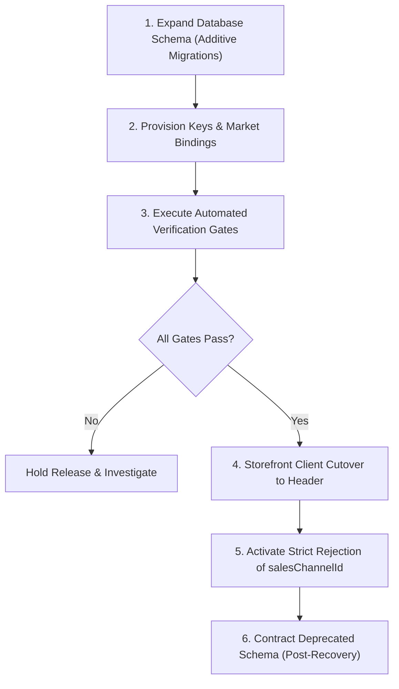
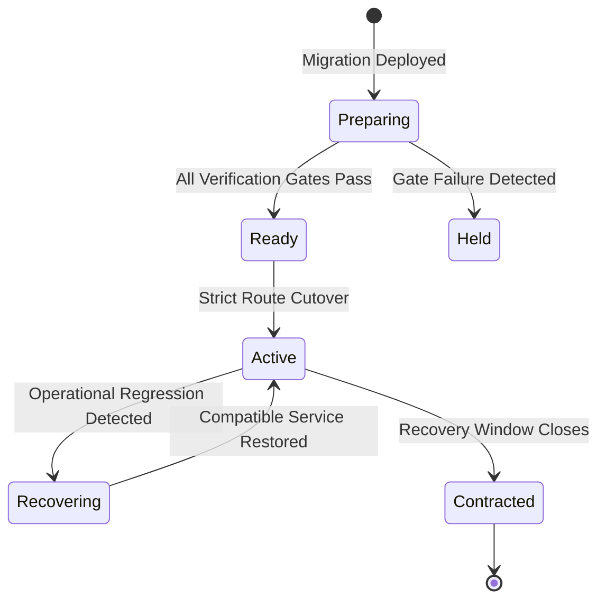
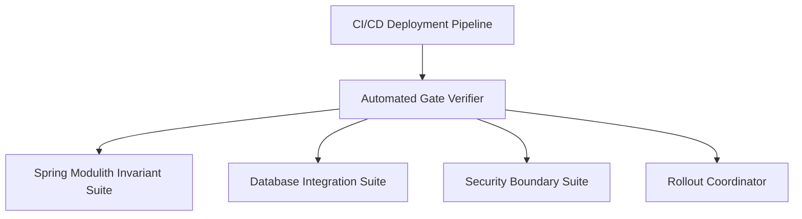
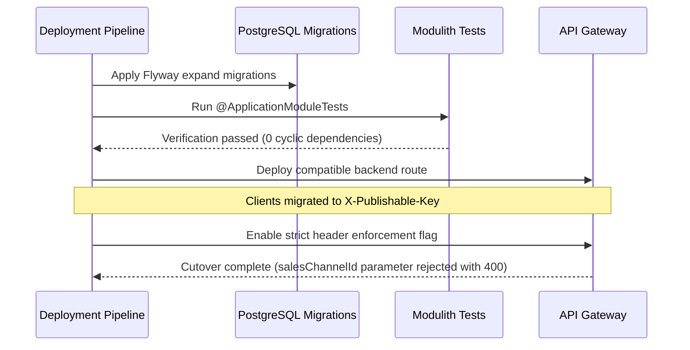

# Tech Spec: Contextual Discovery Verification & Rollout

- **Summary:** Gates contextual activation on automated verification evidence, backward-compatible migrations, prepared storefront clients, and safe recovery procedures.
- **Type:** Cross-Cutting Concern
- **Feature Spec:** [Automated Verification & Zero-Downtime Rollout](../../features/feat_008-automated-verification-zero-downtime-rollout.md)

---

## 1. Problem & Decision

### What breaks without this?

Switching database schemas, client authentication schemes, and storefront API contracts simultaneously risks severe customer-facing downtime. Uncoordinated releases can break older mobile/web clients, expose unauthenticated parameters on some nodes, and destroy the only recoverable projection data before verification passes.

### Decision

| Option | Decision | Why |
|:-------|:---------|:----|
| **Expand, Verify, Activate, then Contract** | Adopted | Preserves a backward-compatible recovery window across independently deployed microservices and client apps. |
| In-Place Breaking Migration | Rejected | Forces synchronous multi-service downtime and immediately breaks active storefront clients. |
| Coexisting Incompatible Public Routes | Rejected | Exposes security holes where clients can bypass key authentication by hitting older route variants. |

### Trade-offs

| Benefits | Trade-offs |
|:-----------|:-------------|
| Zero customer-facing downtime during schema and contract migrations | Temporary storage overhead to maintain compatible schema during the transition window |
| Automated gate verification guarantees architectural integrity before cutover | Requires disciplined phased rollout across multiple deployment stages |

---

## 2. How It Works

### Core Concept

The release executes in five strictly ordered stages:
1. **Expand**: Apply additive, non-breaking schema migrations (e.g., publishable key tables, region binding tables).
2. **Provision**: Generate keys and map channel-region bindings.
3. **Verify**: Execute automated Spring Modulith and integration test suites; execute projection rebuilds.
4. **Client Cutover**: Update storefront clients to pass `X-Publishable-Key` and consume contextual JSON.
5. **Contract**: Remove legacy query parameter support and drop deprecated schema elements after the recovery window expires.

### How It Works Step by Step

| Step | What Happens | Why |
|:-----|:-------------|:----|
| 1 | Flyway applies additive database migrations across services | Ensures backward compatibility with existing running code |
| 2 | Merchant admins provision publishable keys and configure channel regions | Establishes prerequisite credential and market data |
| 3 | Automated verification suites execute: ArchUnit, Spring Modulith, and Testcontainers | Validates system invariants and boundary compliance |
| 4 | Background rebuild coordinator reconciles presentation facts | Pre-populates Tier 1 projection tables |
| 5 | Storefront client applications deploy updated requests using `X-Publishable-Key` | Migrates consumer traffic without downtime |
| 6 | Gateway activates strict cutover, rejecting `salesChannelId` parameters with 400 | Closes security boundary permanently |
| 7 | After stability window, contract release drops legacy columns and tables | Eliminates technical debt cleanly |

### Lifecycle

---

## 3. How We Use It

### Where It Fits in Our System

### Component Responsibilities

| Component | Role | What It Does |
|:----------|:-----|:-------------|
| Rollout Coordinator | Deployment Manager | Controls feature flags and enforces phase progression across release stages. |
| Automated Gate Verifier | Test Runner | Executes test suites and collects verifiable evidence before promoting release. |
| Spring Modulith Suite | Invariant Guard | Detects illegal cross-module package dependencies and SPI violations at build time. |

### Runtime Flow

---

## 4. Implementation Rules

| Rule | Requirement |
|:-----|:------------|
| **R-01** | Release verification **MUST** record concrete test outcomes, environment, database versions, and blockers; unexecuted tests **MUST NOT** be claimed as passed. |
| **R-02** | Unresolved market configurations or default region conflicts **MUST** block promotion to the strict cutover stage. |
| **R-03** | Existing databases **MUST** append new Flyway versioned migrations without rewriting or modifying applied historical migrations. |
| **R-04** | The rollout **MUST** follow: expand schema $\rightarrow$ provision keys/markets $\rightarrow$ validate backend $\rightarrow$ migrate clients $\rightarrow$ strict activation. Incompatible contracts **MUST NOT** coexist on the activated public route. |
| **R-05** | Projection rebuild **MUST** be bounded, resumable, and idempotent, preserving newer live updates and retaining compatible old data until the recovery window passes. |
| **R-06** | Verification **MUST** execute against target PostgreSQL databases via Testcontainers, enable actual Spring Security chains, and run Spring Modulith architecture tests. |
| **R-07** | Documented recovery procedures **MUST** preserve key validation, regional isolation, and legacy selector rejection after cutover; recovery **MUST NOT** silently restore unauthenticated parameter access. |
| **R-08** | Performance evidence **MUST** record dataset sizes, page/variant counts, SQL round trips, and latency percentiles; theoretical timings **MUST NOT** be substituted for actual measurements. |
