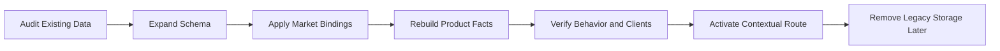
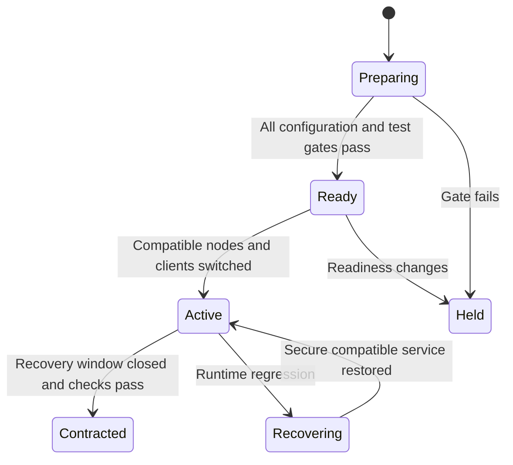
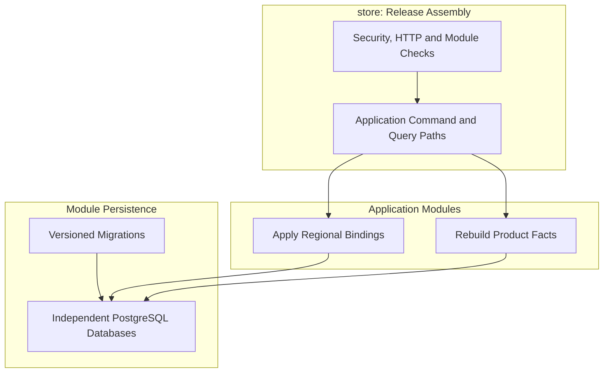
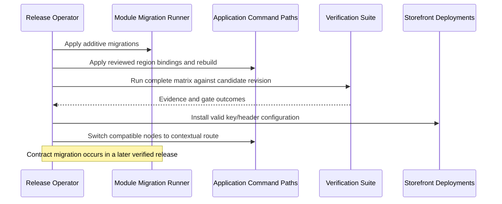

# Tech Specification: Contextual Discovery Verification & Rollout

> **Summary:** Gates the regional discovery cutover on configuration, compatible schema evolution, end-to-end verification and recoverable deployment steps.
> **Classification:** Release Contract / Cross-Module Migration
> **Supporting Modules:** Sales Channel / Region / Pricing / Discovery / store
> **Status:** Planned; no completed rollout or passing contextual end-to-end evidence is claimed.
> **Related Features:** [Edge Shopping-Context Resolution](../../features/feat_004-edge-shopping-context-resolution.md), [Vectorized Batch Regional Pricing](../../features/feat_005-vectorized-batch-regional-pricing.md), [Discovery Wiring & Projection Reconciliation](../../features/feat_006-discovery-wiring-projection-reconciliation.md), [Storefront API Cutover & Response Contract Refactoring](../../features/feat_007-storefront-api-cutover-contract-refactoring.md), [Automated Verification & Zero-Downtime Rollout](../../features/feat_008-automated-verification-zero-downtime-rollout.md)
> **Related Domain Specs:** [Region](../domain/region/architecture/region-domain-spec.md), [Sales Channel](../domain/sales-channel/architecture/sales-channel-domain-spec.md), [Pricing](../domain/pricing/architecture/pricing-domain-spec.md)
> **Related Workflows:** [Browse and Project](../workflows/browse-and-discover-products-workflow.md), [Provision Channels](../workflows/default-sales-channel-provisioning-workflow.md)
> **Related Tech:** [Discovery](storefront-query-tech-spec.md), [Batch Pricing](batch-regional-pricing-tech-spec.md), [Shopping Context](shopping-context-resolution-tech-spec.md)

## 1. Why We Need It

Changing discovery storage and the public channel selector together creates compatibility risks across module databases, application nodes, and storefront deployments. Unit tests for pricing precedence and key hashing do not prove a functioning contextual storefront.

| Option | Decision | Rationale |
| :--- | :--- | :--- |
| Expand, verify, cut over, then contract | Adopt | Preserves compatible storage while clients and nodes migrate. |
| Rewrite existing initial migrations | Reject | Breaks applied migration checksums and upgrade reproducibility. |
| Deploy key-only clients and old/new APIs together | Reject | Clients receive inconsistent security and query behavior. |

Additional storage and temporary compatibility code are explicit rollout costs. A failed later module step cannot atomically roll back all earlier module databases.

## 2. What It Is

### Core Concept

### Release Lifecycle

These are release stages, not implemented database statuses or a new workflow engine.

## 3. How We Use It in This System

### Architecture & Layer Stacking

### Runtime Cutover Flow

## 4. Technical Specification & Contracts

### Release Rules

- **R-01:** Evidence MUST identify revision, environment/database versions, checks executed, outcomes, and known blockers; inspected source tests MUST NOT be labeled passing executions.
- **R-02:** Operators MUST inventory existing countries, currencies, channels and defaults, correct invalid/duplicate data explicitly, and apply reviewed bindings through an authenticated application command entry point; cutover MUST stop for unresolved markets or default conflicts.
- **R-03:** Migrations MUST append new versions without rewriting applied V1 files; expansion MUST preserve old reader compatibility, with a shadow facts representation if legacy non-null/JSON requirements prevent direct coexistence.
- **R-04:** A compatible release MUST validate both old storage and new facts during rebuild, distribute keys to clients before key-only activation, and coordinate node/route switching so the public route never mixes incompatible selector contracts.
- **R-05:** Backfill/rebuild MUST be bounded, resumable and idempotent, protect newer event updates, and retain old storage until reconciliation and the recovery window pass; destructive contract changes MUST occur in a later release.
- **R-06:** Every verification row below MUST have executable passing evidence, with real PostgreSQL for persistence behavior and the actual security chain for public contracts.
- **R-07:** Recovery MUST preserve key validation, region isolation and salesChannelId rejection on the cutover route; projection rebuilds and per-module migration recovery MUST be documented without promising a distributed rollback or silently restoring the insecure public selector.
- **R-08:** Performance evidence MUST report dataset, products/variants per page, SQL round trips, latency percentiles and error rate; the SSD's illustrative latency estimates MUST NOT be treated as achieved results.

### Verification Matrix

| ID | Required verification | Layer / evidence |
| :--- | :--- | :--- |
| **V-01** | Key generation, digest-only storage, rotation, repeated revocation, ownership and authority checks, disabled channels. | Domain/application, PostgreSQL key persistence, actual-security HTTP tests. |
| **V-02** | Exclusive normalized country membership, currency validation, unique channel-region pairs, single enabled default and concurrent changes. | Region/channel domain and PostgreSQL migrations/repositories. |
| **V-03** | Four specificity tiers, same-USD regions with different amounts, unmatched market, campaign windows, quantities and tax preference. | Pricing policy plus batch use-case tests. |
| **V-04** | Empty and duplicate variant input, shared sets, missing prices, full-page quotes with bounded SQL and no lazy N+1. | Batch application and PostgreSQL query-count tests. |
| **V-05** | Publication, stock, route and channel updates, concurrent/duplicate/stale events, last-variant removal and rebuild repair/invalidation. | Projection use cases and PostgreSQL adapter/event integration tests. |
| **V-06** | Key-only browse/PDP, all context errors, unserved markets, price null/zero/ranges, availability precedence, stable 200/404 behavior and safe HAL links. | HTTP tests with security enabled and end-to-end tests across provider interfaces. |
| **V-07** | No-store cutover, market isolation, immediate subsequent-request revocation, compatible old/new storage, restart and recovery rehearsal. | Release smoke tests and migration rehearsal on representative existing data. |
| **V-08** | Dependency direction, query/write isolation, module transactions, shared-event location, no native JPA queries and Modulith interface boundaries. | ArchUnit and Spring Modulith verification. |

### Current Evidence Limits

Pricing policy tests include four-tier precedence and same-currency region isolation. Key domain/application and PostgreSQL persistence test sources exist; discovery adapter tests currently mock repositories, and product controller tests disable security filters.

No test suite was executed as part of this documentation audit. A release cannot pass this contract until the implemented paths and verification above actually run successfully.

### Configuration and Storage

`storefrontquery.rebuild.on-startup=true` currently dispatches the stub rebuild use case; it is not evidence of an online rebuild implementation. No deployment switch, migration version, batch-size binding or recovery-window default is invented here; implementation must document actual controls before release.
