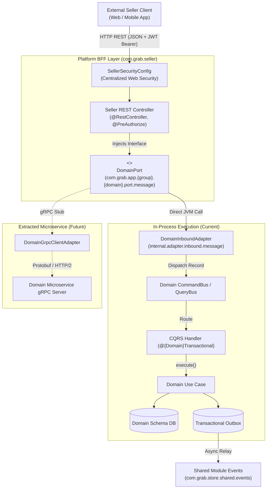

# Tech Spec: BFF-to-Domain Communication Protocol & Controller Contract Migration

- **Summary:** Standardizes external REST ingress via Platform BFFs, converts domain controllers into framework-agnostic Java port interfaces, establishes equivalent Seller REST controllers with centralized security, and defines the future gRPC migration protocol.
- **Type:** Architecture Pattern / Communication Protocol
- **Feature Spec:** [BFF-to-Domain Communication Protocol & Controller Contract Migration](../../features/feat_011-decoupled-service-communication-cqrs-pipeline.md)

---

## 1. Problem & Decision

### What breaks without this?

When domain modules directly host Spring MVC `@RestController` endpoints, business packages become entangled with web transport annotations, Jackson serialization details, HTTP status code management, and Spring Security filters. This creates tight monolithic coupling: client-facing presentation changes force modifications directly inside domain modules, and domain aggregates cannot be tested or extracted into standalone microservices without surgically separating web controllers from domain logic. 

Furthermore, without a uniform protocol boundary, cross-domain dependencies leak through direct controller invocations or ad-hoc HTTP calls, resulting in circular dependencies, latency cascades, and uncoordinated transactions.

### Decision

| Option | Decision | Why |
|:-------|:---------|:----|
| **BFF REST Ingress + Java Port Interfaces (gRPC-Ready)** | Adopted | External clients interact exclusively with Platform BFF REST controllers. Domain groups expose pure, framework-agnostic Java port interfaces (`com.grab.app.{group}.{domain}.port.message`). In the modular monolith, communication is in-process with zero network overhead. When domain groups are extracted into microservices, the Java port interfaces are backed by generated gRPC stubs with zero changes to BFF controllers. |
| Direct `@RestController` Endpoints in Domain Modules | Rejected | Violates hexagonal boundaries by binding domain modules to Spring WebMvc, complicating testing, and creating massive friction during microservice extraction. |
| In-Process HTTP REST Calls between Collocated Monolith Modules | Rejected | Introduces unnecessary JSON serialization/deserialization overhead, network latency, and socket exhaustion within a single JVM. |

### Trade-offs

| Benefits | Trade-offs |
|:---------|:-----------|
| Domain modules remain framework-pure and decoupled from Spring MVC and Web Security concerns. | Requires maintaining explicit Java port interfaces and inbound adapter classes per domain. |
| Seller Platform BFF provides a single, cohesive, secure REST API tailored for seller frontends. | DTOs are mapped at the BFF boundary to domain port parameter records. |
| Future extraction to microservices requires swapping only the adapter implementation to gRPC stubs; zero controller refactoring. | Dual representations of API models (BFF presentation models vs. domain port models). |
| Cross-domain integration events are centralized in `shared.events`, eliminating circular event package imports. | Consuming modules must explicitly listen to shared events and handle eventual consistency. |

---

## 2. How It Works

### Core Concept

The communication protocol establishes a strict three-tier architecture:
1. **External Ingress Tier (Platform BFF)**: External seller clients (web dashboard, mobile app) interact exclusively with REST controllers in the **Seller Platform BFF** (`com.grab.seller`). Authentication and authorization are validated at this boundary by `SellerSecurityConfig`.
2. **Contract & Capability Tier (Java Port Interfaces)**: Domain groups expose their capabilities exclusively through typed Java interfaces in `com.grab.app.{group}.{domain}.port.message`. These interfaces define pure Java methods without any Spring MVC annotations.
3. **Internal Execution Tier (Domain CQRS Pipeline)**: Domain inbound adapters implement the port interfaces, map parameters into immutable `Command` or `Query` records, and dispatch through the domain group's isolated `CommandBus` or `QueryBus` to transactional CQRS handlers.



### How It Works Step by Step

| Step | What Happens | Why |
|:-----|:-------------|:----|
| 1 | External seller client sends HTTP request with JWT Bearer token to Seller BFF REST endpoint. | Enforces a single entry point for seller client interactions. |
| 2 | `SellerSecurityConfig` intercepts request, validates JWT, verifies user roles/authorities, and evaluates method-level `@PreAuthorize` rules. | Web security is enforced at the perimeter; domain modules remain decoupled from HTTP security. |
| 3 | Seller REST controller validates request body (`@Valid`), extracts parameters, and invokes the domain's Java port interface (`port.message.*`). | BFF controller is decoupled from domain internals; it only knows the public Java port contract. |
| 4 | In-process domain inbound adapter (`internal.adapter.inbound.message.*`) receives invocation, maps inputs into an immutable `Command` or `Query` record, and dispatches to the domain bus. | Maintains strict CQRS separation and prevents cross-service bus leaking. |
| 5 | Domain `CommandBus` or `QueryBus` routes record to the registered CQRS handler within the domain boundary. | One-to-one handler mapping guarantees predictable single-responsibility execution. |
| 6 | CQRS handler initiates domain transaction (`@{Domain}Transactional`) and invokes `UseCase.execute(...)`. | Transaction boundary is demarcated strictly at the handler layer. |
| 7 | Use case executes aggregate business logic, persists state changes to the domain schema, and inserts an integration event into the local outbox table. | Ensures atomic persistence of business state and event records in a single ACID transaction. |
| 8 | Handler returns immutable result record; inbound adapter returns response model to Seller controller. | Clean return path through typed Java contracts. |
| 9 | Seller controller wraps result in HATEOAS `EntityModel` and returns `ResponseEntity` to external client. | Formats HTTP response with appropriate status code and hypermedia links. |
| 10 | Transactional outbox relay asynchronously reads committed events and publishes them to `com.grab.store.shared.events.{module}` listeners. | Asynchronous event choreography without distributed two-phase commit (2PC). |

---

## 3. How We Use It

### Part 1: Domain Controller to Inbound Java Port Conversion

Domain modules convert previous REST controllers into clean Java port interfaces residing in `com.grab.app.{group}.{domain}.port.message`.

#### 1. Complete Controller-to-Port Conversion Catalog

| Service Group | Bounded Context | Previous Domain REST Controller | New Inbound Java Port Interface | Method Signatures & Contracts |
|:---|:---|:---|:---|:---|
| **Catalog** | `catalog` | `ProductController` | `ProductPort` | `ProductResponse getProduct(Long id)`<br/>`ProductResponse getProductBySlug(String slug)`<br/>`Page<ProductSummaryResponse> listProducts(Pageable pageable, ProductFilter filter)`<br/>`ProductResponse createProduct(CreateProductCommand command)`<br/>`ProductResponse updateProduct(Long id, UpdateProductCommand command)`<br/>`void deleteProduct(Long id)`<br/>`void updateStatus(Long id, ProductStatus status)`<br/>`void syncVariants(Long id, List<VariantCommand> variants)` |
| **Catalog** | `catalog` | `CategoryController` | `CategoryPort` | `CategoryResponse getCategory(Long id)`<br/>`List<CategoryResponse> listCategories()`<br/>`CategoryResponse createCategory(CreateCategoryCommand command)`<br/>`CategoryResponse updateCategory(Long id, UpdateCategoryCommand command)`<br/>`void deleteCategory(Long id)` |
| **Catalog** | `catalog` | `CatalogMediaController` | `CatalogMediaPort` | `MediaResponse uploadMedia(UploadMediaCommand command)`<br/>`MediaResponse getMedia(Long id)`<br/>`void deleteMedia(Long id)` |
| **Catalog** | `catalog` | `VariantOptionController` | `VariantOptionPort` | `List<VariantOptionResponse> listOptions(Long typeId)`<br/>`VariantOptionResponse createOption(CreateOptionCommand command)`<br/>`void deleteOption(Long id)` |
| **Catalog** | `catalog` | `VariantTypeController` | `VariantTypePort` | `List<VariantTypeResponse> listTypes()`<br/>`VariantTypeResponse createType(CreateTypeCommand command)`<br/>`void deleteType(Long id)` |
| **Catalog** | `inventory` | `InventoryController` | `InventoryPort` | `InventoryItemResponse getItem(Long id)`<br/>`Page<InventoryItemResponse> listItems(Pageable pageable)`<br/>`void adjustStock(AdjustStockCommand command)`<br/>`ReservationResult reserveStock(ReserveStockCommand command)`<br/>`void releaseStock(ReleaseStockCommand command)` |
| **Catalog** | `inventory` | `LocationController` | `LocationPort` | `LocationResponse getLocation(Long id)`<br/>`List<LocationResponse> listLocations()`<br/>`LocationResponse createLocation(CreateLocationCommand command)`<br/>`void deleteLocation(Long id)` |
| **Catalog** | `inventory` | `BinController` | `BinPort` | `BinResponse getBin(Long id)`<br/>`List<BinResponse> listBins(Long locationId)`<br/>`BinResponse createBin(CreateBinCommand command)` |
| **Catalog** | `inventory` | `ZoneController` | `ZonePort` | `ZoneResponse getZone(Long id)`<br/>`List<ZoneResponse> listZones(Long locationId)`<br/>`ZoneResponse createZone(CreateZoneCommand command)` |
| **Catalog** | `inventory` | `AllocationController` | `AllocationPort` | `AllocationResponse allocateStock(AllocateStockCommand command)`<br/>`void deallocateStock(DeallocateStockCommand command)` |
| **Catalog** | `inventory` | `ReorderSuggestionController` | `ReorderSuggestionPort` | `List<ReorderSuggestionResponse> getSuggestions(Long locationId)` |
| **Catalog** | `pricing` | `PriceListController` | `PriceListPort` | `PriceListResponse getPriceList(Long id)`<br/>`Page<PriceListResponse> listPriceLists(Pageable pageable)`<br/>`PriceListResponse createPriceList(CreatePriceListCommand command)`<br/>`void deletePriceList(Long id)` |
| **Catalog** | `pricing` | `PriceSetController` | `PriceSetPort` | `PriceSetResponse getPriceSet(Long id)`<br/>`PriceSetResponse createPriceSet(CreatePriceSetCommand command)` |
| **Catalog** | `pricing` | `PricePreferenceController` | `PricePreferencePort` | `PricePreferenceResponse getPreferences(String currency)`<br/>`void updatePreferences(UpdatePricePreferenceCommand command)` |
| **Catalog** | `pricing` | `VariantPriceSetLinkController` | `VariantPriceSetLinkPort` | `void linkVariantPrice(LinkVariantPriceCommand command)`<br/>`void unlinkVariantPrice(Long linkId)` |
| **Account** | `identity` | `AuthController` | `AuthPort` | `AuthTokenResponse authenticate(LoginCommand command)`<br/>`AuthTokenResponse refreshToken(RefreshTokenCommand command)`<br/>`void logout(String token)`<br/>`UserResponse register(RegisterUserCommand command)` |
| **Account** | `identity` | `ProfileController` | `ProfilePort` | `UserProfileResponse getCurrentSession(String userId)`<br/>`void updateProfile(UpdateProfileCommand command)` |
| **Account** | `identity` | `UserAdminController` | `UserAdminPort` | `UserResponse getUser(Long id)`<br/>`Page<UserResponse> listUsers(Pageable pageable)`<br/>`void updateStatus(Long id, UserStatus status)` |
| **Account** | `identity` | `RoleAdminController` | `RoleAdminPort` | `List<RoleResponse> listRoles()`<br/>`RoleResponse createRole(CreateRoleCommand command)`<br/>`void updatePermissions(Long roleId, List<String> permissions)` |
| **Account** | `identity` | `AccessAdminController` | `AccessAdminPort` | `void assignAccess(AssignAccessCommand command)`<br/>`void revokeAccess(RevokeAccessCommand command)` |
| **Account** | `identity` | `AccessInvitationController` | `AccessInvitationPort` | `InvitationResponse sendInvitation(SendInvitationCommand command)`<br/>`void acceptInvitation(String token)` |
| **Account** | `merchant` | `MerchantController` | `MerchantPort` | `MerchantResponse getMerchant(Long id)`<br/>`Page<MerchantResponse> listMerchants(Pageable pageable)`<br/>`MerchantResponse createMerchant(CreateMerchantCommand command)`<br/>`void updateMerchant(Long id, UpdateMerchantCommand command)` |
| **Account** | `merchant` | `MerchantMemberController` | `MerchantMemberPort` | `List<MemberResponse> listMembers(Long merchantId)`<br/>`MemberResponse addMember(AddMemberCommand command)`<br/>`void removeMember(Long merchantId, Long memberId)` |
| **Account** | `merchant` | `StorefrontController` | `StorefrontPort` | `StorefrontResponse getStorefront(Long id)`<br/>`StorefrontResponse createStorefront(CreateStorefrontCommand command)` |
| **Account** | `merchant` | `MerchantAdminController` | `MerchantAdminPort` | `void verifyMerchant(Long id)`<br/>`void suspendMerchant(Long id, String reason)` |
| **Channel** | `saleschannel` | `SalesChannelController` | `SalesChannelPort` | `ChannelResponse getChannel(Long id)`<br/>`List<ChannelResponse> listChannels()`<br/>`ChannelResponse createChannel(CreateChannelCommand command)`<br/>`void deleteChannel(Long id)` |
| **Channel** | `saleschannel` | `PublishableKeyController` | `PublishableKeyPort` | `KeyResponse generatePublishableKey(GenerateKeyCommand command)`<br/>`List<KeyResponse> listKeys(Long channelId)`<br/>`void revokeKey(String keyId)` |
| **Channel** | `region` | `RegionController` | `RegionPort` | `RegionResponse getRegion(Long id)`<br/>`List<RegionResponse> listRegions()`<br/>`RegionResponse createRegion(CreateRegionCommand command)` |
| **Channel** | `discovery` | `StorefrontProductController` | `DiscoveryProductPort` | `DiscoverySearchResponse search(DiscoverySearchQuery query)`<br/>`DiscoveryDetailResponse getDetail(String productId)` |
| **Order** | `cart` | `CartController` | `CartPort` | `CartResponse getCart(String cartId)`<br/>`CartResponse addItem(AddItemCommand command)`<br/>`CartResponse removeItem(String cartId, String lineId)`<br/>`void clearCart(String cartId)` |
| **Order** | `order` | `OrderController` | `OrderPort` | `OrderResponse getOrder(Long id)`<br/>`Page<OrderResponse> listOrders(Pageable pageable, OrderFilter filter)`<br/>`OrderResponse createOrder(CreateOrderCommand command)`<br/>`void cancelOrder(Long id, String reason)` |
| **Order** | `payment` | `PaymentController` | `PaymentPort` | `PaymentResponse authorizePayment(AuthorizePaymentCommand command)`<br/>`PaymentResponse capturePayment(CapturePaymentCommand command)`<br/>`void refundPayment(RefundPaymentCommand command)` |

#### 2. Example Java Port Interface

```java
package com.grab.app.catalog.catalog.port.message;

import com.grab.app.catalog.catalog.port.message.dto.CreateProductCommand;
import com.grab.app.catalog.catalog.port.message.dto.ProductResponse;
import com.grab.app.catalog.catalog.port.message.dto.ProductSummaryResponse;
import org.springframework.data.domain.Page;
import org.springframework.data.domain.Pageable;

public interface ProductPort {
    ProductResponse getProduct(Long productId);
    ProductResponse getProductBySlug(String slug);
    Page<ProductSummaryResponse> listProducts(Pageable pageable);
    ProductResponse createProduct(CreateProductCommand command);
    ProductResponse updateProduct(Long productId, CreateProductCommand command);
    void deleteProduct(Long productId);
    void updateStatus(Long productId, String status);
}
```

#### 3. Example Inbound Port Adapter

```java
package com.grab.app.catalog.catalog.internal.adapter.inbound.message;

import com.grab.app.catalog.catalog.port.message.ProductPort;
import com.grab.app.catalog.catalog.port.message.dto.CreateProductCommand;
import com.grab.app.catalog.catalog.port.message.dto.ProductResponse;
import com.grab.app.catalog.internal.bus.CatalogCommandBus;
import com.grab.app.catalog.internal.bus.CatalogQueryBus;
import lombok.RequiredArgsConstructor;
import org.springframework.stereotype.Component;

@Component
@RequiredArgsConstructor
public class ProductInboundAdapter implements ProductPort {

    private final CatalogCommandBus commandBus;
    private final CatalogQueryBus queryBus;
    private final ProductPortMapper mapper;

    @Override
    public ProductResponse createProduct(CreateProductCommand command) {
        var domainCommand = mapper.toDomainCommand(command);
        var result = commandBus.dispatch(domainCommand);
        return mapper.toResponse(result);
    }

    @Override
    public ProductResponse getProduct(Long productId) {
        var query = new GetProductByIdQuery(productId);
        var result = queryBus.dispatch(query);
        return mapper.toResponse(result);
    }
}
```

---

### Part 2: Seller Platform BFF REST Controllers & Web Security

The Seller Platform BFF (`com.grab.seller`) provides the REST endpoints for web and mobile dashboards.

#### 1. Seller REST Controller Example

```java
package com.grab.seller.catalog;

import com.grab.app.catalog.catalog.port.message.ProductPort;
import com.grab.app.catalog.catalog.port.message.dto.CreateProductCommand;
import com.grab.app.catalog.catalog.port.message.dto.ProductResponse;
import com.grab.seller.catalog.assembler.SellerProductModelAssembler;
import jakarta.validation.Valid;
import lombok.RequiredArgsConstructor;
import org.springframework.hateoas.EntityModel;
import org.springframework.http.ResponseEntity;
import org.springframework.security.access.prepost.PreAuthorize;
import org.springframework.web.bind.annotation.*;

import static org.springframework.hateoas.server.mvc.WebMvcLinkBuilder.linkTo;
import static org.springframework.hateoas.server.mvc.WebMvcLinkBuilder.methodOn;

@RestController
@RequestMapping("/api/v1/catalog/products")
@RequiredArgsConstructor
public class SellerProductController {

    private final ProductPort productPort;
    private final SellerProductModelAssembler modelAssembler;

    @GetMapping("/{productId}")
    @PreAuthorize("hasAuthority('catalog:product:read')")
    public ResponseEntity<EntityModel<ProductResponse>> getProduct(@PathVariable Long productId) {
        ProductResponse response = productPort.getProduct(productId);
        return ResponseEntity.ok(modelAssembler.toModel(response));
    }

    @PostMapping
    @PreAuthorize("hasAuthority('catalog:product:create')")
    public ResponseEntity<EntityModel<ProductResponse>> createProduct(
            @Valid @RequestBody CreateProductCommand command) {
        ProductResponse response = productPort.createProduct(command);
        return ResponseEntity.created(linkTo(methodOn(SellerProductController.class)
                .getProduct(response.id())).toUri())
                .body(modelAssembler.toModel(response));
    }
}
```

#### 2. Centralized Web Security Configuration

```java
package com.grab.seller.config;

import org.springframework.context.annotation.Bean;
import org.springframework.context.annotation.Configuration;
import org.springframework.security.config.annotation.method.configuration.EnableMethodSecurity;
import org.springframework.security.config.annotation.web.builders.HttpSecurity;
import org.springframework.security.config.annotation.web.configuration.EnableWebSecurity;
import org.springframework.security.config.annotation.web.configurers.AbstractHttpConfigurer;
import org.springframework.security.config.http.SessionCreationPolicy;
import org.springframework.security.web.SecurityFilterChain;
import org.springframework.security.web.authentication.UsernamePasswordAuthenticationFilter;

@Configuration
@EnableWebSecurity
@EnableMethodSecurity(prePostEnabled = true)
public class SellerSecurityConfig {

    @Bean
    public SecurityFilterChain sellerSecurityFilterChain(HttpSecurity http, JwtAuthenticationFilter jwtFilter) throws Exception {
        return http
            .csrf(AbstractHttpConfigurer::disable)
            .sessionManagement(sm -> sm.sessionCreationPolicy(SessionCreationPolicy.STATELESS))
            .authorizeHttpRequests(auth -> auth
                .requestMatchers("/api/v1/identity/auth/**").permitAll()
                .requestMatchers("/api/v1/admin/**").hasRole("PLATFORM_ADMIN")
                .requestMatchers("/api/v1/catalog/**").hasAnyRole("SELLER", "STORE_MANAGER", "PLATFORM_ADMIN")
                .requestMatchers("/api/v1/inventory/**").hasAnyRole("SELLER", "WAREHOUSE_STAFF", "PLATFORM_ADMIN")
                .requestMatchers("/api/v1/pricing/**").hasAnyRole("SELLER", "PRICING_MANAGER", "PLATFORM_ADMIN")
                .requestMatchers("/api/v1/merchants/**").hasAnyRole("SELLER", "PLATFORM_ADMIN")
                .requestMatchers("/api/v1/sales-channels/**").hasAnyRole("SELLER", "PLATFORM_ADMIN")
                .anyRequest().authenticated()
            )
            .addFilterBefore(jwtFilter, UsernamePasswordAuthenticationFilter.class)
            .build();
    }
}
```

---

### Part 3: Future gRPC Migration Protocol

The Java port interfaces represent a stable API contract. When domain groups are extracted into microservices, the implementation of `ProductPort` in the Seller BFF is simply switched from `ProductInboundAdapter` (in-process) to `ProductGrpcClientAdapter` (network):

#### 1. Protobuf Service Definition (`product_service.proto`)
```protobuf
syntax = "proto3";

package com.grab.catalog.v1;
option java_multiple_files = true;
option java_package = "com.grab.catalog.v1.grpc";

service CatalogProductGrpcService {
    rpc GetProduct (GetProductRequest) returns (ProductResponseProto);
    rpc CreateProduct (CreateProductRequestProto) returns (ProductResponseProto);
    rpc UpdateProduct (UpdateProductRequestProto) returns (ProductResponseProto);
    rpc DeleteProduct (DeleteProductRequestProto) returns (EmptyProto);
}
```

#### 2. Future gRPC Client Adapter in Seller BFF
```java
package com.grab.seller.catalog.adapter;

import com.grab.app.catalog.catalog.port.message.ProductPort;
import com.grab.app.catalog.catalog.port.message.dto.CreateProductCommand;
import com.grab.app.catalog.catalog.port.message.dto.ProductResponse;
import com.grab.catalog.v1.grpc.CatalogProductGrpcServiceGrpc;
import net.devh.boot.grpc.client.inject.GrpcClient;
import org.springframework.context.annotation.Profile;
import org.springframework.stereotype.Component;

@Component
@Profile("distributed-microservice")
public class ProductGrpcClientAdapter implements ProductPort {

    @GrpcClient("catalog-service")
    private CatalogProductGrpcServiceGrpc.CatalogProductGrpcServiceBlockingStub stub;

    private final ProductGrpcProtoMapper mapper;

    @Override
    public ProductResponse createProduct(CreateProductCommand command) {
        var protoRequest = mapper.toProtoRequest(command);
        var protoResponse = stub.createProduct(protoRequest);
        return mapper.toDomainResponse(protoResponse);
    }
}
```

> **Key Takeaway**: `SellerProductController` continues to inject `ProductPort`. Zero lines of code in the Seller REST controller change when moving to microservices.

---

### Part 4: Shared Integration Events Organization

All cross-domain integration events (`*IntegrationEvent`) and listener contracts reside under `store/src/main/java/com/grab/store/shared/events/{module}/`:

```
store/src/main/java/com/grab/store/shared/events/
├── catalog/
│   ├── ProductCreatedIntegrationEvent.java
│   └── ProductStatusUpdatedIntegrationEvent.java
├── inventory/
│   ├── StockAdjustedIntegrationEvent.java
│   └── StockReservedIntegrationEvent.java
├── pricing/
│   └── PriceListActivatedIntegrationEvent.java
├── order/
│   ├── OrderPlacedIntegrationEvent.java
│   └── OrderCancelledIntegrationEvent.java
└── merchant/
    └── MerchantRegisteredIntegrationEvent.java
```

---

## 4. Implementation Rules

> These are **non-negotiable contracts**. An implementation is compliant only when **all** rules are satisfied.

- **RULE-COM-01: Sole REST Ingress via Platform BFF**
  All external client HTTP traffic MUST enter exclusively through REST controllers residing in the Platform BFF (`com.grab.seller` or `com.grab.marketplace`). Domain group modules (`com.grab.app.*`) MUST NOT declare Spring MVC `@RestController`, `@Controller`, or `@RequestMapping` annotations.

- **RULE-COM-02: Framework-Agnostic Java Port Interfaces**
  All domain capabilities MUST be exposed exclusively as pure, framework-agnostic Java interfaces residing in `com.grab.app.{group}.{domain}.port.message`. Port method signatures MUST NOT accept or return Spring Web HTTP types, `ResponseEntity`, `HttpServletRequest`, or web HATEOAS models.

- **RULE-COM-03: Seller REST Controller Contract Parity**
  REST controllers in Seller Platform BFF MUST provide 100% path, verb, parameter, request DTO, and response DTO contract parity with existing domain REST endpoints, ensuring zero breaking changes for existing external API consumers.

- **RULE-COM-04: gRPC Microservice Migration Transparency**
  Seller REST controllers MUST depend strictly on Java port interfaces (`port.message.*`), never on concrete inbound adapters or gRPC stubs directly. Transitioning to microservices MUST be accomplished by substituting the adapter bean (`ProductInboundAdapter` $\rightarrow$ `ProductGrpcClientAdapter`) without changing controller code.

- **RULE-COM-05: Centralized Security in Seller Web Config**
  Web security filters, JWT token authentication, route authorization patterns, and `@PreAuthorize` annotations MUST be configured in `com.grab.seller.config.SellerSecurityConfig`. Domain modules MUST NOT import `org.springframework.security.web.*`.

- **RULE-COM-06: Relocation of Integration Events to Shared Module**
  Cross-module integration events MUST be declared under `store/src/main/java/com/grab/store/shared/events/{module}/` in the shared module. Modules consuming integration events MUST listen via `@EventListener` on shared event records.

- **RULE-COM-07: Internal Domain CQRS Ingress Pipeline**
  Domain inbound port adapters MUST translate incoming port invocations into immutable `Command` or `Query` records, dispatching through the domain group's isolated `CommandBus` or `QueryBus`. Handlers MUST demarcate local transactions (`@{Domain}Transactional`) before invoking use cases.
