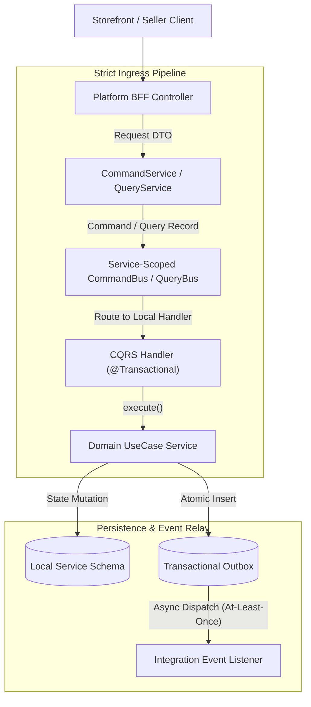
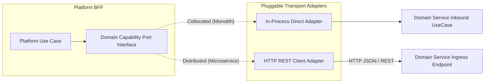
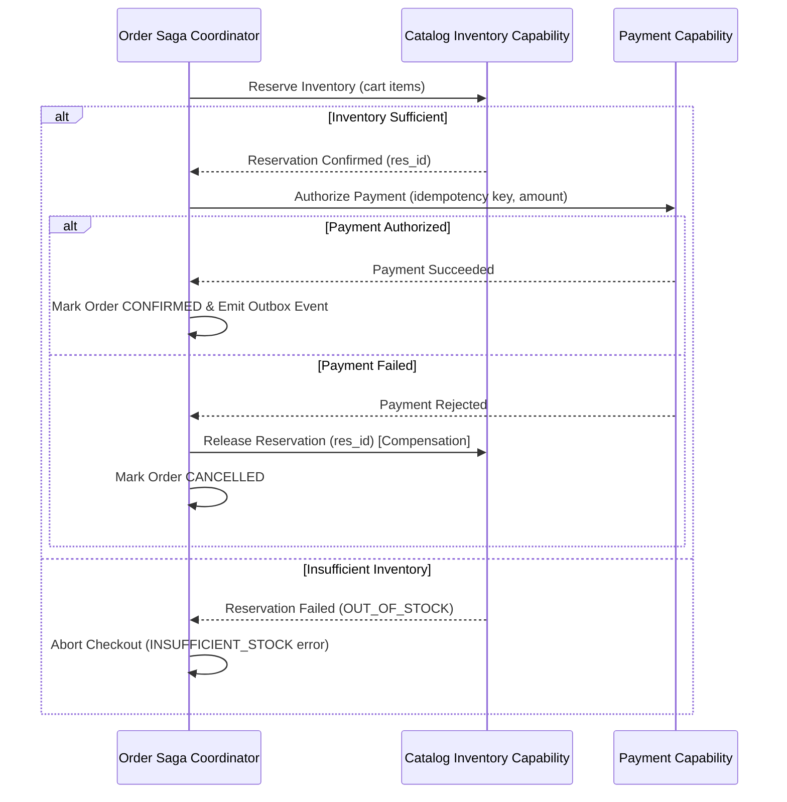

# Tech Spec: Decoupled Service Communication & CQRS Pipeline

- **Summary:** Enforces strict per-service CQRS pipelines, capability ports with swappable transport adapters, transactional outbox eventing, and saga-coordinated distributed checkout.
- **Type:** Architecture Pattern / Platform Infrastructure
- **Feature Spec:** [Decoupled Service Communication & CQRS Pipeline](../../features/feat_011-decoupled-service-communication-cqrs-pipeline.md)

---

## 1. Problem & Decision

### What breaks without this?

Without strict communication boundaries, controllers invoke repositories directly, read queries execute within write transactions (holding row locks), and services call each other's internal command buses or handlers directly. When services are separated or under load, distributed database transactions fail, network latency cascades, and checkout workflows become corrupted if payment or inventory steps fail without compensation.

### Decision

| Option | Decision | Why |
|:-------|:---------|:----|
| **Isolated CQRS Buses + Capability Ports + Outbox Events** | Adopted | Guarantees clear read/write pipeline separation, encapsulates handlers within service instances, allows seamless switching between in-memory and HTTP communication, and eliminates distributed 2PC transactions. |
| Global Application Event / Command Bus | Rejected | Permitted cross-service command dispatching, breaking bounded context autonomy and preventing service extraction. |
| Direct Synchronous REST Calls between Domain Services | Rejected | Creates brittle runtime coupling, circular call graphs, and cascading latency timeouts during peak traffic. |

### Trade-offs

| Benefits | Trade-offs |
|:---------|:-----------|
| Clean separation of read and write workloads prevents lock contention and optimizes query paths. | Requires writing distinct command, query, result records, and mappers for each operation. |
| Asynchronous outbox events decouple domain state mutations from cross-module side-effects. | Eventual consistency introduces slight latency between write execution and read model projection updates. |
| Platform BFFs can run in-process or be deployed separately without altering domain business logic. | Requires maintaining capability port interfaces and transport DTOs. |

---

## 2. How It Works

### Core Concept

The communication architecture enforces three foundational patterns:
1. **Strict Ingress Pipeline**: Every incoming mutation or query follows:
   $$\text{Controller} \longrightarrow \text{CommandService/QueryService} \longrightarrow \text{Bus} \longrightarrow \text{Handler} \longrightarrow \text{UseCase}$$
2. **Per-Service Bus Scoping**: Each domain service instance owns its own `CommandBus` and `QueryBus`. Handlers are registered exclusively from bounded contexts internal to that service.
3. **Pluggable BFF Capability Adapters**: Platform BFFs interact with domain services through typed capability ports (`port/inbound/*UseCase`). When collocated, adapters invoke use cases directly; when separated, adapters use HTTP with immutable JSON DTOs.

### CQRS Separation & Isolation Rules

- **Write Pipeline (`CommandService`)**:
  - Dispatches `Command<R>` records via `CommandBus`.
  - Handles HTTP `POST`, `PUT`, `PATCH`, `DELETE`.
  - **MUST NOT** inject or dispatch via `QueryBus`.
  - **MUST NOT** call `QueryService` or execute read queries.
- **Read Pipeline (`QueryService`)**:
  - Dispatches `Query<R>` records via `QueryBus`.
  - Handles HTTP `GET`.
  - **MUST NOT** inject or dispatch via `CommandBus`.
  - **MUST NOT** call `CommandService` or mutate database state.
- **Zero Cross-Calling**: `CommandService` and `QueryService` must never inject or invoke one another.

### How It Works Step by Step

| Step | What Happens | Why |
|:-----|:-------------|:----|
| 1 | Controller receives HTTP request, performs Bean Validation, and passes DTO to `CommandService` or `QueryService`. | Guards HTTP boundary and handles serialization. |
| 2 | Service maps DTO to an immutable `Command` or `Query` record using MapStruct and dispatches to the service bus. | Keeps domain command records free from HTTP presentation models. |
| 3 | Service Bus locates the single registered handler and invokes `handle()`. | Enforces one-to-one handler mapping within the service boundary. |
| 4 | Handler begins local transaction (`@{Module}Transactional`) and delegates to `UseCase.execute(...)`. | Transaction demarcated strictly at the handler layer. |
| 5 | UseCase executes aggregate logic, writes to repository, and inserts event into the outbox table. | Guarantees atomic persistence of state and events. |
| 6 | Outbox relay asynchronously reads committed events and publishes to registered integration event listeners. | Asynchronous decoupling with guaranteed delivery. |

---

## 3. How We Use It

### Platform BFF Capability Ports & Swappable Transports

Platform BFFs (`com.grab.app.platform.seller` and `marketplace`) call domain capabilities through explicit capability interfaces defined in public port packages:

### Distributed Checkout Coordination in Order Service

Checkout is coordinated exclusively by the **Order Domain Service** using an orchestrated saga pattern:
1. **Cart Validation**: Order service verifies line items and pricing snapshot.
2. **Inventory Reservation**: Order service requests inventory reservation in `catalog`. If stock is insufficient, the checkout aborts immediately.
3. **Payment Authorization**: Order service initiates payment authorization via `payment`. All payment requests include a deterministic client idempotency key (`Idempotency-Key`).
4. **Order Confirmation**: Upon successful payment, order transitions to `CONFIRMED` and emits `OrderPlacedIntegrationEvent` via outbox.
5. **Compensating Rollback**: If payment authorization fails or times out, the Order coordinator dispatches a compensating release command to `catalog` to release reserved inventory.
6. **Reconciliation**: An asynchronous reconciliation poller periodically queries payment gateways for ambiguous/pending transactions.

---

## 4. Implementation Rules

> These are **non-negotiable contracts**. An implementation is compliant only when **all** rules are satisfied.

- **RULE-COM-01: Strict Ingress Path**
  Every incoming API call MUST traverse the strict path:
  $$\text{Controller} \longrightarrow \text{CommandService/QueryService} \longrightarrow \text{Bus} \longrightarrow \text{Handler} \longrightarrow \text{UseCase}$$
  Controllers MUST NOT inject `CommandBus`, `QueryBus`, handlers, use cases, or repositories.

- **RULE-COM-02: Isolated Per-Service Bus**
  Each domain service MUST instantiate and register its own isolated `CommandBus` and `QueryBus`. Handlers from one service MUST NOT be registered on another service's bus. Cross-service bus dispatch is strictly forbidden.

- **RULE-COM-03: Absolute CQRS Separation**
  `CommandService` MUST NOT dispatch `QueryBus` or query data. `QueryService` MUST NOT dispatch `CommandBus` or mutate data. `CommandService` and `QueryService` MUST NOT inject or call each other.

- **RULE-COM-04: Transaction Demarcation Boundary**
  Database transactions (`@Transactional`, `@{Module}Transactional`) MUST be declared only on CQRS Handlers or Provider Adapters. Transactions MUST NOT be placed on Controllers, Services, Mappers, Assemblers, or remote HTTP client adapters. Transactions MUST NEVER span network boundaries.

- **RULE-COM-05: Platform Transport DTO Mapping**
  Platform BFF capability adapters MUST map external request/response DTOs to immutable command/query records. Internal domain entities or JPA entities MUST NEVER be serialized as public API transport contracts.

- **RULE-COM-06: Asynchronous Outbox Eventing & Idempotency**
  Cross-module notifications MUST be dispatched asynchronously using the Transactional Outbox pattern. Event consumers MUST implement idempotent processing to safely handle duplicate message delivery.

- **RULE-COM-07: Backward-Compatible Evolution**
  All public capability APIs, REST contracts, and integration event schemas MUST evolve backward-compatibly (additive fields only, no breaking field renames or deletions) to support independent rolling deployments.
