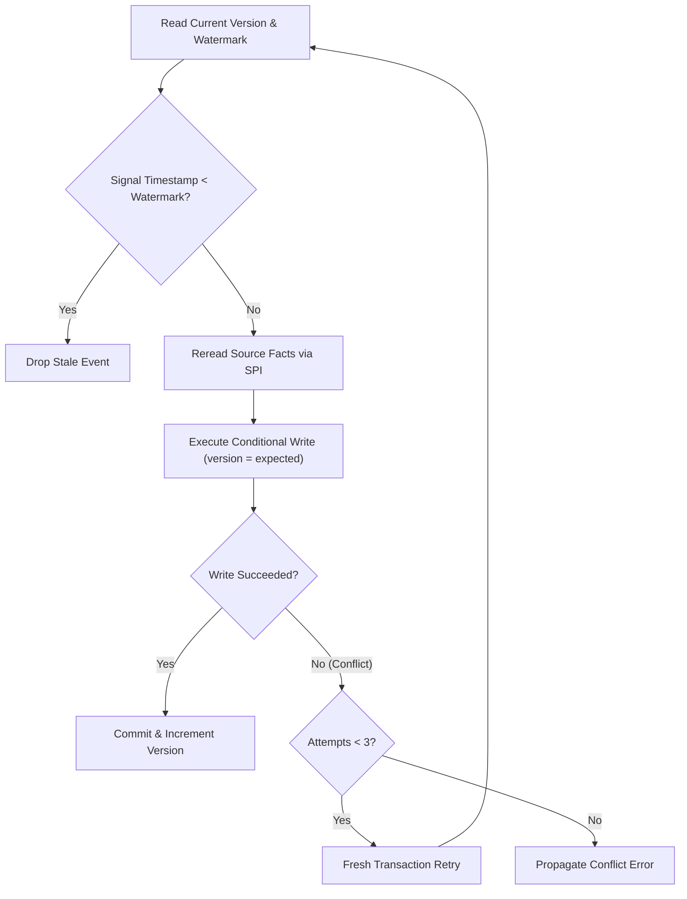
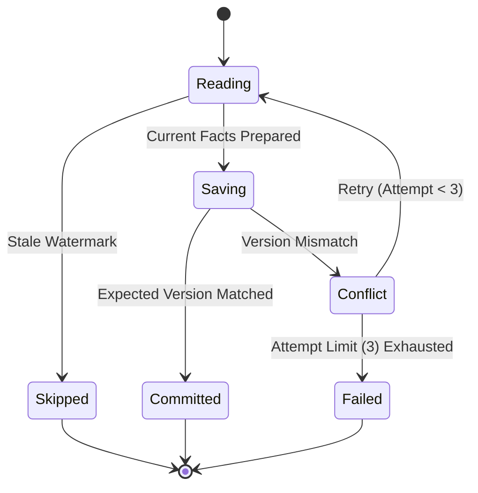
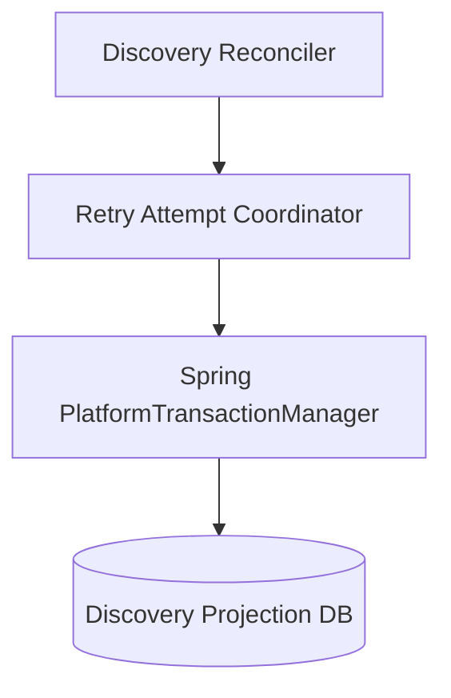
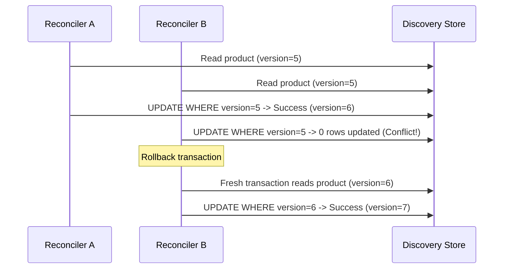

# Tech Spec: Discovery Projection Concurrency Control

- **Summary:** Protects atomic projection replacement with monotonic timestamp watermarks, expected versions, and bounded fresh-transaction retries.
- **Type:** Cross-Cutting Concern
- **Feature Spec:** [Discovery Wiring & Projection Reconciliation](../../features/feat_006-discovery-wiring-projection-reconciliation.md)

---

## 1. Problem & Decision

### What breaks without this?

When multiple domain events (such as concurrent price updates, stock movements, and catalog title changes) arrive simultaneously for the same product, uncoordinated background writes can suffer race conditions where an older read overwrites newer facts, or concurrent inserts cause primary key violations and orphan variant rows.

### Decision

| Option | Decision | Why |
|:-------|:---------|:----|
| **Optimistic Versioning & Monotonic Watermarks** | Adopted | Allows non-blocking reads, detects write-write conflicts deterministically, and bounds retries to fresh transactions without holding locks during external SPI calls. |
| Pessimistic Database Row Locking | Rejected | Extends lock contention across external SPI reread round trips, reducing overall system throughput. |
| Global Serializable Isolation | Rejected | Incurs severe performance penalties and excessive transaction aborts across unrelated read operations. |

### Trade-offs

| Benefits | Trade-offs |
|:-----------|:-------------|
| Guarantees atomic replacement of parent document and child variants | Conflicting transactions must reread source facts in a fresh retry transaction |
| Monotonic watermarks drop stale out-of-order events automatically | Retries are capped at 3 attempts; persistent conflicts propagate as errors |

---

## 2. How It Works

### Core Concept

Each projection document tracks a monotonic `watermark` timestamp and an integer `version`. Insertion of a new document asserts expected absence (`version = -1`). Updates pass the observed version in a conditional `UPDATE ... WHERE version = :expectedVersion`. If the version has changed due to a concurrent write, the transaction rolls back, suspends, and retries in a fresh transaction up to 3 times.

### How It Works Step by Step

| Step | What Happens | Why |
|:-----|:-------------|:----|
| 1 | Thread reads current projection version and watermark | Establishes concurrency expectations |
| 2 | Compares incoming event timestamp against watermark | Rejects stale signals without database writes |
| 3 | Fetches authoritative presentation facts from source SPIs | Rereads current state without holding database locks |
| 4 | Executes conditional database write with expected version | Detects concurrent modifications |
| 5 | Replaces child variant membership rows atomically in the same transaction | Prevents partial or orphaned variant rows |
| 6 | On version conflict, rolls back and initiates fresh transaction (up to 3 attempts) | Resolves transient races automatically |

### Lifecycle

---

## 3. How We Use It

### Where It Fits in Our System

### Component Responsibilities

| Component | Role | What It Does |
|:----------|:-----|:-------------|
| Retry Attempt Coordinator | Transaction Boundary | Spawns fresh local transactions (`REQUIRES_NEW`) and classifies retryable errors. |
| Reconciliation Guard | Domain Policy | Evaluates watermark timestamps and enforces expected-absence or version checks. |
| Conditional Writer | Persistence SPI | Executes conditional SQL updates and atomic variant replacements. |

### Runtime Flow

---

## 4. Implementation Rules

| Rule | Requirement |
|:-----|:------------|
| **R-01** | A strictly older signal **MUST** cause no write; an equal timestamp **MUST** reconcile current facts. |
| **R-02** | New projections **MUST** assert expected absence using logical version `-1`, distinct from an initially stored version `0`; unexpected existence **MUST** fail the attempt. |
| **R-03** | Existing projections **MUST** carry their observed version, and a mismatched current version **MUST** reject replacement. |
| **R-04** | Only optimistic update conflicts and concurrent insertion races **MUST** be retried, with at most three total attempts. |
| **R-05** | Slug collisions, provider outages, and exhausted retry attempts **MUST** propagate immediately and **MUST NOT** enter the conflict retry loop. |
| **R-06** | Each retry attempt **MUST** execute in a fresh local transaction with any ambient caller transaction suspended. |
| **R-07** | Successful updates **MUST** set the stored watermark to the maximum of the previous and incoming timestamps, never regressing. |
| **R-08** | Projection facts and variant memberships **MUST** commit together in a single transaction; prior variant rows **MUST** be cleared before new variants are inserted. |
