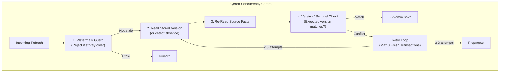
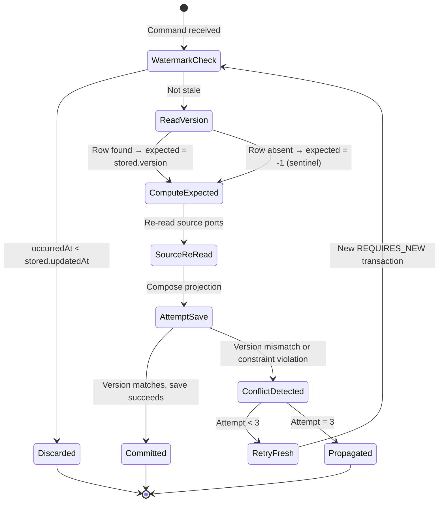
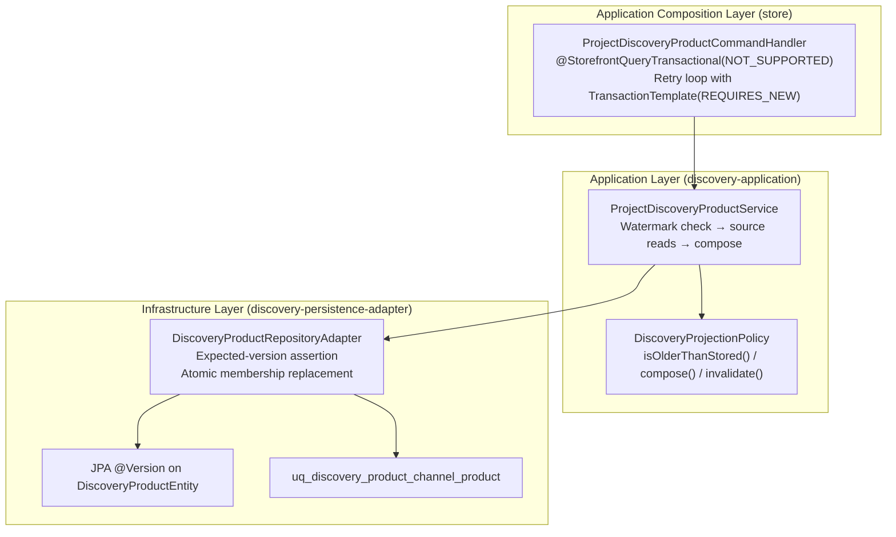
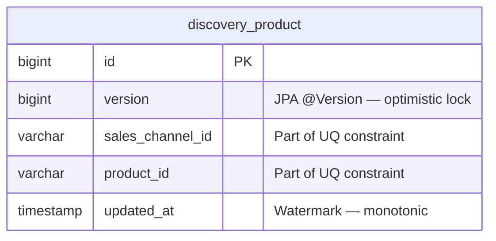

# Tech Specification: Discovery Projection Concurrency Control

- **Summary:** Guards projection writes with watermarks, optimistic versioning, insert-absence sentinels, and bounded retry loops.
- **Classification:** Cross-Cutting Concern / Concurrency Safety
- **Supporting Modules:** `discovery-application` / `discovery-persistence-adapter` / `store/storefrontquery`
- **Related Architecture ADRs:** [multi_regional_contextual_discovery_system_design](../../system-design/001-multi_regional_contextual_discovery_system_design.md)
- **Related Feature:** [feat_006 — Discovery Wiring, Projection Reconciliation & Rebuild](../../features/feat_006-discovery-wiring-projection-reconciliation.md)

---

## 1. Why We Need It

### The Problem

Multiple concurrent integration events can target the same `(salesChannelId, productId)` projection row. A stock adjustment and a catalog presentation change for the same product may arrive within milliseconds, producing two concurrent `REQUIRES_NEW` transactions. Without protection, the later commit silently overwrites the earlier one's facts. Concurrent first-inserts for a previously absent key collide on the unique constraint. The standard JPA `@Version` mechanism addresses row-level conflicts but cannot distinguish "this row should not exist yet" from "this row exists at version 0."

### Technology Decision & Alternatives

| Technology Option | Decision | Evaluation Rationale |
| :--- | :--- | :--- |
| **Optimistic Locking + Watermark + Sentinel + Retry** | **Adopted** | Four complementary mechanisms address distinct failure modes: watermarks reject stale events, `@Version` detects concurrent writes, `NEW_PROJECTION_VERSION = -1` detects insert races, and bounded retry recovers transient conflicts. |
| Pessimistic Row Locks (`SELECT FOR UPDATE`) | Rejected | Holds database locks for the duration of source port reads, increasing contention and degrading throughput under fan-out events. |
| Database-Level Serializable Isolation | Rejected | Global serializable isolation is too broad; impacts all discovery queries, not just writes. |
| Queue-Based Sequential Processing per Key | Deferred | Would require per-key partitioning infrastructure; current event volume does not justify the complexity. |

### Key Benefits & Trade-offs

**Core Benefits:**
- No database locks are held during source port reads — source ports may take tens of milliseconds without contention.
- Each retry reads a fresh database state in a new transaction, resolving the conflict with current facts.
- The sentinel value prevents silent overwrite of a row that was created by a concurrent transaction between the projection's read and write.

**Known Trade-offs:**
- Three retry attempts are a hard limit; sustained high-concurrency bursts can exhaust retries.
- Each retry repeats all source port reads, adding latency and upstream load.
- There is no dead-letter mechanism or circuit breaker; exhausted retries propagate to the outbox, which will also retry.

---

## 2. What It Is

### Core Concept

Projection concurrency control is a layered defense of four mechanisms that work together without pessimistic database locks:

1. **Watermark Guard** — rejects events whose `occurredAt` is strictly before the stored `updatedAt`.
2. **Optimistic Version Check** — verifies the expected `@Version` matches the current database version before write.
3. **Insert-Absence Sentinel** — `NEW_PROJECTION_VERSION = -1L` asserts that no row exists; a concurrent insert is detected when the row is unexpectedly present.
4. **Bounded Retry Loop** — on retryable conflicts (optimistic lock failure or unique constraint `uq_discovery_product_channel_product`), the command handler retries up to 3 times in fresh `REQUIRES_NEW` transactions.

### Internal Mechanics & Lifecycle

> Concurrency state transitions for a single projection write attempt.

---

## 3. How We Use It in This System

### Architecture & Layer Stacking

### Component Responsibilities

| Architectural Role | Layer Location | Responsibility |
| :--- | :--- | :--- |
| `Command Handler` | `store/storefrontquery` | Suspends outer transaction (`NOT_SUPPORTED`). Executes projection in `REQUIRES_NEW` transaction via `TransactionTemplate`. Catches retryable exceptions and retries up to `MAX_ATTEMPTS`. Classifies exceptions by walking the cause chain. |
| `Projection Service` | `discovery-application` | Calls `policy.isOlderThanStored()` for watermark guard. Determines expected version: `NEW_PROJECTION_VERSION` for absent rows, `stored.version()` for existing rows. Passes version to `policy.compose()`. |
| `Projection Policy` | `discovery-application` | Pure comparison logic. `isOlderThanStored(Instant, DiscoveryProductProjection)` returns true when the event is strictly before the stored watermark. |
| `Repository Adapter` | `discovery-persistence-adapter` | On `save()`: re-reads the entity, checks expected existence and version, throws `ObjectOptimisticLockingFailureException` on mismatch. Performs membership delete-then-insert within the same transaction. |

### Runtime Flow

> Two concurrent events for the same (channelId, productId) — one succeeds, one retries.

```mermaid
sequenceDiagram
    participant H1 as Handler (Event A)
    participant H2 as Handler (Event B)
    participant DB as Discovery Database

    Note over H1,H2: Both events target same (ch, prod)
    H1->>DB: BEGIN REQUIRES_NEW&#59; SELECT version=5
    H2->>DB: BEGIN REQUIRES_NEW&#59; SELECT version=5
    H1->>DB: Re-read sources, compose, UPDATE WHERE version=5
    H1->>DB: COMMIT (version now 6)
    H2->>DB: Re-read sources, compose, UPDATE WHERE version=5
    Note over H2,DB: OptimisticLockingFailureException
    H2->>DB: ROLLBACK
    Note over H2: Retry attempt 2
    H2->>DB: BEGIN REQUIRES_NEW&#59; SELECT version=6
    H2->>DB: Re-read sources, compose, UPDATE WHERE version=6
    H2->>DB: COMMIT (version now 7)
```

---

## 4. Technical Specification & Contracts

Normative specification. An implementation is compliant only when all MUST / MUST NOT statements are satisfied.

### Normative Rules

- **R-01:** Events strictly older than the stored watermark (`occurredAt < stored.updatedAt`) **MUST** be discarded without writing. Events with equal timestamps **MUST** proceed to reconciliation.
- **R-02:** New projections (no existing row) **MUST** carry `NEW_PROJECTION_VERSION` (`-1`) to assert expected absence. The repository adapter **MUST** throw `ObjectOptimisticLockingFailureException` if the row unexpectedly exists.
- **R-03:** Existing projections **MUST** carry the stored entity's `version` value. The repository adapter **MUST** throw `ObjectOptimisticLockingFailureException` if the current database version differs.
- **R-04:** Optimistic locking conflicts (`OptimisticLockingFailureException`) and concurrent channel/product insertion collisions (`DataIntegrityViolationException` containing `uq_discovery_product_channel_product`) **MUST** retry up to 3 times in fresh `REQUIRES_NEW` transactions.
- **R-05:** Slug uniqueness violations (`uq_discovery_product_channel_slug`), provider failures (source port exceptions), and exhausted retry attempts **MUST** propagate immediately. The implementation **MUST NOT** retry non-retryable failures.
- **R-06:** The command handler **MUST** suspend the outer transaction (`Propagation.NOT_SUPPORTED`) before entering the retry loop. Each attempt **MUST** execute in a separate `REQUIRES_NEW` transaction so that the persistence context is clean on retry.
- **R-07:** The watermark written to the projection **MUST** be `max(previous.updatedAt, event.occurredAt)`. The watermark **MUST NOT** regress.

### Storage & Data Contract

The concurrency control operates on the same `discovery_product` table with the following key columns:

| Constraint | Type | Concurrency Role |
| :--- | :--- | :--- |
| `@Version` column | JPA optimistic lock | Detects concurrent write-write conflicts on existing rows |
| `uq_discovery_product_channel_product` | Unique constraint | Detects concurrent first-insert races for the same key |
| `uq_discovery_product_channel_slug` | Unique constraint | Prevents slug collisions; not retried (propagated) |

### Configuration Knobs

| Binding / constant | Implemented default | Unit / format | Description |
| :--- | :--- | :--- | :--- |
| `ProjectDiscoveryProductCommandHandler.MAX_ATTEMPTS` | `3` | Fixed constant (int) | Maximum number of fresh-transaction retry attempts before propagating. |
| `TransactionTemplate.propagationBehavior` | `PROPAGATION_REQUIRES_NEW` | Spring TX constant | Ensures each retry gets a clean persistence context and fresh snapshot. |
| `@StorefrontQueryTransactional(propagation = NOT_SUPPORTED)` | `NOT_SUPPORTED` | Spring TX annotation | Suspends the outer calling transaction so the handler controls its own transaction lifecycle. |
| `DiscoveryProductProjection.NEW_PROJECTION_VERSION` | `-1L` | Fixed constant (long) | Sentinel denoting expected absence; distinguished from JPA `@Version` starting at `0`. |