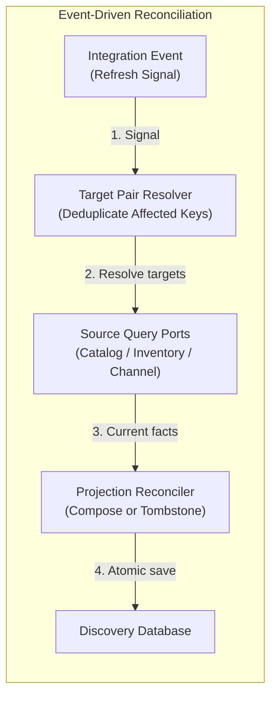
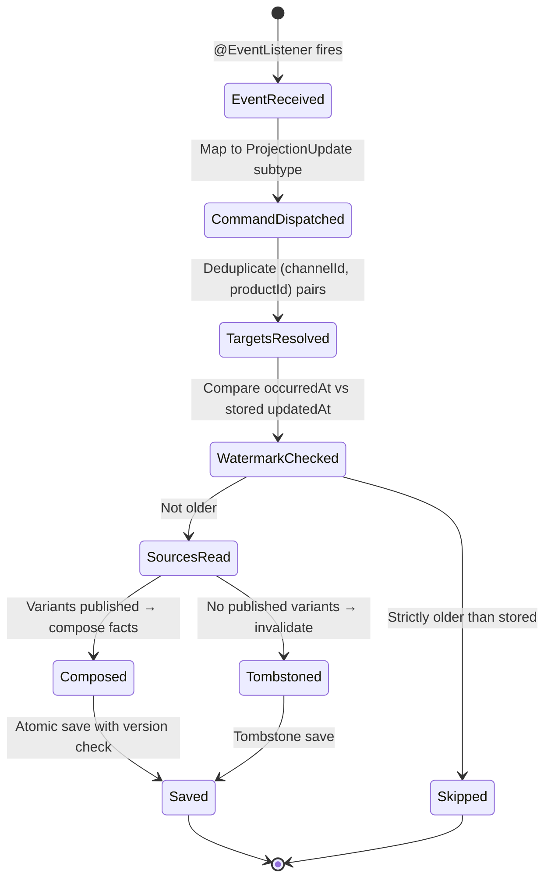
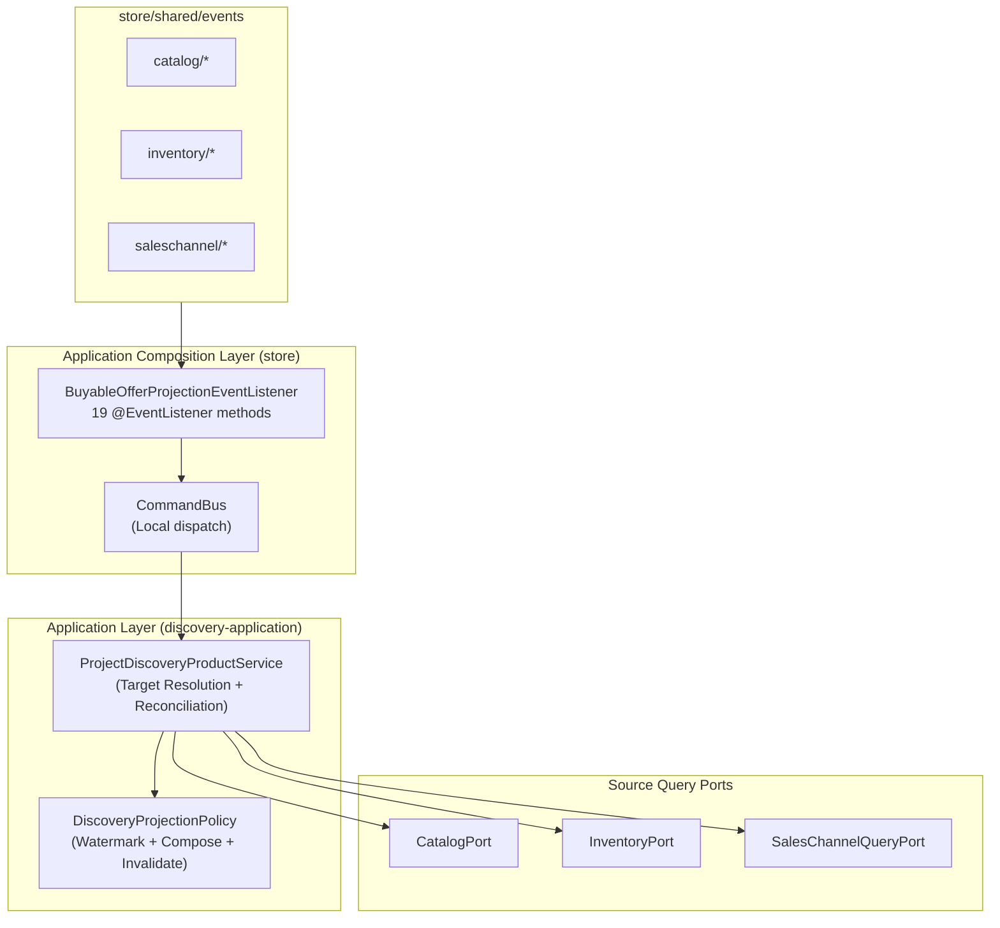
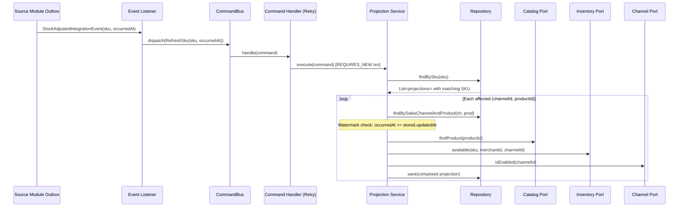

# Tech Specification: Discovery Event-Driven Reconciliation

> **Summary:** Treats integration events as refresh signals; re-reads authoritative facts from source ports to reconcile discovery projections.
> **Classification:** Architectural Pattern / Event-Driven Projection
> **Supporting Modules:** `store/storefrontquery` / `discovery-application`
> **Related Architecture ADRs:** [SSD-001 §Phrase 4](../../system-design/001-multi_regional_contextual_discovery_system_design.md)
> **Related Feature:** [feat_006 — Discovery Wiring, Projection Reconciliation & Rebuild](../../features/feat_006-discovery-wiring-projection-reconciliation.md)

---

## 1. Why We Need It

### The Problem

Directly applying event payloads as authoritative fact values in a projection creates several failure modes: out-of-order event delivery silently corrupts the read model, event replay from the outbox reapplies stale state, and tight coupling between event schema and projection shape makes independent evolution impossible. In a modular monolith where multiple source domains (Catalog, Inventory, Sales Channel) emit events that affect the same projection row, the interaction matrix of event orderings becomes intractable to verify statically.

### Technology Decision & Alternatives

| Technology Option | Decision | Evaluation Rationale |
| :--- | :--- | :--- |
| **Events as Refresh Signals (Source Re-Read)** | **Adopted** | Events trigger a re-read of authoritative facts from source query ports. Out-of-order events resolve to the same current state — naturally idempotent. Projection shape evolves independently of event contracts. |
| Direct Event Payload Application | Rejected | Requires total event ordering per projection key; partial payload events (e.g., stock-only) leave incomplete rows; replay risk is unmitigated. |
| Snapshot-Based Event Sourcing | Rejected | Overkill for a read model; requires event store infrastructure and snapshot management that adds complexity without proportional benefit in a monolith. |
| CDC/Debezium from Source Tables | Deferred | Bypasses domain ports and couples to storage schema; may be considered if modules are physically extracted. |

### Key Benefits & Trade-offs

**Core Benefits:**
- Out-of-order events produce identical projection outcomes because the source is always re-read at reconciliation time.
- Event schema and projection schema evolve independently — adding a projection field requires no event schema change.
- All source domains share a single reconciliation code path, reducing testing surface.

**Known Trade-offs:**
- Each refresh incurs source port reads (minimum 1 catalog + 1 inventory + 1 channel query per affected pair); high-fanout events (e.g., location status change) amplify read load.
- Source port failures during reconciliation propagate as projection failures — the outbox will retry, but a sustained source outage delays convergence.
- Events carry a timestamp (`occurredAt`) but no causal ordering; concurrent events for the same pair race through the watermark guard.

---

## 2. What It Is

### Core Concept

Integration events from Catalog, Inventory, and Sales Channel are treated strictly as **refresh signals** — notifications that something may have changed. The reconciliation engine does not extract fact values from the event payload. Instead, it maps each event to one or more affected `(channelId, productId)` target pairs, then re-reads the current authoritative state from source query ports.

### Internal Mechanics & Lifecycle

> Event dispatch lifecycle from integration event to committed projection.

---

## 3. How We Use It in This System

### Architecture & Layer Stacking

### Component Responsibilities

| Architectural Role | Layer Location | Responsibility |
| :--- | :--- | :--- |
| `Event Listener` | `store/storefrontquery` | Maps 19 integration events to 6 `ProjectionUpdate` command subtypes. Converts raw string IDs to framework `Id` values. Dispatches through `CommandBus`. |
| `Projection Service` | `discovery-application` | Resolves affected `(channelId, productId)` targets from the update subtype. Deduplicates targets via `LinkedHashMap`. Re-reads each target from source ports. Delegates to policy for composition or invalidation. |
| `Projection Policy` | `discovery-application` | Pure, side-effect-free logic: `isOlderThanStored()` for watermark guard, `compose()` for fact assembly, `invalidate()` for tombstone creation, `isInvalidated()` for tombstone detection. |
| `Source Ports` | `discovery-application` (interfaces) | `CatalogPort` provides product/variant/publication facts. `InventoryPort` provides routed stock availability. `SalesChannelQueryPort` provides channel enabled status. |

### Event-to-Command Mapping

| Event | Source Module | Command Subtype | Target Resolution |
| :--- | :--- | :--- | :--- |
| `ProductPublishedToChannelIntegrationEvent` | Catalog | `RefreshVariant` | Variant's existing projections + catalog publication channels |
| `ProductUnpublishedFromChannelIntegrationEvent` | Catalog | `RefreshVariant` | Same as above |
| `ProductVariantAdded/Updated/Deleted/Restored` | Catalog | `RefreshProduct` | All existing projections for product + all catalog-published channels |
| `ProductDeleted` | Catalog | `RefreshProduct` | Same as above |
| `ProductPresentationChanged` | Catalog | `RefreshProduct` | Same as above |
| `ProductStatusChanged` | Catalog | `RefreshProduct` | Same as above |
| `StockReceived/Reserved/Adjusted/Shipped` | Inventory | `RefreshSku` | All existing projections containing the SKU |
| `InventoryStatusChanged` | Inventory | `RefreshSku` | Same as above |
| `LocationStatusChanged` | Inventory | `RefreshLocation` | All projections (location not channel-scoped) |
| `LocationLinked/UnlinkedToChannel` | Inventory | `RefreshLocation` | All projections for the linked/unlinked channel |
| `SalesChannelEnabled/Disabled` | Sales Channel | `RefreshChannel` | All existing projections for the channel |

### Runtime Flow

> Reconciliation of a stock adjustment event.

---

## 4. Technical Specification & Contracts

Normative specification. An implementation is compliant only when all MUST / MUST NOT statements are satisfied.

### Normative Rules

- **R-01:** Integration events **MUST** act strictly as refresh signals. The reconciliation service **MUST NOT** extract fact values (titles, quantities, statuses) from event payloads; it **MUST** re-read current state from authoritative source query ports.
- **R-02:** Each `ProjectionUpdate` subtype **MUST** resolve a deduplicated set of `(salesChannelId, productId)` target pairs from both existing projections and current catalog publication membership.
- **R-03:** Events strictly older than the stored watermark (`occurredAt < stored.updatedAt`) **MUST** be discarded. Events with equal timestamps **MUST** reconcile against current source facts.
- **R-04:** The maximum watermark written to the projection **MUST** be `max(previous.updatedAt, event.occurredAt)` — the watermark **MUST NOT** regress.
- **R-05:** `RefreshProduct` **MUST** cover all existing projection rows for that product **plus** all channels in which any of the product's variants are currently published.
- **R-06:** `RefreshSku` **MUST** locate affected projections via the relational variant-membership index (`findBySku`), not by scanning all projections.
- **R-07:** `RefreshLocation` with a null `salesChannelId` **MUST** scan all existing projections using keyset pagination (batch size `500`); with a non-null channel, it **MUST** scan only that channel's projections.
- **R-08:** Invalidation (tombstone) **MUST** recheck current publication status (`isPublishedInChannel`) before writing — if publication status is inconsistent with product facts, the service **MUST** throw `IllegalStateException`.

### Storage & Data Contract

The reconciliation engine reads and writes the same `discovery_product` and `discovery_product_variant_membership` tables described in the [Facts-Only Projection Tech Spec](./discovery-facts-only-projection-tech-spec.md). No additional tables are introduced.

### Configuration Knobs

| Binding / constant | Implemented default | Unit / format | Description |
| :--- | :--- | :--- | :--- |
| `TARGET_SCAN_BATCH_SIZE` | `500` | Fixed constant (int) | Keyset page size for `RefreshLocation` with null channel (full projection scan). |
| `ProjectDiscoveryProductCommandHandler.MAX_ATTEMPTS` | `3` | Fixed constant (int) | Maximum retry attempts for optimistic lock or concurrent insert conflicts. |
| `TransactionTemplate.propagationBehavior` | `PROPAGATION_REQUIRES_NEW` | Spring TX constant | Each retry starts a fresh transaction with a clean persistence context. |

Implementation references: [`BuyableOfferProjectionEventListener`](../../store/src/main/java/com/grab/store/storefrontquery/internal/event/BuyableOfferProjectionEventListener.java), [`ProjectDiscoveryProductService`](../../discovery-application/src/main/java/com/grab/discovery/application/service/ProjectDiscoveryProductService.java), [`ProjectDiscoveryProductCommand`](../../discovery-application/src/main/java/com/grab/discovery/application/model/write/ProjectDiscoveryProductCommand.java), [`DiscoveryProjectionPolicy`](../../discovery-application/src/main/java/com/grab/discovery/application/policy/DiscoveryProjectionPolicy.java).
