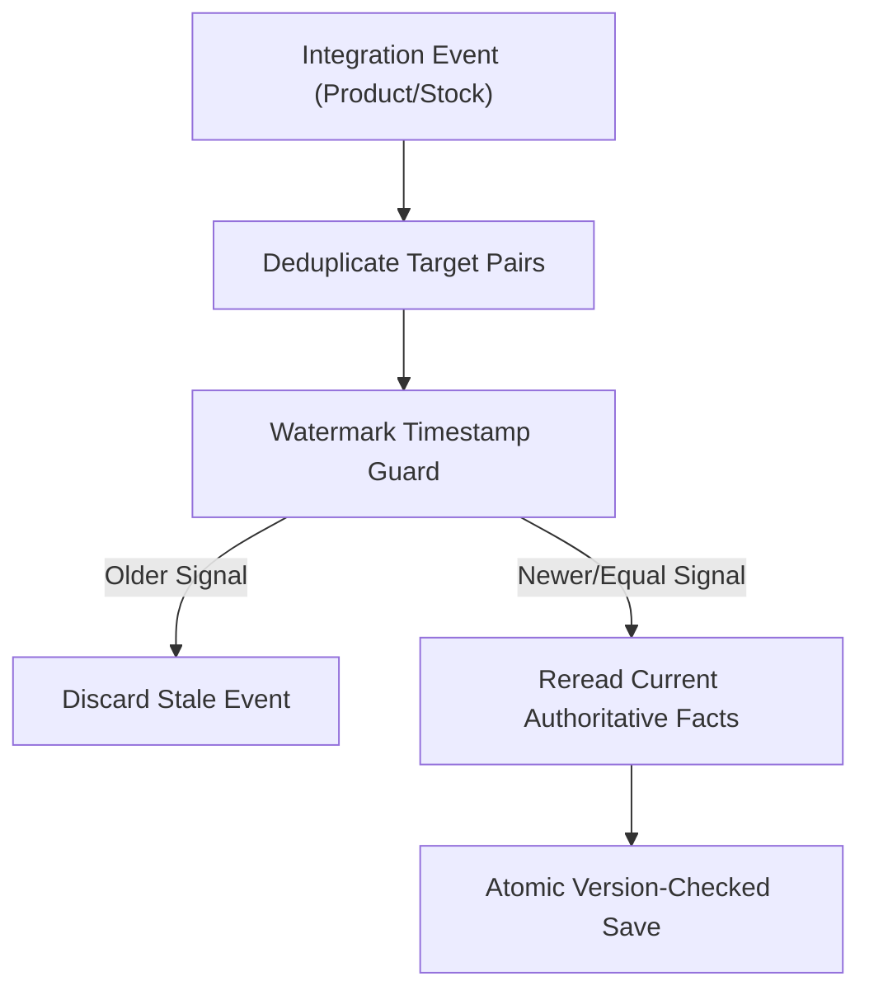
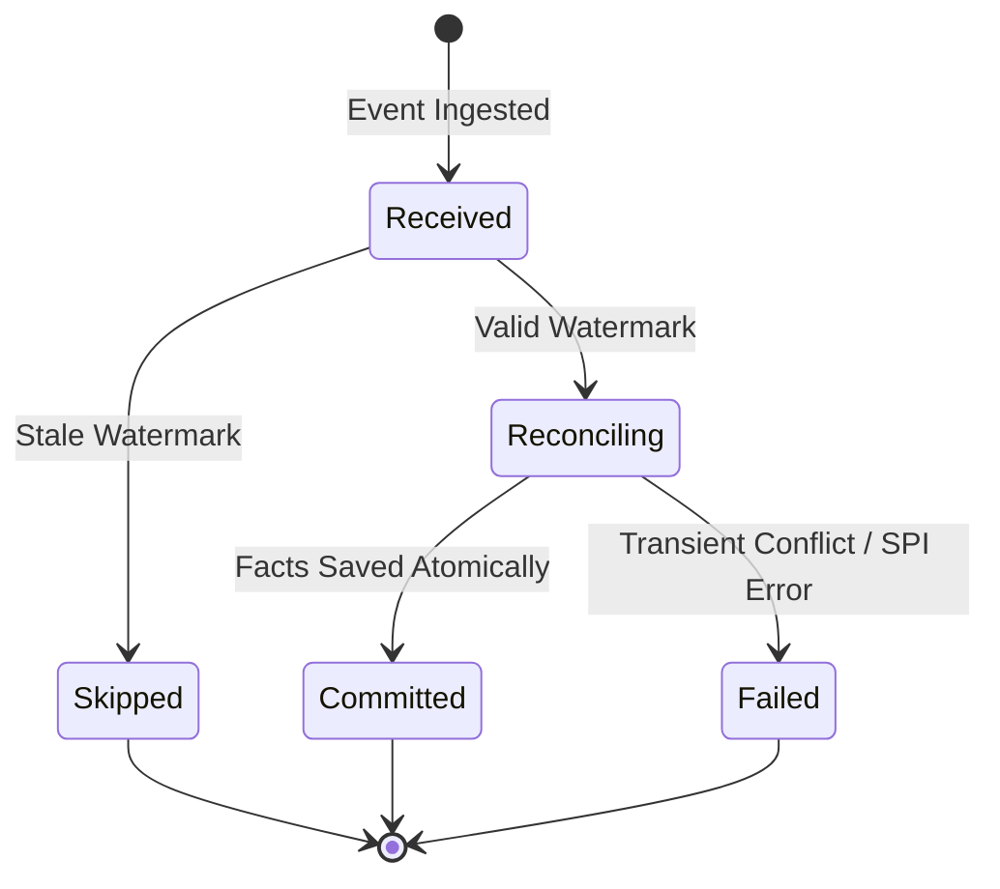
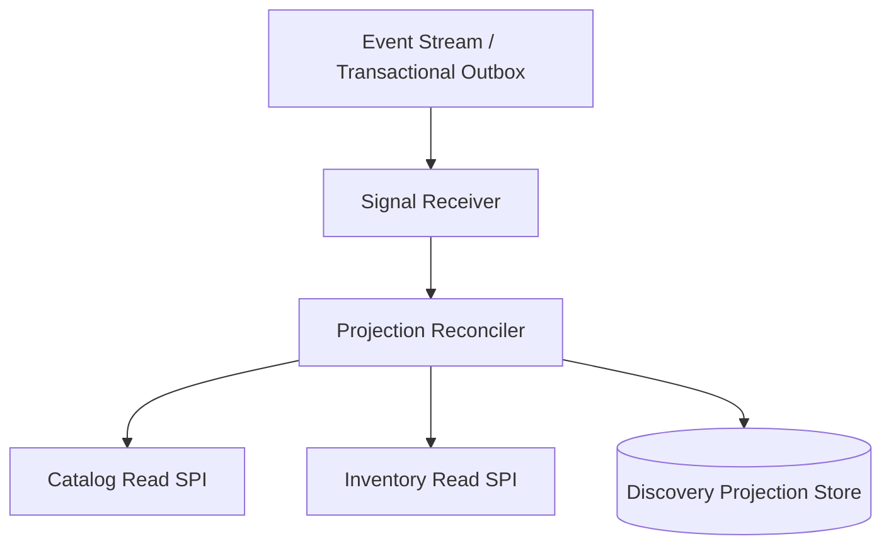
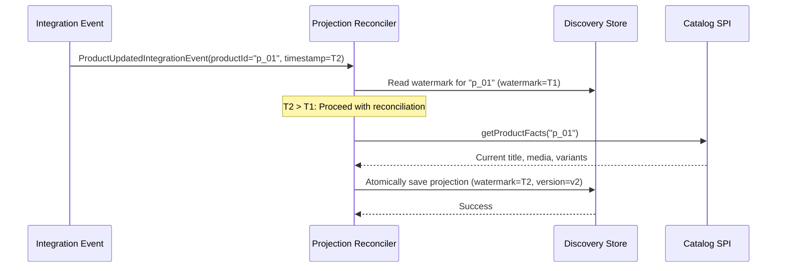

# Tech Spec: Discovery Event-Driven Reconciliation

- **Summary:** Treats source integration events as lightweight refresh signals and reconciles affected projection documents from current authoritative facts.
- **Type:** Architecture Pattern
- **Feature Spec:** [Discovery Wiring & Projection Reconciliation](../../features/feat_006-discovery-wiring-projection-reconciliation.md)

---

## 1. Problem & Decision

### What breaks without this?

Directly applying partial event payloads into read projections introduces out-of-order race conditions where delayed or stale events overwrite newer catalog or stock updates. Furthermore, payloads often lack full relational context (e.g., variant hierarchies or routed inventory rules), causing corrupted read models.

### Decision

| Option | Decision | Why |
|:-------|:---------|:----|
| **Authoritative Reread on Refresh Signal** | Adopted | Guarantees that projection documents are always constructed from current source facts via SPI rereads, eliminating out-of-order payload state regressions. |
| Apply Partial Event Payloads as State | Rejected | Stale, reordered, or duplicate event deliveries overwrite newer state with outdated values. |
| Cross-Database Change Data Capture (CDC) | Deferred | Directly couples read projections to internal transactional database table structures and schemas. |

### Trade-offs

| Benefits | Trade-offs |
|:-----------|:-------------|
| Complete immunity to out-of-order event delivery regressions | Event reconciliation incurs an SPI read hop back to source services |
| Projection schema can evolve independently of event payload contracts | High-volume inventory updates require indexed SKU lookup and deduplication |

---

## 2. How It Works

### Core Concept

When an integration event arrives from Catalog, Inventory, or Sales Channel, the Discovery reconciler extracts the affected product or SKU identity. It checks the event timestamp against the stored document watermark. If the event is valid and not stale, it queries the source services via read-only SPIs to fetch complete current facts and writes the projection atomically.

### How It Works Step by Step

| Step | What Happens | Why |
|:-----|:-------------|:----|
| 1 | Event consumer receives domain event from Catalog, Inventory, or Sales Channel | Ingests notification without assuming payload completeness |
| 2 | Maps product ID, SKU, or channel ID to target `(salesChannelId, productId)` pairs | Deduplicates targets across affected variants |
| 3 | Compares event `occurredAt` against stored projection `watermark` | Drops stale events while allowing equal timestamps to reconcile |
| 4 | Calls authoritative source read SPIs to fetch complete presentation and stock facts | Fetches authoritative state directly from source |
| 5 | Writes updated projection and variant rows atomically with incremented version | Prevents partial writes and concurrency conflicts |

### Lifecycle

---

## 3. How We Use It

### Where It Fits in Our System

### Component Responsibilities

| Component | Role | What It Does |
|:----------|:-----|:-------------|
| Signal Receiver | Event Listener | Ingests integration events and dispatches local reconciliation commands. |
| Target Resolver | Domain Service | Maps SKUs and publications to affected `(salesChannelId, productId)` pairs. |
| Projection Reconciler | Coordinator | Evaluates watermark timestamps, calls SPI rereads, and invokes atomic writes. |

### Runtime Flow

---

## 4. Implementation Rules

| Rule | Requirement |
|:-----|:------------|
| **R-01** | Events **MUST** act as refresh signals; title, quantity, and status **MUST** be reread from authoritative providers rather than copied from event payloads. |
| **R-02** | Affected channel/product targets **MUST** be deduplicated from current publication membership and stored projections. |
| **R-03** | Signals strictly older than the stored watermark **MUST** be discarded; equal timestamps **MUST** reconcile current source facts. |
| **R-04** | The stored watermark **MUST** be the maximum of its previous value and signal time and **MUST NOT** regress. |
| **R-05** | SKU-based inventory refreshes **MUST** use exact indexed variant lookup rather than full table scans. |
| **R-06** | Catalog, Inventory, and Sales Channel integration signals **MUST** trigger local processing; Pricing signals **MUST NOT** refresh factual discovery. |
| **R-07** | Invalidation **MUST** verify current publication state; conflicting facts **MUST** fail the refresh rather than tombstoning a published product. |
