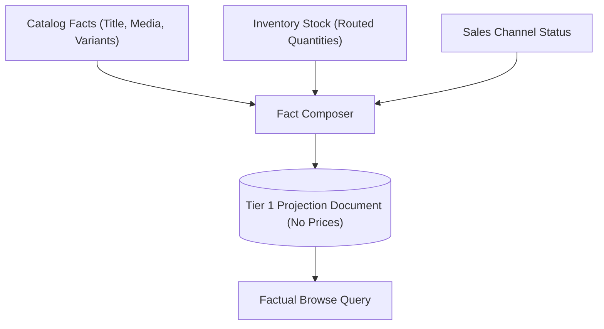
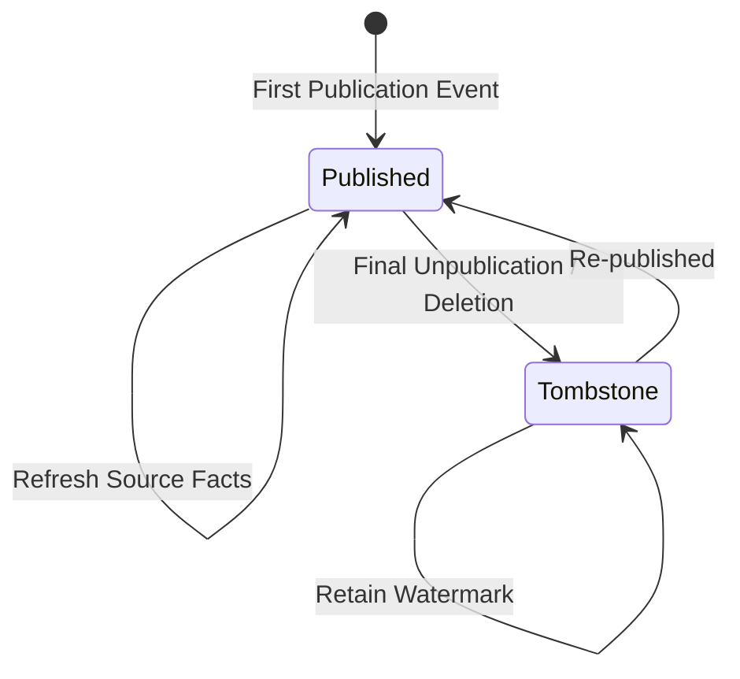
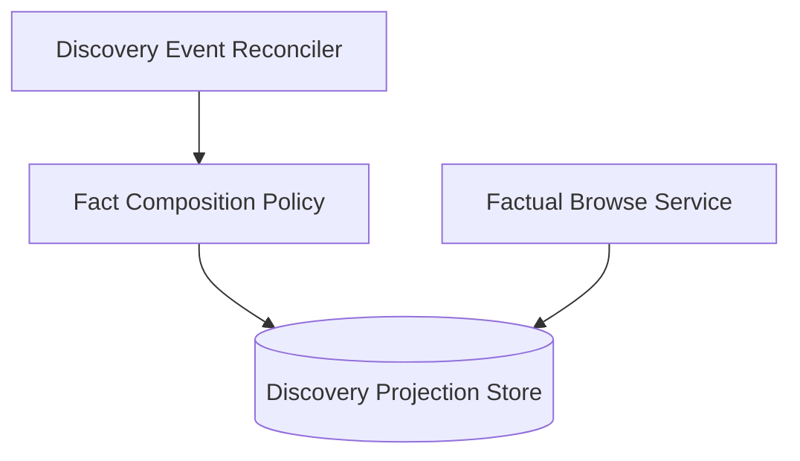
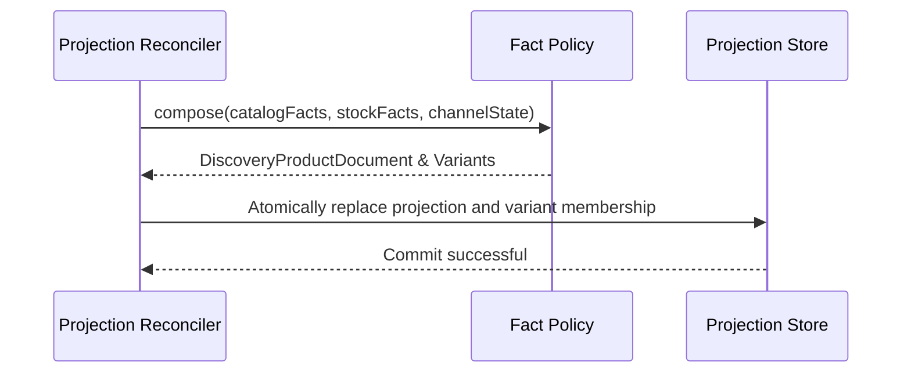

# Tech Spec: Discovery Facts-Only Projection

- **Summary:** Maintains one denormalized, currency-agnostic catalog presentation and stock projection per channel/product pair.
- **Type:** Architecture Pattern
- **Feature Spec:** [Discovery Wiring & Projection Reconciliation](../../features/feat_006-discovery-wiring-projection-reconciliation.md)

---

## 1. Problem & Decision

### What breaks without this?

Embedding regional currency amounts directly into search projections causes storage requirements to multiply exponentially with each added region ($O(P \times C \times R)$). Furthermore, any exchange rate update or promotional campaign launch triggers massive database re-indexing storms that overwhelm storage write capacity and disrupt catalog browsing.

### Decision

| Option | Decision | Why |
|:-------|:---------|:----|
| **Facts-Only Read Model Projection** | Adopted | Decouples stable catalog presentation facts from volatile prices, eliminating write amplification on price adjustments. |
| Pre-Materialized Multi-Region Documents | Rejected | Multiplies storage footprint exponentially ($500,000+$ rows) and triggers database re-indexing storms. |
| Synchronous Live Cross-Module Joins | Rejected | Degrades browse query latency ($>200\text{ ms}$) and introduces distributed cascading failures. |

### Trade-offs

| Benefits | Trade-offs |
|:-----------|:-------------|
| Adding currencies or regions requires zero database projection updates | Presentation facts must be enriched dynamically with prices at request time |
| Zero write amplification from pricing, promotional, or tax adjustments | Projections cannot support global sorting or filtering by price at the database layer |

---

## 2. How It Works

### Core Concept

The `discovery_product` projection maintains one denormalized document per `(sales_channel_id, product_id)` pair. It captures product metadata (title, slug, media, options, descriptions) and variant stock facts while stripping all currency and monetary fields. Incoming Catalog and Inventory events refresh these facts independently of pricing.

### How It Works Step by Step

| Step | What Happens | Why |
|:-----|:-------------|:----|
| 1 | Fact Composer reads catalog taxonomy, product title, slug, and media | Captures core presentation facts |
| 2 | Queries active channel-routed warehouse inventory for variant SKUs | Calculates aggregate available quantity and backorder support |
| 3 | Evaluates variant-level stock badges (`IN_STOCK`, `LOW_STOCK`, `OUT_OF_STOCK`) | Provides stock badges without checking prices |
| 4 | Strips any price, currency, or buyability fields | Guarantees facts-only isolation |
| 5 | Writes projection document and variant facts atomically to local database | Ensures transactional consistency of variant hierarchy |

### Lifecycle

---

## 3. How We Use It

### Where It Fits in Our System

### Component Responsibilities

| Component | Role | What It Does |
|:----------|:-----|:-------------|
| Fact Composition Policy | Domain Service | Selects presentation media, descriptions, and routed stock facts deterministically. |
| Projection Store Repository | Persistence SPI | Persists denormalized `discovery_product` and variant rows atomically. |
| Factual Browse Service | Query Engine | Serves paged presentation facts to downstream request-time composers. |

### Runtime Flow

---

## 4. Implementation Rules

| Rule | Requirement |
|:-----|:------------|
| **R-01** | Exactly one logical projection **MUST** exist per channel/product pair, carrying channel ID, product ID, merchant ID, category ID, title, slug, thumbnail, options, status, publication state, channel state, stock badge, watermark, and version. |
| **R-02** | Variant facts **MUST** retain variant ID, SKU, title, status, option values, available quantity, inventory-management setting, backorder setting, and factual stock state. |
| **R-03** | Projection storage and factual queries **MUST NOT** persist, request, or return currency, monetary amounts, compare-at prices, price ranges, or commercial buyability. |
| **R-04** | Presentation **MUST** select the first nonblank description ordered by identity and the first usable media URL ordered by rank then identity. |
| **R-05** | Quantity **MUST** sum eligible non-negative quantities at active channel-routed locations, excluding suspended or discontinued inventory; untracked variants **MUST** have zero factual quantity without fabricated stock. |
| **R-06** | Publication membership **MUST** be retained for inactive variants; catalog visibility **MUST** separately require an active published variant. |
| **R-07** | Deletion or final unpublication **MUST** retain a tombstone and watermark while clearing slug, publication, and variants; current publication **MUST** be rechecked before invalidation. |
| **R-08** | Projection facts and exact membership **MUST** be replaced atomically under the concurrency contract; pricing changes **MUST NOT** cause factual projection writes. |
