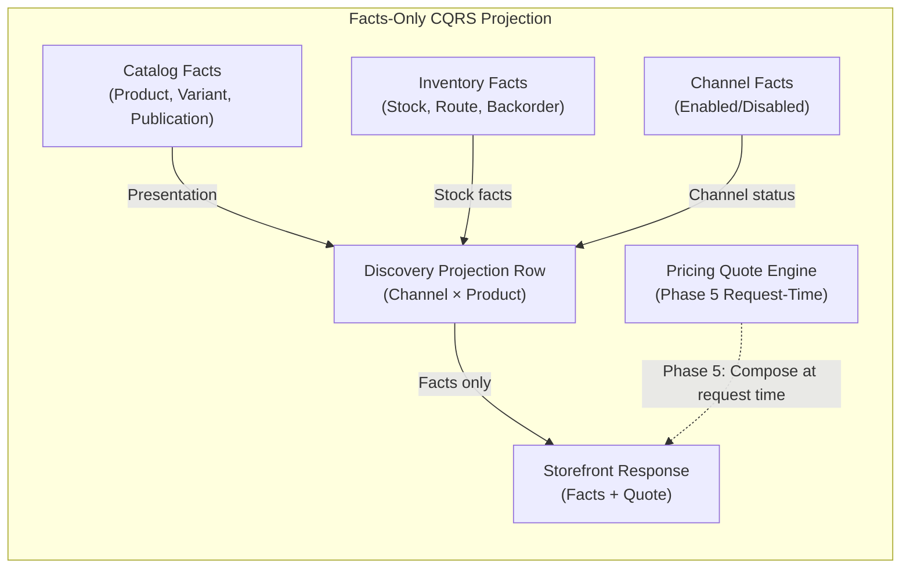
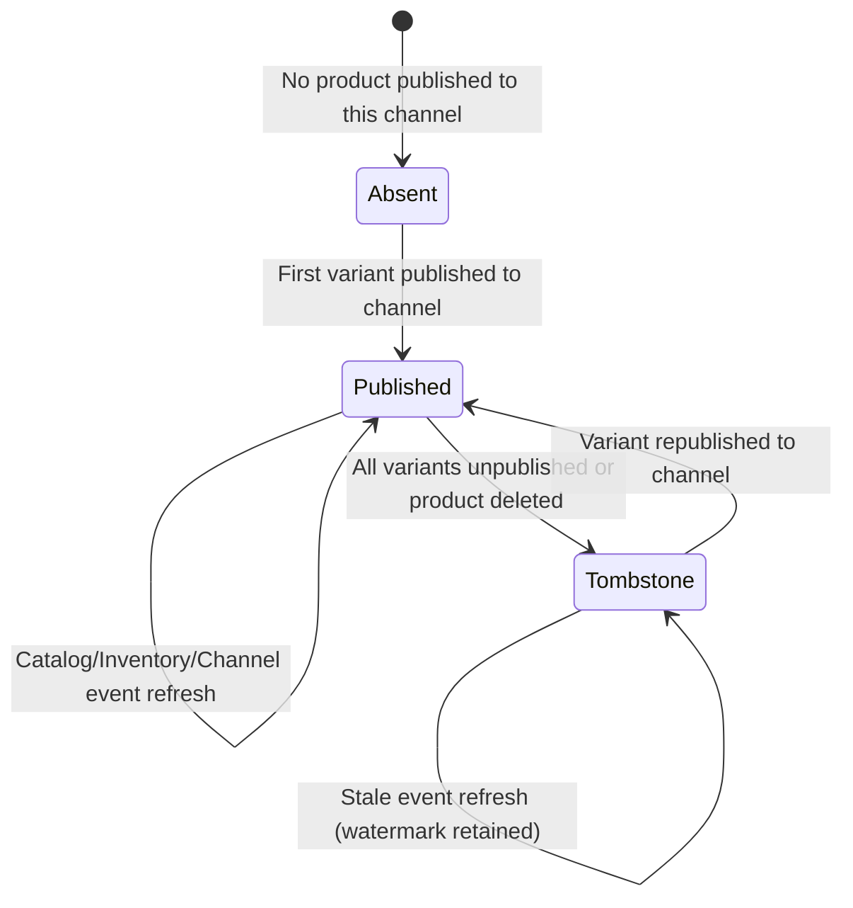
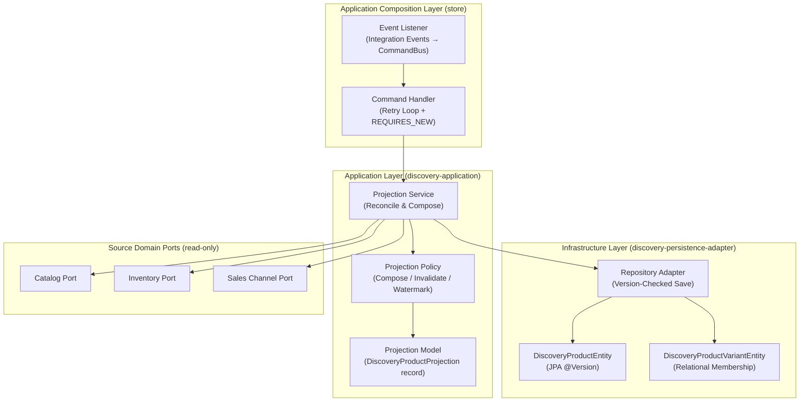
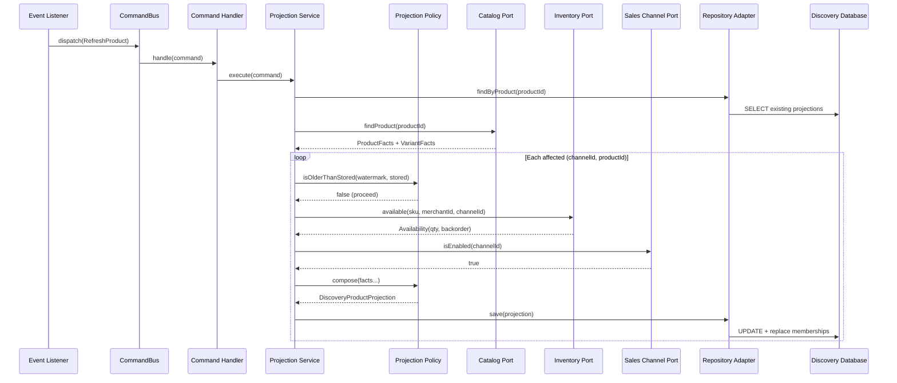
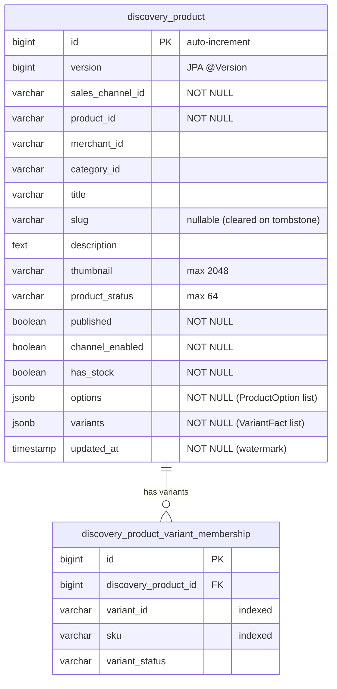

# Tech Specification: Discovery Facts-Only Projection

> **Summary:** Materializes currency-agnostic catalog and inventory facts per channel/product pair; pricing is composed at request time.
> **Classification:** Architectural Pattern / CQRS Read Model
> **Supporting Modules:** `discovery-application` / `discovery-persistence-adapter` / `store/storefrontquery`
> **Related Architecture ADRs:** [SSD-001 §Phrase 4](../../system-design/001-multi_regional_contextual_discovery_system_design.md)
> **Related Feature:** [feat_006 — Discovery Wiring, Projection Reconciliation & Rebuild](../../features/feat_006-discovery-wiring-projection-reconciliation.md)

---

## 1. Why We Need It

### The Problem

Coupling prices, currency codes, compare-at amounts, and regional buyability into materialized discovery projection rows causes **combinatorial write amplification** across price updates, exchange rate shifts, and market reconfigurations. In a multi-regional commerce platform with N channels × M products × P price tiers, every price rule change forces projection rewrites across the entire combinatorial surface. Storing prices directly in search documents leads to index thrashing and stale quotes that confuse storefront consumers.

### Technology Decision & Alternatives

| Technology Option | Decision | Evaluation Rationale |
| :--- | :--- | :--- |
| **Facts-Only Projection (Prices at Request Time)** | **Adopted** | Decouples the largest write-amplification source (pricing events) from projection refresh entirely. Pricing is resolved per-request via `PricingQuoteQuery.quoteBatch` in Phase 5, using the exact regional context of the shopper. |
| Pre-Computed Price Ranges in Projection | Rejected | Requires re-projecting every affected product whenever any price rule, exchange rate, or tier changes. The combinatorial surface (channels × products × currencies × price sets) makes freshness unreliable. |
| Denormalized Price Columns per Currency | Rejected | Violates bounded context separation; ties projection schema to the Pricing module's currency model. Adding a currency or market requires a schema migration. |
| Full Search Engine (Elasticsearch/OpenSearch) | Deferred | Appropriate for future full-text search with facets. Current JPA specification-based search is sufficient for Phase 4 volume, and the facts-only model is portable to an external index. |

### Key Benefits & Trade-offs

**Core Benefits:**
- Pricing events (rule changes, exchange rate updates, market configurations) do not trigger projection writes.
- Projection refresh frequency drops by at least one order of magnitude, since catalog and inventory events are far less frequent than pricing recalculations.
- The projection schema is stable across market expansions — adding a new currency or region requires zero migration.

**Known Trade-offs:**
- Phase 4 REST responses contain no price information. Consumers must understand the phased rollout boundary.
- Request-time pricing adds latency to Phase 5 storefront responses compared to pre-materialized prices.
- Storefront search cannot filter or sort by price until an external search index is introduced.

---

## 2. What It Is

### Core Concept

The Discovery Facts-Only Projection is a CQRS read model that stores one materialized row per `(sales_channel_id, product_id)` pair. Each row captures exclusively **catalog presentation facts** (title, slug, description, thumbnail, options, product status, publication membership) and **inventory stock facts** (available quantity, stock badge, backorder, inventory management) — never currency codes, monetary amounts, or commercial buyability.

### Internal Mechanics & Lifecycle

> Visual lifecycle of a single projection row.

---

## 3. How We Use It in This System

### Architecture & Layer Stacking

### Component Responsibilities

| Architectural Role | Layer Location | Responsibility |
| :--- | :--- | :--- |
| `Projection Service` | `discovery-application` | Resolves affected pairs, re-reads authoritative facts from source ports, delegates to policy for composition, calls repository to persist. |
| `Projection Policy` | `discovery-application` | Pure logic: composes a complete projection record from facts, detects tombstone state, applies watermark comparison. No DI, no side effects. |
| `Projection Model` | `discovery-application` | Immutable Java `record` carrying all facts plus `NEW_PROJECTION_VERSION` sentinel constant (`-1L`). |
| `Repository Adapter` | `discovery-persistence-adapter` | Translates projection records to/from JPA entities, checks version expectations, performs atomic variant membership replacement. |

### Runtime Flow

> Refresh triggered by a catalog presentation change.

---

## 4. Technical Specification & Contracts

Normative specification. An implementation is compliant only when all MUST / MUST NOT statements are satisfied.

### Normative Rules

- **R-01:** The projection row **MUST** store solely currency-agnostic catalog presentation and inventory facts per `(sales_channel_id, product_id)` pair: channel, product, merchant, and category identifiers; product title, slug, description, thumbnail, options, and status; publication membership; channel status; derived stock badge; update watermark; and optimistic-lock version.
- **R-02:** Variant JSON facts **MUST** include variant ID, SKU, title, status, option values, available quantity, inventory management, backorder configuration, and factual stock state.
- **R-03:** The discovery projection and its queries **MUST NOT** persist, request, or return currency codes, monetary amounts, compare-at prices, price ranges, or commercial buyability.
- **R-04:** Description selection **MUST** deterministically choose the first nonblank description ordered by ID. Thumbnail selection **MUST** choose the first usable media URL ordered by rank then ID.
- **R-05:** Inventory quantity **MUST** sum eligible, non-negative quantities from active locations routed to the channel. Untracked variants (`manageInventory = false`) **MUST** report zero available quantity without fabricating stock.
- **R-06:** Publication membership **MUST** be retained even when a variant is inactive; query visibility **MUST** separately require at least one ACTIVE published variant.

### Storage & Data Contract

### Configuration Knobs

| Binding / constant | Implemented default | Unit / format | Description |
| :--- | :--- | :--- | :--- |
| `DiscoveryProductProjection.NEW_PROJECTION_VERSION` | `-1L` | Constant (long) | Sentinel denoting expected absence on first insert; independent of JPA `@Version` starting at `0`. |
| `DiscoveryProductEntity.@Version` | JPA auto-managed (starts `0`) | Auto-increment | Optimistic lock version maintained by Hibernate; incremented on every flush. |

Implementation references: [`DiscoveryProductProjection`](../../discovery-application/src/main/java/com/grab/discovery/application/model/projection/DiscoveryProductProjection.java), [`DiscoveryProjectionPolicy`](../../discovery-application/src/main/java/com/grab/discovery/application/policy/DiscoveryProjectionPolicy.java), [`DiscoveryProductEntity`](../../discovery-persistence-adapter/src/main/java/com/grab/discovery/adapter/persistence/entity/DiscoveryProductEntity.java).
