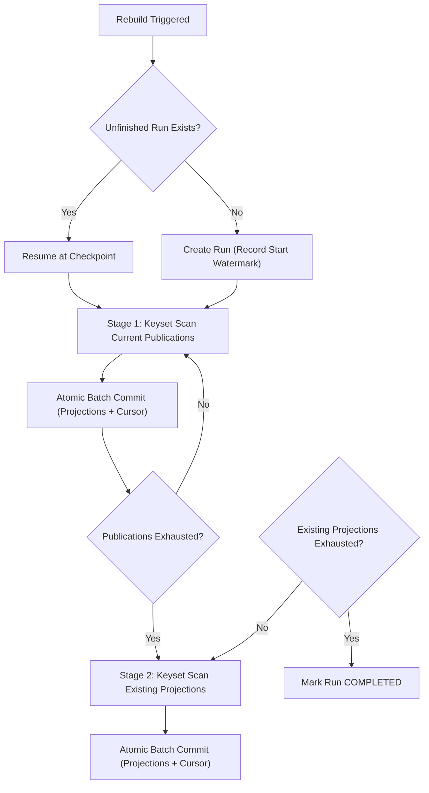
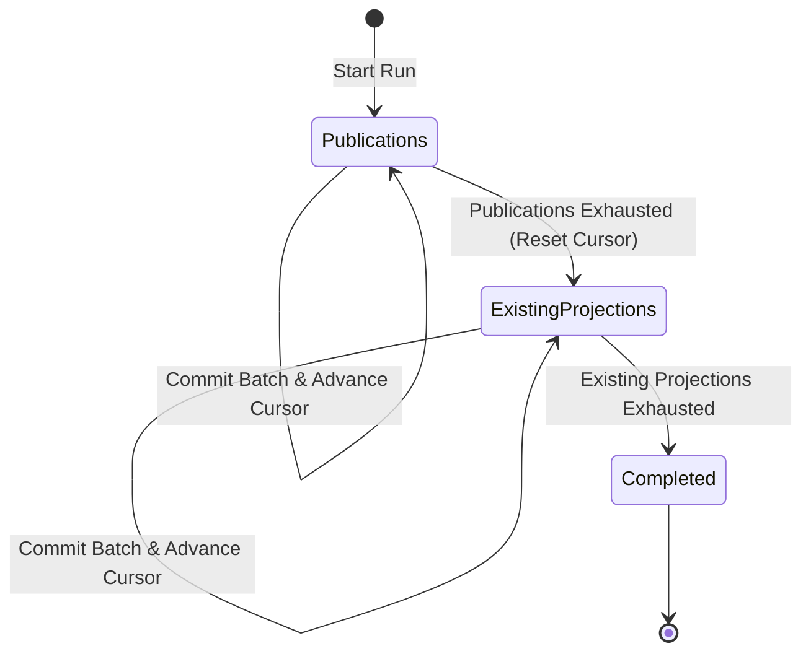
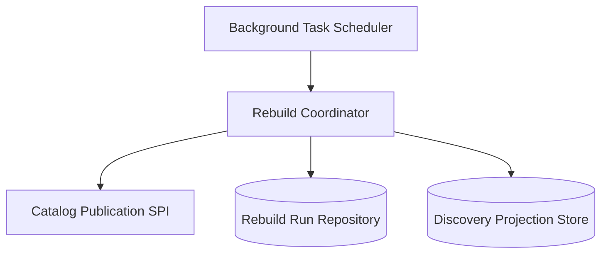
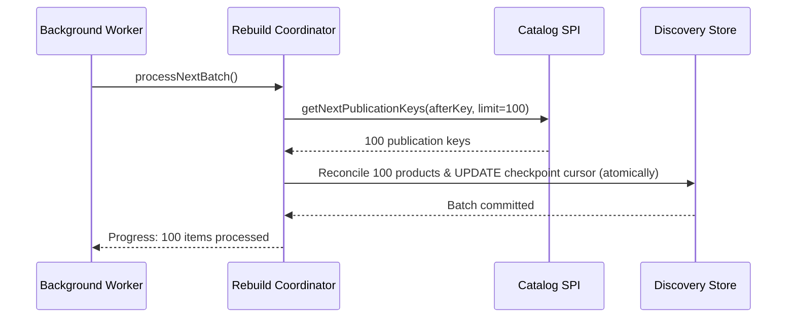

# Tech Spec: Discovery Rebuild Coordinator

- **Summary:** Rebuilds factual discovery projections in two bounded stages using durable database checkpoints and run-start watermark protection for newer live updates.
- **Type:** Infrastructure
- **Feature Spec:** [Discovery Wiring & Projection Reconciliation](../../features/feat_006-discovery-wiring-projection-reconciliation.md)

---

## 1. Problem & Decision

### What breaks without this?

Attempting to rebuild search projections in a single monolithic transaction causes out-of-memory errors, database timeout aborts, and blocks application readiness. Furthermore, an uncoordinated rebuild can overwrite live event updates with stale catalog facts, while failure restarts force the system to repeat all previously completed work.

### Decision

| Option | Decision | Why |
|:-------|:---------|:----|
| **Two-Stage Checkpointed Keyset Rebuild** | Adopted | Bounded keyset batches commit atomically with progress checkpoints, allowing safe resumption after interruption and preventing lock exhaustion. |
| Monolithic Full-Table Transaction | Rejected | High memory footprint, transaction timeout failures, and inability to resume upon partial failures. |
| Offset/Limit Pagination Scanning | Rejected | Concurrent database insertions shift offsets, leading to skipped rows or duplicate processing. |

### Trade-offs

| Benefits | Trade-offs |
|:-----------|:-------------|
| Resumable after crashes or server restarts from the exact last committed cursor | Rebuild runs progress sequentially; only one active run can execute at a time |
| Run-start watermark ensures live updates occurring during rebuild are never regressed | Completed run history and tombstones consume table space until purged |

---

## 2. How It Works

### Core Concept

The rebuild process executes across two distinct stages: Stage 1 (`PUBLICATIONS`) scans current catalog publications via keyset pagination to rebuild active product documents. Stage 2 (`EXISTING_PROJECTIONS`) scans local projection records to tombstone products that are no longer published. Every batch (default 100 items) commits its projection changes and cursor checkpoint in a single atomic transaction.

### How It Works Step by Step

| Step | What Happens | Why |
|:-----|:-------------|:----|
| 1 | Operator or scheduled job triggers rebuild | Opt-in background execution |
| 2 | System creates new run capturing run-start timestamp as watermark, or resumes pending run | Protects against overwriting live updates |
| 3 | Fetches next batch of distinct publication pairs ordered by `(channel_id, product_id)` | Predictable keyset pagination without offset drift |
| 4 | Reconciles projection documents and commits batch with checkpoint cursor atomically | Progress is durably saved every 100 items |
| 5 | When Stage 1 completes, resets cursor and initiates Stage 2 | Prepares to find orphaned or unpublished projections |
| 6 | Scans stored projections, re-checking current publication, and writes tombstones | Cleans up stale products |
| 7 | Marks run status as `COMPLETED` upon exhausting Stage 2 | Concludes execution and stores final counts |

### Lifecycle

---

## 3. How We Use It

### Where It Fits in Our System

### Component Responsibilities

| Component | Role | What It Does |
|:----------|:-----|:-------------|
| Rebuild Coordinator | Background Coordinator | Manages stages, iterates through keyset pages, and coordinates batch transactions. |
| Checkpoint Repository | Persistence SPI | Persists run metadata, stage status, composite cursor keys, and processed counts. |
| Catalog Publication SPI | External Port | Streams published channel/product key pairs ordered by identity. |

### Runtime Flow

---

## 4. Implementation Rules

| Rule | Requirement |
|:-----|:------------|
| **R-01** | Startup rebuild **MUST** be opt-in and disabled by default; enabled startup processing **MUST** run asynchronously on managed background threads. |
| **R-02** | Batch size **MUST** be positive and default to 100 pairs; non-positive configuration **MUST** be rejected. |
| **R-03** | Only one unfinished run **MUST** progress at a time, and subsequent invocations **MUST** resume it rather than create competing runs. |
| **R-04** | Every batch **MUST** commit its projection writes and checkpoint atomically, including stage, cursor key, processed count, invalidated count, and run version. |
| **R-05** | A failed batch **MUST** roll back both work and checkpoint cursor advancement; the next invocation **MUST** resume the last committed cursor. |
| **R-06** | Every reconciled pair **MUST** use the run-start watermark so projections updated by newer live events **MUST NOT** be overwritten. |
| **R-07** | `PUBLICATIONS` **MUST** enumerate current publication pairs in stable key order; exhaustion **MUST** reset the cursor before `EXISTING_PROJECTIONS` begins. |
| **R-08** | Existing projections **MUST** be refreshed or tombstoned only after current publication status is rechecked. |
| **R-09** | `COMPLETED` run metadata and tombstones **MUST** be retained for audit; the coordinator **MUST NOT** delete them. |
| **R-10** | Application startup **MUST NOT** block waiting for rebuild completion; the next batch **MUST** begin only after the previous batch commits. |
