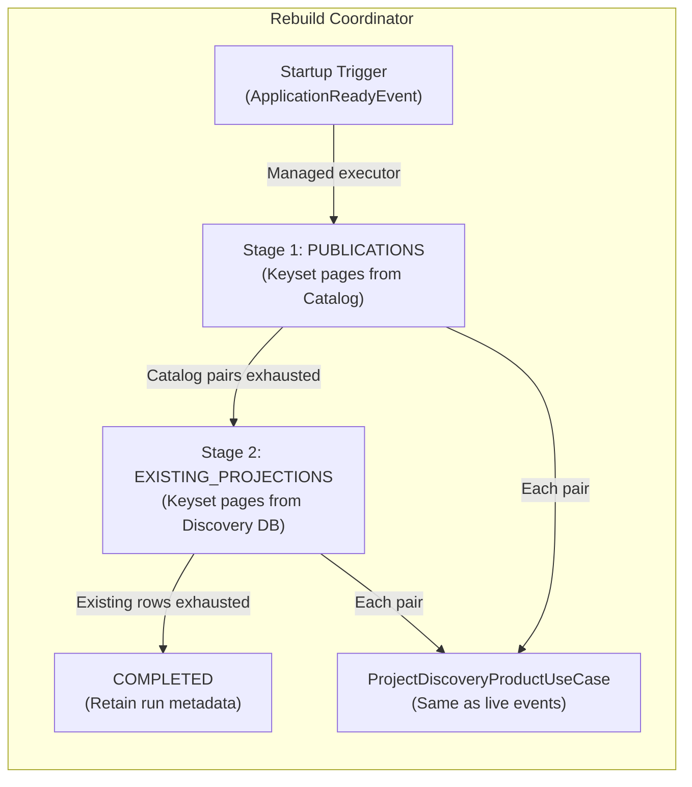
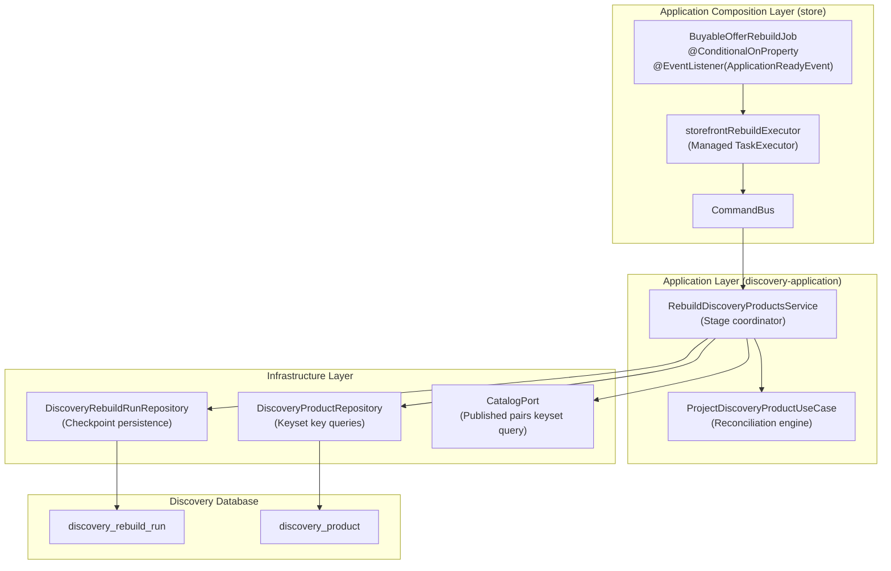
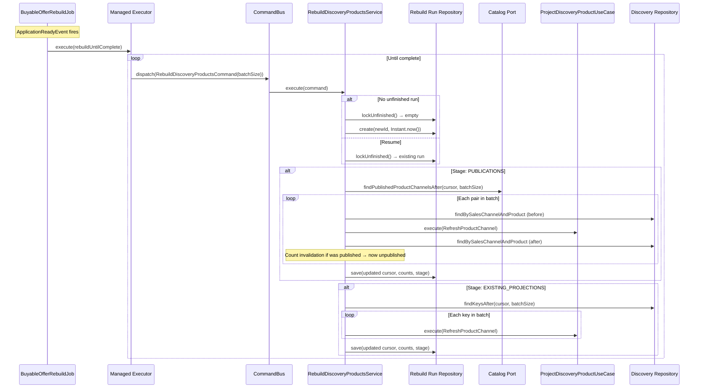
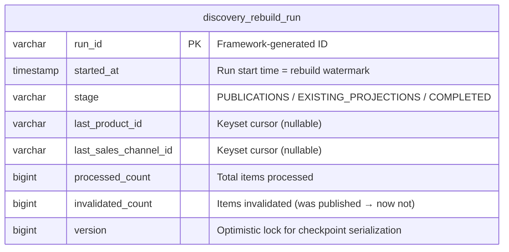

# Tech Specification: Discovery Rebuild Coordinator

> **Summary:** Durable two-stage keyset-paginated rebuild that checkpoints progress atomically and resumes across restarts without dropping live updates.
> **Classification:** Platform Infrastructure / Background Processing
> **Supporting Modules:** `discovery-application` / `store/storefrontquery`
> **Related Architecture ADRs:** [SSD-001 §Phrase 4](../../system-design/001-multi_regional_contextual_discovery_system_design.md)
> **Related Feature:** [feat_006 — Discovery Wiring, Projection Reconciliation & Rebuild](../../features/feat_006-discovery-wiring-projection-reconciliation.md)

---

## 1. Why We Need It

### The Problem

After a schema migration, data model change, or operational incident, all discovery projections may need to be rebuilt from authoritative source data. A naive rebuild that processes every record in one transaction would lock the database, timeout, and drop concurrent live event updates. OFFSET-based pagination degrades as pages advance. Uncoordinated rebuilds that run alongside live events either block application startup or produce inconsistent projections where rebuild values overwrite newer event-driven updates.

### Technology Decision & Alternatives

| Technology Option | Decision | Evaluation Rationale |
| :--- | :--- | :--- |
| **Keyset-Paginated Checkpointed Rebuild** | **Adopted** | Pages through records by composite cursor `(productId, salesChannelId)` — no OFFSET degradation. Each batch commits its projection writes and checkpoint atomically. Resume from checkpoint on restart. Run-start watermark protects live event updates. |
| Single-Transaction Full Rebuild | Rejected | Timeout risk; blocks live event processing for the entire rebuild duration; no resumability. |
| OFFSET-Based Batch Rebuild | Rejected | OFFSET degrades linearly; inserting/deleting rows during rebuild shifts pages and causes duplicates or gaps. |
| External Job Scheduler (e.g., Spring Batch) | Deferred | Adds external infrastructure dependency; the rebuild is infrequent and small enough for an in-process coordinator. |
| Parallel Multi-Threaded Rebuild | Deferred | Current catalog volume does not justify parallel processing; single-threaded with bounded batches meets latency requirements. |

### Key Benefits & Trade-offs

**Core Benefits:**
- Restart-safe: an unfinished run resumes from the last committed cursor without reprocessing earlier batches.
- Non-blocking: runs on a managed `TaskExecutor` after `ApplicationReadyEvent`, does not delay application readiness.
- Live-event-safe: the run-start watermark prevents the rebuild from overwriting projections that were updated by a live event after the rebuild started.

**Known Trade-offs:**
- Only one unfinished run is allowed at a time; concurrent rebuild requests are rejected.
- The rebuild runs single-threaded; large catalogs take longer to converge.
- Completed runs and tombstone rows are retained indefinitely — no automatic cleanup mechanism.

---

## 2. What It Is

### Core Concept

The rebuild coordinator processes the full discovery dataset in two sequential stages, each using stable keyset pagination. It delegates every individual product/channel pair to the same `ProjectDiscoveryProductUseCase` used by live events, ensuring identical reconciliation logic. Progress is checkpointed atomically with each batch, and a start-time watermark prevents the rebuild from regressing projections that live events have already advanced.



### Internal Mechanics & Lifecycle

> Lifecycle of a single rebuild run.

```mermaid
stateDiagram-v2
    [*] --> PUBLICATIONS : Start new run or resume unfinished
    PUBLICATIONS --> PUBLICATIONS : Batch processed, more catalog pages
    PUBLICATIONS --> EXISTING_PROJECTIONS : Catalog pages exhausted, reset cursor
    EXISTING_PROJECTIONS --> EXISTING_PROJECTIONS : Batch processed, more rows
    EXISTING_PROJECTIONS --> COMPLETED : Existing rows exhausted
    COMPLETED --> [*] : Run metadata retained for audit

    note right of PUBLICATIONS: Keyset: CatalogPort.findPublishedProductChannelsAfter()
    note right of EXISTING_PROJECTIONS: Keyset: DiscoveryProductRepository.findKeysAfter()
```

---

## 3. How We Use It in This System

### Architecture & Layer Stacking



### Component Responsibilities

| Architectural Role | Layer Location | Responsibility |
| :--- | :--- | :--- |
| `BuyableOfferRebuildJob` | `store/storefrontquery` | Opt-in startup trigger. Submits rebuild work to managed executor. Loops `dispatch(RebuildDiscoveryProductsCommand)` until `progress.complete()`. |
| `RebuildDiscoveryProductsService` | `discovery-application` | Orchestrates stages. Locks or creates a run. Pages through catalog or existing projections. Delegates each pair to `ProjectDiscoveryProductUseCase`. Updates checkpoint and stage transitions. |
| `DiscoveryRebuildRunRepository` | `discovery-application` (port) | Persists run state: `lockUnfinished()` for resumption, `create()` for new runs, `save()` for checkpoint updates. |
| `ProjectDiscoveryProductUseCase` | `discovery-application` | The same reconciliation engine used by live events. The rebuild passes `RefreshProductChannel(productId, salesChannelId, run.startedAt)` — the run start time as the watermark. |

### Runtime Flow

> Rebuild startup and batch processing.



---

## 4. Technical Specification & Contracts

Normative specification. An implementation is compliant only when all MUST / MUST NOT statements are satisfied.

### Normative Rules

- **R-01:** The rebuild feature **MUST** be opt-in. It **MUST NOT** run unless `storefrontquery.rebuild.on-startup=true` is explicitly configured.
- **R-02:** The batch size **MUST** be positive. A non-positive value **MUST** throw `IllegalArgumentException`.
- **R-03:** Only one unfinished run **MUST** be allowed at a time. `lockUnfinished()` **MUST** return the existing incomplete run for resumption.
- **R-04:** Each batch **MUST** commit its projection writes and checkpoint (cursor, counts, stage) atomically in one transaction.
- **R-05:** A failed batch **MUST** roll back both projection writes and checkpoint advancement. The next invocation **MUST** resume from the last committed cursor.
- **R-06:** The run-start watermark (`startedAt`) **MUST** be passed as the `occurredAt` for each `RefreshProductChannel` command. The watermark guard in `ProjectDiscoveryProductService` **MUST** prevent the rebuild from overwriting projections updated by live events that occurred after the run started.
- **R-07:** When transitioning from `PUBLICATIONS` to `EXISTING_PROJECTIONS`, the cursor **MUST** be reset to `null` to start the second stage from the beginning of the discovery product table.
- **R-08:** The `EXISTING_PROJECTIONS` stage **MUST** recheck current publication status before invalidating stale rows. This is handled by the projection use case's `invalidateIfUnpublished()` method.
- **R-09:** Completed runs and tombstone rows **MUST** be retained. The rebuild coordinator **MUST NOT** delete run metadata or invalidated projection rows.
- **R-10:** The startup coordinator **MUST** execute on a managed `TaskExecutor` and **MUST NOT** block application readiness.

### Storage & Data Contract



### Configuration Knobs

| Binding / constant | Implemented default | Unit / format | Description |
| :--- | :--- | :--- | :--- |
| `storefrontquery.rebuild.on-startup` | `false` | Boolean | Opt-in flag; the rebuild job bean is not created unless `true`. |
| `storefrontquery.rebuild.batch-size` | `100` | Positive integer | Number of product/channel pairs processed per batch command. |
| `storefrontRebuildExecutor` | Managed `TaskExecutor` bean | Spring bean qualifier | The executor on which the rebuild loop runs. Configured externally. |

Implementation references: [`BuyableOfferRebuildJob`](../../store/src/main/java/com/grab/store/storefrontquery/internal/projection/BuyableOfferRebuildJob.java), [`RebuildDiscoveryProductsService`](../../discovery-application/src/main/java/com/grab/discovery/application/service/RebuildDiscoveryProductsService.java), [`DiscoveryRebuildRun`](../../discovery-application/src/main/java/com/grab/discovery/application/model/write/DiscoveryRebuildRun.java), [`DiscoveryRebuildRunRepository`](../../discovery-application/src/main/java/com/grab/discovery/application/port/outbound/DiscoveryRebuildRunRepository.java).
