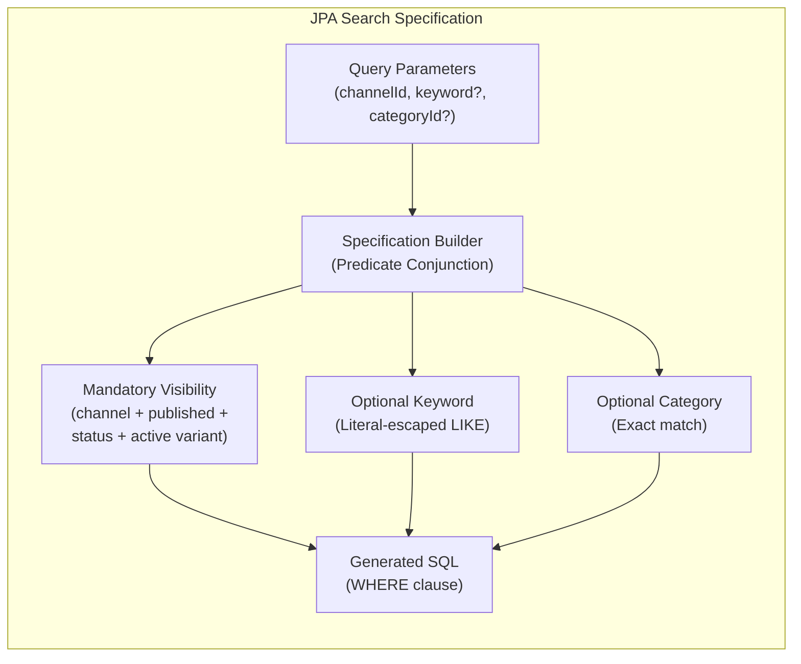
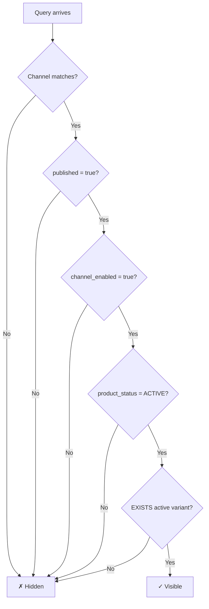
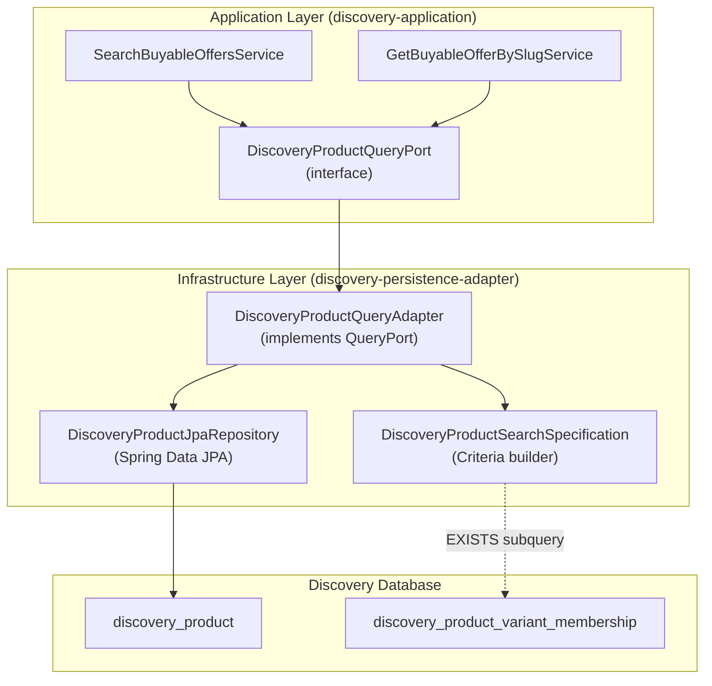
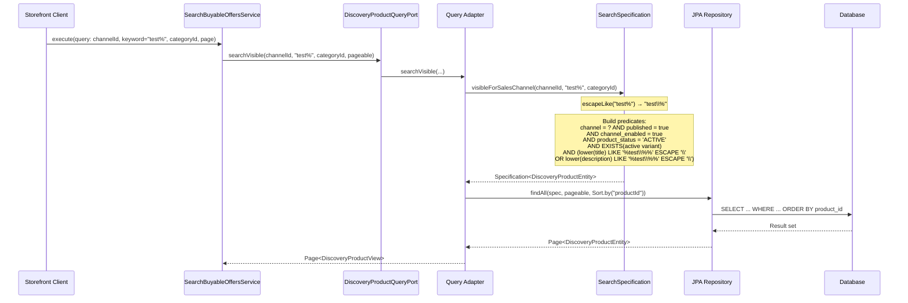
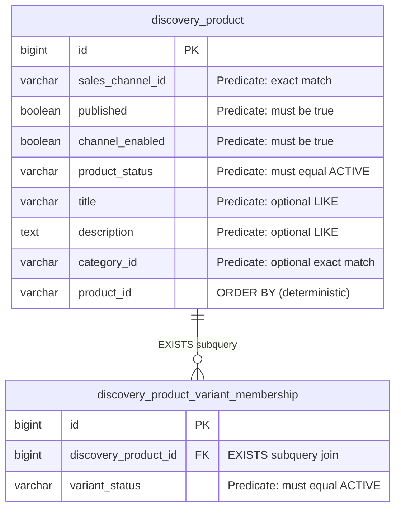

# Tech Specification: Discovery Search Specification & Visibility

> **Summary:** JPA Criteria specification enforcing channel-scoped visibility, literal keyword matching, and deterministic ordering for storefront queries.
> **Classification:** Architectural Pattern / Query Specification
> **Supporting Modules:** `discovery-application` / `discovery-persistence-adapter`
> **Related Architecture ADRs:** [SSD-001 §Phrase 4](../../system-design/001-multi_regional_contextual_discovery_system_design.md)
> **Related Feature:** [feat_006 — Discovery Wiring, Projection Reconciliation & Rebuild](../../features/feat_006-discovery-wiring-projection-reconciliation.md)

---

## 1. Why We Need It

### The Problem

Storefront browse and product detail queries must enforce consistent visibility rules across all access paths. Without a shared specification, each query method reimplements channel isolation, publication checks, status filtering, and active-variant existence checks — introducing divergence risk. SQL `LIKE` queries with user-provided search terms are vulnerable to wildcard injection (`%`, `_`) that causes unintended pattern matching and potential performance degradation through full table scans.

### Technology Decision & Alternatives

| Technology Option | Decision | Evaluation Rationale |
| :--- | :--- | :--- |
| **Injected JPA Criteria Specification** | **Adopted** | Composable predicates shared across search and detail queries. Type-safe via `CriteriaBuilder`. Literal escape prevents wildcard injection. Specification instance is injected, enabling testability. |
| Inline JPQL / Native SQL | Rejected | Harder to compose, test, and reuse visibility predicates across multiple query methods. Escape logic must be manually inlined. |
| Spring Data Derived Query Methods | Rejected | Cannot express `EXISTS` subquery for active variant check; cannot compose optional keyword and category predicates. |
| External Search Engine (Elasticsearch) | Deferred | Appropriate for future full-text search with facets, stemming, and relevance scoring. Phase 4 volume is served by JPA specification on indexed columns. |

### Key Benefits & Trade-offs

**Core Benefits:**
- A single specification class enforces all visibility invariants for both search and detail paths.
- Wildcard characters `%`, `_`, and `\` in user input are escaped to literal characters, preventing pattern injection.
- The specification is a plain Java class with no Spring DI — fully unit-testable.

**Known Trade-offs:**
- JPA Criteria specifications produce SQL at runtime; complex specifications can generate suboptimal queries on some databases.
- `LIKE` with leading wildcard (`%keyword%`) prevents index-only scans on title/description; full-text search index would be needed for high-volume keyword search.
- Case-insensitive matching via `cb.lower()` requires function evaluation per row; a functional index (`lower(title)`) would improve performance but is not part of the V1 migration.

---

## 2. What It Is

### Core Concept

The Discovery Search Specification is a JPA Criteria API `Specification<DiscoveryProductEntity>` that builds a conjunction of mandatory visibility predicates and optional filter predicates. It is injected into query adapter methods and composed with Spring Data's `findAll(Specification, Pageable)`.

### Internal Mechanics & Lifecycle

> Decision tree for visibility evaluation.

---

## 3. How We Use It in This System

### Architecture & Layer Stacking

### Component Responsibilities

| Architectural Role | Layer Location | Responsibility |
| :--- | :--- | :--- |
| `SearchBuyableOffersService` | `discovery-application` | Delegates to `DiscoveryProductQueryPort.searchVisible()` with channel, keyword, category, and pageable. Returns `Page<DiscoveryProductView>`. |
| `GetBuyableOfferBySlugService` | `discovery-application` | Delegates to `DiscoveryProductQueryPort.findVisibleBySlug()`. Returns single `DiscoveryProductView` or throws `OfferNotFound`. |
| `DiscoveryProductQueryPort` | `discovery-application` (interface) | Outbound port defining `searchVisible()` and `findVisibleBySlug()` methods. |
| `DiscoveryProductSearchSpecification` | `discovery-persistence-adapter` | Builds JPA Criteria predicates: channel match, published, channel enabled, product active, active variant EXISTS subquery, optional literal-escaped keyword, optional exact category. |
| `DiscoveryProductQueryAdapter` | `discovery-persistence-adapter` | Implements `DiscoveryProductQueryPort`. Calls `searchSpec.visibleForSalesChannel()` to build the specification. Passes to Spring Data JPA repository. |

### Runtime Flow

> Search query with keyword and category filter.

---

## 4. Technical Specification & Contracts

Normative specification. An implementation is compliant only when all MUST / MUST NOT statements are satisfied.

### Normative Rules

- **R-01:** All storefront discovery queries **MUST** apply the full visibility predicate: channel match AND `published = true` AND `channel_enabled = true` AND `product_status = 'ACTIVE'` AND at least one variant with `variant_status = 'ACTIVE'` exists in `discovery_product_variant_membership`.
- **R-02:** Stock levels **MUST NOT** affect visibility. Sold-out and depleted products **MUST** remain visible on both search and PDP.
- **R-03:** Keyword matching **MUST** be case-insensitive and **MUST** treat `%`, `_`, and `\` as literal characters. The escape character **MUST** be `\` (SQL `ESCAPE '\'` clause).
- **R-04:** The escape function **MUST** process characters in the order: `\` → `\\`, then `%` → `\%`, then `_` → `\_`. Processing `\` first prevents double-escaping.
- **R-05:** Category filtering, when present, **MUST** use exact match on `categoryId`. It **MUST NOT** perform hierarchical category expansion.
- **R-06:** Search results **MUST** be ordered deterministically by `productId`. Pageable parameters from the caller **MUST** be respected for page size and offset.
- **R-07:** PDP lookup for an invisible or non-existent product **MUST** throw `StorefrontQueryServiceException` with error type `OfferNotFound`, which maps to HTTP `404`.

### Storage & Data Contract

The specification queries two tables:

### Indexes Supporting the Specification

| Index | Columns | Purpose |
| :--- | :--- | :--- |
| `uq_discovery_product_channel_product` | `(sales_channel_id, product_id)` | Channel isolation + deterministic ordering |
| `idx_discovery_product_channel_published` | `(sales_channel_id, published)` | Visibility filtering |
| `idx_discovery_product_slug` | `(sales_channel_id, slug)` | PDP slug lookup |
| Variant membership FK index | `(discovery_product_id)` | EXISTS subquery join |

### Configuration Knobs

| Binding / constant | Implemented default | Unit / format | Description |
| :--- | :--- | :--- | :--- |
| `ACTIVE_STATUS` | `"ACTIVE"` | Fixed constant (String) | The product and variant status value required for visibility. |
| Escape character | `\\` (backslash) | Fixed in `cb.like(..., '\\')` | SQL `LIKE` escape character for literal matching. |
| Default sort | `productId` ascending | Applied by query adapter | Deterministic ordering for stable pagination. |

Implementation references: [`DiscoveryProductSearchSpecification`](../../discovery-persistence-adapter/src/main/java/com/grab/discovery/adapter/persistence/specification/jpa/DiscoveryProductSearchSpecification.java), [`SearchBuyableOffersService`](../../discovery-application/src/main/java/com/grab/discovery/application/service/SearchBuyableOffersService.java), [`GetBuyableOfferBySlugService`](../../discovery-application/src/main/java/com/grab/discovery/application/service/GetBuyableOfferBySlugService.java), [`DiscoveryProductQueryPort`](../../discovery-application/src/main/java/com/grab/discovery/application/port/outbound/DiscoveryProductQueryPort.java).
