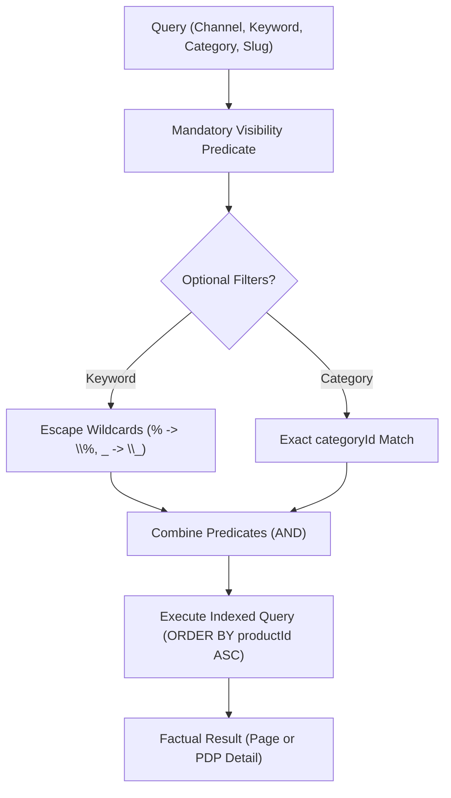
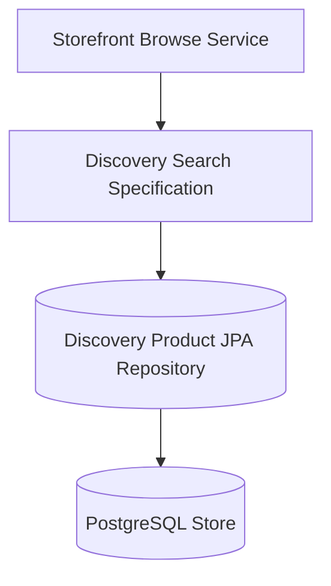
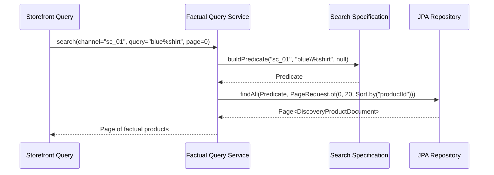

# Tech Spec: Discovery Search Specification & Visibility

- **Summary:** Enforces a unified channel-scoped visibility predicate and literal search contract across catalog browse and product detail lookups.
- **Type:** Architecture Pattern
- **Feature Spec:** [Discovery Wiring & Projection Reconciliation](../../features/feat_006-discovery-wiring-projection-reconciliation.md)

---

## 1. Problem & Decision

### What breaks without this?

If browse and product detail endpoints evaluate visibility independently, products can appear in search listings while returning 404 on their detail pages (or vice versa). Furthermore, naive SQL `LIKE` queries allow wildcard characters (`%`, `_`) in user search strings to broaden searches unpredictably or cause full-table scan resource exhaustion.

### Decision

| Option | Decision | Why |
|:-------|:---------|:----|
| **Shared Composed Specification Predicates** | Adopted | Ensures browse collection and slug detail endpoints execute identical visibility rules and safe literal keyword matching. |
| Independent Queries Per Endpoint | Rejected | Introduces behavioral divergence where browse lists products that PDP lookups reject. |
| External Full-Text Search Engine (Elasticsearch) | Deferred | Unnecessary operational overhead for current literal keyword and exact category matching requirements. |

### Trade-offs

| Benefits | Trade-offs |
|:-----------|:-------------|
| Consistent product visibility: depleted inventory never hides a valid product | Substring `LIKE` queries can be slower on massive text volumes compared to inverted indexes |
| Predictable literal keyword searching with automatic wildcard escaping | Deterministic `productId` sorting does not provide relevance ranking |

---

## 2. How It Works

### Core Concept

The search specification combines mandatory channel visibility predicates (`salesChannelId` match, `channelStatus == ENABLED`, `parentStatus == ACTIVE`, `hasActiveVariant == true`) with optional search filters (escaped literal keyword, exact `categoryId`). The predicate is applied identically to collection queries and slug PDP lookups.

### How It Works Step by Step

| Step | What Happens | Why |
|:-----|:-------------|:----|
| 1 | Query layer receives search criteria: channel ID, optional keyword, category, page | Ingests request parameters |
| 2 | Builds base predicate: matching channel ID, enabled status, active parent, published active variant | Enforces core visibility rules |
| 3 | Escapes wildcard characters in keyword: backslashes first, then `%` and `_` | Prevents wildcard SQL injection / query expansion |
| 4 | Combines predicates and appends deterministic `ORDER BY product_id ASC` | Guarantees stable pagination |
| 5 | Executes query against local `discovery_product` and variant tables | Returns presentation facts without pricing |
| 6 | If detail lookup finds no visible product, returns HTTP 404 `OfferNotFound` | Fails closed for unpublished items |

---

## 3. How We Use It

### Where It Fits in Our System

### Component Responsibilities

| Component | Role | What It Does |
|:----------|:-----|:-------------|
| Discovery Search Specification | Specification Builder | Builds dynamic Spring Data JPA `Specification<DiscoveryProductDocument>` predicates. |
| Factual Query Service | Application Service | Executes paged search and slug lookups using the compiled specification. |
| Discovery JPA Repository | Persistence SPI | Executes SQL queries with pagination, joins, and deterministic sorting. |

### Runtime Flow

---

## 4. Implementation Rules

| Rule | Requirement |
|:-----|:------------|
| **R-01** | Search and detail **MUST** require matching channel ID, publication state, enabled channel, active parent product, and at least one active published variant. |
| **R-02** | Stock quantities and regional prices **MUST NOT** affect factual visibility; sold-out and unpriced products **MUST** remain eligible for display. |
| **R-03** | Keyword matching against title and description **MUST** be case-insensitive and treat `%`, `_`, and backslash `\` as literal characters. |
| **R-04** | Literal matching **MUST** escape backslash before percent and underscore using backslash as the escape character so introduced escapes are not escaped twice. |
| **R-05** | Category filtering **MUST** match exact category identity and **MUST NOT** implicitly expand descendants. |
| **R-06** | Query results **MUST** order by product identity ascending (`productId ASC`) and respect requested page size and offset limits. |
| **R-07** | A missing, deleted, or invisible detail product **MUST** yield 404 `OfferNotFound`; an empty collection query **MUST** return a successful HTTP 200 empty page. |
| **R-08** | Queries **MUST** execute against local factual projections and **MUST NOT** load transactional write aggregates or execute native SQL queries. |
