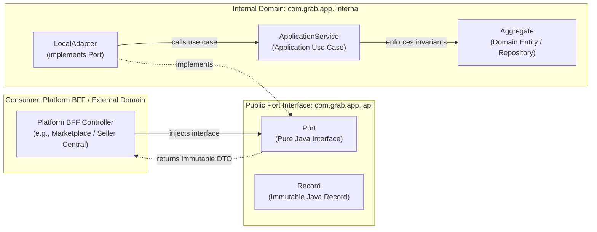
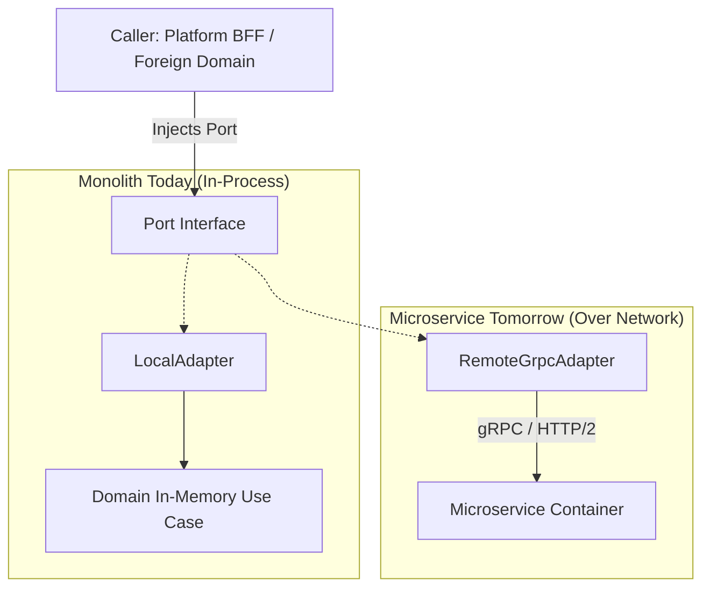

# Tech Spec: Domain Contract Ports & Swappable Adapters Pattern

- **Summary:** Defines the platform-wide Hexagonal Architecture port interfaces (`*QueryPort`, `*CommandPort`), immutable DTO record contracts, local in-process adapter wiring, and remote extraction seams for all ecommerce domain modules.
- **Type:** Architecture Pattern
- **Feature Spec:** [Four Core Domains Swappable Contract Ports](../../features/feat_011-four-core-domains-contract-ports.md)

---

## 1. Problem & Decision

### What breaks without this?

When modular monolithic applications grow, cross-domain dependencies quickly proliferate: platform controllers inject internal domain services, checkout logic queries product repositories directly, and order processing reads customer entities across module boundaries. 

This tight coupling causes severe architectural degradation:
- **ORM Session Leaks**: Entity graphs traversed outside transactional boundaries trigger `LazyInitializationException` runtime failures.
- **Bypassed Domain Invariants**: Direct repository or entity manipulation circumvents business validation and state machine lifecycle checks.
- **Circular Dependencies**: Modules become tangled, preventing isolated unit testing and clean modular compilation.
- **Prohibitive Microservice Migration Cost**: If extracting a domain requires refactoring dozens of calling controllers and updating client code, microservice extraction becomes a risky, multi-month rewrite.

### Decision

| Option | Decision | Why |
|:-------|:---------|:----|
| **General Hexagonal Ports & Immutable DTO Records (`api` vs `internal`)** | Adopted | Standardizes a uniform contract for **all domains** (existing core domains and future additions like promotions, shipping, loyalty). Binds consumers strictly to Java interface ports returning immutable `record` DTOs. In the monolith, local adapters invoke domain use cases in-process; when extracted, the local adapter is swapped for a remote gRPC/REST client with **zero changes** to consumer code. |
| Direct Spring Bean / Application Service Injection | Rejected | Couples calling code directly to internal domain classes, prevents independent compilation, and leaks ORM entity graphs. |
| Immediate gRPC/REST Microservices | Rejected | Incurs network latency, distributed transaction complexity, and DevOps sprawl before business scale demands it. |

### Trade-offs

| Benefits | Trade-offs |
|:-----------|:-------------|
| 100% extractable domain boundaries verified at compile time and test time across all domains. | Requires maintaining DTO record mappings between internal domain entities and public port contracts. |
| Zero `LazyInitializationException` errors because DTO records contain flat, eagerly populated, immutable values. | Developers cannot execute ad-hoc cross-domain database joins in Java. |
| Enables parallel development between frontend BFF teams and backend domain teams based on stable interface contracts. | Requires writing local in-process adapters for each port interface. |
| Future domains (e.g., `promotions`, `fulfillment`, `reviews`) follow the exact same proven pattern. | |

---

## 2. How It Works

### Core Concept

Every domain in the platform encapsulates its internal implementation and exposes its capabilities strictly through a public **`api`** (or **`port`**) package. 

- **Public Port Tier (`com.grab.app.<domain>.api`)**: Contains pure Java interface definitions (`*QueryPort`, `*CommandPort`) and immutable Java `record` types. This is the **only** package foreign modules and Platform BFFs are permitted to import.
- **Internal Domain Tier (`com.grab.app.<domain>.internal`)**: Contains local provider adapters, application use cases, domain state machines, and JPA repositories. This package is private and protected from foreign access.

---

### Port Interface & DTO Contract Rules

All domain ports across the platform MUST adhere to the following contract rules:

1. **Pure Java Signatures**: Port interfaces MUST NOT use Spring MVC (`@RequestParam`, `@PathVariable`), JPA (`@Entity`), or transport-specific annotations.
2. **Immutable Java Records**: All input parameters (commands/queries) and return values MUST be Java `record` types or scalar primitives (`String`, `UUID`, `BigDecimal`, `boolean`).
3. **Defensive Collection Copying**: Any collection inside a record MUST be defensively copied using `List.copyOf()`, `Set.copyOf()`, or `Collections.unmodifiableMap()`.
4. **Spring Modulith Export**: Public port packages MUST include a `package-info.java` annotated with `@org.springframework.modulith.NamedInterface({"query", "port"})`.

---

### Local In-Process Adapter Pattern

The local adapter implements the public port interface and is annotated with Spring's `@Component`. It lives in `internal.adapter` and acts as the anti-corruption layer (ACL) between the external public contract and internal domain entities:

---

### Remote Microservice Extraction Seam

When any domain is extracted from the monolith into an independent microservice:
1. The calling platform BFF or foreign domain continues injecting the exact same interface port (`CatalogQueryPort`).
2. A remote client adapter (`RemoteGrpcCatalogAdapter` or `RemoteRestCatalogAdapter`) is introduced in a client library and registered in the Spring context.
3. **Zero code changes** are required in calling controllers or services!

---

## 3. How We Use It

### General Cross-Domain Interaction Rules

| Workload | Allowed Pattern | Strictly Forbidden Pattern |
|:---------|:----------------|:---------------------------|
| **Platform BFF $\rightarrow$ Domain Read** | Call a public `*QueryPort` method. | Injecting a domain `@Repository` or querying foreign database tables in SQL. |
| **Platform BFF $\rightarrow$ Domain Write** | Call a public `*CommandPort` method. | Manipulating domain entities directly or bypassing validation rules. |
| **Domain A $\rightarrow$ Domain B Read** | Call Domain B's public `*QueryPort` returning an immutable DTO. | Importing Domain B's `@Entity` classes or executing cross-schema SQL joins. |
| **Domain A $\rightarrow$ Domain B Write** | **Publish a Domain Event to the Transactional Outbox.** | **Calling Domain B's `*CommandPort` synchronously across domains.** |

---

### Standard Port Naming Conventions

Across all current and future domains:

| Category | Interface Name Suffix | Method Scope | Example |
|:---------|:----------------------|:-------------|:--------|
| **Query Port** | `*QueryPort` or `*Query` | Read-only queries, lookups, existence checks, search. | `CatalogQueryPort`, `PricingQuoteQuery`, `InventoryAvailabilityQuery` |
| **Command Port** | `*CommandPort` or `*Port` | State mutations, resource creations, lifecycle transitions. | `OrderPlacementPort`, `AccessManagementPort`, `InventoryReservationPort` |
| **DTO Records** | `*Record`, `*Slice`, `*Facts` | Immutable carrier for domain state across boundaries. | `ProductFacts`, `CatalogVariantSlice`, `OrderResultRecord` |

---

## 4. Implementation Rules

| Rule | Requirement |
|:-----|:------------|
| **R-PORT01** | All domain port interfaces **MUST** reside exclusively in public `api` (or `port`) packages (e.g. `com.grab.app.<domain>.api`). |
| **R-PORT02** | All port method arguments and return types **MUST** be Java `record` types, primitives, or standard library collections (`List`, `Map`, `Optional`). JPA entities **MUST NOT** be exposed in port signatures. |
| **R-PORT03** | Port implementations **MUST** reside exclusively in `internal.adapter` packages and **MUST NOT** be referenced directly by external callers. Callers must inject the interface type. |
| **R-PORT04** | Cross-domain state mutations **MUST NOT** be invoked synchronously across domain boundaries. Any action in Domain A that triggers an action in Domain B **MUST** be decoupled via the Transactional Outbox. |
| **R-PORT05** | Public port packages **MUST** declare `package-info.java` with `@org.springframework.modulith.NamedInterface({"query", "port"})`. |
| **R-PORT06** | Automated ArchUnit architecture tests **MUST** fail the build if any class outside a domain imports classes from that domain's `internal` package. |
