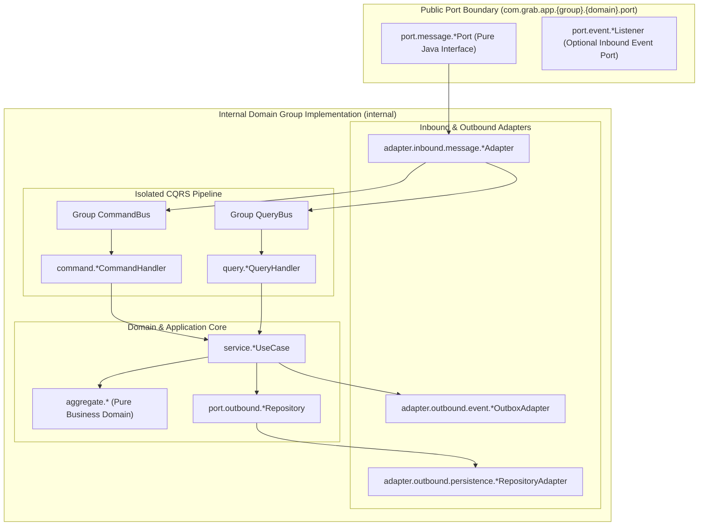
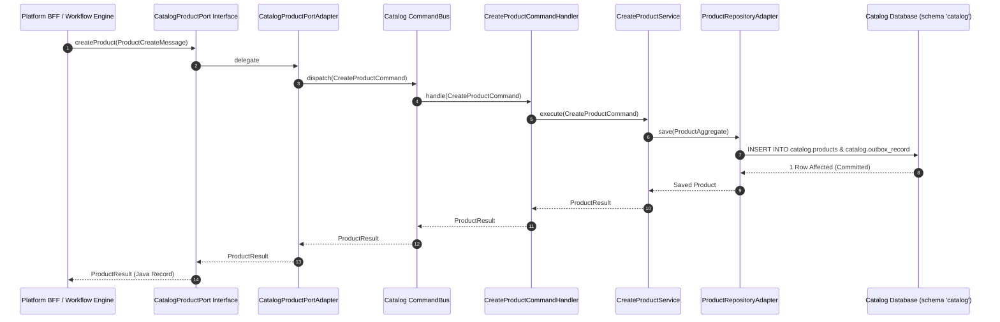

# Tech Spec: Domain Group Services Communication Protocol & Contracts

- **Summary:** Defines the headless Java port interface contracts, inbound message adapters, CQRS bus dispatching, and transactional outbox event contracts for core domain groups (`catalog`, `order`, `account`, `channel`).
- **Type:** Architecture Pattern / Protocol Boundary
- **Feature Spec:** [BFF-to-Domain Communication Protocol & Controller Contract Migration](../../features/feat_011-decoupled-service-communication-cqrs-pipeline.md)

---

## 1. Problem & Decision

### What breaks without this?

When domain services expose internal handlers or Spring Data JPA repositories directly to other modules or platform controllers, architectural encapsulation collapses. Presentation concerns leak into domain aggregates, circular dependencies form between bounded contexts, and database schemas become tightly bound through cross-module method calls. Furthermore, without an explicit, framework-pure protocol contract, extracting any domain group into a standalone microservice requires rewriting all inbound and outbound call sites across the enterprise codebase.

### Decision

| Option | Decision | Why |
|:-------|:---------|:----|
| **Pure Java Inbound Port Interfaces with Isolated CQRS Bus** | Adopted | Provides zero-overhead in-process method invocation with complete compile-time type safety and strict hexagonal isolation between service groups. |
| Ingress via HTTP REST inside Domain Modules | Rejected | Pollutes domain logic with WebMvc controllers, HTTP response formatting, and presentation DTOs, violating hexagonal layering. |
| Direct Cross-Group CQRS Bus Dispatching | Rejected | Bypasses module boundaries, leaks command/query record types across bounded contexts, and breaks module isolation. |

### Trade-offs

| Benefits | Trade-offs |
|:---------|:-----------|
| Domain groups are completely headless, framework-agnostic, and testable without web servers. | Requires an inbound message adapter in each domain group to translate port calls into local commands/queries. |
| Guarantees clean architectural boundaries: changing internal domain logic or database models has zero impact on callers of public ports. | Requires maintaining dedicated inbound message adapter mappings per port method. |

---

## 2. How It Works

### Core Concept

Each domain group service (`catalog`, `order`, `account`, `channel`) exposes its public capabilities exclusively through pure Java port interfaces located in `com.grab.app.{group}.{domain}.port.message`. Outbound callers (BFFs, workflows) interact with these interfaces using immutable message records. Within each domain group, an inbound message adapter implements the port, maps the message to an internal command or query, and dispatches it across an isolated, per-service CQRS bus. Cross-domain side-effects are communicated asynchronously via the Transactional Outbox.

```mermaid
flowchart LR
    Caller["BFF / Workflow Caller"] -->|"Pure Java Port Call"| Port["Inbound Java Port\n(port.message)"]
    Port -->|"Route Call"| Adapter["Inbound Message Adapter\n(internal.adapter.inbound.message)"]
    Adapter -->|"Dispatch"| Bus["Isolated Service Bus\n(CommandBus / QueryBus)"]
    Bus -->|"Handle"| Handler["CQRS Handler\n(@Transactional)"]
    Handler -->|"Execute"| UseCase["Domain Use Case & Aggregate"]
    UseCase -->|"Persist State & Outbox"| DB[("Schema DB & Outbox Table")]
    DB -.->|"Async Relay"| SharedEvent["Shared Integration Event"]
```



### How It Works Step by Step

| Step | What Happens | Why |
|:-----|:-------------|:----|
| 1 | An external caller (e.g., Seller BFF outbound adapter) calls a method on the domain group's public port interface (`port.message`). | Decouples caller from internal domain implementation and database topology. |
| 2 | The domain group's inbound message adapter (`internal.adapter.inbound.message`) intercepts the call and validates the immutable message record. | Serves as the inbound anti-corruption layer (ACL) at the service boundary. |
| 3 | The adapter translates the message into a local `Command<R>` or `Query<R>` record and dispatches it to the service's isolated bus. | Enforces strict CQRS separation within the domain group. |
| 4 | A domain command/query handler (`@Component`) handles the bus dispatch under the module transaction boundary (`@{Module}Transactional`). | Coordinates repository write ports or query projection ports. |
| 5 | Business rules execute within the pure domain aggregate; mutations and outbox records are committed in a single atomic transaction. | Preserves domain invariants and guarantees at-least-once asynchronous event delivery. |
| 6 | The handler returns an immutable result record back through the bus and adapter to the port interface. | Ensures external callers receive typed data without accessing raw JPA entities. |

---

## 3. How We Use It

### Where It Fits in Our System / Architecture & Layer Stacking



### Component Responsibilities

| Component | Role | What It Does |
|:----------|:-----|:-------------|
| `port.message.*Port` | Public Capability Contract | Pure Java interface exposing business operations with zero framework or HTTP dependencies. |
| `internal.adapter.inbound.message` | Inbound Protocol Adapter | Implements `port.message`, maps transport records to internal commands/queries, and routes to the service bus. |
| `Group CommandBus / QueryBus` | CQRS Dispatcher | In-memory synchronous bus dispatching commands to command handlers and queries to query handlers. |
| `internal.command.*CommandHandler` | Transaction Coordinator | Demarcates `@Transactional`, loads aggregates from outbound repository ports, and executes use cases. |
| `internal.adapter.outbound.persistence` | Persistence Adapter | Implements domain repository port using Spring Data JPA, mapping entities to the domain schema. |
| `internal.adapter.outbound.event` | Outbox Producer | Serializes integration event payloads into `{schema}.outbox_record` within the local database transaction. |

### Runtime Flow



### Contracts & Protocol Specifications

#### 1. Universal Domain Port Interface Contract Pattern
```java
// Pure Java Port Interface (Located in com.grab.app.catalog.port.message)
public interface CatalogProductPort {
    ProductResult createProduct(ProductCreateMessage message);
    ProductResult updateProduct(String productId, ProductUpdateMessage message);
    Optional<ProductResult> getProductById(String productId);
    void archiveProduct(String productId);
}

// Inbound Message Contract
public record ProductCreateMessage(
    String merchantId,
    String title,
    String sku,
    BigDecimal price,
    String currencyCode,
    Map<String, String> attributes
) {}

// Outbound Result Contract
public record ProductResult(
    String id,
    String merchantId,
    String title,
    String sku,
    BigDecimal price,
    String currencyCode,
    String status,
    Instant createdAt
) {}
```

#### 2. Inbound Adapter Implementation Pattern
```java
// Located in com.grab.app.catalog.internal.adapter.inbound.message
@Component
public class CatalogProductPortAdapter implements CatalogProductPort {

    private final CommandBus commandBus;
    private final QueryBus queryBus;
    private final CatalogPortMapper mapper;

    public CatalogProductPortAdapter(CommandBus commandBus, QueryBus queryBus, CatalogPortMapper mapper) {
        this.commandBus = commandBus;
        this.queryBus = queryBus;
        this.mapper = mapper;
    }

    @Override
    public ProductResult createProduct(ProductCreateMessage message) {
        CreateProductCommand command = mapper.toCommand(message);
        return commandBus.dispatch(command);
    }

    @Override
    public Optional<ProductResult> getProductById(String productId) {
        GetProductByIdQuery query = new GetProductByIdQuery(Id.of(productId));
        return queryBus.dispatch(query);
    }
}
```

#### 3. Shared Integration Event Contract (`ProductCreatedEvent.java`)
```java
// Located in com.grab.store.shared.events.catalog
public record ProductCreatedEvent(
    String eventId,
    String productId,
    String merchantId,
    String title,
    String sku,
    BigDecimal price,
    String currencyCode,
    Instant occurredAt
) {}
```

---

## 4. Implementation Rules

| Rule | Requirement |
|:-----|:------------|
| **R-01** | Core domain groups (`catalog`, `order`, `account`, `channel`) **MUST NOT** import or use Spring WebMvc annotations (`@RestController`, `@RequestMapping`, `@RequestParam`, etc.). |
| **R-02** | All synchronous capabilities **MUST** be exposed via pure Java interfaces in `com.grab.app.{group}.{domain}.port.message` using immutable `record` types. |
| **R-03** | Inbound message adapters (`internal.adapter.inbound.message`) **MUST** translate port calls into local `Command<R>` or `Query<R>` records and dispatch via the isolated local bus. |
| **R-04** | A domain group's `CommandService` **MUST NOT** inject `QueryBus`, and `QueryService` **MUST NOT** inject `CommandBus`. Strict CQRS separation is mandatory. |
| **R-05** | Domain handlers **MUST NOT** directly inject or invoke repositories or handlers belonging to another domain group. |
| **R-06** | Cross-group asynchronous notifications **MUST** be written to `{schema}.outbox_record` within the local database transaction and dispatched via `com.grab.store.shared.events.{module}`. |
| **R-07** | Every Java port contract **MUST** use immutable Java `record` types containing only primitives, `String`, and standard value objects without third-party serialization or web annotations. |

