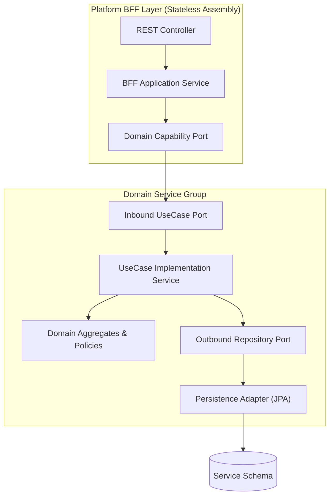

# Tech Spec: Hexagonal Modular Service Packaging

- **Summary:** Defines the hexagonal package structure, domain service groupings, and stateless platform BFF layers for independent scalability and microservice extraction readiness.
- **Type:** Architecture Pattern
- **Feature Spec:** [Modular Hexagonal Package Structure](../../features/feat_009-modular-hexagonal-package-structure.md)

---

## 1. Problem & Decision

### What breaks without this?

Without a standardized hexagonal package structure, business rules become entangled with database frameworks, web controllers access entities directly, and cross-module dependencies form circular tangles. This prevents independent feature development, causes regressions during framework upgrades, and makes extracting services into autonomous microservices nearly impossible without an expensive rewrite.

### Decision

| Option | Decision | Why |
|:-------|:---------|:----|
| **Hexagonal Packaging with Platform BFFs** | Adopted | Strict separation of domain, application, persistence, and stateless presentation layers; enables in-process modular monolith execution today and seamless microservice extraction tomorrow. |
| Traditional 3-Tier Layered Architecture | Rejected | Allows presentation and database concerns to bleed into domain models, leading to tight coupling and leaky abstractions. |
| Immediate Physical Microservices | Deferred | High operational overhead, network latency, distributed transaction complexity, and CI/CD infrastructure cost before domain boundaries stabilize. |

### Trade-offs

| Benefits | Trade-offs |
|:---------|:-----------|
| Domain logic remains completely framework-agnostic and 100% unit-testable. | Higher initial boilerplate (explicit ports, use case interfaces, and mappers). |
| Platform BFFs tailor APIs to specific clients (seller vs shopper) without data coupling. | Requires strict discipline and automated ArchUnit rules to maintain package integrity. |
| Clear extraction boundaries allow converting any domain group into a microservice without touching domain logic. | Multiple sub-packages per domain module increase structural navigation depth. |

---

## 2. How It Works

### Core Concept

The architecture decomposes the platform into two primary tiers: **Stateless Platform BFFs** (`sellercentral`, `marketplace`) and **Domain Service Groups** (`catalog`, `order`, `account`, `channel`). Every domain service strictly applies Hexagonal Architecture (Ports and Adapters), ensuring that dependencies only point inward toward pure domain logic.



### How It Works Step by Step

| Step | What Happens | Why |
|:-----|:-------------|:----|
| 1 | Inbound request arrives at Platform BFF Controller (`com.grab.app.platform.{platform}.internal.adapter.inbound.rest`). | Handles HTTP parsing, validation, and HATEOAS representation without containing business logic. |
| 2 | BFF Controller maps transport DTO to application command/query and dispatches via Platform Service. | Ensures transport contracts remain decoupled from internal domain command records. |
| 3 | Platform Service invokes Domain Capability Port (`com.grab.{platform}.application.port.outbound.{Domain}QueryPort`). | Keeps the BFF agnostic of whether the domain service is hosted in-process or over HTTP. |
| 4 | Domain Service receives request via Inbound Port (`com.{domain}.application.port.inbound.*UseCase`). | Directs execution to pure use case orchestration. |
| 5 | UseCase Service loads aggregate via Outbound Repository Port and applies business rules. | Business logic resides strictly in domain entities and policies. |
| 6 | Persistence Adapter (`com.{domain}.adapter.persistence`) persists state changes and outbox records. | Infrastructure frameworks (Spring Data JPA, Hibernate) remain isolated at the boundary. |

---

## 3. How We Use It

### Package Structure Specification

The codebase is organized into bounded domain service groups and platform BFF modules:

```
com.grab.app/
├── catalog/                                # Product Service Group
│   ├── catalog/                            # Catalog Bounded Context
│   ├── inventory/                          # Inventory Bounded Context
│   └── pricing/                            # Pricing Bounded Context
├── order/                                  # Order Service Group
│   ├── cart/                               # Cart Bounded Context
│   ├── order/                              # Order Bounded Context
│   └── payment/                            # Payment Bounded Context
├── account/                                # Account Service Group
│   ├── identity/                           # Identity Bounded Context
│   ├── merchant/                           # Merchant Bounded Context
│   └── customer/                           # Customer Bounded Context
├── channel/                                # Channel Service Group
│   ├── saleschannel/                       # Sales Channel Bounded Context
│   ├── region/                             # Region Bounded Context
│   └── discovery/                          # Discovery Projection Context
└── platform/                               # Platform BFF Services (Stateless)
    ├── seller/                             # Seller Central BFF
    └── marketplace/                        # Marketplace Storefront BFF
```

#### Detailed Bounded Context Layout (`com.{domain}`)

```
com.{domain}.application/
├── port/
│   ├── inbound/                            # Inbound Use Case Ports (*UseCase.java)
│   └── outbound/                           # Outbound Ports (*Repository, *QueryPort, *EventPublisher)
├── service/                                # Use Case Implementations (*Service.java)
└── model/
    ├── read/                               # Read Projections (*View.java)
    └── write/                              # Command/Result Records

com.{domain}.adapter.persistence/
├── adapter/                                # Outbound Adapters (*RepositoryAdapter, *QueryAdapter)
├── entity/                                 # JPA Entities (*JpaEntity.java)
├── repository/jpa/                         # Spring Data JPA Repositories (*JpaRepository.java)
└── mapper/                                 # Entity/Domain Mappers (*PersistenceMapper.java)
```

#### Domain Group Internal Layout (`com.grab.app.{group}`)

```
com.grab.app.{group}/
├── port/                                   # Public Group Ports
│   ├── message/                            # Intra-Group Message Interfaces
│   └── event/                              # Intra-Group Integration Event Interfaces
└── internal/
    ├── config/                             # Shared Database & Bus Configuration
    └── {domain}/
        ├── config/                         # Domain-Specific Configuration
        ├── adapter/
        │   ├── inbound/                    # Inbound Adapters (Event/Message Listeners -> Bus)
        │   └── outbound/                   # Outbound Adapters (Event/Message Publishers)
        ├── command/                        # Command Handlers
        └── query/                          # Query Handlers
```

#### Platform BFF Layout (`com.grab.app.platform.{platform}`)

```
com.grab.app.platform.{platform}/
├── port/
│   └── rest/                               # Public REST Controller Interfaces
└── internal/
    ├── config/                             # BFF Bus Configuration
    ├── adapter/
    │   ├── inbound/
    │   │   └── rest/                       # Controllers, DTOs, Mappers, Assemblers, Services
    │   └── outbound/
    │       └── message/                    # Adapters implementing Domain Group Capability Ports
    ├── command/                            # BFF Command Handlers
    └── query/                              # BFF Query Handlers
```

### Component Responsibilities

| Component | Role | What It Does |
|:----------|:-----|:-------------|
| `{domain}-domain` | Pure Domain Core | Contains aggregates, entities, value objects, domain policies, and outbound repository interfaces. Framework-free. |
| `{domain}-application` | Application Orchestration | Implements use cases, defines command/query records, and orchestrates aggregate mutation and query port lookups. |
| `{domain}-adapter-persistence` | Intra-Domain Persistence | Implements domain repository ports using JPA/Hibernate; handles entity-to-domain mapping and local outbox persistence. |
| `platform.{platform}` | Client Experience Gateway | Aggregates domain capabilities for specific client types (seller vs marketplace) without owning persistent state. |
| `app` (Root Boot Module) | Application Assembler | Configures Spring Boot environment, registers beans, and wires platform BFFs and domain groups into the runtime process. |

---

## 4. Implementation Rules

> These are **non-negotiable contracts**. An implementation is compliant only when **all** rules are satisfied.

- **RULE-PKG-01: Framework Isolation in Domain**
  Domain modules (`{domain}-domain`) MUST NOT import or depend on Spring, Jakarta/JPA, Jackson, or MapStruct frameworks. All domain logic MUST use pure Java.

- **RULE-PKG-02: Strict Dependency Flow**
  Dependencies MUST only flow inward: `store` / `app` → `adapter.persistence` & `application` → `domain`. The domain layer MUST NEVER depend on application or persistence layers.

- **RULE-PKG-03: Stateless Platform BFF Modules**
  Platform BFF modules (`com.grab.app.platform.seller`, `com.grab.app.platform.marketplace`) MUST NOT contain any persistence packages, JPA repositories, or database entities. They are strictly stateless application gateways.

- **RULE-PKG-04: Intra-Domain Persistence Scope**
  Persistence adapters (`com.{domain}.adapter.persistence`) MUST NOT contain cross-module adapters or reference repositories/entities of another domain. All cross-module communication MUST occur through published capability ports or integration events.

- **RULE-PKG-05: Modulith Package Encapsulation**
  Classes residing within `internal/` packages MUST NOT be imported or accessed by external modules. Public interfaces MUST reside in root `port/` packages or published named interfaces.
