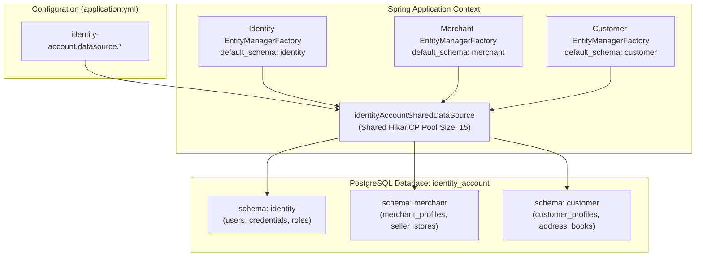

# Tech Spec: Identity & Accounts Database Configuration & Implementation Pattern

- **Summary:** Defines the consolidated PostgreSQL database architecture, schema partitioning (`identity`, `merchant`, `customer`), and HikariCP connection pool settings for the Identity & Accounts domain cluster.
- **Type:** Infrastructure & Architecture Pattern
- **Feature Spec:** [Service-Level Database & Connection Pool Consolidation in Spring Modulith](../../features/feat_010-service-level-database-consolidation.md)

---

## 1. Problem & Decision

### What breaks without this?

Previously, `identity`, `merchant`, and `customer` each maintained distinct HikariCP connection pools connecting to 3 independent databases (`identity`, `merchant`, `customer`). These pools remained largely idle between authentication requests, wasting JVM heap and file descriptors. In contrast, putting all user data into a single flat schema creates severe security and regulatory risks: customer Personally Identifiable Information (PII) gets co-located with merchant business KYC records and internal operator credentials, violating GDPR/PDPA segregation principles and creating a high-risk blast radius if any query is exploited.

### Decision

| Option | Decision | Why |
|:-------|:---------|:----|
| **1 Consolidated Cluster Database (`identity_account`) with 3 Private Schemas** | Adopted | Consolidates connections into 1 shared Hikari pool (15 max connections), and guarantees cryptographic and access control isolation between auth credentials (`identity`), seller business profiles (`merchant`), and shopper PII (`customer`) via PostgreSQL schema partitioning. |
| 3 Separate Physical Databases in Monolith | Rejected | Wastes connection resources for read-heavy authentication and low-frequency profile edits. |
| Single Shared Public Schema | Rejected | Combines credentials, merchant bank details, and customer PII in the same schema, violating GDPR/PDPA data protection standards. |

### Trade-offs

| Benefits | Trade-offs |
|:-----------|:-------------|
| Reduces JVM connection pool count to 1 shared cluster pool (15 connections). | Flyway migrations must be executed independently per domain schema. |
| Strict schema segregation prevents merchant logic from reading customer passwords or refresh tokens. | Cross-account queries (e.g. verifying merchant user identity) must pass through identity authentication ports. |
| Single consolidated database simplifies infrastructure provisioning and operational monitoring. | All subdomains share the cluster database instance resources. |

---

## 2. How It Works

### Core Concept

The Identity & Accounts cluster connects to a single PostgreSQL database instance named `identity_account`. Within this database, three isolated schemas exist: `identity`, `merchant`, and `customer`.

All subdomains (`identity`, `merchant`, `customer`) share a single consolidated HikariCP connection pool. In Spring Boot, `IdentityAccountPersistenceConfiguration` provides the shared `HikariDataSource`. Each subdomain's `EntityManagerFactory` binds to this shared DataSource and sets `hibernate.default_schema` to its respective schema.



---

### Schema & Table Partitioning

| Schema | Domain | Sample Core Tables | Migration Location | History Table |
|:-------|:-------|:-------------------|:-------------------|:--------------|
| `identity` | Identity | `users`, `credentials`, `roles`, `permissions`, `refresh_tokens`, `security_manifests` | `classpath:db/migration/identity` | `identity.flyway_schema_history_identity` |
| `merchant` | Merchant | `merchants`, `merchant_settings`, `kyc_verifications`, `seller_profiles`, `store_locations` | `classpath:db/migration/merchant` | `merchant.flyway_schema_history_merchant` |
| `customer` | Customer | `customers`, `customer_profiles`, `address_books`, `shopper_preferences` | `classpath:db/migration/customer` | `customer.flyway_schema_history_customer` |

---

### YAML Configuration Specification

```yaml
# ==============================================================================
# IDENTITY & ACCOUNTS CLUSTER DATA SOURCE
# ==============================================================================
identity-account:
  datasource:
    url: ${IA_DATASOURCE_URL:jdbc:postgresql://localhost:5432/identity_account}
    username: ${IA_DATASOURCE_USERNAME:admin}
    password: ${IA_DATASOURCE_PASSWORD:123}
    driver-class-name: org.postgresql.Driver
    hikari:
      maximum-pool-size: ${IA_HIKARI_MAX_POOL_SIZE:15}
      minimum-idle: ${IA_HIKARI_MIN_IDLE:3}
      pool-name: HikariPool-IdentityAccount
      connection-timeout: 30000
      idle-timeout: 600000
      max-lifetime: 1800000

identity:
  seed:
    enabled: ${IDENTITY_SEED_ENABLED:true}
  datasource:
    schema: identity

merchant:
  seed:
    enabled: ${MERCHANT_SEED_ENABLED:true}
  datasource:
    schema: merchant

customer:
  seed:
    enabled: ${CUSTOMER_SEED_ENABLED:true}
  datasource:
    schema: customer
```

---

### Spring Java Implementation Pattern

```java
package com.grab.app.identityaccount.internal.config;

import com.zaxxer.hikari.HikariDataSource;
import jakarta.persistence.EntityManagerFactory;
import org.flywaydb.core.Flyway;
import org.springframework.beans.factory.annotation.Qualifier;
import org.springframework.boot.context.properties.ConfigurationProperties;
import org.springframework.context.annotation.Bean;
import org.springframework.context.annotation.Configuration;
import org.springframework.data.jpa.repository.config.EnableJpaRepositories;
import org.springframework.orm.jpa.JpaTransactionManager;
import org.springframework.orm.jpa.LocalContainerEntityManagerFactoryBean;
import org.springframework.orm.jpa.vendor.HibernateJpaVendorAdapter;
import org.springframework.transaction.PlatformTransactionManager;

import javax.sql.DataSource;
import java.util.HashMap;
import java.util.Map;

@Configuration
@EnableJpaRepositories(
        basePackages = "com.identity.adapter.persistence.repository",
        entityManagerFactoryRef = "identityEntityManagerFactory",
        transactionManagerRef = "identityTransactionManager"
)
public class IdentityPersistenceConfiguration {

    // Shared connection pool for identity & accounts cluster
    @Bean("identityAccountSharedDataSource")
    @ConfigurationProperties("identity-account.datasource.hikari")
    public HikariDataSource identityAccountSharedDataSource() {
        return new HikariDataSource();
    }

    @Bean("identityEntityManagerFactory")
    public LocalContainerEntityManagerFactoryBean identityEntityManagerFactory(
            @Qualifier("identityAccountSharedDataSource") DataSource dataSource) {

        LocalContainerEntityManagerFactoryBean em = new LocalContainerEntityManagerFactoryBean();
        em.setDataSource(dataSource);
        em.setPackagesToScan("com.identity.adapter.persistence");
        em.setPersistenceUnitName("identity");
        em.setJpaVendorAdapter(new HibernateJpaVendorAdapter());

        Map<String, Object> props = new HashMap<>();
        props.put("hibernate.default_schema", "identity");
        props.put("hibernate.dialect", "org.hibernate.dialect.PostgreSQLDialect");
        em.setJpaPropertyMap(props);

        return em;
    }

    @Bean("identityTransactionManager")
    public PlatformTransactionManager identityTransactionManager(
            @Qualifier("identityEntityManagerFactory") EntityManagerFactory emFactory) {
        return new JpaTransactionManager(emFactory);
    }

    @Bean(initMethod = "migrate")
    public Flyway identityFlyway(@Qualifier("identityAccountSharedDataSource") DataSource dataSource) {
        return Flyway.configure()
                .dataSource(dataSource)
                .schemas("identity")
                .defaultSchema("identity")
                .table("flyway_schema_history_identity")
                .locations("classpath:db/migration/identity")
                .baselineOnMigrate(true)
                .load();
    }
}
```

---

## 3. How We Use It

### Step-by-Step Identity & Onboarding Persistence Flow

| Step | Phase | Action |
|:-----|:------|:-------|
| 1 | **Seller Registration** | Seller account credentials created in `identity.users` using `identityTransactionManager`. |
| 2 | **Merchant Profile Setup** | Merchant business information persisted in `merchant.merchants` using `merchantTransactionManager`. |
| 3 | **Customer Onboarding** | Customer profile and address book saved in `customer.customers` using `customerTransactionManager`. |
| 4 | **Decoupled Verification** | Merchant approval triggers `MerchantVerifiedEvent` to Outbox, allowing Product domain to unlock catalog publish permissions without cross-schema database writes. |

---

## 4. Implementation Rules

| Rule | Requirement |
|:-----|:------------|
| **R-IA01** | Credentials and auth tokens **MUST** reside exclusively in schema `identity`. Merchant data **MUST** reside in `merchant`, and shopper data in `customer`. |
| **R-IA02** | Customer PII tables **MUST NOT** be joined with merchant or identity tables via raw SQL queries. |
| **R-IA03** | Flyway migration history tables **MUST** be namespaced: `flyway_schema_history_identity`, `flyway_schema_history_merchant`, and `flyway_schema_history_customer`. |
| **R-IA04** | All subdomains within Identity & Accounts (`identity`, `merchant`, `customer`) **MUST** share the `identity_account` cluster database and `HikariPool-IdentityAccount` connection pool. |
| **R-IA05** | Total connections allocated to `HikariPool-IdentityAccount` in shared mode **MUST NOT** exceed 15 connections. |
