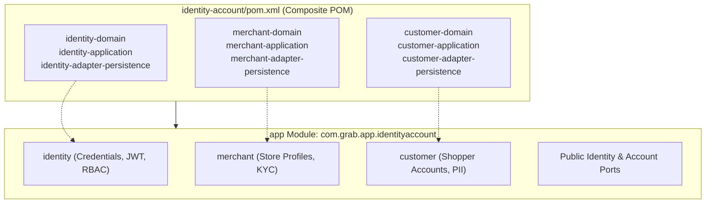
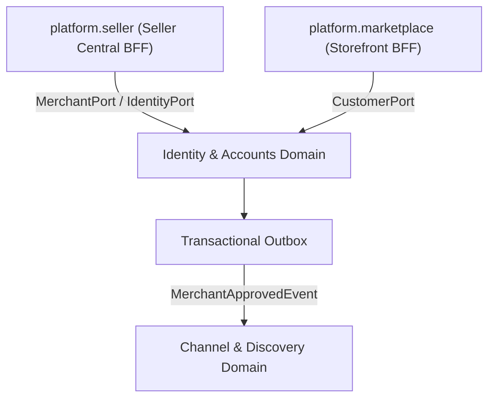

# Tech Spec: Identity & Accounts Domain Namespace

- **Summary:** Defines the Maven composite aggregation, Spring Modulith module boundaries, package architecture, and isolation rules for the Identity & Accounts domain cluster.
- **Type:** Architecture Pattern
- **Feature Spec:** [Industrial Project Structure Organization & Runnable App Module](../../features/feat_009-industrial-project-structure-organization.md)

---

## 1. Problem & Decision

### What breaks without this?

Mixing IAM (Identity and Access Management) credentials, merchant seller profiles, and shopper customer accounts within generic domain services creates dangerous security and data governance loopholes. Without an isolated Identity & Accounts boundary, seller authentication logic can accidentally expose customer personally identifiable information (PII), and downstream services end up querying raw password hashes and JWT secrets to perform basic account lookups.

### Decision

| Option | Decision | Why |
|:-------|:---------|:----|
| **Composite Maven POM & Spring Modulith Namespace (`com.grab.app.identityaccount`)** | Adopted | Consolidates `identity`, `merchant`, and `customer` into an isolated IAM and Account directory, exposing only immutable identity principals and role assertions to platform BFFs. |
| Physical Directory Restructuring | Rejected | Moving 9 identity, merchant, and customer module directories causes git churn and risks accidental file permission or history degradation. |
| Splitting Identity, Merchant, and Customer into 3 Monolithic Packages | Rejected | Creates high coordination overhead for core authentication flows while they are hosted in the same JVM. Grouping into a single cluster provides high cohesion with low operational complexity. |

### Trade-offs

| Benefits | Trade-offs |
|:-----------|:-------------|
| Unified Party model encapsulating credentials, roles, merchant stores, and customer address books | External domains cannot access internal User/Merchant entities directly; must use DTOs |
| Ready to absorb future account capabilities (`seller-kyc`, `address-book`, `rbac-roles`) | Account lookups from Order or Product BFFs require explicit Port query calls |
| Zero filesystem disruption for existing identity, merchant, and customer repositories | Customer and Merchant profiles maintain distinct lifecycle workflows within the namespace |

---

## 2. How It Works

### Core Concept

The Identity & Accounts domain cluster is managed via a composite Maven POM (`identity-account/pom.xml`) at the repository root. In the runnable application (`app`), all authentication filters, security context resolvers, and account management beans are housed inside `com.grab.app.identityaccount`.



### Package Layout & Internal Namespaces

```text
identity-account/
└── pom.xml                                           # Composite Service POM

app/src/main/java/com/grab/app/identityaccount/
├── package-info.java                                 # @org.springframework.modulith.ApplicationModule
├── identity/                                         # Authentication & Token Services
│   ├── IdentityConfiguration.java                    # Spring @Configuration
│   ├── internal/                                     # Token generators, password encoders
│   └── api/                                          # Public Auth & Principal Ports
├── merchant/                                         # Merchant Profile & Store Directory
│   ├── MerchantConfiguration.java                    # Spring @Configuration
│   ├── internal/                                     # Merchant state, verification
│   └── api/                                          # Public Merchant Ports & DTOs
└── customer/                                         # Customer Profile & Preferences
    ├── CustomerConfiguration.java                    # Spring @Configuration
    ├── internal/                                     # Address book, preferences
    └── api/                                          # Public Customer Ports & DTOs
```

### How It Works Step by Step

| Step | What Happens | Why |
|:-----|:-------------|:----|
| 1 | `app/pom.xml` imports `identity-account` composite dependency | Transitively includes all 9 identity, merchant, and customer libraries |
| 2 | Spring Modulith bootstraps `com.grab.app.identityaccount` module | Enforces module encapsulation and verifies package boundary rules |
| 3 | Seller Central BFF authenticates merchant via `IdentityPort.authenticate(credentials)` | Validates password hash, resolves merchant business ID, and issues scoped JWT |
| 4 | Storefront BFF resolves customer identity via `CustomerPort.resolve(token)` | Verifies shopper session without exposing internal database entities |
| 5 | ArchUnit architecture tests verify that zero external classes import password or secret entities | Guarantees security and PII compliance across the codebase |

---

## 3. How We Use It

### Where It Fits in Our System



### Component Responsibilities

| Component | Role | What It Does |
|:----------|:-----|:-------------|
| `identity-account/pom.xml` | Maven Aggregator | Aggregates identity, merchant, and customer modules with `<type>pom</type>`. |
| `com.grab.app.identityaccount` | Domain Cluster Namespace | Houses authentication services, merchant management, and customer directories. |
| `IdentityConfiguration` | Spring Bean Registrar | Exposes user authentication, password verification, and JWT generation beans. |
| `MerchantConfiguration` | Spring Bean Registrar | Exposes merchant store creation, profile queries, and approval workflows. |
| `CustomerConfiguration` | Spring Bean Registrar | Exposes customer profile retrieval, address management, and registration beans. |

---

## 4. Implementation Rules

| Rule | Requirement |
|:-----|:------------|
| **R-01** | The `app/pom.xml` module **MUST** depend on `identity-account` and **MUST NOT** import individual modules (`identity-domain`, `merchant-application`, etc.) directly. |
| **R-02** | The package `com.grab.app.identityaccount` **MUST** be annotated with `@org.springframework.modulith.ApplicationModule` or declared as an application module in `package-info.java`. |
| **R-03** | Sensitive credentials (password hashes, secret salts, raw tokens) **MUST NOT** be exposed outside the `identity` internal package. |
| **R-04** | Other domains **MUST NOT** query customer or merchant database tables directly; all access must use public immutable DTO records via interface ports. |
| **R-05** | Future party and account domains (`seller-kyc`, `address-book`, `user-profiles`, `rbac-roles`) **MUST** reside under the `identity-account` composite POM and package namespace. |
