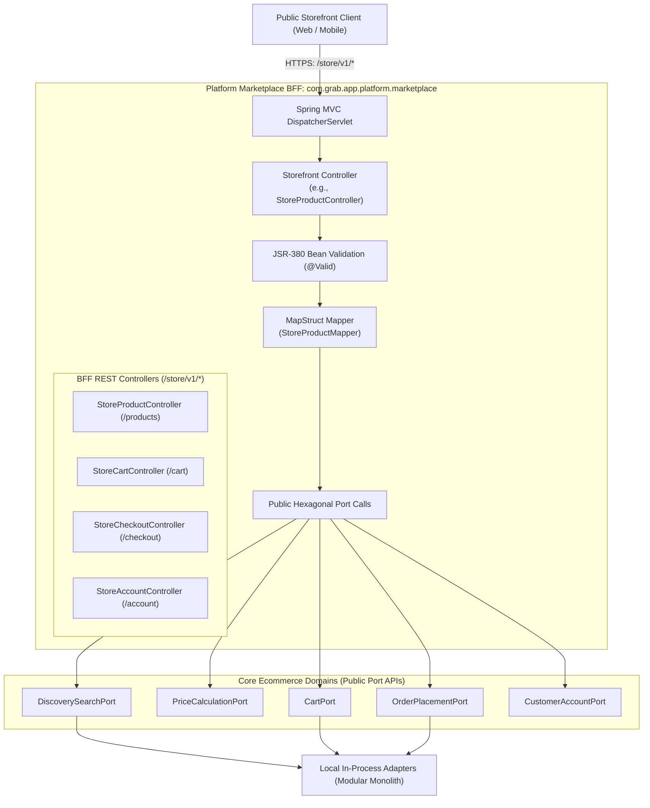
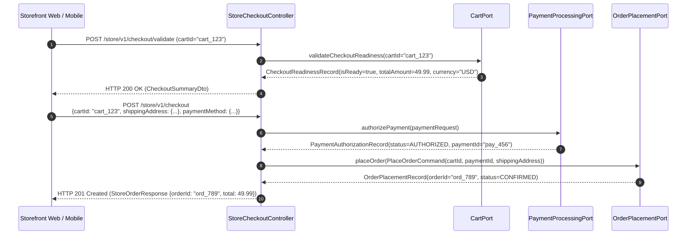

# Tech Spec: Marketplace BFF Endpoints & Contract Mapping

- **Summary:** Defines the `/store/v1/*` REST endpoint hierarchy, MapStruct DTO ↔ Domain Port record transformations, multi-regional discovery composition, and checkout orchestration for public storefronts.
- **Type:** Architecture Pattern / Platform Gateway
- **Feature Spec:** [Platform Marketplace BFF Implementation](../../features/feat_013-platform-marketplace-bff.md)

---

## 1. Problem & Decision

### What breaks without this?

Without a dedicated endpoint specification and DTO translation contract, web controllers expose internal JPA `@Entity` models directly into public HTTP responses. Outside transactional sessions, navigating lazy-loaded relationships triggers `LazyInitializationException` failures and leaks sensitive internal schemas (such as wholesale supplier costs, warehouse bin coordinates, and merchant commission rates) to public storefront shoppers. Furthermore, without an edge BFF to stitch catalog presentations with regional pricing and inventory allocations, mobile and web storefronts are forced to make multiple sequential HTTP roundtrips across low-level internal services, causing sluggish page loads and mobile battery drain.

### Decision

| Option | Decision | Why |
|:-------|:---------|:----|
| **Dedicated `/store/v1/*` Namespace + Compile-Time MapStruct Mappers + Pure Hexagonal Port Delegation** | **Adopted** | Isolates public storefront contracts from internal domain models. Controllers inject exclusively public domain port interfaces (`*Port`), use dedicated `/store/v1` DTOs, and transform payloads via compile-time MapStruct mappers with zero entity leakage. |
| Direct JPA Entity Controller Returns | Rejected | Severe risk of `LazyInitializationException`, schema exposure, cyclic JSON serialization loops, and tight coupling between database tables and public client contracts. |
| Flat Monolithic `/api/v1/*` Endpoints | Rejected | Conflates administrative merchant actions with public shopper traffic, preventing dedicated rate limits, specialized security filters, and independent BFF versioning. |
| Client-Side Multi-Domain Checkout Stitching | Rejected | Forces mobile and web clients to orchestrate multi-step checkout (address validation, stock reservation, price locking, payment authorization, and order aggregate creation), risking stranded inventory and inconsistent cart states on flaky mobile connections. |

### Trade-offs

| Benefits | Trade-offs |
|:---------|:-----------|
| Zero JPA entity leakage; 100% extractable to standalone microservices without modifying storefront client code. | Requires maintaining dedicated request/response DTO classes and MapStruct mappers per storefront endpoint. |
| Unified presentation payloads: Catalog descriptions, localized currency prices, and stock availability are composed in a single fast response. | Additional mapping layer adds a minor object allocation overhead per HTTP request. |
| Compile-time type safety: MapStruct fails the build if a domain port record or DTO field name is mismatched or missing. | Schema updates across domain ports require updating corresponding MapStruct mapper interfaces. |

---

## 2. How It Works

### Core Concept

The Marketplace BFF sits at the edge of the application tier (`com.grab.app.platform.marketplace`). It structures endpoints around the end-shopper journey:
1. **Catalog & Contextual Discovery** (`StoreProductController`, `StoreSearchController`): Serves indexed catalog presentation facts from `DiscoverySearchPort`, enriched with regional currency prices and promotional discounts from `PriceCalculationPort`.
2. **Shopping Cart Management** (`StoreCartController`): Manages shopping cart sessions, line item mutations, quantity adjustments, and promotional coupon validation via `CartPort`.
3. **Checkout & Order Placement** (`StoreCheckoutController`): Orchestrates checkout validation, shipping destination verification, payment authorization (`PaymentProcessingPort`), and order conversion (`OrderPlacementPort`).
4. **Customer Account** (`StoreAccountController`): Manages customer registration, authentication, personal profiles, and saved shipping addresses via `CustomerAccountPort`.

Controllers **never** import domain entities or repositories. They interact exclusively with public domain port records via MapStruct mappers.



### How It Works Step by Step

| Step | What Happens | Why |
|:-----|:-------------|:----|
| 1 | Storefront client sends JSON request to `/store/v1/{resource}` with `X-Publishable-Key`. | Ingress pipeline verifies channel validity and resolves `ShoppingContext`. |
| 2 | Spring MVC validates payload against JSR-380 annotations (`@NotBlank`, `@Min`, `@Email`). | Fails fast with `HTTP 400 Bad Request` before invoking any business logic. |
| 3 | `@CurrentShoppingContext` injects verified channel, currency, country, and tax rules. | Ensures queries and commands are strictly scoped to the active market. |
| 4 | MapStruct mapper transforms web request DTO into an immutable domain port record (e.g. `AddToCartCommand`). | Decouples web payload representation from internal domain record structures. |
| 5 | Controller invokes public port method (e.g. `cartPort.addItem(command)`). | Preserves hexagonal architecture; BFF has zero knowledge of domain entities or tables. |
| 6 | Domain adapter executes use case within domain transaction and returns immutable record (`CartRecord`). | Domain entities remain encapsulated inside the domain boundary. |
| 7 | MapStruct mapper converts domain record into response DTO (`StoreCartResponse`). | Returns flat, clean JSON with zero Hibernate lazy-loading proxies. |

### Storefront Checkout & Order Placement Lifecycle



---

## 3. How We Use It

### Detailed Endpoint Inventory & Contract Mapping

The table below catalogs every endpoint exposed by the Marketplace BFF, its authentication requirement, its DTO contracts, and the downstream port invoked:

| Domain Area | Method | Endpoint Path | Authentication Required | Request DTO | Response DTO | Contract Port / Component |
|:------------|:-------|:--------------|:------------------------|:------------|:-------------|:--------------------------|
| **Discovery** | `GET` | `/store/v1/products` | Publishable Key | `StoreProductFilterQuery` (params) | `PagedResponse<StoreProductSummaryDto>` | `DiscoverySearchPort` + `PriceCalculationPort` |
| | `GET` | `/store/v1/products/{slug}` | Publishable Key | None | `StoreProductDetailDto` | `DiscoverySearchPort` + `PriceCalculationPort` |
| | `GET` | `/store/v1/categories` | Publishable Key | None | `List<StoreCategoryTreeDto>` | `DiscoverySearchPort.getCategories()` |
| | `GET` | `/store/v1/search` | Publishable Key | `StoreSearchQuery` (params) | `StoreSearchResultDto` | `DiscoverySearchPort.search()` |
| **Cart** | `GET` | `/store/v1/cart` | Publishable Key (+ Guest/Cust) | None | `StoreCartDto` | `CartPort.getCart()` |
| | `POST` | `/store/v1/cart/items` | Publishable Key (+ Guest/Cust) | `AddCartItemRequest` | `StoreCartDto` | `CartPort.addItem()` |
| | `PUT` | `/store/v1/cart/items/{itemId}`| Publishable Key (+ Guest/Cust) | `UpdateCartItemRequest` | `StoreCartDto` | `CartPort.updateQuantity()` |
| | `DELETE`| `/store/v1/cart/items/{itemId}`| Publishable Key (+ Guest/Cust) | None | `StoreCartDto` | `CartPort.removeItem()` |
| | `POST` | `/store/v1/cart/coupon` | Publishable Key (+ Guest/Cust) | `ApplyCouponRequest` | `StoreCartDto` | `CartPort.applyCoupon()` |
| | `DELETE`| `/store/v1/cart/coupon` | Publishable Key (+ Guest/Cust) | None | `StoreCartDto` | `CartPort.removeCoupon()` |
| **Checkout** | `POST` | `/store/v1/checkout/validate` | Publishable Key (+ Guest/Cust) | `ValidateCheckoutRequest` | `CheckoutValidationDto` | `CartPort.validateCheckoutReadiness()` |
| | `POST` | `/store/v1/checkout` | Publishable Key (+ Guest/Cust) | `SubmitCheckoutRequest` | `StoreOrderResponse` (HTTP 201) | `OrderPlacementPort.placeOrder()` + `PaymentProcessingPort` |
| **Orders** | `GET` | `/store/v1/orders/{id}` | Customer JWT | None | `StoreOrderDetailDto` | `OrderPlacementPort.getOrderById()` |
| | `GET` | `/store/v1/orders` | Customer JWT | `OrderListQuery` (params) | `PagedResponse<StoreOrderSummaryDto>` | `OrderPlacementPort.listCustomerOrders()` |
| **Account** | `POST` | `/store/v1/account/register` | Publishable Key | `CustomerRegistrationRequest` | `CustomerSessionDto` | `CustomerAccountPort.register()` |
| | `POST` | `/store/v1/account/login` | Publishable Key | `CustomerLoginRequest` | `CustomerSessionDto` | `CustomerAccountPort.authenticate()` |
| | `GET` | `/store/v1/account/me` | Customer JWT | None | `CustomerProfileDto` | `CustomerAccountPort.getProfile()` |
| | `PUT` | `/store/v1/account/me` | Customer JWT | `UpdateCustomerProfileRequest` | `CustomerProfileDto` | `CustomerAccountPort.updateProfile()` |
| | `GET` | `/store/v1/account/addresses`| Customer JWT | None | `List<CustomerAddressDto>` | `CustomerAccountPort.getAddresses()` |
| | `POST` | `/store/v1/account/addresses`| Customer JWT | `CreateAddressRequest` | `CustomerAddressDto` | `CustomerAccountPort.addAddress()` |
| | `DELETE`| `/store/v1/account/addresses/{id}`| Customer JWT | None | `Void` (HTTP 204) | `CustomerAccountPort.deleteAddress()` |

---

### Component Responsibilities & Package Organization

```text
com.grab.app.platform.marketplace
├── controller/                   # REST endpoint mappings under /store/v1/*
│   ├── StoreProductController.java
│   ├── StoreSearchController.java
│   ├── StoreCartController.java
│   ├── StoreCheckoutController.java
│   └── StoreAccountController.java
│
├── security/                     # Security, Authentication & Context Resolution
│   ├── MarketplaceSecurityFilter.java
│   ├── ShoppingContextResolver.java
│   ├── CustomerSecurityFilter.java
│   ├── ShoppingContext.java
│   ├── AuthenticatedCustomerPrincipal.java
│   ├── MarketplaceCorsConfiguration.java
│   └── annotation/
│       └── CurrentShoppingContext.java
│
├── dto/                          # Dedicated /store/v1 DTO representations
│   ├── product/                  # StoreProductSummaryDto, StoreProductDetailDto
│   ├── cart/                     # StoreCartDto, AddCartItemRequest, UpdateCartItemRequest
│   ├── checkout/                 # SubmitCheckoutRequest, CheckoutValidationDto
│   ├── order/                    # StoreOrderResponse, StoreOrderDetailDto
│   └── account/                  # CustomerLoginRequest, CustomerProfileDto, CustomerAddressDto
│
└── mapper/                       # MapStruct interface mappers (DTO ↔ Port Records)
    ├── StoreProductMapper.java
    ├── StoreCartMapper.java
    ├── StoreCheckoutMapper.java
    └── StoreAccountMapper.java
```

---

## 4. Implementation Rules

| Rule | Requirement |
|:-----|:------------|
| **R-01** | All public storefront endpoints **MUST** be mapped under the `/store/v1/*` base path. Controllers in this namespace **MUST NOT** accept administrative seller requests. |
| **R-02** | Controllers **MUST NOT** import JPA `@Entity`, Spring Data `@Repository`, or domain internal classes (`*.internal.*`). Violations **MUST** fail ArchUnit test verification (`MarketplaceBffArchitectureTest`). |
| **R-03** | Controllers **MUST** communicate with core ecommerce domains strictly through public hexagonal port interfaces (`DiscoverySearchPort`, `PriceCalculationPort`, `CartPort`, `OrderPlacementPort`, `PaymentProcessingPort`, `CustomerAccountPort`, `SalesChannelSecurityPort`). |
| **R-04** | All request and response bodies **MUST** use dedicated `/store/v1` DTOs. Domain port records **MUST** be transformed to/from DTOs using compile-time MapStruct mappers (`@Mapper(componentModel = "spring")`). |
| **R-05** | Public catalog responses **MUST** generate an HTTP `ETag` based on product presentation hash and include `Cache-Control: public, max-age=60` headers to offload repeated queries to edge CDNs. |
| **R-06** | All mutating request DTOs **MUST** be validated using JSR-380 Bean Validation annotations (`@Valid`, `@NotNull`, `@Size`, `@Email`). Validation failures **MUST** return `HTTP 400 Bad Request` in RFC 7807 Problem Details format. |
| **R-07** | The checkout submission endpoint (`POST /store/v1/checkout`) **MUST** return `HTTP 201 Created` with an immutable order summary upon successful order creation. |
| **R-08** | Controllers **MUST NOT** expose Hibernate lazy-initialization proxies. MapStruct mappers **MUST** map only flat, non-lazy fields or fully initialized collections from domain port records. |
| **R-09** | Cart operations **MUST** enforce regional context consistency: adding an item whose variant currency or distribution center does not match the active `ShoppingContext` **MUST** be rejected with `HTTP 400 Bad Request` (`currencyMismatch`). |
| **R-10** | Downstream domain exceptions (such as `InsufficientStockException`, `ProductNotFoundException`, `CouponExpiredException`) **MUST** be intercepted by a centralized `@RestControllerAdvice` (`MarketplaceExceptionHandler`) and translated into standardized RFC 7807 error envelopes with stable error codes. |
