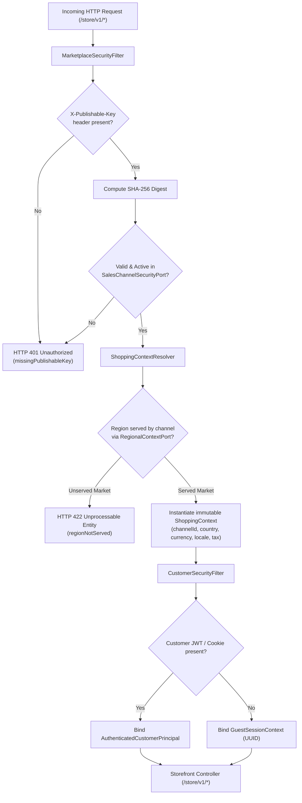
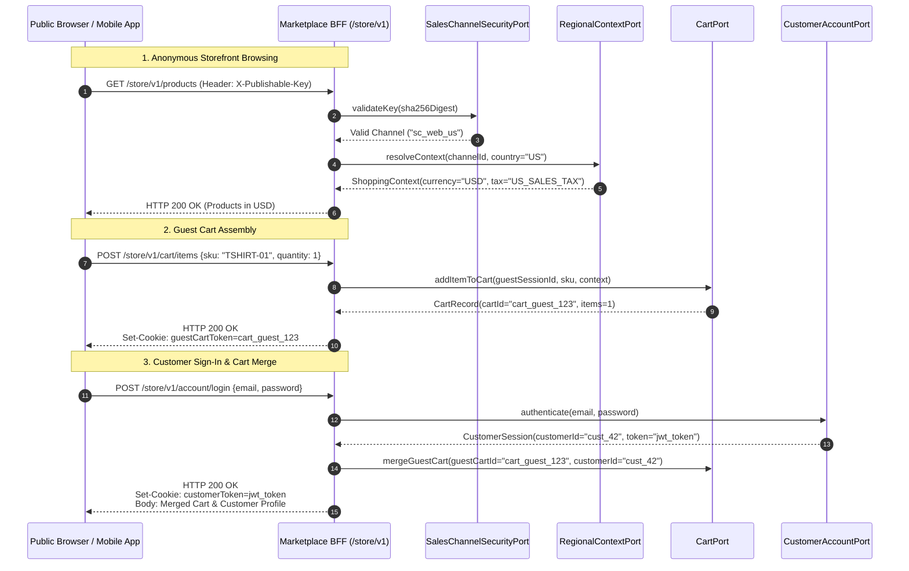
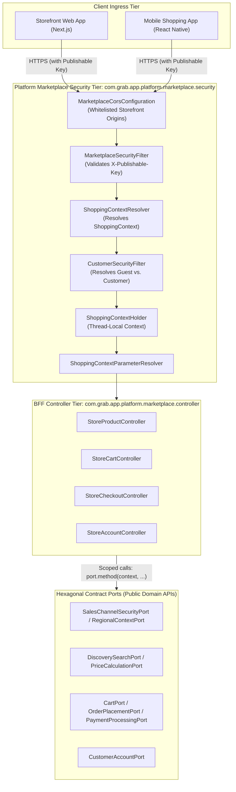
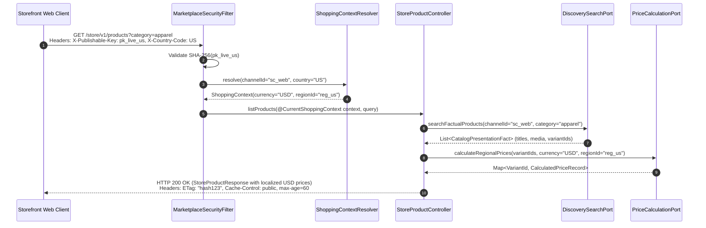

# Tech Spec: Marketplace BFF Ingress Security & Shopping Context Resolution

- **Summary:** Enforces edge publishable key authentication (`X-Publishable-Key` SHA-256), stateless `ShoppingContext` resolution, dual-mode customer identity (Guest vs. Authenticated), and storefront CORS for the Marketplace BFF (`/store/v1/*`).
- **Type:** Architecture Pattern / Security Infrastructure
- **Feature Spec:** [Platform Marketplace BFF Implementation](../../features/feat_013-platform-marketplace-bff.md)

---

## 1. Problem & Decision

### What breaks without this?

Without a dedicated edge security and context resolution filter pipeline, public storefront endpoints rely on client-supplied channel, currency, and country query parameters (e.g., `?channelId=1&currency=USD`). Malicious shoppers can tamper with channel IDs to access unreleased catalogs, manipulate currency parameters to bypass regional pricing rules, or trigger checkout flows with invalid regional tax structures. Furthermore, exposing administrative endpoints alongside public shopping routes exposes the platform to denial-of-service (DoS) attacks and prevents applying lenient CORS policies specifically tailored for public storefront domains.

### Decision

| Option | Decision | Why |
|:-------|:---------|:----|
| **Edge Publishable Key Filter + Stateless Shopping Context Resolver + Dual-Mode Customer Auth** | **Adopted** | Intercepts `/store/v1/*`, hashes `X-Publishable-Key` via SHA-256 to verify channel status, resolves country/currency/tax into an immutable `ShoppingContext`, and transparently binds guest tokens or verified customer JWTs. |
| Client-Supplied Channel & Currency Parameters (`?channelId=...&currency=...`) | Rejected | High vulnerability to channel spoofing, currency arbitrage, and bypass of regional market tax/price rules. |
| Requiring Customer Login for Storefront Browsing | Rejected | Severe friction for shoppers; drastically reduces conversion rates. Storefront browsing and cart creation must support anonymous guests. |
| Private API Key / Secret Embedded in Web Frontend | Rejected | High security risk; static client secrets embedded in browser JavaScript can be extracted and abused. |

### Trade-offs

| Benefits | Trade-offs |
|:---------|:-----------|
| Cryptographic channel binding: Channel status, allowed markets, and regional policies are resolved server-side without trusting client inputs. | Requires an initial token digest lookup via `SalesChannelSecurityPort` for incoming requests. |
| Seamless shopper onboarding: Anonymous visitors can immediately browse, search, and assemble carts without authenticating. | Guest carts require maintaining temporary guest session identifiers and merging with customer accounts upon post-login. |
| Clean segregation from merchant back-office: Public storefront traffic can be cached aggressively at CDN edges without exposing seller operations. | Public endpoints require strict rate-limiting per IP/key to mitigate scraping and automated checkout bots. |

---

## 2. How It Works

### Core Concept

The Marketplace BFF security pipeline chains three specialized filters across `/store/v1/*`:
1. **`MarketplaceSecurityFilter`**: Extracts `X-Publishable-Key`, computes its SHA-256 digest, and validates it against `SalesChannelSecurityPort`.
2. **`ShoppingContextResolver`**: Reads geographic indicators (IP Geo-location headers, `Accept-Language`, or optional explicit country override), verifies the region is active for the channel via `RegionalContextPort`, and binds an immutable `ShoppingContext` to the request.
3. **`CustomerSecurityFilter`**: Checks for an existing customer Bearer JWT or `accessToken` cookie. If present, it resolves an `AuthenticatedCustomerPrincipal`; if absent, it assigns or maintains a guest session UUID.

### How It Works Step by Step

| Step | What Happens | Why |
|:-----|:-------------|:----|
| 1 | Storefront client (`grab-web` / mobile app) sends request to `/store/v1/*` with `X-Publishable-Key: pk_live_...`. | Identifies the specific sales channel destination (e.g. US Web Store, SG Mobile App). |
| 2 | `MarketplaceSecurityFilter` computes SHA-256 digest and verifies it via `SalesChannelSecurityPort.validateKey(digest)`. | Validates credential without storing raw keys in the database or leaking secrets in logs. |
| 3 | Filter confirms sales channel is in `ENABLED` status. If disabled or revoked, returns `HTTP 401 Unauthorized`. | Instantly shuts down decommissioned channels or revoked frontend credentials. |
| 4 | `ShoppingContextResolver` inspects Geo-IP / country headers and invokes `RegionalContextPort.resolveContext(channelId, countryCode)`. | Establishes the authoritative currency, tax jurisdiction, and regional price list. |
| 5 | If the region is unserved, filter halts with `HTTP 422 Unprocessable Entity` with `regionNotServed` code. | Strictly avoids masquerading another market's catalog or displaying invalid currencies (no silent fallback). |
| 6 | `CustomerSecurityFilter` checks `Authorization: Bearer <jwt>`. If present, validates customer identity; otherwise, tracks guest session. | Provides continuous shopper identity across cart assembly and checkout. |
| 7 | Controller receives resolved `ShoppingContext` via `@CurrentShoppingContext` and delegates to domain ports. | All downstream domain operations operate within verified channel and currency boundaries. |

### Shopper Session & Authentication Lifecycle

---

## 3. How We Use It

### Where It Fits in Our System / Architecture & Layer Stacking

### Component Responsibilities

| Component | Role | What It Does |
|:----------|:-----|:-------------|
| `MarketplaceSecurityFilter` | Ingress Key Filter | Intercepts `/store/v1/**`, extracts `X-Publishable-Key`, computes SHA-256 digest, and validates key status via `SalesChannelSecurityPort`. |
| `ShoppingContextResolver` | Context Provider | Resolves active sales channel, market, country, currency, locale, and tax jurisdiction via `RegionalContextPort`. Binds immutable `ShoppingContext`. |
| `CustomerSecurityFilter` | Identity Resolver | Detects customer Bearer JWT or cookies. Binds `AuthenticatedCustomerPrincipal` or generates/validates anonymous guest session tokens. |
| `ShoppingContext` | Security & Context Record | Immutable record holding `salesChannelId`, `regionId`, `countryCode`, `currencyCode`, `locale`, and `taxRuleId`. Injected via `@CurrentShoppingContext`. |
| `MarketplaceCorsConfiguration` | Network Boundary | Configures permissive, credentials-supported CORS for verified public storefront origins (`http://localhost:3000`, production storefront domains). |
| `MarketplaceExceptionHandler` | Error Translator | Catches security and context resolution exceptions, returning standardized RFC 7807 problem details (`missingPublishableKey`, `regionNotServed`). |

### Runtime Flow: Contextual Catalog Query

---

## 4. Implementation Rules

| Rule | Requirement |
|:-----|:------------|
| **R-01** | `MarketplaceSecurityFilter` **MUST** intercept all HTTP requests under `/store/v1/**`. Requests lacking a valid `X-Publishable-Key` header **MUST** be rejected with `HTTP 401 Unauthorized` in RFC 7807 format. |
| **R-02** | Publishable keys **MUST** be evaluated exclusively by their SHA-256 cryptographic digest. Raw tokens **MUST NOT** be persisted in plaintext or logged in server operational logs. |
| **R-03** | `ShoppingContextResolver` **MUST** verify that the customer's resolved country/market is officially served by the channel. If unserved, the filter **MUST** reject the request with `HTTP 422 Unprocessable Entity` (`regionNotServed`). Silent fallbacks to alternate currencies or countries are **STRICTLY PROHIBITED**. |
| **R-04** | The resolved `ShoppingContext` **MUST** be an immutable Java `record`. Downstream controllers and domain ports **MUST NOT** accept client-supplied currency or channel overrides that conflict with the resolved context. |
| **R-05** | Guest cart operations **MUST** be bound to a server-generated UUID guest session token stored in an `HttpOnly`, `SameSite=Lax` cookie (`guestSessionId`) or custom session header. |
| **R-06** | Authenticated customer endpoints (`/store/v1/account/**`, `/store/v1/orders/**`) **MUST** require a valid customer Bearer JWT. Accessing orders or profiles belonging to another customer **MUST** return `HTTP 403 Forbidden` or `HTTP 404 Not Found`. |
| **R-07** | `MarketplaceCorsConfiguration` **MUST** allow requests from configured storefront origins (`http://localhost:3000`, whitelisted merchant storefront domains) and **MUST** expose headers `ETag`, `X-Guest-Session-Id`, and `Link`. |
| **R-08** | Public catalog and search endpoints **MUST** return appropriate caching headers (`Cache-Control: public, max-age=60` and `ETag`) to enable edge CDN and browser caching. |
| **R-09** | Rate limiting **MUST** be applied per publishable key and client IP on all mutating endpoints (`/store/v1/cart/**`, `/store/v1/checkout/**`) to prevent automated inventory hoarding and card-testing attacks. |
| **R-10** | Spring Modulith ArchUnit tests (`MarketplaceBffSecurityArchitectureTest`) **MUST** verify that security filters in `platform.marketplace` do not import internal domain repositories or JPA entities. |
