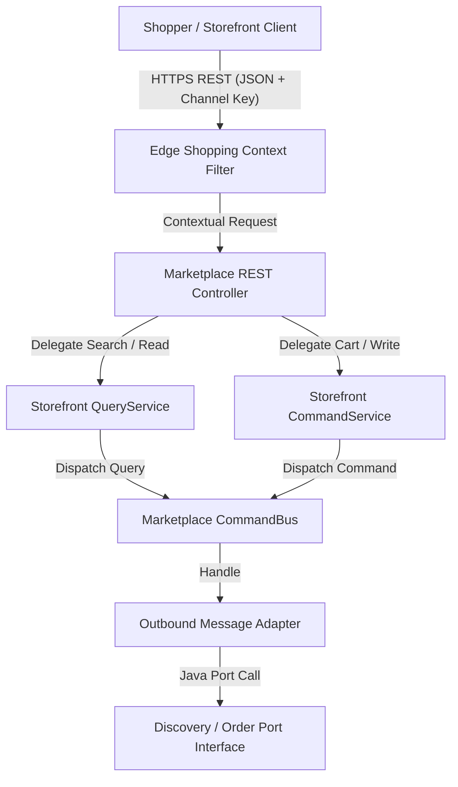
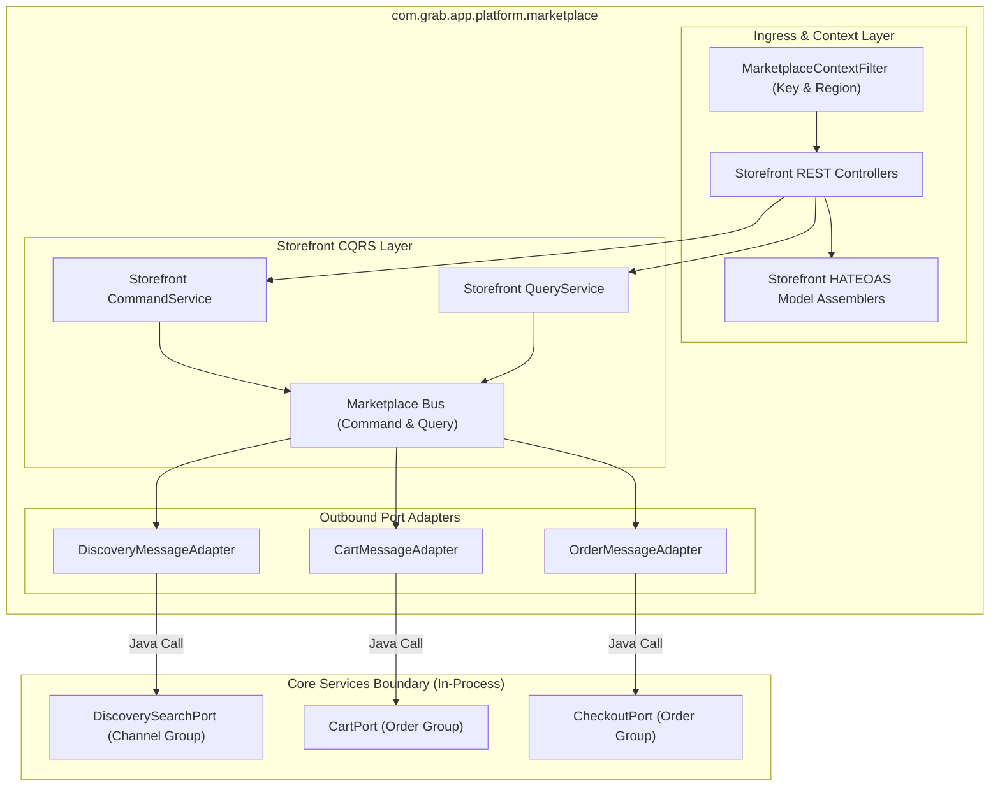
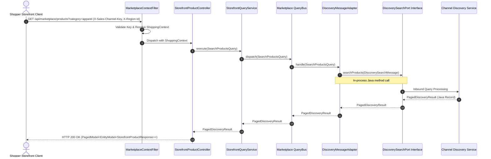

# Tech Spec: Marketplace Platform Communication Protocol & Contracts

- **Summary:** Defines the high-throughput storefront REST API protocol, publishable key and edge context resolution filters, and synchronous in-process Java outbound port contracts for the Marketplace Platform BFF (`com.grab.app.platform.marketplace`).
- **Type:** Architecture Pattern / Ingress Protocol
- **Feature Spec:** [BFF-to-Domain Communication Protocol & Controller Contract Migration](../../features/feat_011-decoupled-service-communication-cqrs-pipeline.md)

---

## 1. Problem & Decision

### What breaks without this?

Storefront shoppers require low-latency browsing, anonymous session caching, and contextual product discovery resolved by sales channel and geographic region. Without a dedicated Marketplace Platform BFF, storefront controllers are entangled with back-office merchant endpoints and domain logic. This results in heavy, unindexed database queries on write instances during traffic surges, leaks internal pricing algorithms and unpublished inventory directly to public consumers, and prevents independent edge scaling or CDN-based response caching for consumer traffic.

### Decision

| Option | Decision | Why |
|:---------|:---------|:----|
| **Dedicated Marketplace Platform BFF with Edge Context Resolution** | Adopted | Provides optimized, high-throughput REST APIs for shoppers, extracts geographic and sales channel context at the ingress filter, and delegates to domain query and command ports without local persistence. |
| Shared Monolithic REST Controller Layer | Rejected | Mixes merchant administration with high-concurrency public browsing, resulting in single-point-of-failure contention and complex security configurations. |
| Direct Shopper Ingress into Domain Services | Rejected | Exposes raw domain aggregates, bypasses edge contextual pricing projections, and prevents future microservice extraction. |

### Trade-offs

| Benefits | Trade-offs |
|:---------|:-----------|
| Storefront APIs can scale independently with aggressive HTTP caching and edge CDN integration. | Requires a translation step mapping shopper request parameters into domain query ports. |
| Edge shopping context (channel key, region, currency) is validated once at the ingress filter before dispatching. | Adds an additional stateless layer between external mobile/web clients and domain services. |

---

## 2. How It Works

### Core Concept

The Marketplace Platform BFF (`com.grab.app.platform.marketplace`) serves as the public ingress gateway for shoppers, mobile apps, and web storefronts. It validates the client's publishable sales channel key (`X-Sales-Channel-Key`), resolves the regional shopping context (`X-Region-Id`), and delegates requests to core domain services via strongly typed Java port interfaces (`port.message`).



### How It Works Step by Step

| Step | What Happens | Why |
|:-----|:-------------|:----|
| 1 | Client issues an HTTPS GET or POST to `/api/marketplace/**` with `X-Sales-Channel-Key` and optional `X-Region-Id` headers. | Delivers storefront requests with required commercial channel and regional routing context. |
| 2 | `MarketplaceContextFilter` validates the publishable key against the Channel service cache and resolves the effective `ShoppingContext`. | Ensures only authorized sales channels can query catalog projections and binds regional context early. |
| 3 | Controller receives the contextual request and delegates to `StorefrontQueryService` (for search/catalog) or `StorefrontCommandService` (for cart/checkout). | Enforces strict CQRS separation at the presentation edge. |
| 4 | Query/Command service dispatches an immutable record containing the resolved `ShoppingContext` to the Marketplace CQRS Bus. | Decouples HTTP request semantics from internal capability orchestration. |
| 5 | The platform handler resolves the query/command via an outbound message adapter (`adapter.outbound.message`). | Shields platform logic from transport details through hexagonal adapters. |
| 6 | Outbound adapter invokes the public Java port interface (`port.message`) of the targeted domain group (`channel.discovery`, `order.cart`, `order.checkout`). | In-process Java call with zero serialization overhead and complete compile-time type safety. |
| 7 | Controller transforms domain view records into `EntityModel<T>` or `PagedModel<EntityModel<T>>` with navigational HATEOAS links. | Provides hypermedia navigation (e.g., self, add-to-cart, checkout) directly in the storefront response. |

---

## 3. How We Use It

### Where It Fits in Our System / Architecture & Layer Stacking



### Component Responsibilities

| Component | Role | What It Does |
|:----------|:-----|:-------------|
| `MarketplaceContextFilter` | Ingress Context Filter | Validates `X-Sales-Channel-Key`, parses `X-Region-Id`, and binds an immutable `ShoppingContext` to the request execution thread. |
| `StorefrontProductController` | Catalog Ingress Adapter | Exposes high-throughput product listing, filtering, and detail endpoints under `/api/marketplace/products/**`. |
| `StorefrontCartController` | Cart Ingress Adapter | Manages customer cart lifecycle (creation, item additions, updates) under `/api/marketplace/carts/**`. |
| `StorefrontModelAssembler` | Presentation Assembler | Enriches storefront views with HATEOAS links (`add-to-cart`, `view-details`, `checkout`). |
| `Outbound Message Adapters` | Capability Bridge | Maps storefront commands/queries to domain group port interfaces (`DiscoverySearchPort`, `CartPort`). |

### Runtime Flow



### Contracts & Protocol Specifications

#### 1. Ingress REST Protocol & Header Contract
- **Base URL Pattern:** `/api/marketplace/{resource}`
- **Required Header:** `X-Sales-Channel-Key: {publishable_channel_key}` (identifies commercial tenant).
- **Optional Header:** `X-Region-Id: {region_uuid}` (defaults to channel's default territory if omitted).
- **Authentication:** Anonymous sessions via cookie/header; JWT Bearer token for authenticated customers.
- **Transport Format:** `Content-Type: application/json`, `Accept: application/json`.

#### 2. Edge Shopping Context Record Contract
```java
// Resolved Immutable Context Passed to Inbound Queries/Commands
public record ShoppingContext(
    String salesChannelId,
    String publishableKey,
    String regionId,
    String currencyCode,
    Locale locale,
    Optional<String> customerId
) {}
```

#### 3. Marketplace REST Ingress DTO Contracts (Sample)
```java
// Storefront Search Request Query DTO
public record ProductSearchRequest(
    String query,
    String category,
    BigDecimal minPrice,
    BigDecimal maxPrice,
    int page,
    int size
) {}

// Storefront Product Response DTO (Primitives & Strings Only)
public record StorefrontProductResponse(
    String id,
    String title,
    String description,
    BigDecimal regionalPrice,
    String currencyCode,
    boolean inStock,
    List<String> imageUrls
) {}
```

#### 4. Outbound Port Invocation Contract
```java
// Downstream Domain Port Interface Contract (Implemented by Discovery Domain)
public interface DiscoverySearchPort {
    PagedDiscoveryResult searchProducts(DiscoverySearchMessage message);
    Optional<DiscoveryProductDetailResult> getProductDetails(String productId, ShoppingContext context);
}

// Outbound Message Record (Contract between Marketplace BFF and Channel Discovery)
public record DiscoverySearchMessage(
    ShoppingContext context,
    String searchQuery,
    String category,
    BigDecimal minPrice,
    BigDecimal maxPrice,
    int page,
    int size
) {}
```

---

## 4. Implementation Rules

| Rule | Requirement |
|:-----|:------------|
| **R-01** | All storefront shopper HTTP endpoints **MUST** reside exclusively in the Marketplace Platform BFF (`com.grab.app.platform.marketplace`) under `/api/marketplace/**`. |
| **R-02** | Every marketplace request **MUST** be processed by `MarketplaceContextFilter` to validate the `X-Sales-Channel-Key` and resolve the `ShoppingContext` before reaching controllers. |
| **R-03** | The Marketplace Platform BFF **MUST NOT** import JPA repositories or `@Entity` models; all read/write operations must invoke domain port interfaces. |
| **R-04** | Controllers **MUST NOT** inject `CommandBus`, `QueryBus`, or domain use cases directly; they delegate reads to `StorefrontQueryService` and writes to `StorefrontCommandService`. |
| **R-05** | Downstream domain calls **MUST** pass through outbound message adapters invoking public Java port interfaces (`port.message`), enforcing compile-time type safety and strict hexagonal decoupling. |
| **R-06** | Catalog and product searches **MUST** query the `discovery` projection port (`DiscoverySearchPort`) rather than querying the core catalog write database directly. |
| **R-07** | Storefront collection responses **MUST** be wrapped in `PagedModel<EntityModel<T>>` containing hypermedia links (`self`, `next`, `prev`). |

