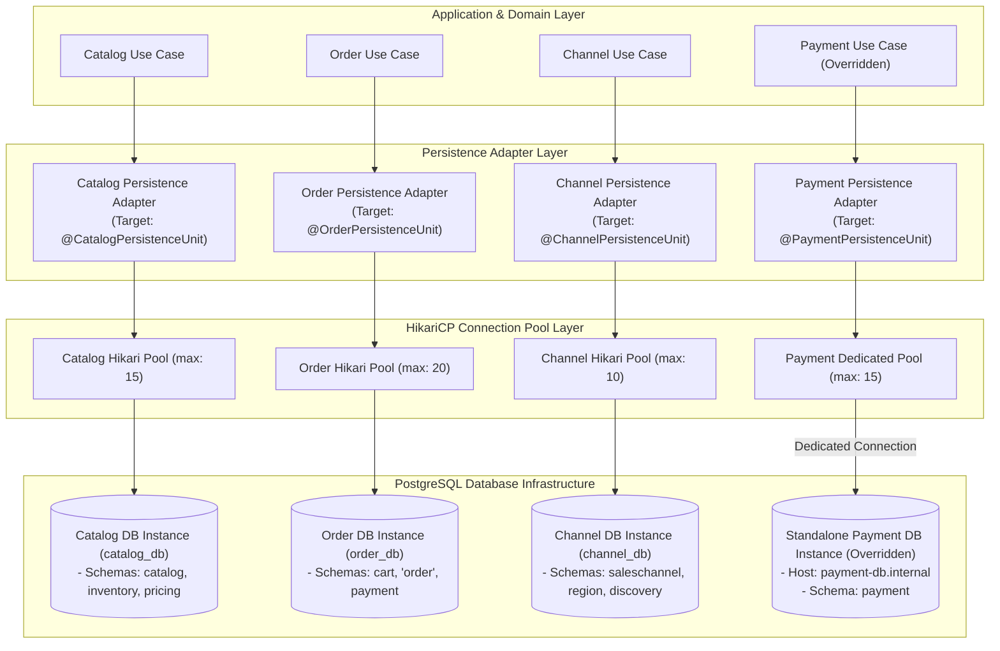

# Tech Spec: Multi-Schema Database Isolation & Connection Budgeting

- **Summary:** Defines multi-schema logical persistence isolation and connection pool budgeting across service groups by default, with granular per-domain configuration for dedicated connection pools or separate database instances.
- **Type:** Platform Infrastructure
- **Feature Spec:** [Multi-Schema Database Isolation & Connection Budgeting](../../features/feat_010-multi-schema-database-isolation-connection-budgeting.md)
- **Supporting Service Group Specs:**
  - [Catalog Service Group Persistence](catalog-service-group-persistence-tech-spec.md) (`catalog`, `inventory`, `pricing` $\rightarrow$ schema `'catalog'`)
  - [Order Service Group Persistence](order-service-group-persistence-tech-spec.md) (`cart`, `order`, `payment` $\rightarrow$ schema `'"order"'`)
  - [Account Service Group Persistence](account-service-group-persistence-tech-spec.md) (`identity`, `merchant`, `customer` $\rightarrow$ schema `'account'`)
  - [Channel Service Group Persistence](channel-service-group-persistence-tech-spec.md) (`saleschannel`, `region` $\rightarrow$ schema `'channel'`)
  - [Discovery Service Persistence](discovery-service-persistence-tech-spec.md) (`discovery` $\rightarrow$ dedicated separate connection & projection tables)

---

## 1. Problem & Decision

### What breaks without this?

When all modules share an unpartitioned database schema and a single connection pool, high-volume read traffic (such as storefront search or flash sale browsing) exhausts all available database connections. When connections are saturated, critical transactional write operations—such as order creation and payment authorization—fail with connection timeout exceptions. Furthermore, without schema boundaries and dedicated migration streams, database tables become tightly coupled through cross-domain joins and foreign keys, preventing zero-downtime schema evolution and making future physical microservice extraction impossible.

### Decision

| Option | Decision | Why |
|:-------|:---------|:----|
| **Database Instance per Service Group with Schema per Domain** | Adopted | Complete physical and I/O isolation per functional group. Each service group operates its own database instance (`catalog_db`, `order_db`, `account_db`, `channel_db`), while each domain occupies its dedicated schema. Pods connect directly using bounded HikariCP connection pools, avoiding external proxy layers like PgBouncer for simplicity. |
| Single Shared Schema & Shared Pool | Rejected | High blast radius: a slow query in one domain starves connection resources across all domains; cross-table foreign keys couple modules permanently. |
| Single Monolithic Database Instance for All Services | Rejected | Shared database instance means CPU, RAM, disk I/O, and storage are physically shared across all domains; catalog flash sales crash checkout databases. |

### Trade-offs

| Benefits | Trade-offs |
|:---------|:-----------|
| Complete I/O and failure isolation across service groups; failure or load spikes in catalog browsing cannot impact checkout or payment. | Managing four PostgreSQL instances requires independent database maintenance and backups. |
| Simple, direct connection architecture using battle-tested HikariCP; zero external proxy dependencies. | Application pod replica scaling must respect configured database connection ceilings. |
| Clean domain boundaries with dedicated Flyway migration streams per schema; zero cross-schema foreign keys. | Cross-context data integrity must be maintained at the application layer using typed identifiers (`Id`) and transactional outbox events. |

---

## 2. How It Works

### Core Concept

The persistence architecture enforces **Database Instance per Service Group** and **Schema per Domain**:
1. **Database Instance per Service Group**: Rather than a single shared database instance, each service group operates its own autonomous PostgreSQL database instance:
   - `catalog` service group operates database instance `catalog_db`.
   - `order` service group operates database instance `order_db`.
   - `account` service group operates database instance `account_db`.
   - `channel` service group operates database instance `channel_db`.
2. **Schema per Domain within Group Instance**:
   - Inside `catalog_db`: schema `catalog`, schema `inventory`, schema `pricing`.
   - Inside `order_db`: schema `cart`, schema `"order"` (quoted SQL identifier), schema `payment`.
   - Inside `account_db`: schema `identity`, schema `merchant`, schema `customer`.
   - Inside `channel_db`: schema `saleschannel`, schema `region`, schema `discovery`.
3. **Dedicated Discovery Connection & Per-Domain Overwrites**:
   - The `discovery` domain service in `channel_db` operates on a **dedicated separate connection pool** (`DiscoveryHikariPool`), isolating high-volume storefront search queries from administrative channel configuration, and is ready for read-replica routing.
   - Any individual domain service can selectively overwrite its configuration to bind to a separate database instance (e.g. `payment` to a standalone PCI instance) without code changes.

### How It Works Step by Step

| Step | What Happens | Why |
|:-----|:-------------|:----|
| 1 | Service context boots and inspects domain persistence configuration properties. | Determines whether the domain service uses group defaults or specific overrides. |
| 2 | Persistence factory initializes `HikariDataSource` and `PlatformTransactionManager`. | Binds the domain service to its designated connection pool, credentials, and target schema. |
| 3 | Flyway migration runner executes migrations from `db/migration/{domain}`. | Applies versioned DDL against the target schema and updates its local `flyway_schema_history`. |
| 4 | Use cases execute aggregate queries and mutations through intra-domain repositories. | Enforces that queries and updates stay strictly within the domain's configured persistence unit. |
| 5 | Domain events and outbox records are inserted into `{schema}.outbox_record` within the local transaction. | Guarantees atomic persistence of aggregate state and outbox events in the same physical database. |

### Connection Pool Management & Direct HikariCP Pooling

Each service group connects directly to its designated PostgreSQL database instance (`catalog_db`, `order_db`, `account_db`, `channel_db`) using an isolated, bounded **HikariCP connection pool**. This guarantees deterministic connection allocation, prevents catalog browsing bursts from starving checkout operations, and eliminates external proxy layers:

```
[ Application Pod (HikariCP) ] 
       │
       ├─► CatalogHikariPool (max: 15)  ───────────────► [ catalog_db:5432 (PostgreSQL) ]
       ├─► OrderHikariPool (max: 20)    ───────────────► [ order_db:5432 (PostgreSQL) ]
       ├─► AccountHikariPool (max: 10)  ───────────────► [ account_db:5432 (PostgreSQL) ]
       ├─► ChannelHikariPool (max: 10)  ──┐
       └─► DiscoveryHikariPool (max: 25) ─┴────────────► [ channel_db:5432 (PostgreSQL) ]
```

#### Pool Allocation Matrix per Database Instance

| Service Group Database Instance | Target Database | HikariCP Pool Name | Maximum Pool Size (`maximum-pool-size`) | Minimum Idle (`minimum-idle`) | Target Schemas per Domain |
|:--------------------------------|:----------------|:-------------------|:----------------------------------------|:------------------------------|:--------------------------|
| **Catalog DB** | `catalog_db` | `CatalogHikariPool` | 15 | 3 | `catalog`, `inventory`, `pricing` |
| **Order DB** | `order_db` | `OrderHikariPool` | 20 | 5 | `cart`, `"order"`, `payment` |
| **Account DB** | `account_db` | `AccountHikariPool` | 10 | 2 | `identity`, `merchant`, `customer` |
| **Channel DB** | `channel_db` | `ChannelHikariPool` | 10 | 2 | `saleschannel`, `region` |
| **Channel DB (Search)** | `channel_db` | `DiscoveryHikariPool` | 25 | 5 | `discovery` (Read-Replica Ready) |

---

## 3. How We Use It

### Where It Fits in Our System / Architecture & Layer Stacking



### Component Responsibilities

| Component | Role | What It Does |
|:----------|:-----|:-------------|
| **Group Default Datasource** | Baseline Persistence Configuration | Declares group database connection endpoint, default credentials, and HikariCP pool settings. |
| **Domain Datasource Override** | Granular Connection Configuration | Allows an individual bounded context to declare custom JDBC URL, credentials, pool limits, or target database instance. |
| **Flyway Migration Runner** | Schema DDL Migration Authority | Executes domain-specific SQL migrations (`db/migration/{domain}`) and maintains a discrete `flyway_schema_history` table in the target schema. |
| **HikariCP Local Pool** | In-JVM Concurrency Manager | Manages thread-to-connection handoff within the application pod (`maximum-pool-size: 10–20`). |
| **Transactional Outbox Table** | Reliable Event Store | Persists integration events atomically within the local database transaction of the mutating domain service. |

---

## 4. Implementation Rules

> These are **non-negotiable contracts**. An implementation is compliant only when **all** rules are satisfied.

- **RULE-DB-01: Schema Quoting for "order"**
  All SQL scripts, Flyway migrations, and Spring configuration files MUST explicitly quote the schema name `"order"`. Unquoted usage (which defaults to the SQL reserved keyword) is strictly forbidden.

- **RULE-DB-02: Zero Cross-Schema Foreign Keys or Joins**
  No table in one schema may declare a foreign key constraint referencing a table in another schema. Cross-schema joins in SQL queries or JPQL are prohibited. Cross-context entities MUST be referenced by typed identifier (`Id`) only.

- **RULE-DB-03: Two-Tier Configuration Hierarchy**
  Domain persistence adapters MUST support two-tier configuration: inheriting service group defaults while permitting granular per-domain overrides for JDBC URL, credentials, pool limits, and schema without code changes.

- **RULE-DB-04: Isolated Connection Pools per Persistence Unit**
  Each persistence unit MUST maintain its own dedicated `HikariDataSource`. Services or overridden domains MUST NOT share a connection pool under any circumstances.

- **RULE-DB-05: Dedicated Connection Pool per Persistence Unit**
  Each persistence unit MUST maintain its own dedicated `HikariDataSource` with bounded pool sizes (`maximum-pool-size`) and timeouts directly connecting to its PostgreSQL database instance. Direct application connections to PostgreSQL are standard without intermediate proxies. All entities and queries MUST configure `hibernate.default_schema` for domain schema qualification.

- **RULE-DB-06: One Outbox Table per Domain Schema**
  Each domain schema MUST maintain its own outbox table (`{schema}.outbox_record`). All domain events MUST be inserted into this local outbox table within their domain transaction boundary (`@{Domain}Transactional`).

- **RULE-DB-07: Independent Migration Streams per Schema**
  Each domain service or group MUST maintain its own independent Flyway migration folder (`db/migration/{domain}`) and record history in its own `{schema}.flyway_schema_history` table.
