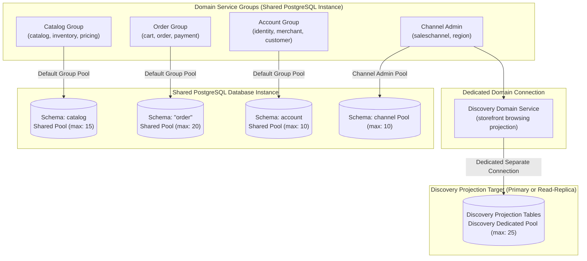
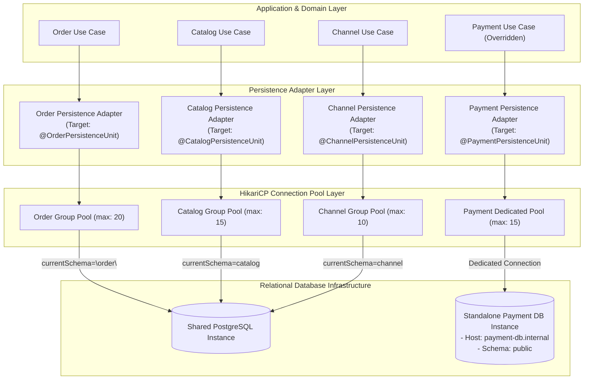
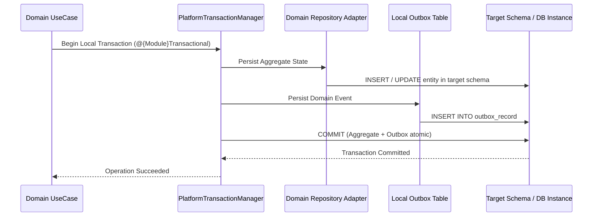

# Tech Spec: Multi-Schema Database Isolation & Connection Budgeting

- **Summary:** Defines multi-schema logical persistence isolation and connection pool budgeting across service groups by default, with granular per-domain configuration for dedicated connection pools or separate database instances.
- **Type:** Platform Infrastructure
- **Feature Spec:** [Multi-Schema Database Isolation & Connection Budgeting](../../features/feat_010-multi-schema-database-isolation-connection-budgeting.md)
- **Supporting Service Group Specs:**
  - [Catalog Service Group Persistence](catalog-service-group-persistence-tech-spec.md) (`catalog`, `inventory`, `pricing` $\rightarrow$ schema `'catalog'`)
  - [Order Service Group Persistence](order-service-group-persistence-tech-spec.md) (`cart`, `order`, `payment` $\rightarrow$ schema `'"order"'`)
  - [Account Service Group Persistence](account-service-group-persistence-tech-spec.md) (`identity`, `merchant`, `customer` $\rightarrow$ schema `'account'`)
  - [Channel Service Group Persistence](channel-service-group-persistence-tech-spec.md) (`saleschannel`, `region` $\rightarrow$ schema `'channel'`; `discovery` $\rightarrow$ separate connection)

---

## 1. Problem & Decision

### What breaks without this?

When all modules share an unpartitioned database schema and a single connection pool, high-volume read traffic (such as storefront search or flash sale browsing) exhausts all available database connections. When connections are saturated, critical transactional write operations—such as order creation and payment authorization—fail with connection timeout exceptions. Furthermore, without schema boundaries and dedicated migration streams, database tables become tightly coupled through cross-domain joins and foreign keys, preventing zero-downtime schema evolution and making future physical microservice extraction impossible.

### Decision

| Option | Decision | Why |
|:-------|:---------|:----|
| **Multi-Schema with Per-Domain Configurable Overrides** | Adopted | Balances operational simplicity with microservice extraction readiness. By default, domain services within a service group share the group's schema on a shared database instance, while allowing any individual domain service (such as `discovery` in `channel`) to configure a dedicated connection pool or separate database instance. |
| Single Shared Schema & Shared Pool | Rejected | High blast radius: a slow query in one domain starves connection resources across all domains; cross-table foreign keys couple modules permanently. |
| Mandatory Separate Physical Database per Domain | Deferred | Operational overkill for current scale; introduces premature network latency, multi-instance hosting costs, and distributed data management before business traffic demands it. |

### Trade-offs

| Benefits | Trade-offs |
|:---------|:-----------|
| Domain services within a group share a common schema by default, minimizing database instance and migration overhead. | Shared database instance means CPU, RAM, disk I/O, and storage are physically shared; noisy neighbors can impact overall I/O. |
| Heavy read-projection domains (such as `discovery`) can operate on dedicated connection pools or read-replicas without starving administrative channel management. | Requires maintaining separate Flyway migration streams and managing two connection pools in the channel service group. |
| A connection spike in catalog or channel browsing cannot starve the order checkout connection pool. | Cross-schema joins and database foreign keys are strictly prohibited; cross-context data integrity must be maintained at the application layer. |

---

## 2. How It Works

### Core Concept

The persistence architecture employs a **two-tier configuration and schema isolation model**:
1. **Service Group Default Schema**: By default, domain services belonging to a service group share the group's schema on a shared PostgreSQL instance:
   - `catalog` service group (`catalog`, `inventory`, `pricing`) shares schema `'catalog'`.
   - `order` service group (`cart`, `order`, `payment`) shares schema `'"order"'` (quoted SQL identifier).
   - `account` service group (`identity`, `merchant`, `customer`) shares schema `'account'`.
   - `channel` service group: `saleschannel` and `region` share schema `'channel'`.
2. **Dedicated Discovery Connection & Per-Domain Overrides**:
   - The `discovery` domain service in the `channel` group operates on a **dedicated separate database connection** (`DiscoveryHikariPool`), isolating high-volume storefront search queries from administrative channel configuration and key management.
   - Any individual domain service can override its configuration to bind to a custom pool, distinct schema, or dedicated physical database instance without code modification.



### How It Works Step by Step

| Step | What Happens | Why |
|:-----|:-------------|:----|
| 1 | Service context boots and inspects domain persistence configuration properties. | Determines whether the domain service uses group defaults or specific overrides. |
| 2 | Persistence factory initializes `HikariDataSource` and `PlatformTransactionManager`. | Binds the domain service to its designated connection pool, credentials, and target schema. |
| 3 | Flyway migration runner executes migrations from `db/migration/{domain}`. | Applies versioned DDL against the target schema and updates its local `flyway_schema_history`. |
| 4 | Use cases execute aggregate queries and mutations through intra-domain repositories. | Enforces that queries and updates stay strictly within the domain's configured persistence unit. |
| 5 | Domain events and outbox records are inserted into `{schema}.outbox_record` within the local transaction. | Guarantees atomic persistence of aggregate state and outbox events in the same physical database. |

### Connection Pool Sizing & Saturation Budget Formula

To prevent database-wide connection exhaustion on the shared database instance, total connections across all service groups, replicas, and rolling deployment overlaps must not exceed the PostgreSQL maximum connection limit:

$$\sum_{s \in \text{Services}} \left( N_s \times O_s \times P_s \right) + C_{\text{admin}} + C_{\text{reserve}} \le \text{MaxDBConnections}$$

Where:
- $N_s$: Number of active service replicas/pods for service or domain $s$.
- $O_s$: Rolling deployment overlap multiplier (standard is $2.0$, reflecting double capacity during blue/green or rolling updates).
- $P_s$: Maximum pool size (`maximum-pool-size`) configured in HikariCP for service or domain $s$.
- $C_{\text{admin}}$: Connections reserved for background workers, Flyway migrations, and monitoring agents (e.g., Datadog/Prometheus).
- $C_{\text{reserve}}$: PostgreSQL system reserved connections (superuser connections and safety margin, minimum 10%).
- $\text{MaxDBConnections}$: Maximum connection limit configured on the shared PostgreSQL instance (`max_connections`).

#### Example Budget Calculation (Max Connections = 300)

| Service / Domain Pool | Replicas ($N$) | Overlap ($O$) | Max Pool ($P$) | Total Budgeted Connections | Target Database |
|:----------------------|:---------------|:--------------|:---------------|:---------------------------|:----------------|
| `order` (cart, order, payment) | 2 | 2 | 20 | 80 | Shared DB (`"order"`) |
| `catalog` (catalog, inventory, pricing) | 2 | 2 | 15 | 60 | Shared DB (`catalog`) |
| `account` (identity, merchant, customer) | 2 | 2 | 10 | 40 | Shared DB (`account`) |
| `channel` (saleschannel, region) | 2 | 2 | 10 | 40 | Shared DB (`channel`) |
| `discovery` (separate storefront connection) | 2 | 2 | 25 | *(0 against shared primary)* | Dedicated Read-Replica / Projection Target |
| Admin / Flyway / Monitoring | — | — | — | 10 | Shared DB |
| Operational Safety Reserve | — | — | — | 20 | Shared DB |
| **Total Allocated to Shared Primary DB** | — | — | — | **250 $\le$ 300 (Compliant)** | Shared DB |

---

## 3. How We Use It

### Where It Fits in Our System / Architecture & Layer Stacking



### Component Responsibilities

| Component | Role | What It Does |
|:----------|:-----|:-------------|
| **Group Default Datasource** | Baseline Persistence Configuration | Provides shared connection pool, Flyway location, and default schema for all bounded contexts within a service group. |
| **Domain Datasource Override** | Granular Connection Configuration | Allows an individual bounded context to declare custom JDBC URL, credentials, pool limits, or target database instance. |
| **Flyway Migration Runner** | Schema DDL Migration Authority | Executes domain-specific SQL migrations (`db/migration/{domain}`) and maintains a discrete `flyway_schema_history` table in the target schema. |
| **HikariCP Pool Manager** | Connection Budget Enforcer | Enforces maximum pool limits per persistence unit to prevent connection exhaustion. |
| **Transactional Outbox Table** | Reliable Event Store | Persists integration events atomically within the local database transaction of the mutating domain service. |

### Runtime Flow

> Shows a local transaction commit with outbox event persistence on either the shared group schema or an overridden database instance.



### Configuration Hierarchy & Override Model

Configuration resolves via a two-tier hierarchy: **Domain Service Override $\rightarrow$ Service Group Default $\rightarrow$ Global Shared Database**.

#### 1. Group Default Configuration (Shared Database Instance)

Domain services without explicit overrides inherit group defaults:

```yaml
grab:
  order:
    datasource:
      jdbc-url: jdbc:postgresql://${DB_HOST:localhost}:${DB_PORT:5432}/${DB_NAME:grab_commerce}?currentSchema="order"
      username: ${ORDER_DB_USER:order_user}
      password: ${ORDER_DB_PASSWORD:order_secret}
      hikari:
        maximum-pool-size: 20
        minimum-idle: 5
        connection-timeout: 30000
        pool-name: OrderHikariPool
    flyway:
      schemas: '"order"'
      default-schema: '"order"'
      table: flyway_schema_history
      locations: classpath:db/migration/order

  channel:
    datasource:
      jdbc-url: jdbc:postgresql://${DB_HOST:localhost}:${DB_PORT:5432}/${DB_NAME:grab_commerce}?currentSchema=channel
      username: ${CHANNEL_DB_USER:channel_user}
      password: ${CHANNEL_DB_PASSWORD:channel_secret}
      hikari:
        maximum-pool-size: 10
        minimum-idle: 2
        connection-timeout: 30000
        pool-name: ChannelHikariPool
    flyway:
      schemas: channel
      default-schema: channel
      table: flyway_schema_history
      locations: classpath:db/migration/channel
```

#### 2. Granular Per-Domain Override (Dedicated Connection / Instance)

When an individual domain service (e.g., `payment`) requires an independent connection pool, schema, or separate database instance:

```yaml
grab:
  order:
    domains:
      payment:
        datasource:
          # Overrides group host to target a dedicated physical database instance
          jdbc-url: jdbc:postgresql://${PAYMENT_DB_HOST:payment-db.internal}:${PAYMENT_DB_PORT:5432}/${PAYMENT_DB_NAME:payment_standalone}
          username: ${PAYMENT_DB_USER:payment_app}
          password: ${PAYMENT_DB_PASSWORD:payment_secret}
          hikari:
            maximum-pool-size: 15
            minimum-idle: 3
            pool-name: PaymentDedicatedPool
        flyway:
          schemas: public
          default-schema: public
          table: flyway_schema_history
          locations: classpath:db/migration/payment
```

> [!WARNING]
> Configuring an override connection or redirecting to a separate database instance does **not** automatically migrate historical data. Physical extraction requires an independent schema migration, ETL data backfill, and cutover window.

---

## 4. Implementation Rules

> These are **non-negotiable contracts**. An implementation is compliant only when **all** rules are satisfied.

- **RULE-DB-01: Schema Quoting for "order"**
  All SQL scripts, Flyway migrations, and Spring configuration files MUST explicitly quote the schema name `"order"`. Unquoted usage (which defaults to the SQL reserved keyword) is strictly forbidden.

- **RULE-DB-02: Zero Cross-Schema Foreign Keys or Joins**
  No table in one schema may declare a foreign key constraint referencing a table in another schema. Cross-schema joins in SQL queries or JPQL are prohibited. Cross-context entities MUST be referenced by typed identifier (`Id`) only.

- **RULE-DB-03: Two-Tier Configuration Hierarchy**
  Domain persistence adapters MUST support two-tier configuration: inheriting service group defaults while permitting granular per-domain overrides for JDBC URL, credentials, pool limits, and schema without code changes.

- **RULE-DB-04: Isolated Connection Pools per Persistence Unit**
  Each persistence unit MUST maintain its own dedicated `HikariDataSource`. Services or overridden domains MUST NOT share a connection pool under any circumstances.

- **RULE-DB-05: Strict Connection Budget Compliance**
  Every deployment configuration on the shared database instance MUST satisfy the Connection Budgeting Formula:
  $$\sum (N \times O \times P) + C_{\text{admin}} + C_{\text{reserve}} \le \text{MaxDBConnections}$$
  Increasing pool size or pod replica counts without validating against the shared connection budget is prohibited.

- **RULE-DB-06: Single Outbox Table per Service Group Schema**
  Each service group schema MUST maintain exactly ONE outbox table (`{schema}.outbox_record`). All domain bounded contexts within that service group (e.g., `catalog`, `inventory`, `pricing` in schema `catalog`) MUST insert their integration events into this single shared outbox table within their local ACID database transaction. A single unified relay poller per service group claims and publishes these events.

- **RULE-DB-07: Independent Migration Streams per Schema**
  Each domain service or group MUST maintain its own independent Flyway migration folder (`db/migration/{domain}`) and record history in its own `{schema}.flyway_schema_history` table.
