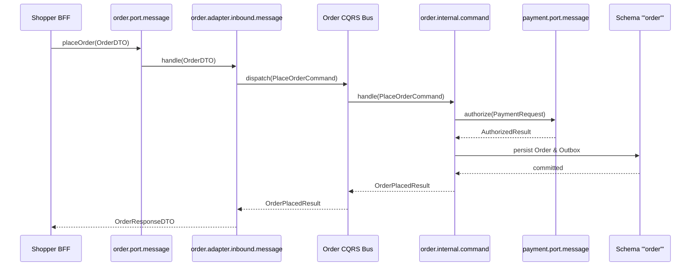

# Tech Spec: Order Service Group Hexagonal Packaging

- **Summary:** Defines the hexagonal package structure, ports, adapters, and CQRS boundaries for the Order Service Group (`cart`, `order`, `payment`) within `com.grab.app.order`.
- **Type:** Architecture Pattern
- **Feature Spec:** [Modular Hexagonal Package Structure](../../features/feat_009-modular-hexagonal-package-structure.md)

---

## 1. Problem & Decision

### What breaks without this?

The checkout and order fulfillment funnel is the core financial engine of e-commerce. Without strict hexagonal package boundaries, transient cart items directly mutate permanent order records, third-party payment gateway callbacks access raw order tables, and external controllers trigger unvalidated order state transitions. This leads to corrupt financial records, duplicate charges, and untracked checkout side-effects.

### Decision

| Option | Decision | Why |
|:-------|:---------|:----|
| **Hexagonal Packaging per Bounded Context in `com.grab.app.order`** | Adopted | Strictly encapsulates `cart`, `order`, and `payment` into distinct bounded contexts while sharing a dedicated connection pool targeting quoted schema `"order"`. |
| Monolithic Checkout Package | Rejected | Collapses distinct cart, order, and payment lifecycles into a single package, causing state machine coupling and race conditions. |
| Immediate Microservice Separation | Deferred | Adds distributed two-phase commit overhead and network failure modes across the critical checkout path before traffic demands physical isolation. |

### Trade-offs

| Benefits | Trade-offs |
|:---------|:-----------|
| Order state machine transitions are strictly guarded behind inbound ports and command handlers. | Cross-context coordination (e.g., cart clearance upon order placement) requires explicit ports and events. |
| Dedicated connection pool prevents order and payment flows from being starved by catalog browsing. | Additional adapter classes required to map between payment responses and order payment records. |

---

## 2. How It Works

### Core Concept

The Order Service Group arranges `cart`, `order`, and `payment` as autonomous bounded contexts under `com.grab.app.order`. Each context publishes public capability contracts in `port/`, contains internal CQRS handlers in `internal/`, and persists state to schema `"order"` via isolated repository adapters.

```mermaid
flowchart TD
    subgraph Ingress ["Checkout Ingress"]
        BFF["Marketplace / Platform BFF"] -->|"Invokes Port"| OrderPort["order.port.message"]
    end

    subgraph OrderGroup ["com.grab.app.order"]
        direction TB
        OrderPort -->|"Adapter"| OrderBus["Order CQRS Bus"]
        OrderBus -->|"Dispatches"| OrderCmd["order.internal.command"]
        OrderCmd -->|"Invokes Port"| PayPort["payment.port.message"]
        PayPort -->|"Dispatches"| PayBus["Order Bus (Payment Handlers)"]
        PayBus -->|"Authorizes"| PayCore["Payment Aggregate"]
        PayCore -->|"Persists"| PayRepo["payment.internal.adapter.outbound.persistence"]
    end

    subgraph SchemaOrder ["PostgreSQL Schema '\"order\"'"]
        PayRepo --> DB[("order.payment_transaction")]
    end
```

### How It Works Step by Step

| Step | What Happens | Why |
|:-----|:-------------|:----|
| 1 | Shopper initiates checkout via `PlaceOrderUseCase` in `order.port.message`. | Entry occurs through a published public interface. |
| 2 | Inbound adapter (`order.internal.adapter.inbound.message`) publishes `PlaceOrderCommand` to `OrderCommandBus`. | Encapsulates transport models into immutable command records. |
| 3 | Command handler (`order.internal.command`) validates items and creates `Order` aggregate in `PENDING` state. | Invariants are checked and owned exclusively by domain aggregates. |
| 4 | Outbound message adapter calls `payment.port.message` to process payment authorization. | Cross-context action is invoked via a formal port rather than internal classes. |
| 5 | Order repository adapter saves order and emits `OrderPlacedIntegrationEvent` via outbox adapter. | Guarantees atomic state change and durable event delivery within `@OrderTransactional`. |

---

## 3. How We Use It

### Where It Fits in Our System / Architecture & Layer Stacking

```mermaid
flowchart TD
    subgraph Clients ["Platform Ingress"]
        ShopperGateway["Marketplace Storefront BFF"]
        SellerGateway["Seller Operations BFF"]
    end

    subgraph OrderServiceGroup ["Order Service Group: com.grab.app.order"]
        GroupCfg["internal.config (Order DB Pool & Bus)"]
        CartBC["cart (Cart Items, Saved Lists)"]
        OrderBC["order (Order State Machine, Fulfillment)"]
        PaymentBC["payment (Transactions, Refunds)"]
    end

    subgraph PersistenceLayer ["Persistence Tier"]
        OrderSchema[("Schema: '\"order\"'")]
    end

    ShopperGateway --> CartBC
    ShopperGateway --> OrderBC
    SellerGateway --> OrderBC
    OrderBC --> PaymentBC
    CartBC --> OrderSchema
    OrderBC --> OrderSchema
    PaymentBC --> OrderSchema
```

### Detailed Package Structure

```text
com.grab.app.order
  ├── internal/
  │   └── config/                                   # Shared Order DB Pool, Flyway, and Bus config
  │       ├── OrderDatabaseConfig.java
  │       └── OrderCqrsBusConfig.java
  ├── cart/                                         # Cart Bounded Context
  │   ├── port/
  │   │   ├── message/
  │   │   │   ├── AddItemToCartUseCase.java
  │   │   │   ├── ClearCartUseCase.java
  │   │   │   └── CartQueryPort.java
  │   │   └── event/
  │   │       └── OrderPlacedEventListener.java
  │   └── internal/
  │       ├── config/CartContextConfig.java
  │       ├── command/AddItemToCartCommandHandler.java
  │       ├── query/FindActiveCartQueryHandler.java
  │       └── adapter/
  │           ├── inbound/
  │           │   ├── message/CartInboundMessageAdapter.java
  │           │   └── event/OrderPlacedCartEventAdapter.java
  │           └── outbound/
  │               ├── event/CartOutboxEventAdapter.java
  │               ├── message/PricingQueryOutboundAdapter.java
  │               └── persistence/
  │                   ├── CartRepositoryAdapter.java
  │                   ├── entity/CartJpaEntity.java
  │                   ├── repository/CartJpaRepository.java
  │                   └── mapper/CartPersistenceMapper.java
  ├── order/                                        # Order Bounded Context
  │   ├── port/
  │   │   ├── message/
  │   │   │   ├── PlaceOrderUseCase.java
  │   │   │   ├── CancelOrderUseCase.java
  │   │   │   └── OrderQueryPort.java
  │   │   └── event/
  │   │       └── PaymentCompletedEventListener.java
  │   └── internal/
  │       ├── config/OrderContextConfig.java
  │       ├── command/PlaceOrderCommandHandler.java
  │       ├── query/FindOrderByIdQueryHandler.java
  │       └── adapter/
  │           ├── inbound/
  │           │   ├── message/OrderInboundMessageAdapter.java
  │           │   └── event/PaymentCompletedEventAdapter.java
  │           └── outbound/
  │               ├── event/OrderOutboxEventAdapter.java
  │               ├── message/PaymentCommandOutboundAdapter.java
  │               └── persistence/
  │                   ├── OrderRepositoryAdapter.java
  │                   ├── entity/OrderJpaEntity.java
  │                   ├── repository/OrderJpaRepository.java
  │                   └── mapper/OrderPersistenceMapper.java
  └── payment/                                      # Payment Bounded Context
      ├── port/
      │   ├── message/
      │   │   ├── AuthorizePaymentUseCase.java
      │   │   ├── RefundPaymentUseCase.java
      │   │   └── PaymentQueryPort.java
      │   └── event/
      │       └── OrderCancelledEventListener.java
      └── internal/
          ├── config/PaymentContextConfig.java
          ├── command/AuthorizePaymentCommandHandler.java
          ├── query/FindTransactionByIdQueryHandler.java
          └── adapter/
              ├── inbound/
              │   ├── message/PaymentInboundMessageAdapter.java
              │   └── event/OrderCancelledPaymentEventAdapter.java
              └── outbound/
                  ├── event/PaymentOutboxEventAdapter.java
                  ├── message/ExternalGatewayOutboundAdapter.java
                  └── persistence/
                      ├── PaymentRepositoryAdapter.java
                      ├── entity/PaymentTransactionJpaEntity.java
                      ├── repository/PaymentTransactionJpaRepository.java
                      └── mapper/PaymentPersistenceMapper.java
```

### Component Responsibilities

| Component | Role | What It Does |
|:----------|:-----|:-------------|
| `cart.port.message` | Cart Capability Port | Exposes item addition, quantity updates, and cart evaluation. |
| `order.port.message` | Order Capability Port | Exposes checkout initiation, order cancellation, and status lookups. |
| `payment.port.message` | Payment Capability Port | Exposes authorization, capture, and refund use cases. |
| `internal.config` | Group Shared Infra | Configures `OrderHikariPool` and initializes isolated `OrderCommandBus`/`OrderQueryBus`. |
| `cart.internal.adapter.outbound.persistence` | Cart Persistence | Manages cart JPA entities stored in schema `"order"`. |
| `order.internal.adapter.outbound.persistence` | Order Persistence | Manages order and order line JPA entities stored in schema `"order"`. |
| `payment.internal.adapter.outbound.persistence` | Payment Persistence | Manages transaction records and idempotency keys stored in schema `"order"`. |

### Runtime Flow



---

## 4. Implementation Rules

> These are **non-negotiable contracts**. An implementation is compliant only when **all** rules are satisfied.

| Rule | Requirement |
|:-----|:------------|
| **R-01** | All order services **MUST** reside within `com.grab.app.order` under `cart`, `order`, or `payment`. |
| **R-02** | Interactions between `cart`, `order`, and `payment` **MUST** pass through public `port/` contracts; direct references to peer `internal/` packages are **PROHIBITED**. |
| **R-03** | Order checkout coordination **MUST** manage inventory reservations and payment authorizations via outbound ports without distributed 2PC transactions. |
| **R-04** | All write mutations **MUST** be annotated with `@OrderTransactional` demarcated strictly on CQRS handlers. |
| **R-05** | Database identifiers targeting schema `"order"` **MUST** consistently use quoted identifiers in SQL and JPA metadata. |
| **R-06** | Payment gateway integrations **MUST** reside within `payment.internal.adapter.outbound` and enforce strict idempotency keys. |

