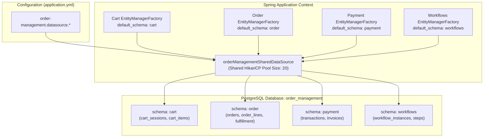

# Tech Spec: Order Management Database Configuration & Implementation Pattern

- **Summary:** Defines the consolidated PostgreSQL database architecture, schema partitioning (`cart`, `order`, `payment`, `workflows`), and HikariCP connection pool settings for the Order Management domain cluster.
- **Type:** Infrastructure & Architecture Pattern
- **Feature Spec:** [Service-Level Database & Connection Pool Consolidation in Spring Modulith](../../features/feat_010-service-level-database-consolidation.md)

---

## 1. Problem & Decision

### What breaks without this?

Previously, `cart`, `order`, `payment`, and `workflows` each maintained separate HikariCP connection pools to 4 separate PostgreSQL databases (`cart`, `order`, `payment`, `workflows`), consuming 40+ database connections. During checkout bursts, connection exhaustion across these four pools caused cascading timeouts and broken cart-to-order conversions. Furthermore, developers frequently attempted cross-database joins between `cart` and `order` or direct foreign keys from orders to payments, creating severe distributed transaction and data coupling problems.

### Decision

| Option | Decision | Why |
|:-------|:---------|:----|
| **1 Consolidated Cluster Database (`order_management`) with 4 Private Schemas** | Adopted | Consolidates connections into 1 shared Hikari pool (20 max connections), and enforces strict boundary separation across `cart`, `order`, `payment`, and `workflows` via PostgreSQL schemas. |
| 4 Separate Databases in Monolith | Rejected | Multiplies connection pool overhead, increases latency during checkout pipeline operations, and complicates local developer operations. |
| Single Shared Public Schema | Rejected | Allows direct cross-domain SQL joins and foreign keys between cart sessions, orders, and payments, preventing independent microservice extraction. |

### Trade-offs

| Benefits | Trade-offs |
|:-----------|:-------------|
| Reduces JVM connection pool count from 4 separate pools to 1 shared cluster pool. | Flyway migrations must be executed independently per domain schema. |
| Eliminates direct database joins between carts, orders, and payments. | Cart-to-order conversions must pass through DTO commands rather than `INSERT INTO orders SELECT FROM cart`. |
| Consolidates connections and operational overhead across all checkout subdomains. | All order management subdomains share the cluster database instance resource limits. |

---

## 2. How It Works

### Core Concept

The Order Management cluster connects to a single PostgreSQL database instance named `order_management`. Within this database, four isolated schemas exist: `cart`, `order`, `payment`, and `workflows`.

All subdomains (`cart`, `order`, `payment`, `workflows`) share a single consolidated HikariCP connection pool. In Spring Boot, `OrderManagementPersistenceConfiguration` provides the shared `HikariDataSource`. Each subdomain's `EntityManagerFactory` binds to this shared DataSource and sets `hibernate.default_schema` to its respective schema.



---

### Schema & Table Partitioning

| Schema | Domain | Sample Core Tables | Migration Location | History Table |
|:-------|:-------|:-------------------|:-------------------|:--------------|
| `cart` | Cart | `cart_sessions`, `cart_items`, `cart_discounts`, `cart_metadata` | `classpath:db/migration/cart` | `cart.flyway_schema_history_cart` |
| `order` | Order | `orders`, `order_items`, `order_addresses`, `order_fulfillments`, `order_notes` | `classpath:db/migration/order` | `order.flyway_schema_history_order` |
| `payment` | Payment | `payments`, `payment_transactions`, `cod_records`, `refund_logs`, `invoices` | `classpath:db/migration/payment` | `payment.flyway_schema_history_payment` |
| `workflows` | Workflows | `workflow_instances`, `workflow_tasks`, `workflow_steps`, `saga_checkpoints` | `classpath:db/migration/workflows` | `workflows.flyway_schema_history_workflows` |

---

### YAML Configuration Specification

```yaml
# ==============================================================================
# ORDER MANAGEMENT CLUSTER DATA SOURCE
# ==============================================================================
order-management:
  datasource:
    url: ${OM_DATASOURCE_URL:jdbc:postgresql://localhost:5432/order_management}
    username: ${OM_DATASOURCE_USERNAME:admin}
    password: ${OM_DATASOURCE_PASSWORD:123}
    driver-class-name: org.postgresql.Driver
    hikari:
      maximum-pool-size: ${OM_HIKARI_MAX_POOL_SIZE:20}
      minimum-idle: ${OM_HIKARI_MIN_IDLE:5}
      pool-name: HikariPool-OrderManagement
      connection-timeout: 30000
      idle-timeout: 600000
      max-lifetime: 1800000

cart:
  seed:
    enabled: ${CART_SEED_ENABLED:true}
  datasource:
    schema: cart

order:
  seed:
    enabled: ${ORDER_SEED_ENABLED:true}
  datasource:
    schema: order

payment:
  seed:
    enabled: ${PAYMENT_SEED_ENABLED:true}
  datasource:
    schema: payment

workflows:
  seed:
    enabled: ${WORKFLOWS_SEED_ENABLED:true}
  datasource:
    schema: workflows
```

---

### Spring Java Implementation Pattern

```java
package com.grab.app.ordermanagement.internal.config;

import com.zaxxer.hikari.HikariDataSource;
import jakarta.persistence.EntityManagerFactory;
import org.flywaydb.core.Flyway;
import org.springframework.beans.factory.annotation.Qualifier;
import org.springframework.boot.context.properties.ConfigurationProperties;
import org.springframework.context.annotation.Bean;
import org.springframework.context.annotation.Configuration;
import org.springframework.data.jpa.repository.config.EnableJpaRepositories;
import org.springframework.orm.jpa.JpaTransactionManager;
import org.springframework.orm.jpa.LocalContainerEntityManagerFactoryBean;
import org.springframework.orm.jpa.vendor.HibernateJpaVendorAdapter;
import org.springframework.transaction.PlatformTransactionManager;

import javax.sql.DataSource;
import java.util.HashMap;
import java.util.Map;

@Configuration
@EnableJpaRepositories(
        basePackages = "com.order.adapter.persistence.repository",
        entityManagerFactoryRef = "orderEntityManagerFactory",
        transactionManagerRef = "orderTransactionManager"
)
public class OrderPersistenceConfiguration {

    // Shared connection pool for order management cluster
    @Bean("orderManagementSharedDataSource")
    @ConfigurationProperties("order-management.datasource.hikari")
    public HikariDataSource orderManagementSharedDataSource() {
        return new HikariDataSource();
    }

    @Bean("orderEntityManagerFactory")
    public LocalContainerEntityManagerFactoryBean orderEntityManagerFactory(
            @Qualifier("orderManagementSharedDataSource") DataSource dataSource) {

        LocalContainerEntityManagerFactoryBean em = new LocalContainerEntityManagerFactoryBean();
        em.setDataSource(dataSource);
        em.setPackagesToScan("com.order.adapter.persistence");
        em.setPersistenceUnitName("order");
        em.setJpaVendorAdapter(new HibernateJpaVendorAdapter());

        Map<String, Object> props = new HashMap<>();
        props.put("hibernate.default_schema", "order");
        props.put("hibernate.dialect", "org.hibernate.dialect.PostgreSQLDialect");
        em.setJpaPropertyMap(props);

        return em;
    }

    @Bean("orderTransactionManager")
    public PlatformTransactionManager orderTransactionManager(
            @Qualifier("orderEntityManagerFactory") EntityManagerFactory emFactory) {
        return new JpaTransactionManager(emFactory);
    }

    @Bean(initMethod = "migrate")
    public Flyway orderFlyway(@Qualifier("orderManagementSharedDataSource") DataSource dataSource) {
        return Flyway.configure()
                .dataSource(dataSource)
                .schemas("order")
                .defaultSchema("order")
                .table("flyway_schema_history_order")
                .locations("classpath:db/migration/order")
                .baselineOnMigrate(true)
                .load();
    }
}
```

---

## 3. How We Use It

### Step-by-Step Checkout Persistence Flow

| Step | Phase | Action |
|:-----|:------|:-------|
| 1 | **Cart Finalization** | Shopper cart is locked and converted to an immutable checkout command in `cartTransactionManager`. |
| 2 | **Order Creation** | Order aggregate is inserted into `order.orders` with status `PENDING` in `orderTransactionManager`. |
| 3 | **Outbox Emission** | `OrderPlacedEvent` is atomically committed into `order.outbox_events` within the order transaction. |
| 4 | **Saga Checkpointing** | Workflow engine logs saga step execution in `workflows.workflow_instances` via `workflowsTransactionManager`. |
| 5 | **Payment Recording** | Payment authorization / transaction record is saved in `payment.payments` via `paymentTransactionManager`. |

---

## 4. Implementation Rules

| Rule | Requirement |
|:-----|:------------|
| **R-OM01** | Tables for cart, order, payment, and workflows **MUST** reside within schemas `cart`, `order`, `payment`, and `workflows` respectively. |
| **R-OM02** | Foreign keys across order schemas (e.g., `FOREIGN KEY (cart_id) REFERENCES cart.cart_sessions(id)`) **MUST NOT** be created in PostgreSQL DDL. All references **MUST** be stored as scalar UUIDs. |
| **R-OM03** | Each domain **MUST** maintain its own Flyway migration history table: `flyway_schema_history_cart`, `flyway_schema_history_order`, `flyway_schema_history_payment`, and `flyway_schema_history_workflows`. |
| **R-OM04** | All subdomains within Order Management (`cart`, `order`, `payment`, `workflows`) **MUST** share the `order_management` cluster database and `HikariPool-OrderManagement` connection pool. |
| **R-OM05** | Total connections allocated to `HikariPool-OrderManagement` in shared mode **MUST NOT** exceed 20 connections. |
