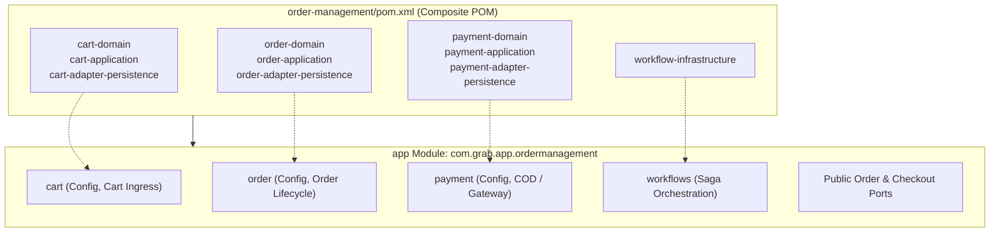
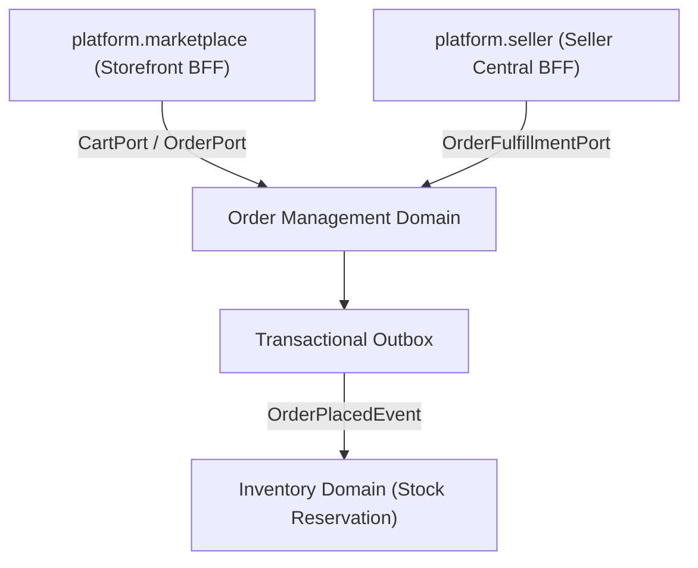

# Tech Spec: Order Management Domain Namespace

- **Summary:** Defines the Maven composite aggregation, Spring Modulith module boundaries, package architecture, and isolation rules for the Order Management domain cluster.
- **Type:** Architecture Pattern
- **Feature Spec:** [Industrial Project Structure Organization & Runnable App Module](../../features/feat_009-industrial-project-structure-organization.md)

---

## 1. Problem & Decision

### What breaks without this?

Order placement and checkout inherently coordinate cart state, order creation, payment capture, and workflow sagas. When these libraries are wired haphazardly in a generic monolith, developers execute synchronous distributed transactions or cross-database foreign key joins directly between orders and customer accounts. Without a formalized Order Management boundary, checkout state machines become tightly tangled with billing and inventory internals, risking transaction rollbacks, partial orders, and blocking microservice extraction.

### Decision

| Option | Decision | Why |
|:-------|:---------|:----|
| **Composite Maven POM & Spring Modulith Namespace (`com.grab.app.ordermanagement`)** | Adopted | Unifies `cart`, `order`, `payment`, and `workflow-infrastructure` behind a cohesive bounded context with explicit lifecycle ports and outbox event publishing. |
| Physical Directory Restructuring | Rejected | Moving 10+ module directories in the repository root disrupts ongoing development, invalidates active pull requests, and causes merge chaos. |
| Fragmented Multi-Module Ingress | Rejected | Exposing separate entrypoints for cart, order, and payment without domain grouping forces BFF layers to coordinate low-level entity operations. |

### Trade-offs

| Benefits | Trade-offs |
|:-----------|:-------------|
| Establishes a standard Order Management System (OMS) cluster matching commercetools and MACH standards | Inter-domain actions (e.g. reserving stock) must use asynchronous outbox events or decoupled ports |
| Provides an immediate natural home for upcoming post-order domains (`fulfillment`, `shipping`, `c2c-deals`) | Saga workflows and payment state transitions must be strictly decoupled from HTTP request threads |
| Zero filesystem churn for existing cart, order, payment, and workflow modules | Cart-to-order conversions cannot perform cross-table SQL joins into customer or merchant tables |

---

## 2. How It Works

### Core Concept

The Order Management cluster is defined by a composite Maven POM (`order-management/pom.xml`) at the repository root that aggregates all cart, order, payment, and workflow libraries. In the runnable application (`app`), all configuration, saga orchestrators, and listener beans reside within the package namespace `com.grab.app.ordermanagement`.



### Package Layout & Internal Namespaces

```text
order-management/
└── pom.xml                                           # Composite Service POM

app/src/main/java/com/grab/app/ordermanagement/
├── package-info.java                                 # @org.springframework.modulith.ApplicationModule
├── cart/                                             # Cart Ingress & Configuration
│   ├── CartConfiguration.java                        # Spring @Configuration
│   ├── internal/                                     # Internal use cases, session mappers
│   └── api/                                          # Public Cart Ports & DTOs
├── order/                                            # Order Lifecycle & Configuration
│   ├── OrderConfiguration.java                       # Spring @Configuration
│   ├── internal/                                     # Order state machine, repositories
│   └── api/                                          # Public Order Ports & DTOs
├── payment/                                          # Payment Processing & Configuration
│   ├── PaymentConfiguration.java                     # Spring @Configuration
│   ├── internal/                                     # COD collection, refund handlers
│   └── api/                                          # Public Payment Ports & DTOs
└── workflows/                                        # Transaction & Checkout Sagas
    ├── WorkflowConfiguration.java                    # Spring @Configuration
    └── internal/                                     # Saga coordinators, step handlers
```

### How It Works Step by Step

| Step | What Happens | Why |
|:-----|:-------------|:----|
| 1 | Developer declares dependency on `order-management` in `app/pom.xml` | Transitively includes cart, order, payment, and workflow modules in a single dependency |
| 2 | Spring Modulith bootstraps `com.grab.app.ordermanagement` as a distinct module | Enforces module encapsulation and verifies package access rules |
| 3 | Shopper initiates checkout via `platform.marketplace` | Calls `OrderCommandPort.execute(PlaceOrderCommand)` exposed in `order.api` |
| 4 | Order domain persists order in `PENDING` state and writes `OrderPlacedEvent` to Outbox | Decouples stock deduction and merchant notifications into asynchronous listeners |
| 5 | Workflow engine advances order lifecycle via internal state transitions | Orchestrates fulfillment, cancellation, and payment status updates reliably |

---

## 3. How We Use It

### Where It Fits in Our System



### Component Responsibilities

| Component | Role | What It Does |
|:----------|:-----|:-------------|
| `order-management/pom.xml` | Maven Aggregator | Aggregates cart, order, payment, and workflow modules with `<type>pom</type>`. |
| `com.grab.app.ordermanagement` | Domain Cluster Namespace | Houses order pipeline configurations, saga coordinators, and transaction listeners. |
| `CartConfiguration` | Spring Bean Registrar | Exposes cart creation, item mutation, and session transfer beans. |
| `OrderConfiguration` | Spring Bean Registrar | Exposes order state machines, order placement use cases, and status queries. |
| `PaymentConfiguration` | Spring Bean Registrar | Exposes payment capture, Cash on Delivery settlement, and refund services. |
| `WorkflowConfiguration` | Spring Bean Registrar | Exposes saga orchestration steps and compensation handlers. |

---

## 4. Implementation Rules

| Rule | Requirement |
|:-----|:------------|
| **R-01** | The `app/pom.xml` module **MUST** depend on `order-management` and **MUST NOT** import individual modules (`order-domain`, `cart-application`, etc.) directly. |
| **R-02** | The package `com.grab.app.ordermanagement` **MUST** be annotated with `@org.springframework.modulith.ApplicationModule` or declared as an application module in `package-info.java`. |
| **R-03** | Order Management components **MUST NOT** perform SQL joins or direct repository queries against customer, merchant, or inventory tables. |
| **R-04** | All cross-domain operations (e.g. inventory reservation upon checkout) **MUST** occur asynchronously via Transactional Outbox integration events or decoupled contract ports. |
| **R-05** | Future order-related domains (`fulfillment`, `shipping`, `returns`, `refunds`, `c2c-deals`) **MUST** be housed under the `order-management` composite POM and package namespace. |
