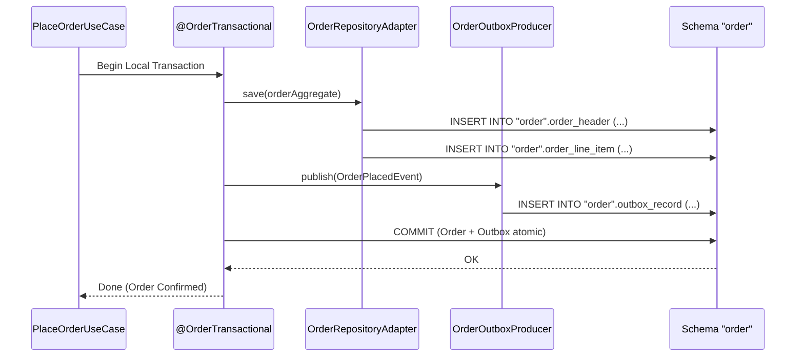

# Tech Spec: Order Service Group Persistence

- **Summary:** Defines the shared relational schema, connection pooling, and Flyway migration stream for the Order Service Group (`cart`, `order`, `payment`) on the shared database instance using quoted schema `"order"`.
- **Type:** Platform Infrastructure
- **Feature Spec:** [Multi-Schema Database Isolation & Connection Budgeting](../../features/feat_010-multi-schema-database-isolation-connection-budgeting.md)

---

## 1. Problem & Decision

### What breaks without this?

If cart, order, and payment contexts competed for database connections against browsing or catalog traffic, a flash sale or heavy search volume would exhaust the connection pool and drop active checkouts. Furthermore, `ORDER` is an ANSI SQL and PostgreSQL reserved keyword; unquoted schema usage triggers syntax errors across database migration scripts and ORM mappings.

### Decision

| Option | Decision | Why |
|:-------|:---------|:----|
| **Shared Quoted Schema `'"order"'` for Cart, Order, and Payment** | Adopted | Consolidates checkout lifecycle entities under a high-priority, dedicated connection pool (`OrderHikariPool`), protecting transactional checkout operations from search/catalog traffic while grouping tightly coupled transaction steps. |
| Split Cart, Order, and Payment into 3 Separate Schemas | Rejected | Premature separation; cart-to-order conversion and payment records benefit from local transactional coordination during the first phases of checkout. |
| Unpartitioned Monolithic Database | Rejected | Allows non-critical queries to starve mission-critical payment and order processing connections. |

### Trade-offs

| Benefits | Trade-offs |
|:---------|:-----------|
| Transactional checkout flows have a guaranteed, dedicated connection pool that cannot be exhausted by external read traffic. | All Flyway migration scripts, configurations, and queries MUST explicitly quote the schema name `'"order"'`. |
| Cart conversion, order creation, and payment recording execute within local transactional boundaries. | Even within schema `'"order"'`, table ownership must remain strictly separated by bounded context with no cross-context foreign keys. |

---

## 2. How It Works

### Core Concept

The Order Service Group (`com.grab.app.order`) groups `cart`, `order`, and `payment` within the dedicated schema `'"order"'` on the shared PostgreSQL instance. The service group uses a dedicated `OrderHikariPool` sized specifically for transactional checkout capacity, isolated from catalog and channel pools.

```mermaid
flowchart TD
    subgraph OrderServiceGroup ["Order Service Group (order-service)"]
        CartBC["Cart Domain Service"]
        OrderBC["Order Domain Service"]
        PaymentBC["Payment Domain Service"]
    end

    subgraph PoolLayer ["Dedicated HikariCP Pool"]
        OrdPool["OrderHikariPool (Max: 20 per pod)"]
    end

    subgraph SchemaLayer ["Shared PostgreSQL Instance: Schema \"order\""]
        FlywayHistory[("\"order\".flyway_schema_history")]
        OutboxTable[("\"order\".outbox_record")]
        CartTables[("\"order\".cart_header\n\"order\".cart_line_item")]
        OrderTables[("\"order\".order_header\n\"order\".order_line_item\n\"order\".order_fulfillment")]
        PaymentTables[("\"order\".payment_intent\n\"order\".payment_transaction\n\"order\".payment_refund")]
    end

    CartBC --> OrdPool
    OrderBC --> OrdPool
    PaymentBC --> OrdPool

    OrdPool --> CartTables
    OrdPool --> OrderTables
    OrdPool --> PaymentTables
    OrdPool --> OutboxTable
    OrdPool --> FlywayHistory
```

### How It Works Step by Step

| Step | What Happens | Why |
|:-----|:-------------|:----|
| 1 | Order Service boots and establishes `OrderHikariPool` targeting PostgreSQL schema `'"order"'`. | Provides reserved connection headroom for mission-critical write transactions. |
| 2 | Flyway runs migrations from `db/migration/order`, quoting the schema name and writing to `'"order"'.flyway_schema_history`. | Applies DDL changes cleanly without SQL keyword parser collisions. |
| 3 | Use cases interact with aggregates via their respective repository adapters (`CartRepositoryAdapter`, `OrderRepositoryAdapter`, `PaymentRepositoryAdapter`). | Preserves single-table responsibility per bounded context. |
| 4 | State changes and outbound domain events (`OrderPlaced`, `PaymentAuthorized`) commit atomically within `@OrderTransactional`. | Protects business transactions and ensures at-least-once outbox delivery. |

### Schema Table Allocation & Ownership

| Bounded Context | Owned Tables | Description |
|:----------------|:-------------|:------------|
| **Cart** | `cart_header`, `cart_line_item`, `cart_discount` | Active shopper baskets, line items, and promotional discounts. |
| **Order** | `order_header`, `order_line_item`, `order_fulfillment`, `order_adjustment` | Committed commercial orders, tracking status, and line fulfillments. |
| **Payment** | `payment_intent`, `payment_transaction`, `payment_refund` | Payment authorizations, gateway references, and refund records. |
| **Shared Infrastructure** | `outbox_record`, `flyway_schema_history` | Transactional outbox event queue and Flyway schema version history. |

---

## 3. How We Use It

### Where It Fits in Our System / Architecture & Layer Stacking

```mermaid
flowchart TB
    subgraph UseCases ["Order Application Layer"]
        CreateCart["CreateCartUseCase"]
        PlaceOrder["PlaceOrderUseCase"]
        AuthorizePay["AuthorizePaymentUseCase"]
    end

    subgraph Adapters ["Persistence Adapter Layer"]
        CartRepo["CartRepositoryAdapter"]
        OrderRepo["OrderRepositoryAdapter"]
        PayRepo["PaymentRepositoryAdapter"]
    end

    subgraph Infrastructure ["Order Persistence Configuration"]
        DataSource["OrderHikariDataSource (@OrderPersistenceUnit)"]
        TxManager["OrderTransactionManager (@OrderTransactional)"]
    end

    subgraph Database ["PostgreSQL Schema '\"order\"'"]
        OrdSchema[("Schema: \"order\"\nQuoted SQL Identifiers\nExclusive Table Ownership")]
    end

    CreateCart --> CartRepo --> DataSource
    PlaceOrder --> OrderRepo --> DataSource
    AuthorizePay --> PayRepo --> DataSource
    DataSource --> OrdSchema
    TxManager --> DataSource
```

### Component Responsibilities

| Component | Role | What It Does |
|:----------|:-----|:-------------|
| **`OrderPersistenceConfig`** | Spring Configuration | Configures `DataSource`, `HikariConfig`, `EntityManagerFactory`, and `TransactionManager` targeting `'"order"'`. |
| **`CartRepositoryAdapter`** | Outbound Adapter | Persists and loads shopping cart aggregates. |
| **`OrderRepositoryAdapter`** | Outbound Adapter | Persists order state transitions (`PENDING`, `CONFIRMED`, `FULFILLED`, `CANCELLED`). |
| **`PaymentRepositoryAdapter`** | Outbound Adapter | Manages idempotent payment transactions and gateway authorizations. |
| **`OrderOutboxProducer`** | Outbox Infrastructure | Inserts checkout integration events into `'"order"'.outbox_record`. |

### Runtime Flow

> Order placement flow atomically updates order tables and commits an outbox record within schema `'"order"'`.



### Configuration Specification

```yaml
grab:
  order:
    datasource:
      jdbc-url: jdbc:postgresql://${DB_HOST:localhost}:${DB_PORT:5432}/${DB_NAME:grab_commerce}?currentSchema="order"
      username: ${ORDER_DB_USER:order_user}
      password: ${ORDER_DB_PASSWORD:order_secret}
      hikari:
        maximum-pool-size: 20
        minimum-idle: 5
        connection-timeout: 30000
        idle-timeout: 600000
        max-lifetime: 1800000
        pool-name: OrderHikariPool
    flyway:
      schemas: '"order"'
      default-schema: '"order"'
      table: flyway_schema_history
      locations: classpath:db/migration/order
```

---

## 4. Implementation Rules

> These are **non-negotiable contracts**. An implementation is compliant only when **all** rules are satisfied.

- **RULE-ORD-DB-01: Quoted Schema Identifier Required**
  The schema name `'"order"'` MUST ALWAYS be enclosed in double quotes in YAML configuration, Flyway migration files, and native SQL snippets.

- **RULE-ORD-DB-02: Shared Schema Encapsulation**
  The `cart`, `order`, and `payment` bounded contexts MUST reside in schema `'"order"'`. They MUST NOT declare foreign keys to tables outside schema `'"order"'` or cross-join with catalog/account tables.

- **RULE-ORD-DB-03: Zero Cross-Context Foreign Keys**
  Within schema `'"order"'`, foreign key constraints between `cart_header` and `order_header` or `order_header` and `payment_intent` are prohibited. References MUST be stored as domain identifiers (`OrderId`, `PaymentId`).

- **RULE-ORD-DB-04: Isolated Connection Budget**
  The `OrderHikariPool` MUST be sized to accommodate peak checkout loads while honoring the global connection budget ($N \times O \times 20$).

- **RULE-ORD-DB-05: Atomic Local Outbox Commit**
  All order and payment events MUST be committed to `'"order"'.outbox_record` within the local `@OrderTransactional` boundary.
