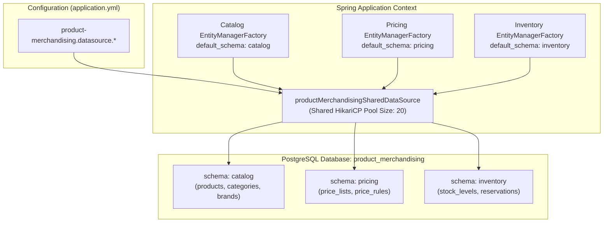

# Tech Spec: Product & Merchandising Database Configuration & Implementation Pattern

- **Summary:** Defines the consolidated PostgreSQL database architecture, schema partitioning (`catalog`, `inventory`, `pricing`), and HikariCP connection pool settings for the Product & Merchandising domain cluster.
- **Type:** Infrastructure & Architecture Pattern
- **Feature Spec:** [Service-Level Database & Connection Pool Consolidation in Spring Modulith](../../features/feat_010-service-level-database-consolidation.md)

---

## 1. Problem & Decision

### What breaks without this?

Previously, `catalog`, `inventory`, and `pricing` each ran independent HikariCP connection pools connecting to 3 distinct PostgreSQL databases (`catalog`, `inventory`, `pricing`), consuming 30+ database connections solely for product data. In the monolith, this wasted memory and saturated PostgreSQL limits. However, simply merging their tables into a single public schema would lead to cross-domain SQL joins (e.g., catalog querying inventory reservations in SQL), destroying domain boundaries and blocking independent microservice extraction.

### Decision

| Option | Decision | Why |
|:-------|:---------|:----|
| **1 Consolidated Cluster Database (`product_merchandising`) with 3 Private Schemas** | Adopted | Consolidates to a single optimized connection pool (20 max connections) for all product domains in the monolith, and keeps tables partitioned into `catalog`, `inventory`, and `pricing` schemas. |
| 3 Separate Physical Databases in Monolith | Rejected | Wastes connection slots and idle memory in the JVM with 3 connection pools and 3 database servers. |
| Single Flat Schema (Public) | Rejected | Invites cross-domain table joins and foreign keys, violating bounded context encapsulation. |

### Trade-offs

| Benefits | Trade-offs |
|:-----------|:-------------|
| Reduces database connections from 30+ to 20 shared connections. | Flyway migrations must be executed independently per schema. |
| Strict schema boundaries eliminate accidental table joins across catalog, inventory, and pricing. | Cross-domain data composition requires asynchronous outbox events or in-memory application DTO assembly. |
| Single consolidated database simplifies infrastructure provisioning and operational monitoring. | All three subdomains share the cluster database instance resources. |

---

## 2. How It Works

### Core Concept

The Product & Merchandising cluster connects to a single PostgreSQL database instance named `product_merchandising`. Within this database, three isolated schemas exist: `catalog`, `inventory`, and `pricing`. 

All subdomains (`catalog`, `inventory`, `pricing`) share a single consolidated HikariCP connection pool. In Spring Boot, `ProductMerchandisingPersistenceConfiguration` provides the shared `HikariDataSource`. Each domain's `EntityManagerFactory` binds to this shared DataSource and sets `hibernate.default_schema` to its respective schema name.



---

### Schema & Table Partitioning

| Schema | Domain | Sample Core Tables | Migration Location | History Table |
|:-------|:-------|:-------------------|:-------------------|:--------------|
| `catalog` | Catalog | `products`, `product_variants`, `categories`, `brands`, `tags`, `attributes` | `classpath:db/migration/catalog` | `catalog.flyway_schema_history_catalog` |
| `inventory` | Inventory | `inventory_items`, `stock_levels`, `stock_locations`, `reservations`, `adjustments` | `classpath:db/migration/inventory` | `inventory.flyway_schema_history_inventory` |
| `pricing` | Pricing | `price_lists`, `price_rules`, `regional_prices`, `currency_rates`, `price_overrides` | `classpath:db/migration/pricing` | `pricing.flyway_schema_history_pricing` |

---

### YAML Configuration Specification

```yaml
# ==============================================================================
# PRODUCT & MERCHANDISING CLUSTER DATA SOURCE
# ==============================================================================
product-merchandising:
  datasource:
    url: ${PM_DATASOURCE_URL:jdbc:postgresql://localhost:5432/product_merchandising}
    username: ${PM_DATASOURCE_USERNAME:admin}
    password: ${PM_DATASOURCE_PASSWORD:123}
    driver-class-name: org.postgresql.Driver
    hikari:
      maximum-pool-size: ${PM_HIKARI_MAX_POOL_SIZE:20}
      minimum-idle: ${PM_HIKARI_MIN_IDLE:5}
      pool-name: HikariPool-ProductMerchandising
      connection-timeout: 30000
      idle-timeout: 600000
      max-lifetime: 1800000

catalog:
  seed:
    enabled: ${CATALOG_SEED_ENABLED:true}
  datasource:
    schema: catalog

inventory:
  seed:
    enabled: ${INVENTORY_SEED_ENABLED:true}
  datasource:
    schema: inventory

pricing:
  seed:
    enabled: ${PRICING_SEED_ENABLED:true}
  datasource:
    schema: pricing
```

---

### Spring Java Implementation Pattern

```java
package com.grab.app.productmerchandising.internal.config;

import com.zaxxer.hikari.HikariDataSource;
import jakarta.persistence.EntityManagerFactory;
import org.flywaydb.core.Flyway;
import org.springframework.beans.factory.annotation.Qualifier;
import org.springframework.boot.context.properties.ConfigurationProperties;
import org.springframework.context.annotation.Bean;
import org.springframework.context.annotation.Configuration;
import org.springframework.data.jpa.repository.config.EnableJpaRepositories;
import org.springframework.orm.jpa.JpaTransactionManager;
import org.springframework.orm.jpa.LocalContainerEntityManagerFactoryBean;
import org.springframework.orm.jpa.vendor.HibernateJpaVendorAdapter;
import org.springframework.transaction.PlatformTransactionManager;

import javax.sql.DataSource;
import java.util.HashMap;
import java.util.Map;

@Configuration
@EnableJpaRepositories(
        basePackages = "com.catalog.adapter.persistence.repository",
        entityManagerFactoryRef = "catalogEntityManagerFactory",
        transactionManagerRef = "catalogTransactionManager"
)
public class CatalogPersistenceConfiguration {

    // Shared connection pool for product & merchandising cluster
    @Bean("productMerchandisingSharedDataSource")
    @ConfigurationProperties("product-merchandising.datasource.hikari")
    public HikariDataSource productMerchandisingSharedDataSource() {
        return new HikariDataSource();
    }

    @Bean("catalogEntityManagerFactory")
    public LocalContainerEntityManagerFactoryBean catalogEntityManagerFactory(
            @Qualifier("productMerchandisingSharedDataSource") DataSource dataSource) {

        LocalContainerEntityManagerFactoryBean em = new LocalContainerEntityManagerFactoryBean();
        em.setDataSource(dataSource);
        em.setPackagesToScan("com.catalog.adapter.persistence");
        em.setPersistenceUnitName("catalog");
        em.setJpaVendorAdapter(new HibernateJpaVendorAdapter());

        Map<String, Object> props = new HashMap<>();
        props.put("hibernate.default_schema", "catalog");
        props.put("hibernate.dialect", "org.hibernate.dialect.PostgreSQLDialect");
        em.setJpaPropertyMap(props);

        return em;
    }

    @Bean("catalogTransactionManager")
    public PlatformTransactionManager catalogTransactionManager(
            @Qualifier("catalogEntityManagerFactory") EntityManagerFactory emFactory) {
        return new JpaTransactionManager(emFactory);
    }

    @Bean(initMethod = "migrate")
    public Flyway catalogFlyway(@Qualifier("productMerchandisingSharedDataSource") DataSource dataSource) {
        return Flyway.configure()
                .dataSource(dataSource)
                .schemas("catalog")
                .defaultSchema("catalog")
                .table("flyway_schema_history_catalog")
                .locations("classpath:db/migration/catalog")
                .baselineOnMigrate(true)
                .load();
    }
}
```

---

## 3. How We Use It

### Step-by-Step Execution Lifecycle

| Step | Phase | Action |
|:-----|:------|:-------|
| 1 | **Database Init** | Docker or PostgreSQL provisions `product_merchandising` database with schemas `catalog`, `inventory`, and `pricing`. |
| 2 | **Flyway Run** | `catalogFlyway`, `inventoryFlyway`, and `pricingFlyway` execute their independent migration SQL scripts against their private schemas. |
| 3 | **Hibernate Resolution** | Each persistence unit targets its schema automatically via `hibernate.default_schema`. |
| 4 | **Transaction Scoping** | Catalog changes commit via `catalogTransactionManager`. Cross-domain synchronization (e.g. Stock Reservation on Order Placed) is received via Outbox event listeners, avoiding cross-schema database locks. |

---

## 4. Implementation Rules

| Rule | Requirement |
|:-----|:------------|
| **R-PM01** | All catalog tables **MUST** reside in schema `catalog`, inventory tables in schema `inventory`, and pricing tables in schema `pricing`. |
| **R-PM02** | Direct cross-schema SQL queries (e.g. `SELECT * FROM inventory.stock WHERE product_id IN (...)` called from Catalog) **MUST NOT** be used. All inter-domain coordination **MUST** pass via Java ports or Outbox events. |
| **R-PM03** | Flyway migration history tables **MUST** be explicitly namespaced: `flyway_schema_history_catalog`, `flyway_schema_history_inventory`, and `flyway_schema_history_pricing`. |
| **R-PM04** | All subdomains in the Product & Merchandising cluster (`catalog`, `inventory`, `pricing`) **MUST** share the `product_merchandising` database instance and the shared connection pool. |
| **R-PM05** | Total connections allocated to `HikariPool-ProductMerchandising` in shared mode **MUST NOT** exceed 20 connections. |
