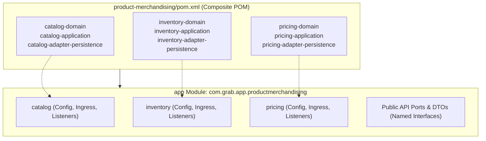
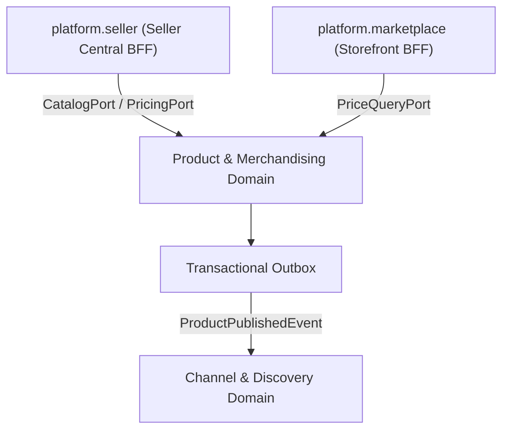

# Tech Spec: Product & Merchandising Domain Namespace

- **Summary:** Defines the Maven composite aggregation, Spring Modulith module boundaries, package architecture, and isolation rules for the Product & Merchandising domain cluster.
- **Type:** Architecture Pattern
- **Feature Spec:** [Industrial Project Structure Organization & Runnable App Module](../../features/feat_009-industrial-project-structure-organization.md)

---

## 1. Problem & Decision

### What breaks without this?

Directly importing fine-grained product libraries (`catalog`, `inventory`, `pricing`) into a flat web application allows cross-domain entity leakage, circular Spring bean wiring, and unconstrained database joins. Without a formal composite namespace boundary, developers inadvertently invoke catalog persistence repositories from pricing logic or bypass inventory reservation invariants, preventing future microservice extraction and causing runtime dependency deadlocks.

### Decision

| Option | Decision | Why |
|:-------|:---------|:----|
| **Composite Maven POM & Spring Modulith Namespace (`com.grab.app.productmerchandising`)** | Adopted | Encapsulates all 9 catalog, inventory, and pricing modules behind a single composite artifact and enforces strict package boundary validation at compile and test time. |
| Physical Directory Restructuring | Rejected | Moving directories in the filesystem breaks git commit history, causes merge conflicts across active branches, and disrupts CI pipelines. |
| Flat Monolithic Packaging (`com.grab.store.*`) | Rejected | Fails architecture boundary tests, leaks internal beans across domains, and prevents modular service extraction. |

### Trade-offs

| Benefits | Trade-offs |
|:-----------|:-------------|
| Zero filesystem churn for existing 9 module repositories | Internal domain communications across catalog, inventory, and pricing must go through public ports or events |
| High cohesion grouping matching PIM and merchandising industry standards | Requires a top-level composite POM maintenance step when adding new sub-modules |
| Ready to seamlessly absorb future merchandising modules (`promotions`, `discounts`, `reviews`) | Developers cannot directly `@Autowired` repositories between catalog and pricing |

---

## 2. How It Works

### Core Concept

The Product & Merchandising domain cluster is declared as a virtual composite Maven POM (`product-merchandising/pom.xml`) at the repository root that aggregates the catalog, inventory, and pricing sub-modules. In the runnable application (`app`), all ingress wiring, configuration beans, and event handlers are encapsulated under the package namespace `com.grab.app.productmerchandising`.



### Package Layout & Internal Namespaces

```text
product-merchandising/
└── pom.xml                                           # Composite Service POM

app/src/main/java/com/grab/app/productmerchandising/
├── package-info.java                                 # @org.springframework.modulith.ApplicationModule
├── catalog/                                          # Catalog Ingress & Configuration
│   ├── CatalogConfiguration.java                     # Spring @Configuration
│   ├── internal/                                     # Internal adapters, mappers, listeners
│   └── api/                                          # Public Catalog Ports & Contracts
├── inventory/                                        # Inventory Ingress & Configuration
│   ├── InventoryConfiguration.java                   # Spring @Configuration
│   ├── internal/
│   └── api/                                          # Public Inventory Ports & Contracts
└── pricing/                                          # Pricing Ingress & Configuration
    ├── PricingConfiguration.java                     # Spring @Configuration
    ├── internal/
    └── api/                                          # Public Pricing Ports & Contracts
```

### How It Works Step by Step

| Step | What Happens | Why |
|:-----|:-------------|:----|
| 1 | Developer adds dependency on `product-merchandising` in `app/pom.xml` | Pulls in all 9 domain, application, and persistence libraries transitively in a single declaration |
| 2 | Spring Modulith inspects `com.grab.app.productmerchandising` during bootstrap | Identifies the package as a cohesive named application module |
| 3 | Ingress requests enter via Platform BFF (`platform.seller` or `platform.marketplace`) | Calls public port interfaces exposed in `com.grab.app.productmerchandising.*.api` |
| 4 | Catalog, Inventory, or Pricing mutations trigger domain events | Events are written to the Transactional Outbox for cross-domain decoupling |
| 5 | ArchUnit and Modulith verification tests run during CI | Validates that external modules access only public API packages, failing the build on boundary leaks |

---

## 3. How We Use It

### Where It Fits in Our System



### Component Responsibilities

| Component | Role | What It Does |
|:----------|:-----|:-------------|
| `product-merchandising/pom.xml` | Maven Aggregator | Aggregates all catalog, inventory, and pricing libraries with `<type>pom</type>`. |
| `com.grab.app.productmerchandising` | Domain Cluster Namespace | Houses domain-specific configurations, event listeners, and ingress wiring. |
| `CatalogConfiguration` | Spring Bean Registrar | Exposes the catalog inbound use case beans and public port adapters. |
| `InventoryConfiguration` | Spring Bean Registrar | Exposes inventory allocation, reservation, and stock availability beans. |
| `PricingConfiguration` | Spring Bean Registrar | Exposes regional pricing calculation, price lists, and currency resolution beans. |

---

## 4. Implementation Rules

| Rule | Requirement |
|:-----|:------------|
| **R-01** | The `app/pom.xml` module **MUST** depend on `product-merchandising` and **MUST NOT** import individual modules (e.g. `catalog-domain`, `pricing-application`) directly. |
| **R-02** | The package `com.grab.app.productmerchandising` **MUST** be annotated with `@org.springframework.modulith.ApplicationModule` or declared as a top-level module in `package-info.java`. |
| **R-03** | Classes in `com.grab.app.productmerchandising` **MUST NOT** import entities or repositories from other core domain packages (`ordermanagement`, `identityaccount`, `channeldiscovery`). |
| **R-04** | Communication from external packages into Product & Merchandising **MUST** pass strictly through public interface ports defined in public `api` packages. |
| **R-05** | Future merchandising domains (`promotions`, `discounts`, `reviews`, `media-assets`) **MUST** be placed under the `product-merchandising` composite POM and `com.grab.app.productmerchandising` package namespace. |
