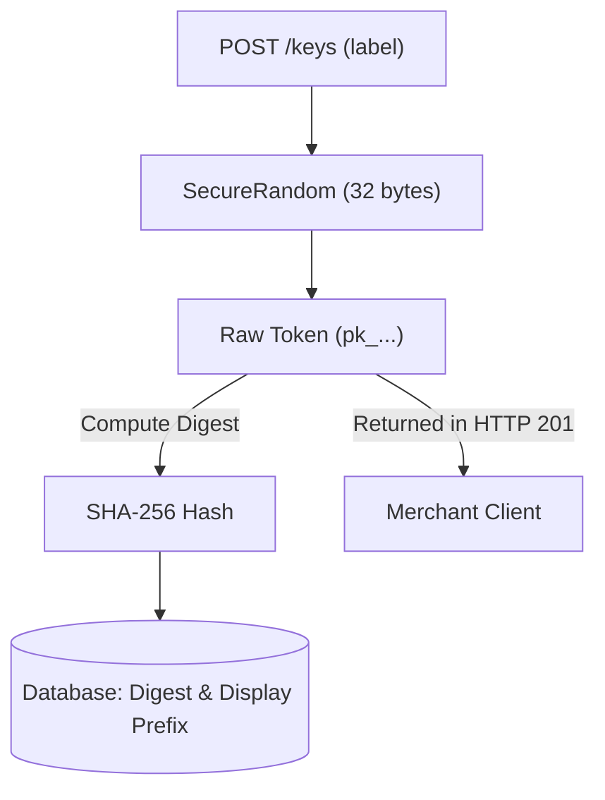
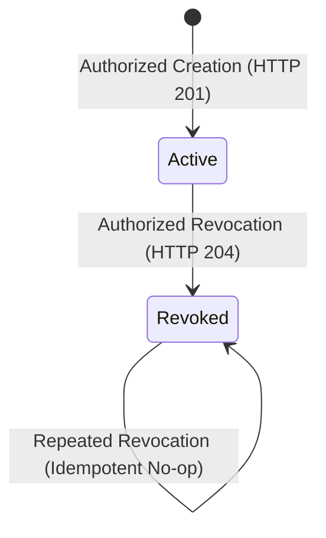
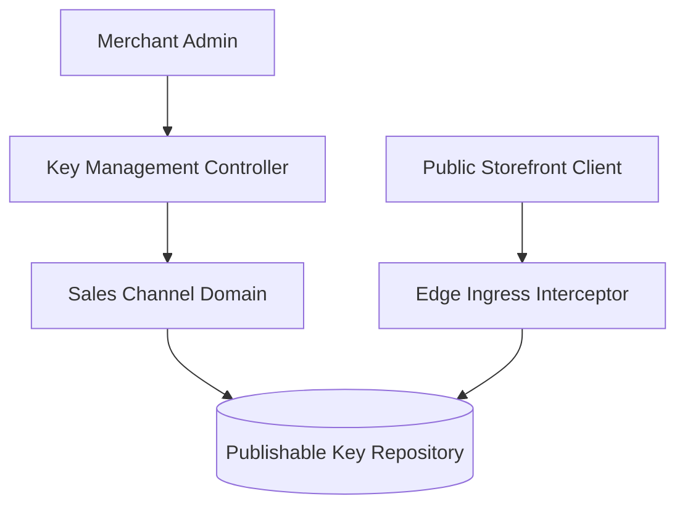
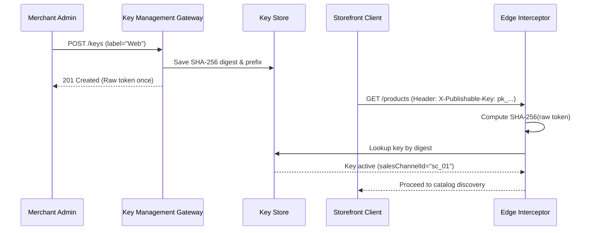

# Tech Spec: Publishable Key Lifecycle

- **Summary:** Issues revocable public channel credentials while retaining only their SHA-256 digests and safe management metadata.
- **Type:** Cross-Cutting Concern
- **Feature Spec:** [Sales-Channel Key Lifecycle Management](../../features/feat_003-sales-channel-key-lifecycle-management.md)

---

## 1. Problem & Decision

### What breaks without this?

Without independent publishable keys, public storefronts must authenticate using raw merchant credentials or spoofable `salesChannelId` query parameters. Persisting raw tokens in databases or server logs exposes merchants to credential harvesting and catalog scraping, while tying channel identity to a single static token prevents seamless zero-downtime key rotation during security audits.

### Decision

| Option | Decision | Why |
|:-------|:---------|:----|
| **Independent SHA-256 Digest-Backed Keys** | Adopted | Protects stored credentials, allows one-time raw token disclosure, and enables concurrent key rotation without downtime. |
| Raw Token Storage | Rejected | Exposes raw credentials in database dumps, backups, and administrative inspect queries. |
| Single Key Per Channel | Rejected | Prevents safe credential rotation by forcing an immediate breaking cutover across all active storefront clients. |

### Trade-offs

| Benefits | Trade-offs |
|:-----------|:-------------|
| Defense-in-depth: database compromises never reveal usable API keys | Raw tokens can never be recovered if lost; merchant must generate a new key |
| Zero-downtime key rotation through concurrent active keys | Application must enforce constant-time digest lookup |

---

## 2. How It Works

### Core Concept

When a merchant provisions a publishable key, the server generates 32 cryptographically random bytes formatted as an unpadded Base64 string prefixed with `pk_`. The server computes a SHA-256 digest of this token and saves only the digest, a truncated display prefix (`pk_` + 8 chars), and client metadata into the database, returning the raw token exactly once in the HTTP 201 response.

### How It Works Step by Step

| Step | What Happens | Why |
|:-----|:-------------|:----|
| 1 | Merchant submits labeled key creation request with bearer authentication | Ensures caller owns the channel or holds administrative authority |
| 2 | Generator creates 32 secure random bytes encoded as unpadded URL-safe Base64 | Provides high entropy preventing brute-force token prediction |
| 3 | System computes SHA-256 hash of raw token | Persists only irreversible cryptographic digest for verification |
| 4 | System writes digest, display prefix, and timestamps to database | Stores verification material without secret retention |
| 5 | Raw token is returned in response body once, then discarded from memory | Eliminates credential leakage paths across subsequent reads or logs |

### Lifecycle

---

## 3. How We Use It

### Where It Fits in Our System

### Component Responsibilities

| Component | Role | What It Does |
|:----------|:-----|:-------------|
| Key Management Controller | API Ingress Gateway | Authenticates merchant callers, enforces RBAC, and exposes one-time token creation. |
| Key Authority Service | Domain Service | Enforces key creation invariants, label lengths, and revocation state rules. |
| Token Generator | Security Utility | Generates 32 cryptographically random bytes and calculates SHA-256 hex digests. |
| Edge Ingress Interceptor | Authentication Filter | Computes SHA-256 digest of incoming `X-Publishable-Key` header and validates active status. |

### Runtime Flow

---

## 4. Implementation Rules

| Rule | Requirement |
|:-----|:------------|
| **R-01** | Token generation **MUST** use 32 cryptographically secure random bytes formatted as unpadded URL-safe Base64 matching `pk_[A-Za-z0-9_-]{43}`; digests **MUST** be unique. |
| **R-02** | The system **MUST NOT** persist, log, or include raw secret tokens in domain events; only the 64-hex SHA-256 digest and safe prefix (`pk_` + 8 chars) may be stored. |
| **R-03** | POST `/api/v1/sales-channels/channels/{salesChannelId}/publishable-keys` **MUST** return 201 with the raw token once; subsequent GET listings **MUST NOT** return raw tokens or digests. |
| **R-04** | DELETE `/api/v1/sales-channels/channels/{salesChannelId}/publishable-keys/{keyId}` **MUST** return 204; repeated revocation **MUST** preserve the original `revokedAt` timestamp. |
| **R-05** | Key management **MUST** enforce RBAC: `SALES_CHANNEL_KEY_READ` for listing, `SALES_CHANNEL_KEY_WRITE` for creation/revocation, or `SALES_CHANNEL_KEY_ADMIN` for platform administrators. |
| **R-06** | Missing, malformed, unknown, or revoked public tokens **MUST** yield an identical generic `401 Unauthorized` response without revealing credential existence. |
| **R-07** | Public key verification **MUST** confer only public channel read identity and **MUST NOT** grant merchant login, administrative, or mutation privileges. |
