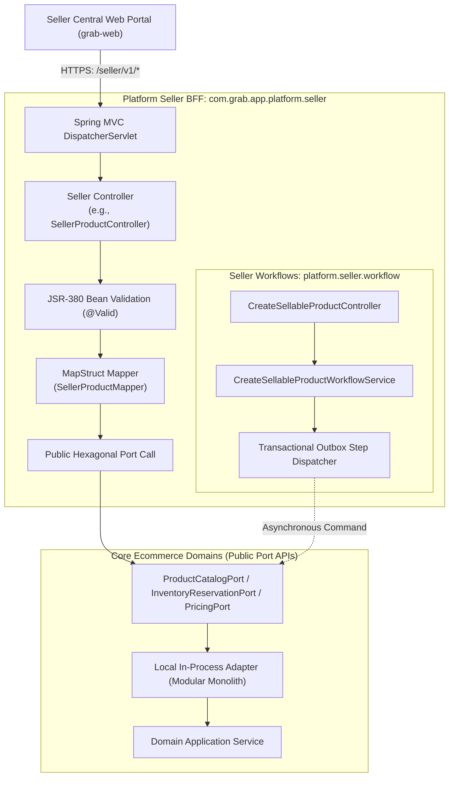
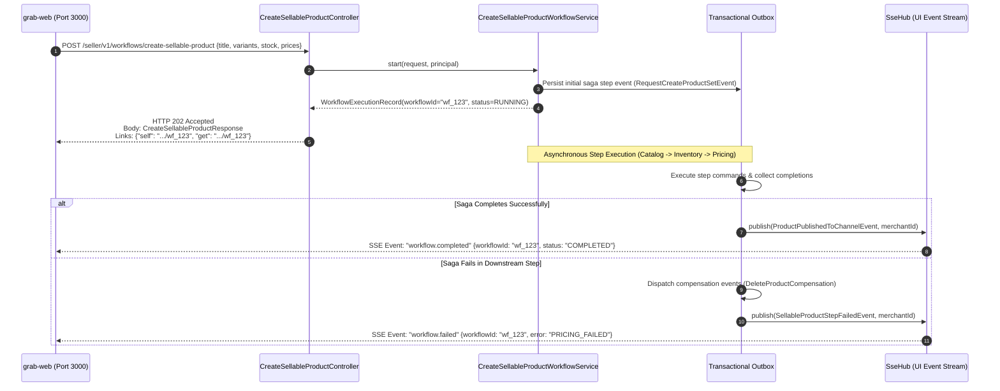

# Tech Spec: Seller Central BFF Endpoints & Contract Mapping

- **Summary:** Defines the `/seller/v1/*` REST endpoint hierarchy, MapStruct DTO ↔ Domain Port record transformations, asynchronous workflow response envelopes, and hexagonal boundary delegation for the Seller Central portal (`grab-web`).
- **Type:** Architecture Pattern / Platform Gateway
- **Feature Spec:** [Platform Seller Central BFF Implementation](../../features/feat_012-platform-seller-central-bff.md)

---

## 1. Problem & Decision

### What breaks without this?

Without a formal endpoint specification and data transformation contract, web controllers directly expose internal JPA `@Entity` models and Hibernate proxies into HTTP JSON responses. Outside active transactional sessions, traversing lazy associations triggers runtime `LazyInitializationException` failures and leaks internal database schema details. Furthermore, any refactoring of domain tables or entity relationships immediately breaks the React micro-frontends (`grab-web` on port 3000), and frontend developers are forced to perform complex, multi-domain data stitching across low-level internal services.

### Decision

| Option | Decision | Why |
|:-------|:---------|:----|
| **Dedicated `/seller/v1/*` Namespace + Compile-Time MapStruct Mappers + Pure Hexagonal Port Delegation** | **Adopted** | Isolates seller portal contracts from internal domain models. Controllers inject exclusively public domain port interfaces (`*Port`), use dedicated `/seller/v1` DTOs, and transform payloads via compile-time MapStruct mappers with zero entity leakage. |
| Direct JPA Entity Controller Returns | Rejected | Severe risk of `LazyInitializationException`, schema exposure, cyclic JSON serialization loops, and tight coupling between database tables and UI contracts. |
| Flat Monolithic `/api/v1/*` Endpoints | Rejected | Conflates administrative merchant actions with public shopper traffic, preventing dedicated rate limits, specialized security filters, and independent BFF versioning. |
| Client-Side Multi-Domain Saga Orchestration | Rejected | Forces `grab-web` to orchestrate multi-step product creation across Catalog, Inventory, and Pricing via sequential HTTP calls, causing partial failures and stranded data without distributed rollback. |

### Trade-offs

| Benefits | Trade-offs |
|:---------|:-----------|
| Zero JPA entity leakage; 100% extractable to standalone microservices without modifying controller or frontend code. | Requires maintaining dedicated request/response DTO classes and MapStruct mappers per endpoint. |
| Asynchronous saga orchestration returns `202 Accepted` immediately, eliminating client HTTP timeouts during long multi-domain writes. | Client must listen to the SSE event stream (`/seller/v1/events/stream`) or poll status to track workflow completion. |
| Compile-time type safety: MapStruct fails the build if a domain port record or DTO field name is mismatched or missing. | Additional mapping layer adds a minor object allocation overhead per HTTP request. |

---

## 2. How It Works

### Core Concept

The Seller Central BFF sits at the edge of the application tier (`com.grab.app.platform.seller`). It structures endpoints around the operational domains of the `grab-web` micro-frontends:
1. **Auth & Session** (`SellerAuthController`): Manages authentication, token refresh, and operator session state.
2. **Merchant Account** (`SellerMerchantController`): Manages legal profile, KYC verification, and storefront branding.
3. **Catalog & Products** (`SellerProductController`): Manages direct product catalog CRUD and category trees.
4. **Seller Workflows** (`SellerWorkflowsRootController` & saga controllers): Orchestrates multi-domain sagas (`create-sellable-product`, `update-sellable-product`, `update-product-variant`).
5. **Inventory** (`SellerInventoryController`): Manages warehouse stock levels, bin replenishment, and fulfillment locations.
6. **Pricing** (`SellerPricingController`): Manages price lists, promotional tiers, and variant price sets.
7. **Order Fulfillment** (`SellerOrderController`): Manages seller order listings, details, order confirmation, and COD collection.
8. **Real-Time Notifications** (`SellerEventStreamController`): Serves persistent SSE streams for terminal workflow updates.

Controllers **never** import domain entities or repositories. They interact exclusively with public domain port records via MapStruct mappers.



### How It Works Step by Step

| Step | What Happens | Why |
|:-----|:-------------|:----|
| 1 | `grab-web` sends JSON request to `/seller/v1/{resource}`. | Standard REST ingress strictly partitioned from customer `/store/v1/*`. |
| 2 | Spring MVC validates payload against JSR-380 annotations (`@NotBlank`, `@ValidPricingCoverage`, etc.). | Fails fast with `HTTP 400 Bad Request` before invoking any business or database logic. |
| 3 | `@CurrentMerchant` extracts verified `merchantId` and `userId` from `SecurityContextHolder`. | Guarantees multi-tenant scoping without trusting client parameters. |
| 4 | MapStruct mapper transforms web request DTO into an immutable domain port record (e.g. `CreateProductCommand`). | Decouples web payload representation from internal domain record structures. |
| 5 | Controller invokes public port method (e.g. `productCatalogPort.createProduct(command)`). | Preserves hexagonal architecture; BFF has zero knowledge of domain entities or tables. |
| 6 | Domain adapter executes use case within domain transaction and returns immutable record (e.g. `ProductCatalogRecord`). | Domain entities remain encapsulated inside the domain boundary. |
| 7 | MapStruct mapper converts domain record into response DTO (`SellerProductResponse`). | Returns flat, clean JSON with zero Hibernate lazy-loading proxies. |

### Workflow Saga Lifecycle & Terminal SSE Notification

For multi-domain write operations (`create-sellable-product`, `update-sellable-product`, `update-product-variant`), the BFF initiates an asynchronous saga:



---

## 3. How We Use It

### Detailed Endpoint Inventory & Contract Mapping

The table below catalogs every endpoint exposed by the Seller Central BFF, its required role, its DTO contracts, and the downstream port invoked:

| Domain Area | Method | Endpoint Path | Role Required | Request DTO | Response DTO | Contract Port / Component |
|:------------|:-------|:--------------|:--------------|:------------|:-------------|:--------------------------|
| **Auth** | `POST` | `/seller/v1/auth/login` | Anonymous | `SellerLoginRequest` | `SellerSessionDto` | `UserAuthenticationPort.authenticate()` |
| | `POST` | `/seller/v1/auth/refresh` | Anonymous (Cookie) | None | `SellerTokenRefreshResponse` | `UserAuthenticationPort.refreshToken()` |
| | `POST` | `/seller/v1/auth/logout` | Authenticated | None | `Void` (HTTP 204) | `UserAuthenticationPort.logout()` |
| **Session** | `GET` | `/seller/v1/session/me` | Authenticated | None | `SellerSessionDto` | `UserAuthenticationPort.getProfile()` |
| **Merchant Account** | `GET` | `/seller/v1/merchants/profile` | `MERCHANT_ADMIN` | None | `MerchantProfileDto` | `MerchantProfilePort.getProfile()` |
| | `PUT` | `/seller/v1/merchants/profile` | `MERCHANT_ADMIN` | `UpdateMerchantProfileRequest`| `MerchantProfileDto` | `MerchantProfilePort.updateProfile()` |
| | `GET` | `/seller/v1/merchants/storefront`| `STORE_MANAGER` | None | `StorefrontBrandingDto` | `MerchantProfilePort.getStorefront()` |
| | `PUT` | `/seller/v1/merchants/storefront`| `STORE_MANAGER` | `UpdateStorefrontRequest` | `StorefrontBrandingDto` | `MerchantProfilePort.updateStorefront()` |
| **Catalog** | `POST` | `/seller/v1/products` | `STORE_MANAGER` | `CreateProductRequest` | `SellerProductResponse` | `ProductCatalogPort.createProduct()` |
| | `GET` | `/seller/v1/products` | `STORE_MANAGER` | `ProductFilterQuery` (params) | `PagedResponse<SellerProductResponse>` | `ProductCatalogPort.listProducts()` |
| | `GET` | `/seller/v1/products/{id}` | `STORE_MANAGER` | None | `SellerProductDetailResponse` | `ProductCatalogPort.getProductById()` |
| | `PUT` | `/seller/v1/products/{id}` | `STORE_MANAGER` | `UpdateProductRequest` | `SellerProductResponse` | `ProductCatalogPort.updateProduct()` |
| | `POST` | `/seller/v1/products/{id}/publish` | `STORE_MANAGER` | `PublishChannelRequest` | `SellerProductResponse` | `ProductCatalogPort.publishProduct()` |
| | `POST` | `/seller/v1/products/{id}/unpublish` | `STORE_MANAGER` | `UnpublishChannelRequest` | `SellerProductResponse` | `ProductCatalogPort.unpublishProduct()` |
| | `GET` | `/seller/v1/categories` | `STORE_MANAGER` | None | `List<CategoryTreeDto>` | `ProductCatalogPort.getCategories()` |
| **Workflows (Sagas)** | `GET` | `/seller/v1/workflows` | Authenticated | None | `HalModel` (Root Links) | `SellerWorkflowsRootController` |
| | `POST` | `/seller/v1/workflows/create-sellable-product` | `STORE_MANAGER` | `CreateSellableProductRequest` | `CreateSellableProductResponse` (HTTP 202) | `CreateSellableProductWorkflowService.start()` |
| | `GET` | `/seller/v1/workflows/create-sellable-product/{id}` | `STORE_MANAGER` | None | `WorkflowStatusResponse` | `CreateSellableProductWorkflowService.get()` |
| | `POST` | `/seller/v1/workflows/update-sellable-product` | `STORE_MANAGER` | `UpdateSellableProductRequest` | `UpdateSellableProductResponse` (HTTP 202) | `UpdateSellableProductWorkflowService.start()` |
| | `GET` | `/seller/v1/workflows/update-sellable-product/{id}` | `STORE_MANAGER` | None | `WorkflowStatusResponse` | `UpdateSellableProductWorkflowService.get()` |
| | `POST` | `/seller/v1/workflows/update-product-variant` | `STORE_MANAGER` | `UpdateProductVariantRequest` | `UpdateProductVariantResponse` (HTTP 202) | `UpdateProductVariantWorkflowService.start()` |
| | `GET` | `/seller/v1/workflows/update-product-variant/{id}` | `STORE_MANAGER` | None | `WorkflowStatusResponse` | `UpdateProductVariantWorkflowService.get()` |
| **Inventory** | `GET` | `/seller/v1/inventory/items` | `STORE_MANAGER` | `InventoryQuery` (params) | `PagedResponse<StockLevelDto>` | `InventoryReservationPort.getStockLevels()` |
| | `POST` | `/seller/v1/inventory/replenish` | `STORE_MANAGER` | `ReplenishStockRequest` | `StockLevelDto` | `InventoryReservationPort.replenishStock()` |
| | `GET` | `/seller/v1/inventory/locations` | `STORE_MANAGER` | None | `List<FulfillmentLocationDto>` | `InventoryReservationPort.getLocations()` |
| **Pricing** | `GET` | `/seller/v1/pricing/price-lists` | `STORE_MANAGER` | None | `List<PriceListDto>` | `PricingPort.getPriceLists()` |
| | `POST` | `/seller/v1/pricing/price-lists` | `STORE_MANAGER` | `SavePriceListRequest` | `PriceListDto` | `PricingPort.savePriceList()` |
| | `GET` | `/seller/v1/pricing/variants/{id}` | `STORE_MANAGER` | None | `VariantPriceSetDto` | `PricingPort.getVariantPrices()` |
| **Orders** | `GET` | `/seller/v1/orders` | `FULFILLMENT_OPERATOR` | `OrderQueryFilter` (params) | `PagedResponse<SellerOrderSummaryDto>` | `OrderFulfillmentPort.listOrders()` |
| | `GET` | `/seller/v1/orders/{id}` | `FULFILLMENT_OPERATOR` | None | `SellerOrderDetailDto` | `OrderFulfillmentPort.getOrderById()` |
| | `POST` | `/seller/v1/orders/{id}/confirm` | `FULFILLMENT_OPERATOR` | None | `SellerOrderDetailDto` | `OrderFulfillmentPort.confirmOrder()` |
| | `POST` | `/seller/v1/orders/{id}/cancel` | `FULFILLMENT_OPERATOR` | `CancelOrderRequest` | `SellerOrderDetailDto` | `OrderFulfillmentPort.cancelOrder()` |
| | `POST` | `/seller/v1/orders/{id}/mark-paid` | `FULFILLMENT_OPERATOR` | None | `SellerOrderDetailDto` | `OrderFulfillmentPort.markPaid()` |
| **Events** | `GET` | `/seller/v1/events/stream` | Authenticated | None | `text/event-stream` (SSE) | `SseHub.registerEmitter()` |

---

### Component Responsibilities & Package Organization

```text
com.grab.app.platform.seller
├── controller/                   # REST endpoint mappings under /seller/v1/*
│   ├── SellerAuthController.java
│   ├── SellerMerchantController.java
│   ├── SellerProductController.java
│   ├── SellerInventoryController.java
│   ├── SellerPricingController.java
│   ├── SellerOrderController.java
│   └── SellerEventStreamController.java
│
├── workflow/                     # Migrated Seller Workflows & Sagas
│   ├── controller/               # REST controllers under /seller/v1/workflows/*
│   ├── service/                  # Saga coordinators (CreateSellableProductWorkflowService)
│   ├── dto/                      # Workflow request/response DTOs & custom validators
│   ├── mapper/                   # Request mappers & HAL model assemblers
│   └── events/                   # Outbox integration events
│
├── dto/                          # Dedicated /seller/v1 DTO representations
│   ├── auth/                     # SellerLoginRequest, SellerSessionDto
│   ├── merchant/                 # MerchantProfileDto, StorefrontBrandingDto
│   ├── product/                  # SellerProductResponse, CreateProductRequest
│   ├── inventory/                # StockLevelDto, ReplenishStockRequest
│   ├── pricing/                  # PriceListDto, VariantPriceSetDto
│   └── order/                    # SellerOrderSummaryDto, SellerOrderDetailDto
│
└── mapper/                       # MapStruct interface mappers (DTO ↔ Port Records)
    ├── SellerProductMapper.java
    ├── SellerInventoryMapper.java
    ├── SellerPricingMapper.java
    ├── SellerOrderMapper.java
    └── SellerMerchantMapper.java
```

---

## 4. Implementation Rules

| Rule | Requirement |
|:-----|:------------|
| **R-01** | All Seller Central endpoints **MUST** be mapped under the `/seller/v1/*` base path. Controllers in this namespace **MUST NOT** handle customer storefront traffic. |
| **R-02** | Controllers **MUST NOT** import JPA `@Entity`, Spring Data `@Repository`, or domain internal classes (`*.internal.*`). Violations **MUST** fail ArchUnit test verification (`SellerBffArchitectureTest`). |
| **R-03** | Controllers **MUST** communicate with core ecommerce domains strictly through public hexagonal port interfaces (`ProductCatalogPort`, `InventoryReservationPort`, `PricingPort`, `UserAuthenticationPort`, `MerchantProfilePort`, `OrderFulfillmentPort`). |
| **R-04** | All request and response bodies **MUST** use dedicated `/seller/v1` DTOs. Domain port records **MUST** be transformed to/from DTOs using compile-time MapStruct mappers (`@Mapper(componentModel = "spring")`). |
| **R-05** | Workflow creation and update endpoints (`POST /seller/v1/workflows/*`) **MUST** return `HTTP 202 Accepted` with a tracking payload containing `workflowId`, `status: RUNNING`, and HATEOAS HAL links (`self`, `get`). |
| **R-06** | Legacy `/api/v1/workflows/*` routes **MUST** be maintained as forwarders/aliases to `/seller/v1/workflows/*` to ensure backward compatibility with older `grab-web` micro-frontend remotes. |
| **R-07** | Mutating request DTOs **MUST** be validated using JSR-380 Bean Validation annotations (`@Valid`, `@NotNull`, `@Size`, and custom validators like `@ValidPricingCoverage`, `@ValidInventoryTracking`). Validation failures **MUST** return `HTTP 400 Bad Request` in RFC 7807 Problem Details format. |
| **R-08** | Controllers **MUST NOT** expose Hibernate lazy-initialization proxies. MapStruct mappers **MUST** map only flat, non-lazy fields or fully initialized collections from domain port records. |
| **R-09** | The SSE endpoint `GET /seller/v1/events/stream` **MUST** produce `text/event-stream` with a 30-minute timeout and heartbeat comments (`:keepalive\n\n`) emitted every 15 seconds to prevent proxy disconnects. |
| **R-10** | Downstream domain exceptions (such as `ProductNotFoundException`, `InsufficientStockException`, `ConcurrentModificationException`) **MUST** be intercepted by a centralized `@RestControllerAdvice` (`SellerExceptionHandler`) and translated into standardized RFC 7807 error envelopes with stable error codes. |
