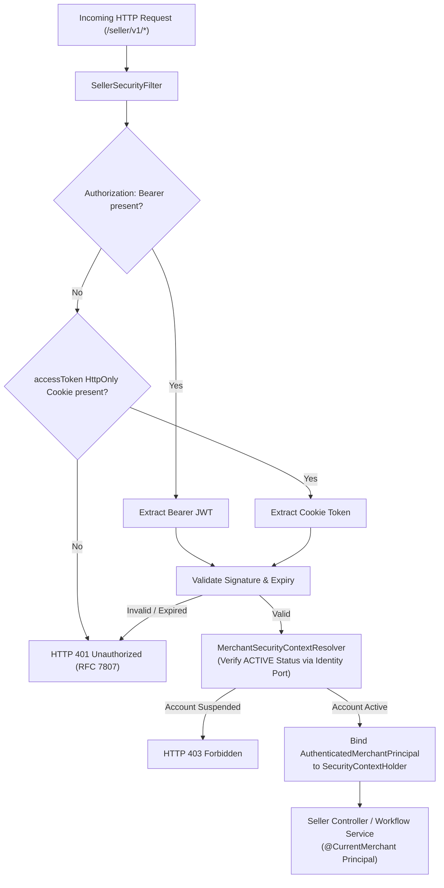
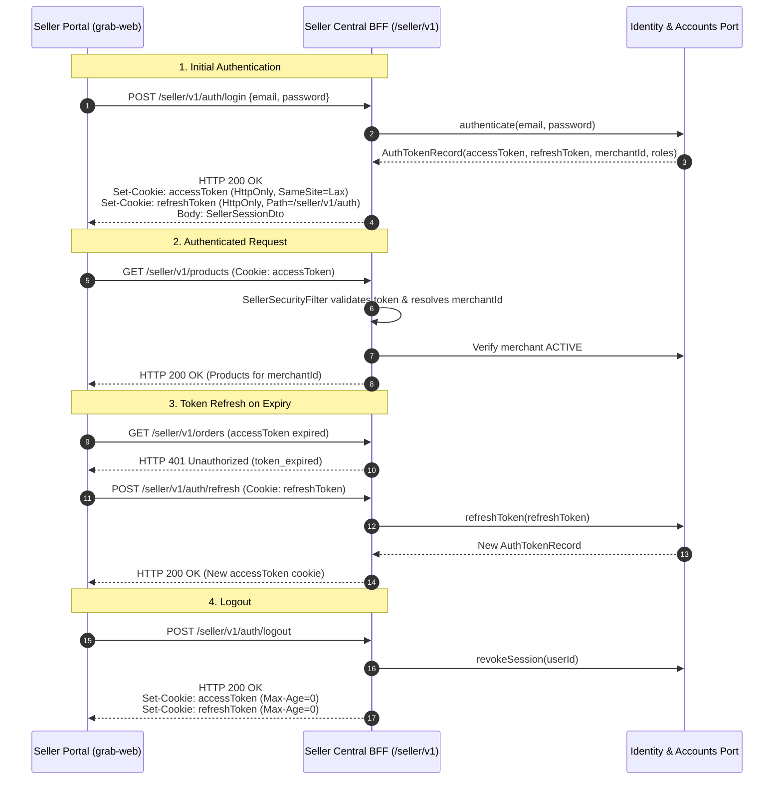
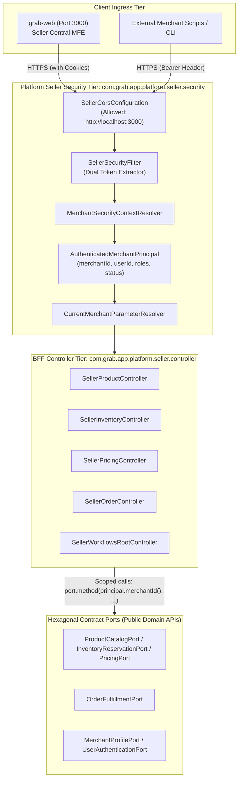
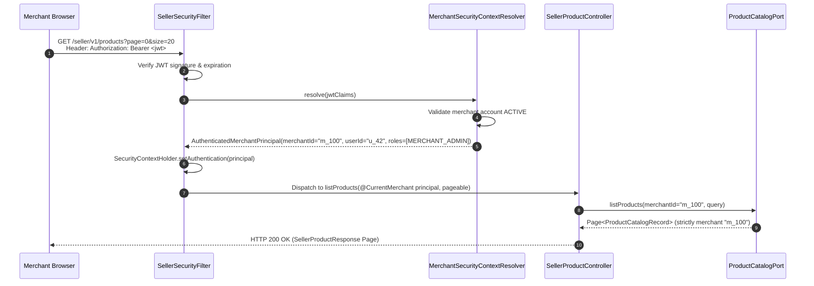

# Tech Spec: Seller Central BFF Ingress Security & Multi-Tenant Isolation

- **Summary:** Enforces edge authentication, dual-token extraction (Bearer JWT and HttpOnly cookie), immutable `AuthenticatedMerchantPrincipal` resolution, and strict multi-tenant boundary isolation for the Seller Central BFF (`/seller/v1/*`).
- **Type:** Architecture Pattern / Security Infrastructure
- **Feature Spec:** [Platform Seller Central BFF Implementation](../../features/feat_012-platform-seller-central-bff.md)

---

## 1. Problem & Decision

### What breaks without this?

Without a dedicated, edge-enforced merchant security layer, seller administration endpoints rely on client-supplied parameters (such as `?merchantId=...` or request body identifiers). This introduces severe Insecure Direct Object Reference (IDOR) vulnerabilities where malicious merchants can view, modify, or delete competitor catalogs, warehouse inventory, price lists, and customer orders. Furthermore, mixing browser credentials (which require `HttpOnly` cookies to prevent XSS) and automated API tokens (Bearer headers) without clear ingress boundaries leads to session leaks, CSRF vulnerabilities, and improper CORS exposure between public shoppers and administrative merchants.

### Decision

| Option | Decision | Why |
|:-------|:---------|:----|
| **Edge Dual-Token Ingress Filter + Cryptographic Security Principal + Explicit Whitelisted CORS** | **Adopted** | `SellerSecurityFilter` intercepts `/seller/v1/*`, prioritizing `Authorization: Bearer <jwt>` and falling back to `accessToken` `HttpOnly` cookie. Resolves an immutable `AuthenticatedMerchantPrincipal`. Completely bans client-supplied `merchantId` parameters. |
| Client-Supplied Merchant ID Parameters (`?merchantId=...`) | Rejected | High IDOR risk; clients can manipulate parameters to access or mutate other merchants' private data. |
| Classic Stateful HTTP Session (`JSESSIONID`) | Rejected | Violates 12-factor stateless design, blocks horizontal autoscaling, and prevents seamless API consumption by external automation scripts. |
| Browser `localStorage` JWT Storage | Rejected | High risk of XSS token theft. Browser tokens must reside in `HttpOnly`, `SameSite=Lax` cookies. |

### Trade-offs

| Benefits | Trade-offs |
|:---------|:-----------|
| Mathematical multi-tenant isolation: `merchantId` is derived solely from cryptographically verified security tokens. | Requires strict CORS preflight handling with `Access-Control-Allow-Credentials: true` and explicit origin whitelisting. |
| Seamless dual-client support: browser portal (`grab-web`) uses `HttpOnly` cookies while automated CLI/scripts use Bearer headers. | Token verification and active merchant status check introduce a minor lookup overhead at the ingress boundary. |
| Fine-grained role-based access control (RBAC) per merchant operator (`MERCHANT_ADMIN`, `STORE_MANAGER`, `FULFILLMENT_OPERATOR`). | Token expiration requires an automated refresh dance (`/seller/v1/auth/refresh`) using a refresh token cookie. |

---

## 2. How It Works

### Core Concept

The `SellerSecurityFilter` intercepts every incoming HTTP request targeting `/seller/v1/*`. It extracts the authentication token using a dual-source strategy (Bearer header prioritized over cookie). The token is verified for signature and expiration against the JWT verification key. Once validated, the `MerchantSecurityContextResolver` confirms that the merchant account is in `ACTIVE` status and constructs an immutable `AuthenticatedMerchantPrincipal`. This principal is bound to Spring's `SecurityContextHolder` for the duration of the request and injected into controllers via `@CurrentMerchant`.

### How It Works Step by Step

| Step | What Happens | Why |
|:-----|:-------------|:----|
| 1 | Client sends HTTP request to `/seller/v1/*` with either `Authorization: Bearer <jwt>` header or `accessToken` cookie. | Supports both browser clients (`grab-web`) and external automated API integrations. |
| 2 | `SellerSecurityFilter` checks header first; if absent, inspects cookies. If neither exists, aborts with `HTTP 401 Unauthorized`. | Enforces that all endpoints in the `/seller/v1/*` namespace (except public auth paths) are protected by default. |
| 3 | Authenticator verifies cryptographic signature, not-before, and expiration timestamps. | Guarantees the token was issued by the platform Identity service and has not expired or been forged. |
| 4 | Claims are unpacked to extract `userId`, `merchantId`, `roles`, and `tokenVersion`. | Obtains the authenticated identity without trusting any client-supplied request body or query parameter. |
| 5 | `MerchantSecurityContextResolver` checks the merchant's operational status (`ACTIVE`). | Prevents suspended, closed, or deactivated merchants from mutating resources even if their token has not yet expired. |
| 6 | Resolver creates `AuthenticatedMerchantPrincipal` and attaches it to `SecurityContextHolder`. | Makes verified identity available throughout Spring MVC parameter resolvers, security expressions, and audit logs. |
| 7 | Controller receives `AuthenticatedMerchantPrincipal` via `@CurrentMerchant` and injects `principal.merchantId()` into domain port calls. | Guarantees downstream database queries and commands are strictly scoped to the tenant. |

### Session Lifecycle & Token Refresh

---

## 3. How We Use It

### Where It Fits in Our System / Architecture & Layer Stacking

### Component Responsibilities

| Component | Role | What It Does |
|:----------|:-----|:-------------|
| `SellerSecurityFilter` | Ingress Filter | Intercepts `/seller/v1/**`, extracts Bearer token or `accessToken` cookie, performs initial cryptographic validation, and handles authentication errors. |
| `MerchantSecurityContextResolver` | Context Provider | Validates merchant account active status via `MerchantProfilePort`, checks tenant revocation, and instantiates `AuthenticatedMerchantPrincipal`. |
| `AuthenticatedMerchantPrincipal` | Security Record | Immutable record containing verified `merchantId`, `userId`, `roles`, and `businessStatus`. Stored in Spring `SecurityContextHolder`. |
| `@CurrentMerchant` | Method Argument Annotation | Injected into controller methods to automatically provide the current `AuthenticatedMerchantPrincipal`. |
| `CurrentMerchantParameterResolver` | Spring MVC Handler | Resolves method parameters annotated with `@CurrentMerchant` directly from `SecurityContextHolder.getContext().getAuthentication()`. |
| `SellerCorsConfiguration` | Network Boundary | Configures CORS explicitly for Seller Central frontend hosts (`http://localhost:3000`), allowing credentials (`Access-Control-Allow-Credentials: true`). |

### Runtime Flow: Multi-Tenant Protected Query

---

## 4. Implementation Rules

| Rule | Requirement |
|:-----|:------------|
| **R-01** | `SellerSecurityFilter` **MUST** intercept all HTTP requests under `/seller/v1/**`, except the explicitly whitelisted public authentication paths: `/seller/v1/auth/login` and `/seller/v1/auth/refresh`. |
| **R-02** | `SellerSecurityFilter` **MUST** check the `Authorization: Bearer <jwt>` header first; it **MUST** fall back to the `accessToken` `HttpOnly` cookie only when the header is absent. |
| **R-03** | Missing, malformed, expired, or cryptographically invalid tokens **MUST** result in an immediate `HTTP 401 Unauthorized` response conforming to RFC 7807 Problem Details. The response **MUST NOT** leak stack traces or internal exception details. |
| **R-04** | Controllers and workflow services in `com.grab.app.platform.seller` **MUST NOT** accept `merchantId` as a query parameter (`?merchantId=...`), path variable (`/seller/v1/{merchantId}/...`), or request body field. |
| **R-05** | All tenant-scoped domain queries, mutations, and workflow sagas **MUST** derive the `merchantId` exclusively from the verified `AuthenticatedMerchantPrincipal`. |
| **R-06** | `SellerCorsConfiguration` **MUST** explicitly whitelist allowed origins (`http://localhost:3000` in development, configured seller portal domain in production) and **MUST** set `Access-Control-Allow-Credentials: true`. Wildcards (`*`) **MUST NOT** be used for origins when credentials are enabled. |
| **R-07** | Merchants with account status other than `ACTIVE` (e.g. `PENDING_KYC`, `SUSPENDED`, `CLOSED`) **MUST** be rejected with `HTTP 403 Forbidden` on all write/mutation endpoints. |
| **R-08** | If a merchant attempts to access or mutate an aggregate (product, stock line, price set, or order) that belongs to another merchant, the domain port **MUST** return an authorization failure or empty result, and the controller **MUST** return `HTTP 403 Forbidden` or `HTTP 404 Not Found`. Cross-tenant data leakage is strictly forbidden. |
| **R-09** | Authentication cookies (`accessToken`, `refreshToken`) **MUST** be set with flags `HttpOnly`, `SameSite=Lax`, and `Secure` (in HTTPS/production environments). Raw JWT tokens **MUST NOT** be stored in browser `localStorage`. |
| **R-10** | Spring Modulith ArchUnit tests (`SellerBffSecurityArchitectureTest`) **MUST** verify that security filter classes do not directly import internal domain repositories or JPA entities. |
