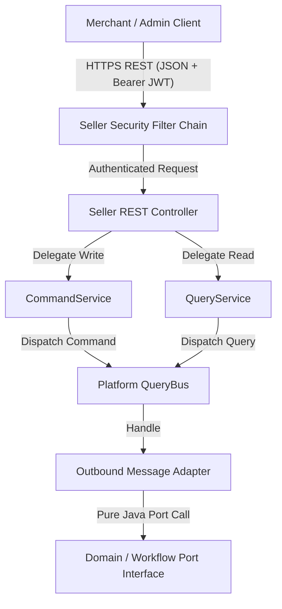
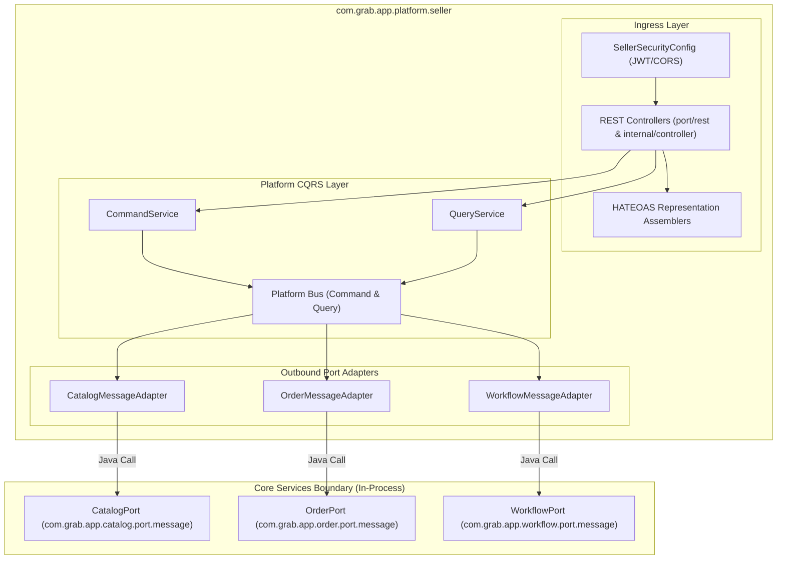
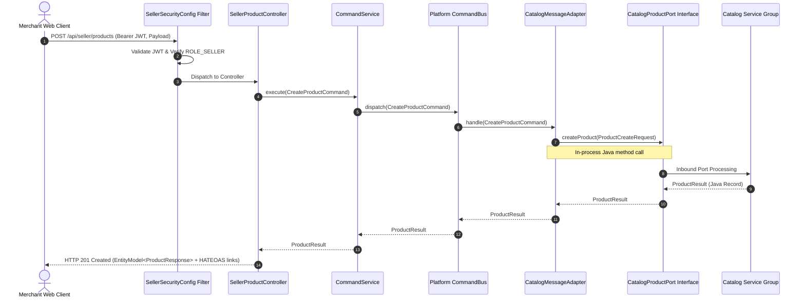

# Tech Spec: Seller Platform Communication Protocol & Contracts

- **Summary:** Defines the REST API ingress protocol, centralized JWT security perimeter, and synchronous in-process Java outbound port contracts for the Seller Platform BFF (`com.grab.app.platform.seller`).
- **Type:** Architecture Pattern / Ingress Protocol
- **Feature Spec:** [BFF-to-Domain Communication Protocol & Controller Contract Migration](../../features/feat_011-decoupled-service-communication-cqrs-pipeline.md)

---

## 1. Problem & Decision

### What breaks without this?

Without a standardized ingress protocol and contract boundary for the Seller Platform BFF, merchant-facing REST controllers remain scattered across core domain packages. This leaks presentation-specific JSON formats, HATEOAS link logic, and JWT role verification into headless domain services. Furthermore, without explicit outbound capability contracts, seller controllers directly invoke domain repositories or internal beans, creating tight binary coupling that prevents extracting domain services into independent microservices.

### Decision

| Option | Decision | Why |
|:-------|:---------|:----|
| **Dedicated Seller BFF with REST Ingress and Port Adapter Invocations** | Adopted | Centralizes merchant HTTP routing, JWT token verification, and HATEOAS assembling at the ingress edge while decoupling callers from domain internals via pure Java port interfaces. |
| Ingress Controllers Hosted Directly within Domain Groups | Rejected | Couples headless domain business logic to Spring MVC, HTTP status codes, and web security filters, breaking hexagonal isolation. |
| Direct In-Memory Method Calls to Domain CQRS Handlers | Rejected | Bypasses the communication protocol boundary and couples platform web controllers directly to internal domain handlers. |

### Trade-offs

| Benefits | Trade-offs |
|:---------|:-----------|
| Domain groups remain 100% headless, testable without web servers, and free of web security dependencies. | Requires maintaining dedicated request/response DTOs and MapStruct mappers at the BFF boundary. |
| Centralizes merchant security policies, role-based access controls, and rate-limiting at a single gateway filter. | Introduces a lightweight adapter hop from BFF outbound adapters to domain port interfaces. |

---

## 2. How It Works

### Core Concept

The Seller Platform BFF acts as the single entry point for merchant and administrative back-office operations. It terminates external HTTPS requests, verifies JWT credentials via `SellerSecurityConfig`, routes commands and queries through its internal CQRS services, and invokes downstream domain services and workflows exclusively through strongly typed port interfaces.



### How It Works Step by Step

| Step | What Happens | Why |
|:-----|:-------------|:----|
| 1 | Client submits an HTTPS REST request to a `/api/seller/**` route with a JWT Bearer token in the `Authorization` header. | Transports merchant action using standard HTTP protocols and authentication headers. |
| 2 | `SellerSecurityConfig` validates the JWT signature, extracts merchant identity and claims, and enforces route authorizations (`@PreAuthorize`). | Enforces ingress security at the perimeter before any business processing occurs. |
| 3 | Controller receives the validated payload, delegates to `CommandService` (for mutations) or `QueryService` (for reads). | Enforces strict CQRS separation and prevents controllers from containing orchestration logic. |
| 4 | Command/Query service dispatches an immutable record to the internal Platform CQRS Bus. | Decouples the HTTP lifecycle from downstream capability execution. |
| 5 | The platform handler resolves the request by invoking an outbound message adapter (`adapter.outbound.message`). | Isolates outbound transport mechanics behind hexagonal port interfaces. |
| 6 | Outbound adapter invokes the domain or workflow public port interface (`port.message`). | Executes in-process Java method with zero serialization overhead and complete compile-time type safety. |
| 7 | Controller transforms domain response records into `EntityModel<T>` with HATEOAS navigational links and returns HTTP 200/201. | Delivers hypermedia-driven responses tailored specifically to merchant web interfaces. |

---

## 3. How We Use It

### Where It Fits in Our System / Architecture & Layer Stacking



### Component Responsibilities

| Component | Role | What It Does |
|:----------|:-----|:-------------|
| `SellerSecurityConfig` | Security Perimeter | Configures HTTP security filter chain, JWT bearer authentication, CORS policies, and role-based permissions (`ROLE_SELLER`, `ROLE_ADMIN`). |
| `Seller*Controller` | Web Ingress Adapter | Exposes REST endpoints under `/api/seller/**`, performs Jakarta Bean Validation, and maps inputs to platform commands/queries. |
| `SellerModelAssembler` | Presentation Assembler | Enriches response records with HATEOAS hypermedia links for state transitions and child resources. |
| `Platform Command/QueryService` | CQRS Gateway | Enforces single-responsibility dispatching; writes strictly via `CommandBus`, reads strictly via `QueryBus`. |
| `Outbound Message Adapters` | Capability Bridge | Adapts platform commands/queries to downstream domain or workflow port interfaces (`port.message`). |

### Runtime Flow



### Contracts & Protocol Specifications

#### 1. Ingress REST Protocol & Security Contract
- **Base URL Pattern:** `/api/seller/{resource}`
- **Security Scheme:** HTTP Bearer authentication with RS256/ES256-signed JSON Web Tokens (JWT).
- **Required Claims:** `sub` (Merchant/User UUID), `roles` (contains `ROLE_SELLER` or `ROLE_ADMIN`), `merchant_id` (Merchant Account UUID).
- **Transport Format:** `Content-Type: application/json`, `Accept: application/json`.
- **Response Format:** Single resources wrapped in `EntityModel<T>`; collections wrapped in `PagedModel<EntityModel<T>>`.

#### 2. Seller REST Ingress DTO Contracts (Sample)
```java
// Request DTO (Immutable Record with Jakarta Bean Validation)
public record CreateProductRequest(
    @NotBlank(message = "Title is required")
    @Size(min = 3, max = 255)
    String title,

    @NotBlank(message = "SKU is required")
    String sku,

    @NotNull(message = "Price is required")
    @DecimalMin(value = "0.01", message = "Price must be positive")
    BigDecimal price,

    @NotBlank(message = "Currency code is required")
    @Size(min = 3, max = 3)
    String currencyCode
) {}

// Response DTO (Primitives & Strings Only)
public record ProductResponse(
    String id,
    String title,
    String sku,
    BigDecimal price,
    String currencyCode,
    String status,
    Instant createdAt
) {}
```

#### 3. Outbound Port Invocation Contract
```java
// Downstream Domain Port Interface Contract (Implemented by Catalog Service)
public interface CatalogProductPort {
    ProductResult createProduct(ProductCreateMessage message);
    ProductResult updateProduct(String productId, ProductUpdateMessage message);
    Optional<ProductResult> getProductById(String productId);
}

// Outbound Message Record (Contract between Seller BFF and Domain Group)
public record ProductCreateMessage(
    String merchantId,
    String title,
    String sku,
    BigDecimal price,
    String currencyCode
) {}
```

---

## 4. Implementation Rules

| Rule | Requirement |
|:-----|:------------|
| **R-01** | All merchant-facing HTTP endpoints **MUST** reside exclusively in the Seller Platform BFF (`com.grab.app.platform.seller`) under `/api/seller/**`. |
| **R-02** | The Seller Platform BFF **MUST NOT** import or use Spring Data JPA repositories, `@Entity` classes, or persistence units; it operates strictly as a stateless ingress gateway. |
| **R-03** | Ingress endpoints **MUST** enforce authentication and authorization via `SellerSecurityConfig` using JWT tokens containing `ROLE_SELLER` or `ROLE_ADMIN`. |
| **R-04** | Controllers **MUST NOT** inject `CommandBus`, `QueryBus`, domain repositories, or core use cases directly; they delegate writes exclusively to `CommandService` and reads to `QueryService`. |
| **R-05** | Downstream service calls from the Seller BFF **MUST** pass through outbound message adapters invoking public Java port interfaces (`port.message`), ensuring compile-time type safety and strict hexagonal decoupling. |
| **R-06** | All single-entity REST responses **MUST** be wrapped in `EntityModel<T>` and collection responses in `PagedModel<EntityModel<T>>` with standard HATEOAS link relations. |
| **R-07** | Request and response DTOs **MUST** be immutable Java `record` types containing only primitives, `String`, and standard value objects. |

