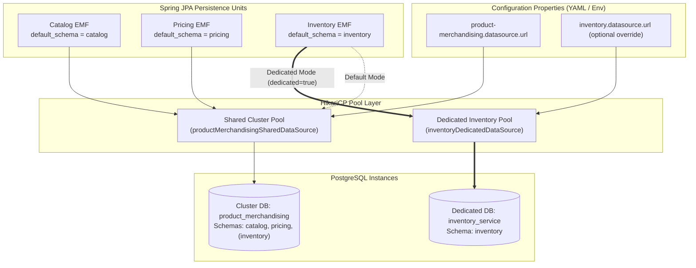
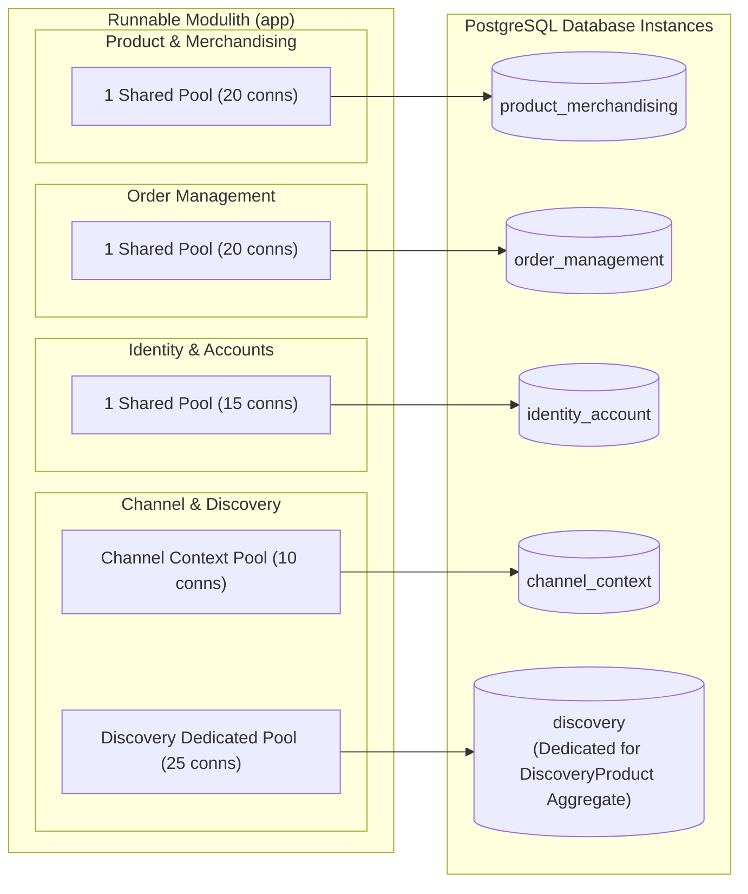

# Tech Spec: Service-Level Database & Connection Pool Consolidation

- **Summary:** Defines the database consolidation architecture, PostgreSQL schema partitioning, HikariCP connection pool optimization, and declarative per-domain dedicated database override patterns for the Spring Modulith platform.
- **Type:** Infrastructure & Architecture Pattern
- **Feature Spec:** [Service-Level Database & Connection Pool Consolidation in Spring Modulith](../../features/feat_010-service-level-database-consolidation.md)

---

## 1. Problem & Decision

### What breaks without this?

Running 13 fine-grained domain libraries with 13 independent HikariCP connection pools in a single JVM consumes over 130 peak connections ($13 \times 10$). Default PostgreSQL instances reject connections after 100 concurrent clients, causing startup failures, thread starvation, connection pool exhaustion during traffic spikes, and massive idle memory waste. Without schema partitioning, teams either suffer pool exhaustion or merge tables into a single schema, inadvertently introducing cross-domain joins that prevent microservice extraction.

### Decision

| Option | Decision | Why |
|:-------|:---------|:----|
| **4 Service Cluster Databases with Schema Partitioning & Dedicated Override** | Adopted | Consolidates connections into 4 shared Hikari pools (reducing peak connections by 65%), enforces strict table boundary isolation via PostgreSQL schemas, and provides seamless zero-code override to dedicated database instances when scaling or extracting microservices. |
| Retain 13 Fine-Grained Databases | Rejected | Exhausts database connection limits, consumes excessive JVM memory, and complicates local developer setup with 13 running database containers. |
| Single Flat Database with Shared Public Schema | Rejected | Eliminates domain isolation boundaries, allows developers to write cross-domain SQL joins and foreign keys, creating tight coupling that makes future microservice extraction impossible. |

### Trade-offs

| Benefits | Trade-offs |
|:-----------|:-------------|
| Reduces JVM connection pool overhead from 130+ down to 40–80 total connections. | Multi-schema Flyway migrations must be explicitly configured with isolated history tables. |
| Strict schema isolation prevents table name collisions and cross-domain foreign key entanglements. | Domains cannot run native multi-table SQL joins across different schemas (must use asynchronous outbox events or application-level enrichment). |
| Any domain (e.g., `inventory`) can dynamically switch between shared and dedicated databases via environment variables. | Developers must declare `@Table(name = "...", schema = "...")` or set `hibernate.default_schema` per persistence unit. |

---

## 2. How It Works

### Core Concept

The persistence architecture consolidates data storage at the **Service Cluster level** (`product_merchandising`, `order_management`, `identity_account`, `channel_discovery`). Within each cluster's PostgreSQL database instance, individual domains reside in dedicated **PostgreSQL schemas**. In Spring Boot, each cluster initializes a primary shared `HikariDataSource`, while domain-specific `EntityManagerFactory` beans dynamically bind to either the shared cluster pool or a dedicated pool via an `ObjectProvider<DataSource>` conditional resolver.



---

### Dynamic Connection Routing Pattern

To prevent creating redundant HikariCP pools when multiple domains share the same database instance, Spring's `ObjectProvider` conditionally injects a dedicated DataSource only if enabled; otherwise, it supplies the shared cluster DataSource:

```java
@Configuration
public class DomainDataSourceFactory {

    public static LocalContainerEntityManagerFactoryBean createEntityManagerFactory(
            DataSource sharedClusterDataSource,
            ObjectProvider<DataSource> dedicatedDomainDataSource,
            String persistenceUnitName,
            String packageToScan,
            String defaultSchema) {

        // If a dedicated DataSource bean was registered via @ConditionalOnProperty, use it;
        // otherwise, reuse the shared cluster connection pool.
        DataSource effectiveDataSource = dedicatedDomainDataSource.getIfAvailable(() -> sharedClusterDataSource);

        LocalContainerEntityManagerFactoryBean em = new LocalContainerEntityManagerFactoryBean();
        em.setDataSource(effectiveDataSource);
        em.setPackagesToScan(packageToScan);
        em.setPersistenceUnitName(persistenceUnitName);

        HibernateJpaVendorAdapter vendorAdapter = new HibernateJpaVendorAdapter();
        em.setJpaVendorAdapter(vendorAdapter);

        Map<String, Object> properties = new HashMap<>();
        properties.put("hibernate.default_schema", defaultSchema);
        properties.put("hibernate.dialect", "org.hibernate.dialect.PostgreSQLDialect");
        properties.put("hibernate.hbm2ddl.auto", "validate");
        em.setJpaPropertyMap(properties);

        return em;
    }
}
```

---

### Step-by-Step Execution Flow

| Step | Phase | Action |
|:-----|:------|:-------|
| 1 | **Bootstrap** | Spring Boot loads `application.yml` and evaluates cluster vs domain-specific properties. |
| 2 | **Pool Initialization** | Spring registers the 4 shared HikariCP pools. If any `<domain>.datasource.dedicated=true` flag is set, a dedicated Hikari pool is also initialized for that specific domain. |
| 3 | **Flyway Execution** | Each domain triggers its dedicated Flyway migration runner against its designated schema, using its private `flyway_schema_history_<domain>` table. |
| 4 | **Entity Mapping** | Hibernate sets `hibernate.default_schema` for each persistence unit, ensuring all queries automatically target the correct schema without requiring hardcoded table annotations. |
| 5 | **Transaction Scoping** | Inbound requests acquire a connection strictly from the resolved DataSource during `@Transactional` boundary execution, isolating commits to that schema or database instance. |

---

## 3. How We Use It

### Domain Cluster Topology



### Component Responsibilities

| Component | Role | What It Does |
|:----------|:-----|:-------------|
| `*ClusterPersistenceConfig` | Cluster Pool Registrar | Instantiates the primary shared `HikariDataSource` for the domain group (e.g., `ProductMerchandisingPersistenceConfiguration`, `ChannelContextPersistenceConfiguration`). |
| `DiscoveryProductPersistenceConfiguration` | Dedicated Read-Model Registrar | Configures dedicated `discoveryProductDataSource` pointing directly to the isolated `discovery` database instance for high-throughput storefront searches. |
| `*DomainPersistenceConfig` | Domain EntityManager Factory | Configures the `EntityManagerFactory`, `JpaTransactionManager`, and Flyway migration runner for a specific subdomain, utilizing `ObjectProvider<DataSource>` for dynamic routing. |
| `flyway_schema_history_<domain>` | Migration State Table | Tracks applied database migrations independently per domain, preventing table lock contention and version conflicts across subdomains. |
| `docker-compose.yml` | Local Infrastructure Provider | Spins up the PostgreSQL database instances (`product_merchandising`, `order_management`, `identity_account`, `channel_context`, `discovery`) with initialized schemas. |

---

## 4. Implementation Rules

| Rule | Requirement |
|:-----|:------------|
| **R-01** | Tables for any domain **MUST** reside within that domain's private PostgreSQL schema (e.g. `catalog`, `inventory`, `pricing`). Tables **MUST NOT** be created in the `public` schema. |
| **R-02** | Foreign keys across schemas **MUST NOT** be defined in DDL migrations or Hibernate mappings. Relationships between domains **MUST** be referenced strictly by scalar ID (e.g. `productId: UUID`) and reconciled via domain event messages. |
| **R-03** | Each domain **MUST** maintain its own Flyway migration history table named `flyway_schema_history_<domain>` (e.g. `flyway_schema_history_catalog`). |
| **R-04** | All domain datasource configurations **MUST** support the hierarchical property fallback pattern (`<domain>.datasource.url:${<cluster>.datasource.url}`). |
| **R-05** | If a domain requires a dedicated database instance, it **MUST** be enabled via `<domain>.datasource.dedicated=true` without requiring any changes to Java entity classes or repository interfaces. |
| **R-06** | In default cluster mode, connection pool sizes **MUST NOT** exceed 20 connections per cluster pool (`maximum-pool-size: 20`), ensuring total Monolith connections stay well below PostgreSQL connection thresholds. |
