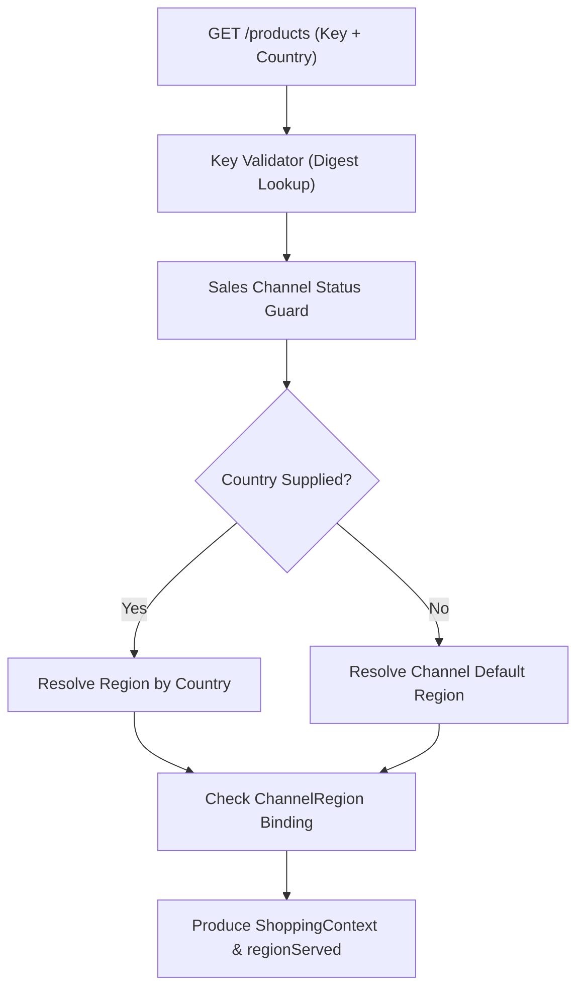
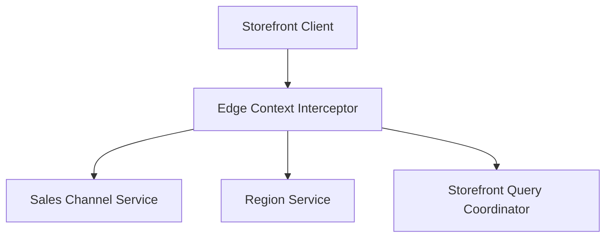
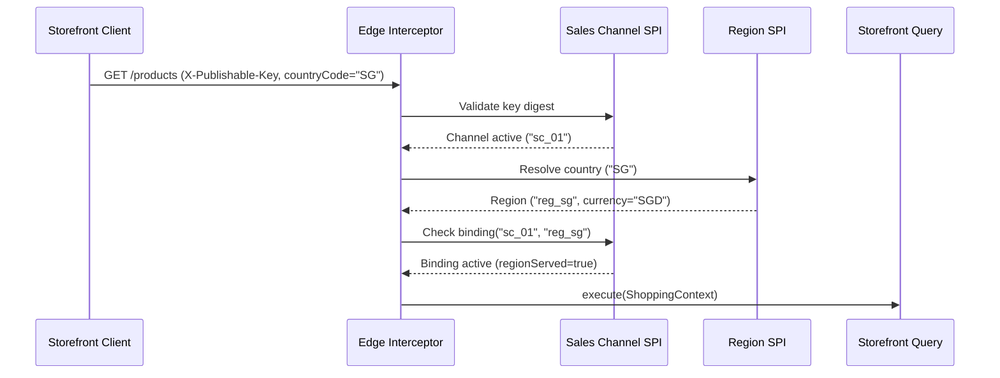

# Tech Spec: Shopping Context Resolution

- **Summary:** Resolves public channel identity and authoritative regional market context before factual discovery queries execute.
- **Type:** Cross-Cutting Concern
- **Feature Spec:** [Edge Shopping-Context Resolution](../../features/feat_004-edge-shopping-context-resolution.md)

---

## 1. Problem & Decision

### What breaks without this?

Without pre-query edge context resolution, storefront browse endpoints must accept raw `salesChannelId` and `currency` query parameters from untrusted clients. This allows malicious actors to enumerate private merchant channels, spoof competitor channel configurations, and tamper with currencies to trigger cross-border pricing discrepancies.

### Decision

| Option | Decision | Why |
|:-------|:---------|:----|
| **Pre-Query Authoritative Edge Resolution** | Adopted | Guarantees channel authenticity and authoritative settlement currency upfront, establishing immutable context before queries run. |
| Client-Supplied Channel & Currency | Rejected | Exposes security risks through channel spoofing, parameter tampering, and cross-border currency exploitation. |
| Silent Default Substitution for Unserved Markets | Rejected | Misleads shoppers by displaying mismatched products or prices instead of transparently communicating regional market unavailability. |

### Trade-offs

| Benefits | Trade-offs |
|:-----------|:-------------|
| Deterministic channel identity and currency authority from Region service | Inbound requests incur an edge validation hop before querying catalog facts |
| Clear distinction between unserved valid markets and malformed requests | Channels without a configured default region reject requests that omit country |

---

## 2. How It Works

### Core Concept

The resolution filter extracts the `X-Publishable-Key` header and optional `countryCode` parameter. It authenticates the key against the Sales Channel service, validates country membership against the Region service, verifies channel-region bindings, and produces an immutable `ShoppingContext` tuple accompanying an explicit `regionServed` boolean flag.

### How It Works Step by Step

| Step | What Happens | Why |
|:-----|:-------------|:----|
| 1 | Interceptor reads `X-Publishable-Key` header and computes SHA-256 digest | Validates public credential authenticity |
| 2 | Verifies channel status is `ENABLED` | Fails fast with HTTP 400 if channel is deactivated |
| 3 | Normalizes `countryCode` (uppercase ISO 3166-1) or resolves channel's default region | Establishes geographic destination |
| 4 | Retrieves authoritative settlement currency from Region entity | Prevents client-side currency tampering |
| 5 | Evaluates `ChannelRegion` binding and sets `regionServed` boolean | Separates commercial eligibility from catalog visibility |
| 6 | Emits immutable `ShoppingContext` for downstream query execution | Provides contextual parameters across read pipeline |

---

## 3. How We Use It

### Where It Fits in Our System

### Component Responsibilities

| Component | Role | What It Does |
|:----------|:-----|:-------------|
| Edge Context Interceptor | HTTP Filter | Intercepts storefront requests, validates headers, and orchestrates resolution calls. |
| Sales Channel SPI | Channel Authority | Validates publishable key token digests, channel status, and channel-region bindings. |
| Region SPI | Territorial Authority | Provides authoritative ISO country mappings, market status, and settlement currency. |
| Storefront Query Coordinator | Application Service | Consumes immutable `ShoppingContext` to orchestrate Tier 1 read model queries. |

### Runtime Flow

---

## 4. Implementation Rules

| Rule | Requirement |
|:-----|:------------|
| **R-01** | The resolved result **MUST** contain an immutable channel ID, region ID, optional country, Region-owned currency, and optional locale; `regionServed` **MUST** accompany the context as separate eligibility. |
| **R-02** | Missing, malformed, unknown, or revoked tokens **MUST** yield an identical generic `401 Unauthorized` response; valid tokens for disabled channels **MUST** yield `400 Bad Request`. |
| **R-03** | Supplied country codes **MUST** be trimmed, uppercased, and validated as known 2-letter ISO alpha-2 codes; malformed or unknown codes **MUST** yield 400, and valid countries without active regions **MUST** yield `422 Unprocessable Entity`. |
| **R-04** | Omitted country codes **MUST** resolve the channel's enabled default region binding and retain null country; missing, inactive, or unserved defaults **MUST** yield 422. |
| **R-05** | An explicit valid active Region unserved by the channel **MUST** produce `regionServed=false` without default substitution; downstream queries **MUST** skip pricing and mark visible variants `NOT_AVAILABLE_IN_REGION`. |
| **R-06** | Cross-context reads **MUST** use published SPI capabilities and immutable projections; resolution **MUST NOT** access foreign storage or mutate source state. |
| **R-07** | Currency **MUST** come exclusively from Region and **MUST NOT** be inferred from locale or overwritten by client query parameters. |
| **R-08** | Provider failures **MUST** propagate as operational failures (`500`) rather than invalid-key or unserved-market outcomes; resolution **MUST NOT** expose raw tokens. |
