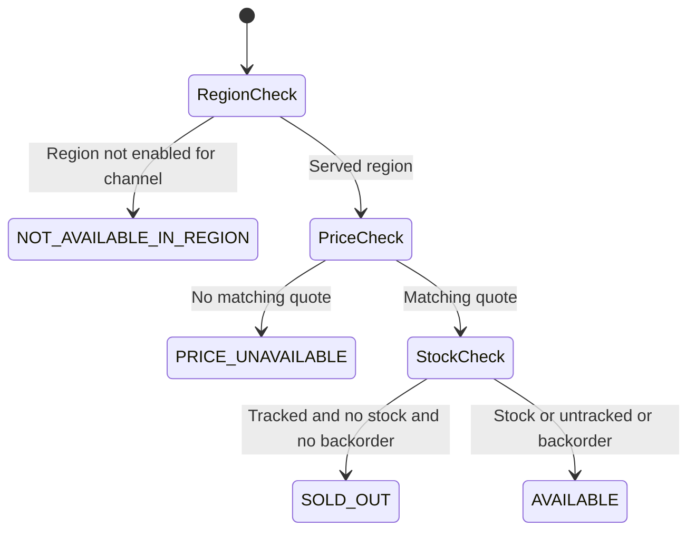
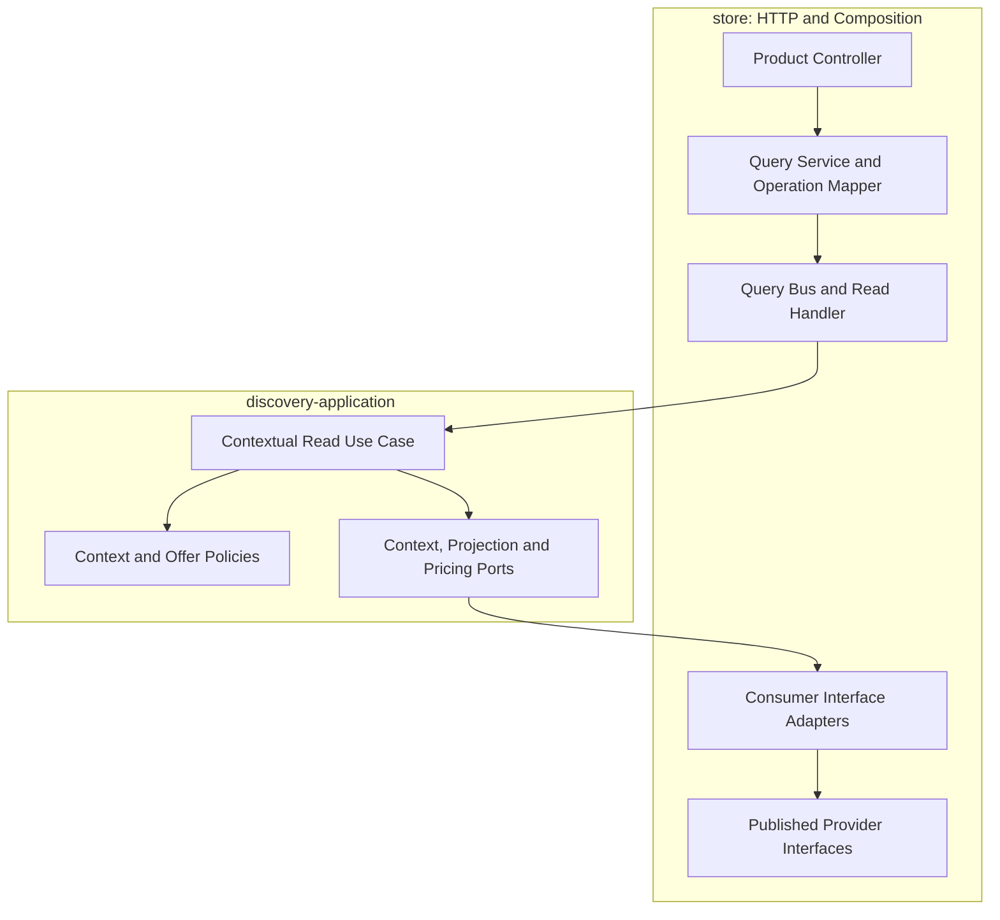
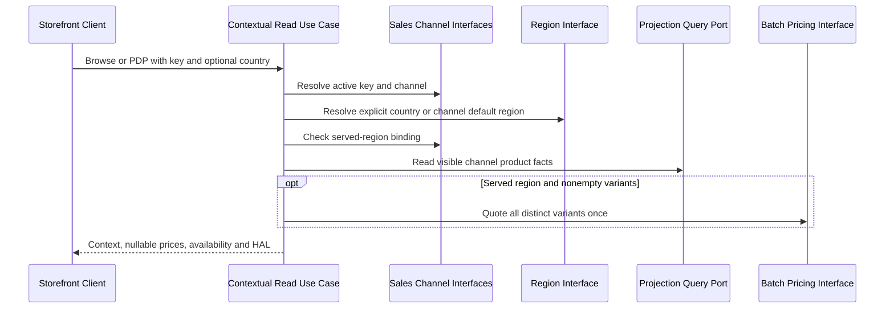

# Tech Specification: Shopping Context Resolution & Contextual Offers

> **Summary:** Resolves a public storefront request to an authoritative market before reading product facts and enriching them with regional quotes.
> **Classification:** Cross-Cutting Read Contract / Security Boundary
> **Supporting Modules:** `discovery-application` / `store/storefrontquery` with Sales Channel, Region, and Pricing published interfaces
> **Status:** Planned; no shopping-context resolver or contextual HTTP input exists in the audited code.
> **Regional Foundation:** [Edge Shopping-Context Resolution](../../features/feat_004-edge-shopping-context-resolution.md)
> **Related Feature:** [Storefront API Cutover & Response Contract Refactoring](../../features/feat_007-storefront-api-cutover-contract-refactoring.md)
> **Related Domain Specs:** [Publishable Key](../domain/sales-channel/architecture/publishable-key-domain-spec.md), [Sales Channel](../domain/sales-channel/architecture/sales-channel-domain-spec.md), [Region](../domain/region/architecture/region-domain-spec.md), [Pricing](../domain/pricing/architecture/pricing-domain-spec.md)
> **Related Workflow:** [Browse and Discover Products](../workflows/browse-and-discover-products-workflow.md)
> **Supporting Tech:** [Batch Pricing](batch-regional-pricing-tech-spec.md), [Discovery Projection](storefront-query-tech-spec.md), [Rollout](contextual-discovery-rollout-tech-spec.md)
> **System Design:** [SSD-001](../../system-design/001-multi_regional_contextual_discovery_system_design.md)

## 1. Why We Need It

### The Problem

`StorefrontProductController` currently requires `salesChannelId` and accepts neither the key header nor country input. Its assembler also embeds the raw channel selector in customer links, and its response describes a prepriced channel document.

The existing key feature allows dual selectors, while SSD-001 requires key-only public selection. This specification defines the planned cutover contract and makes regional unavailability a response state, preserving visible PDP URLs.

### Technology Decision & Alternatives

| Option | Decision | Rationale |
| :--- | :--- | :--- |
| Resolve context in the read use case before projection lookup | Adopt | Keeps controllers/services thin while enforcing one authoritative context. |
| Accept raw public channel IDs alongside keys | Supersede at cutover | Preserves the selector bypass that the SSD removes. |
| Infer currency from a country map or channel fallback | Reject | Duplicates Region authority and cannot isolate same-currency markets. |

A publishable key identifies a public commercial channel; it grants no merchant login or write access. It does not prevent a client who possesses the public key from reading that channel's public products.

## 2. What It Is

### Core Concept

The resolver is stateless. The context carries channel ID, region ID, optional country code, Region's currency code, and optional locale; served-region eligibility is retained alongside it as a resolution result.

### Availability Evaluation

These are per-request results rather than stored lifecycle transitions. A priced sold-out variant retains its quoted amount; missing prices remain null.

## 3. How We Use It in This System

### Architecture & Layer Stacking

HTTP inputs are mapped to immutable queries; controllers do not inject a resolver, use case, or provider port. The read use case orchestrates key/Region/binding ports, projection reads, and batch quotes; pure policies decide context validity and offer availability without port injection.

Provider adapters start their own module read transactions and delegate only to inbound use cases. New application IDs use `Id`, each operation has its own MapStruct abstract mapper, and response monetary/timestamp/identifier scalars are strings.

### Runtime Flow

## 4. Technical Specification & Contracts

### Context and Request Rules

- **CTX-01:** Product collection/PDP requests MUST reject any `salesChannelId` query parameter with HTTP 400, including empty or repeated values; the header is the only public channel selector, and raw region/currency selectors MUST NOT override resolved context.
- **CTX-02:** A missing, malformed, unknown, or revoked key MUST produce one generic HTTP 401 problem response without token echoes or existence clues; a valid key resolving to a disabled channel MUST produce HTTP 400 ChannelDisabled before product reads.
- **CTX-03:** An explicit country MUST be trimmed, normalized to uppercase, validated as an ISO alpha-2 country, and resolved to one active Region; blank/malformed input MUST return 400, and a valid country with no active Region MUST return 422 RegionUnavailable.
- **CTX-04:** An omitted country MUST resolve the channel's enabled default binding and active Region; missing/invalid defaults MUST return 422 DefaultRegionUnavailable, and country MUST remain null when none was supplied rather than choosing an arbitrary country from that Region.
- **CTX-05:** For a valid active Region that the channel does not serve, resolution MUST retain the channel/Region context with `regionServed=false`; visible products MUST remain readable and pricing MUST be skipped, yielding NOT_AVAILABLE_IN_REGION instead of an error or default-region substitution.

The unserved-region rule resolves the ambiguity between the SSD's region verification step and its availability state machine. Disabled channels still fail closed; an unserved active market does not expose another channel's catalog.

### Enrichment and Representation Rules

- **CTX-06:** Each nonempty served page/PDP MUST request all distinct published projected variants in exactly one batch quote invocation with quantity one; no per-product or per-variant pricing loop is permitted, and empty pages MUST skip pricing.
- **CTX-07:** Responses MUST expose resolved channel, region, country, currency, optional locale and region-served status; prices and compare-at prices MUST be nullable decimal strings, and min/max MUST use quoted visible variants including sold-out variants, excluding unpriced/unserved variants and becoming null when none are quoted.
- **CTX-08:** Variant availability MUST evaluate region exclusion, then price absence, then tracked-stock exhaustion without backorder, then AVAILABLE; `buyable` MUST equal `availability == AVAILABLE`, and a configured zero price MUST be treated as a valid quote.
- **CTX-09:** An eligible PDP MUST return 200 regardless of those availability states; absent, deleted, unpublished or inactive products MUST return 404 OfferNotFound, and operational provider failures MUST propagate as service errors rather than synthetic absent prices or stock.
- **CTX-10:** HAL self/list/pagination links MUST use controller/link facades and preserve country, locale and paging without raw keys or `salesChannelId`; clients MUST resend the header when following links, and browse MUST NOT advertise product creation.
- **CTX-11:** Initial responses MUST use `Cache-Control: no-store`; future cache enablement MUST validate key activity/channel status before cache access, partition by channel/region/currency/country/locale and any quote-affecting input, and use correct HTTP `Vary` for header-driven inputs without logging raw tokens.
- **CTX-12:** HTTP tests MUST run with the security chain enabled and verify selector rejection, generic key failures, disabled channels, every country/default outcome, availability precedence, null/zero/range behavior, links, and market isolation.

### HTTP and Data Contract

| Input or outcome | Contract |
| :--- | :--- |
| `X-Publishable-Key` | Required existing `pk_` token format; never included in links, errors, logs, or response context. |
| `countryCode` | Optional request parameter with omitted versus blank distinguished. |
| `locale` | Optional validated language-tag request parameter carried into context and navigation; no currency or regional authority. |
| `salesChannelId` parameter | Always rejected on public product endpoints. |
| Context | Immutable application record using `Id` for channel/region, optional country/locale and required Region currency. |
| Variant response | Existing presentation/stock fields plus string availability, boolean buyable, and nullable string monetary values. |
| Collection/PDP envelope | Existing paged/entity HAL shape with context carried in each product response and contextual navigation. |
| Problems | RFC 7807 via sealed errors with ErrorCategory and i18n codes; no secret values. |

No new locale default or public response cache binding is assumed. The existing `pk_` format is retained; SSD examples using `pk_live_` do not imply a token-format migration.
