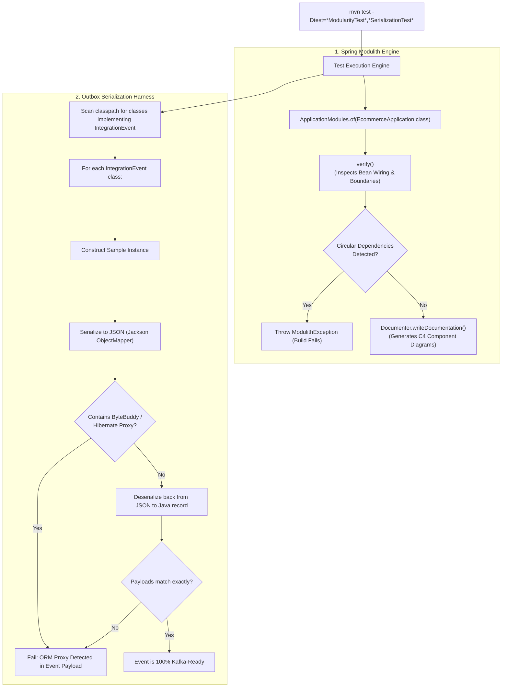

# Tech Spec: Spring Modulith Verification & Outbox Serialization

- **Summary:** Enforces Spring Modulith module boundary rules, generates living C4 architectural documentation, and verifies that all Transactional Outbox integration events are JSON-serializable and Kafka-ready.
- **Type:** Architecture Pattern / Automated Quality & Governance
- **Feature Spec:** [Microservice Seam Enforcement & Spring Modulith ArchUnit Verification](../../features/feat_014-microservice-seam-archunit-verification.md)

---

## 1. Problem & Decision

### What breaks without this?

In a modular monolith running in a single Spring application context, it is easy for Spring beans in one domain to inadvertently autowire internal components of another domain. Furthermore, when services publish integration events via the Transactional Outbox, developers can accidentally include JPA entities, uninitialized Hibernate lazy-loading proxies, or cyclic references in the event payloads. In-process event listeners might succeed, but the moment those events are extracted and streamed over Kafka or RabbitMQ, JSON serialization crashes with `InvalidDefinitionException` or `LazyInitializationException`, halting the entire distributed event pipeline.

### Decision

| Option | Decision | Why |
|:-------|:---------|:----|
| **Spring Modulith `ApplicationModules.verify()` + Automated Outbox JSON Serialization Test Harness** | **Adopted** | Spring Modulith programmatically parses Spring component boundaries, verifying zero unexposed internal access and zero circular module dependencies. The outbox serialization harness reflects over all integration events, verifying bidirectional JSON roundtrip serialization and Kafka readiness. |
| Manual Spring Configuration Review | Rejected | Unreliable; human reviewers cannot trace complex transitive `@Autowired` dependency graphs across dozens of Spring configuration classes. |
| Testing Event Serialization Only in Production / Integration Clusters | Rejected | Catches serialization bugs too late, causing message poison pills in production message brokers and broken consumer pipelines. |
| Generic Jackson `ObjectMapper` without Strict Type Validation | Rejected | Permissive mappers mask type-erasure issues, missing fields, and cyclic references that break external non-Java or remote consumers. |

### Trade-offs

| Benefits | Trade-offs |
|:---------|:-----------|
| Guarantees 100% microservice extractability: events can be streamed to external consumers (Kafka, Debezium) with zero payload adjustments. | Running full reflection and serialization roundtrips adds roughly 2 seconds to the test suite. |
| Automatic living documentation: Spring Modulith `Documenter` renders up-to-date C4 PlantUML diagrams and Markdown module canvases during builds. | Module authors must annotate public packages with `@NamedInterface` if they wish to expose components outside their top-level package. |
| Immediate detection of Hibernate lazy-loading leakage into message payloads before runtime. | Requires integration event classes to maintain strict backward-compatible constructors or Jackson creator annotations. |

---

## 2. How It Works

### Core Concept

The verification harness executes in two specialized test suites:
1. **Spring Modulith Modularity Verification (`ApplicationModularityTests`)**: Uses Spring Modulith's `ApplicationModules` API to inspect all packages in `com.grab.app`. It validates that each bounded context exposes only its designated public API, flags unauthorized internal bean injections, and detects circular module dependencies.
2. **Transactional Outbox Event Serialization Suite (`OutboxEventSerializationTest`)**: Scans all classes implementing the platform `IntegrationEvent` interface. It creates realistic sample instances, serializes them to JSON via the production Jackson `ObjectMapper`, deserializes them back, and asserts field equality while verifying zero ORM proxies exist in the serialized graph.



### How It Works Step by Step

| Step | What Happens | Why |
|:-----|:-------------|:----|
| 1 | `ApplicationModularityTests` boots the Spring Modulith module model pointing at `EcommerceApplication.class`. | Builds an AST of module definitions based on package naming under `com.grab.app`. |
| 2 | `ApplicationModules.verify()` executes assertions against Spring bean references, checking for illegal cross-package access. | Fails if a domain injects a Spring bean from another domain's `internal` package. |
| 3 | `Documenter` writes PlantUML and Canvas artifacts to `target/spring-modulith-docs/`. | Provides visual proof of architectural boundaries for architecture reviews and auditing. |
| 4 | `OutboxEventSerializationTest` uses ClassGraph/reflections to discover all integration event classes. | Automatically verifies new event types without requiring manual test additions. |
| 5 | Harness serializes each event class to a UTF-8 JSON byte array. | Simulates the exact serialization step performed by `TransactionalOutboxRelay`. |
| 6 | Harness scans JSON string to ensure no `@class` or Java-specific serialization hints are required by remote consumers. | Ensures events are portable across programming languages (Go, TypeScript, Python). |
| 7 | Harness deserializes the JSON and asserts payload equivalence. | Guarantees event consumers will receive identical data without data loss or truncation. |

---

## 3. How We Use It

### Test Suite Structure in `app`

All modularity and serialization tests reside in `app/src/test/java/com/grab/app/modularity/`:

```text
app/src/test/java/com/grab/app/modularity/
├── ApplicationModularityTests.java              # Spring Modulith verify() & living documentation
├── OutboxEventSerializationTest.java            # Jackson bidirectional JSON serialization harness
├── EventSchemaMetadataTest.java                 # Asserts eventId, occurredAt, eventVersion, aggregateId
└── OutboxEventContractVerificationTest.java     # Verifies event payload compatibility across versions
```

### Core Modulith Test Implementation

```java
@SpringBootTest
class ApplicationModularityTests {

    private static final ApplicationModules modules = ApplicationModules.of(EcommerceApplication.class);

    @Test
    void verifiesModularArchitecture() {
        // Enforces zero circular dependencies and strictly exposed package boundaries
        modules.verify();
    }

    @Test
    void generatesLivingArchitectureDocumentation() {
        // Generates C4 component diagrams and module canvas markdown
        new Documenter(modules)
            .writeDocumentation()
            .writeIndividualFilesAsPlantUml();
    }
}
```

### Outbox Event Serialization Test Implementation

```java
class OutboxEventSerializationTest {

    private final ObjectMapper objectMapper = new Jackson2ObjectMapperBuilder()
            .modules(new JavaTimeModule())
            .featuresToDisable(SerializationFeature.WRITE_DATES_AS_TIMESTAMPS)
            .build();

    @Test
    void allIntegrationEventsMustBeJsonSerializableAndKafkaReady() {
        Set<Class<? extends IntegrationEvent>> eventClasses = 
            EventClassScanner.findAllIntegrationEvents("com.grab");

        for (Class<? extends IntegrationEvent> eventClass : eventClasses) {
            IntegrationEvent sample = EventSampleFactory.createSample(eventClass);
            
            // 1. Serialize to JSON
            String json = assertDoesNotThrow(() -> objectMapper.writeValueAsString(sample),
                "Failed to serialize event: " + eventClass.getSimpleName());

            // 2. Assert zero Hibernate / ORM proxy leakage
            assertFalse(json.contains("org.hibernate.proxy"),
                "Event payload contains Hibernate proxy: " + eventClass.getSimpleName());

            // 3. Deserialize back
            IntegrationEvent deserialized = assertDoesNotThrow(() -> 
                objectMapper.readValue(json, eventClass),
                "Failed to deserialize event: " + eventClass.getSimpleName());

            // 4. Assert equivalence
            assertEquals(sample, deserialized, 
                "Deserialized event does not match original: " + eventClass.getSimpleName());
        }
    }
}
```

---

## 4. Implementation Rules

| Rule | Requirement |
|:-----|:------------|
| **R-01** | `ApplicationModularityTests` **MUST** execute `modules.verify()` on every Maven test build and **MUST NOT** disable cyclic dependency checks or package isolation checks. |
| **R-02** | All domain integration events **MUST** implement the platform `IntegrationEvent` interface and **MUST** reside in `com.grab.store.shared.events.{module}` or `com.grab.app.{cluster}.event`. |
| **R-03** | Integration events **MUST** be declared as immutable Java `record` types containing only primitive types, `String`, `UUID`, `Instant`, `BigDecimal`, or nested immutable records. |
| **R-04** | Integration events **MUST NOT** contain JPA entities, Hibernate collections (`PersistentBag`, `PersistentSet`), or framework proxies. |
| **R-05** | Every integration event **MUST** provide non-null metadata attributes: `eventId` (UUID), `occurredAt` (Instant), `eventVersion` (integer $\ge 1$), `aggregateType` (String), and `aggregateId` (String). |
| **R-06** | Changes to existing integration event schemas **MUST** remain backward-compatible (e.g. only adding optional nullable fields). Breaking changes require incrementing `eventVersion` and publishing under a new event type name. |
| **R-07** | Spring Modulith documentation artifacts (`target/spring-modulith-docs/`) **MUST** be generated during CI/CD test phases and made available for architectural auditing. |
| **R-08** | Inbound use case ports and application services in core domains **MUST NOT** depend on Spring Modulith testing utilities at runtime. Modulith dependencies must be scoped to `<scope>test</scope>`. |
| **R-09** | Outbox event payloads **MUST** be encoded as UTF-8 JSON without Java-specific serialization wrappers, ensuring native compatibility with Kafka, Debezium, and polyglot consumer runtimes. |
| **R-10** | If a pull request causes `modules.verify()` or `OutboxEventSerializationTest` to fail, the CI/CD pipeline **MUST** block merging immediately. |
