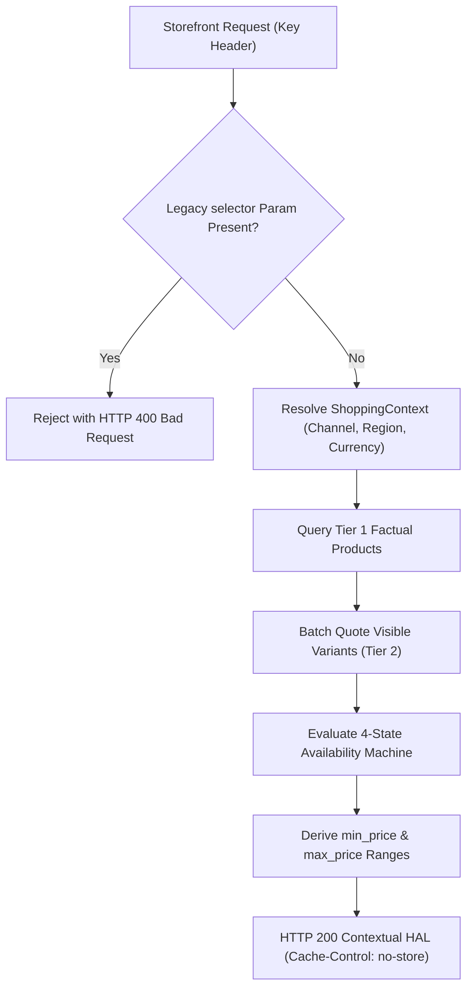
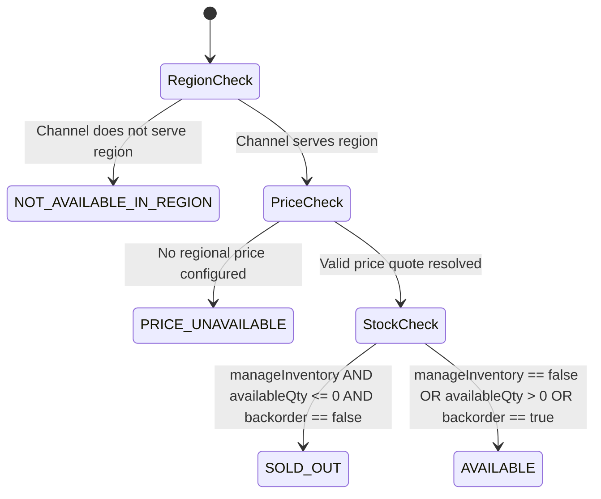
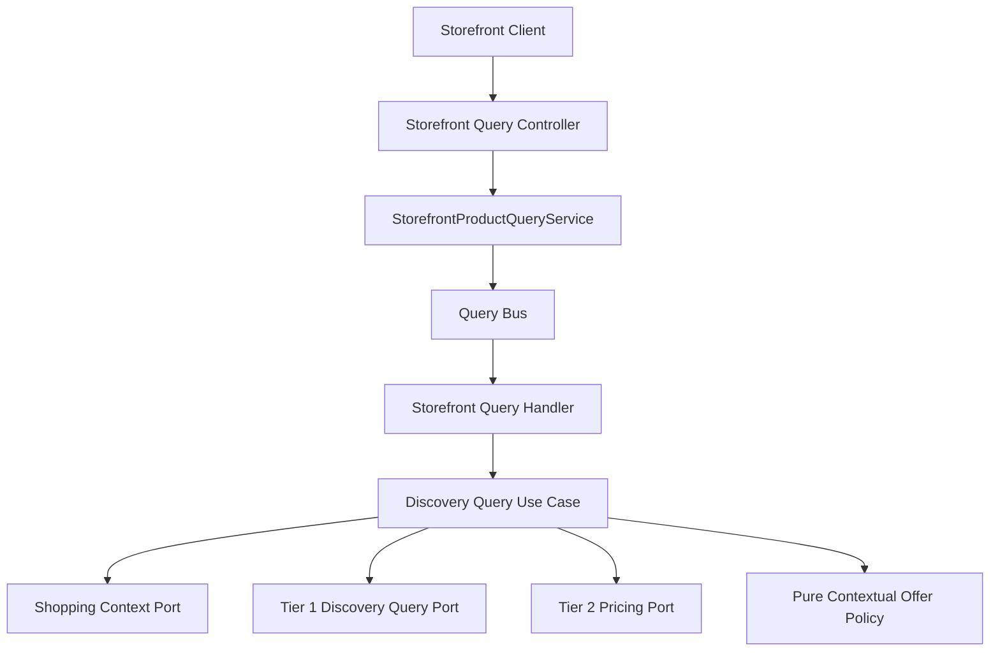
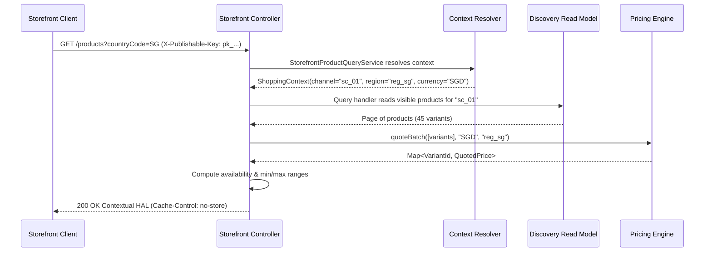

# Tech Spec: Storefront Contextual Cutover & Response Contract

- **Summary:** Composes authoritative shopping context, factual products, and vectorized regional price batches into stable public offers under HTTP 200.
- **Type:** Architecture Pattern
- **Feature Spec:** [Storefront API Cutover & Contract Refactoring](../../features/feat_007-storefront-api-cutover-contract-refactoring.md)

---

## 1. Problem & Decision

### What breaks without this?

Accepting legacy `salesChannelId` query parameters exposes private channels to public enumeration. Furthermore, if the browse API returns binary 404 errors when inventory runs out or regional prices are unconfigured, product URLs break, crawler rankings plummet, and customers land on broken pages. Returning `0.00` for missing prices misleads shoppers and causes cart abandonment.

### Decision

| Option | Decision | Why |
|:-------|:---------|:----|
| **Request-Time Dynamic Composition under HTTP 200** | Adopted | Preserves stable URLs with explicit variant availability codes (`AVAILABLE`, `SOLD_OUT`, `PRICE_UNAVAILABLE`, `NOT_AVAILABLE_IN_REGION`) and nullable prices. |
| Materialize Regional Offers in Search Documents | Rejected | Multiplies storage exponentially and triggers write storms across hundreds of thousands of documents. |
| Retain Legacy Query Parameter Channel Selectors | Rejected | Allows parameter tampering, channel spoofing, and bypasses public-key security controls. |

### Trade-offs

| Benefits | Trade-offs |
|:-----------|:-------------|
| URLs remain stable under HTTP 200, protecting search engine crawl indexing | Storefront browse requests coordinate Tier 1 facts and Tier 2 batch quotes at runtime |
| Transparent, granular availability codes provide clear UI messaging | Dynamic multi-region responses mandate `Cache-Control: no-store` to prevent CDN poisoning |

---

## 2. How It Works

### Core Concept

The controller validates the `X-Publishable-Key` header and rejects legacy `salesChannelId` and `publishableKey` parameters with HTTP 400. The contract applies to collection, slug detail, and `/api/v1/storefront-query/products/context`. It resolves `ShoppingContext`, reads visible presentation facts from the Tier 1 read model, executes a single-trip batch quote from Tier 2 pricing for visible variants, evaluates the 4-state availability machine, computes dynamic price ranges, and returns a contextual HAL JSON payload.

### How It Works Step by Step

| Step | What Happens | Why |
|:-----|:-------------|:----|
| 1 | Validates exactly one nonblank `X-Publishable-Key` header; rejects any `salesChannelId` or `publishableKey` query parameter with HTTP 400 | Enforces secure credential ingress |
| 2 | Resolves immutable `ShoppingContext` (channel, region, settlement currency, `regionServed` flag) | Establishes authoritative market context |
| 3 | Queries Tier 1 projection for visible products and published active variants | Reads presentation facts without prices |
| 4 | If region is served and variants exist, invokes Tier 2 batch pricing for all visible variants | Single-trip bulk quote at quantity one |
| 5 | Evaluates 4-state availability precedence: `NOT_AVAILABLE_IN_REGION > PRICE_UNAVAILABLE > SOLD_OUT > AVAILABLE` | Determines explicit variant statuses |
| 6 | Derives `min_price` and `max_price` from quoted variants in the settlement currency | Computes dynamic product price ranges |
| 7 | Serializes response DTO with navigation HAL links and adds `Cache-Control: no-store` | Prevents cross-border CDN cache poisoning |

### Lifecycle

---

## 3. How We Use It

### Where It Fits in Our System

### Component Responsibilities

| Component | Role | What It Does |
|:----------|:-----|:-------------|
| Storefront Query Controller | REST Controller | Validates transport parameters, headers, and dispatches queries. |
| Contextual Offer Composer | Domain Composer | Applies 4-state availability rules and derives dynamic price ranges. |
| HAL Link Builder | Representation Utility | Generates self and pagination links without leaking credentials. |

### Runtime Flow

---

## 4. Implementation Rules

| Rule | Requirement |
|:-----|:------------|
| **R-01** | GET `/api/v1/storefront-query/products`, GET `/api/v1/storefront-query/products/{slug}`, and GET `/api/v1/storefront-query/products/context` **MUST** require `X-Publishable-Key`; invalid credential outcomes **MUST** be generic 401. |
| **R-02** | Any `salesChannelId` query parameter, including empty or repeated values, **MUST** yield 400 before provider reads; client parameters **MUST NOT** override resolved context. |
| **R-03** | Offers **MUST** expose resolved channel, region, country, currency, locale, and `regionServed` eligibility with presentation facts; monetary amounts **MUST** be strings or null, and internal IDs or credentials **MUST NOT** be exposed. |
| **R-04** | Availability **MUST** evaluate: unserved region (`NOT_AVAILABLE_IN_REGION`), missing price (`PRICE_UNAVAILABLE`), depleted tracked inventory without backorder (`SOLD_OUT`), then `AVAILABLE`. Buyability is true only for `AVAILABLE`. |
| **R-05** | Minimum and maximum price ranges **MUST** derive from quoted active published variants in the resolved currency, including sold-out variants; unpriced or unserved variants **MUST** be excluded, and empty ranges **MUST** be null. |
| **R-06** | Visible detail products **MUST** return 200 even when sold out, unpriced, or unserved; missing, deleted, unpublished, or inactive products **MUST** return 404 `OfferNotFound`. |
| **R-07** | A nonempty served page or detail request **MUST** quote all distinct visible variants exactly once at quantity one; empty pages or unserved markets **MUST** skip pricing entirely. |
| **R-08** | HAL links **MUST** preserve market, search, category, and pagination parameters; keys and legacy channel selectors **MUST NOT** appear in links. |
| **R-09** | Contextual responses **MUST** include `Cache-Control: no-store` to prevent cross-border CDN cache poisoning. |
| **R-10** | Provider outages **MUST** propagate as operational service failures (`500`) rather than synthetic absent, unpriced, or out-of-stock outcomes. |
