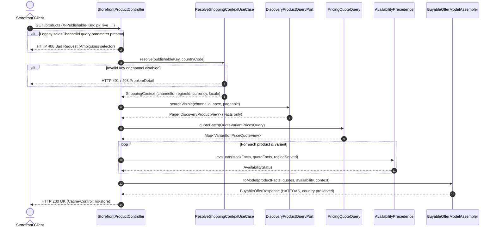
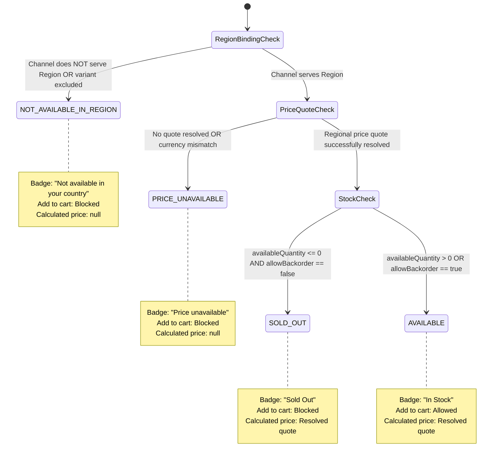

# Tech Specification: Storefront Contextual Cutover & Response Contract

> **Summary:** Cuts over storefront query endpoints from unauthenticated channel selectors to `X-Publishable-Key` context resolution, single-trip batch pricing composition, and explicit 4-state commercial availability.
> **Classification:** Architectural Pattern / Storefront API Composition
> **Supporting Modules:** `store/storefrontquery`, `discovery-application`, `store/pricing`, `store/saleschannel`, `store/region`
> **Related Feature:** [feat_007 — Storefront API Cutover & Response Contract Refactoring](../../features/feat_007-storefront-api-cutover-contract-refactoring.md)
> **Related System Design:** [SSD-001 §Phrase 5](../../system-design/001-multi_regional_contextual_discovery_system_design.md#L208-L210)
> **Related Workflow:** [Browse Contextual Storefront Offers](../workflows/browse-contextual-storefront-offers-workflow.md)
> **Foundational Tech Specs:** [Shopping Context Resolution](./shopping-context-resolution-tech-spec.md), [Batch Regional Pricing](./batch-regional-pricing-tech-spec.md), [Storefront Query and Discovery Facts](./storefront-query-tech-spec.md)

---

## 1. Why We Need It

### The Problem

Prior to Phase 5, storefront product endpoints (`GET /api/v1/storefront-query/products` and `.../{slug}`) accepted an unauthenticated `salesChannelId` query parameter, returned flat facts-only DTOs without regional pricing, and lacked explicit commercial availability status codes. When products depleted inventory or lacked market pricing, they either returned misleading `0.00` price amounts or unexpected `404 Not Found` errors that destroyed SEO rankings, invalidated search engine indexes, and broke customer bookmarks.

### Technology Decision & Alternatives

| Technology Option | Decision | Evaluation Rationale |
| :--- | :--- | :--- |
| **Request-Time Composition (Key Context + Discovery Facts + Batch Pricing)** | **Adopted** | Keeps discovery materialized projections strictly currency-agnostic and free from pricing write amplification, while composing authentic regional quotes and availability dynamically per request. |
| Pre-Materializing Regional Quotes into Discovery Table | Rejected | Causes combinatorial write amplification across channels × products × regions × currencies whenever price rules or exchange rates change. |
| Tolerating Dual Selectors (`salesChannelId` OR `X-Publishable-Key`) | Rejected | Violates edge security boundaries; allows shoppers to bypass regional catalog restrictions and price tiers by manipulating query parameters. |
| Throwing 404 on Depleted Stock or Missing Regional Price | Rejected | Degrades storefront SEO ranking and destroys user bookmarks; depleted and unpriced items must return HTTP 200 with clear state badges (`SOLD_OUT` / `PRICE_UNAVAILABLE`). |

### Key Benefits & Trade-offs

**Core Benefits:**
- **Zero Pricing Write Amplification:** Changing a price rule or exchange rate requires zero updates to the discovery persistence layer.
- **Strict Edge Security:** Rejection of `salesChannelId` forces all public storefront traffic through cryptographic key verification and market boundary checks.
- **SEO & Bookmark Stability:** Published products remain accessible via HTTP 200 even when out of stock or unpriced in a particular region.
- **Explicit Commercial UX:** Frontends receive unambiguous availability reason codes (`AVAILABLE`, `SOLD_OUT`, `PRICE_UNAVAILABLE`, `NOT_AVAILABLE_IN_REGION`).

**Known Trade-offs:**
- **Request Latency:** Adding request-time pricing quotation and context resolution introduces additional compute and database queries compared to a static denormalized table. Mitigated by single-trip vectorized batch pricing (`PricingQuoteQuery.quoteBatch`).
- **CDN Cache Isolation:** Because responses depend on the resolved market context, responses cannot be cached globally across regions without `Vary` or `no-store` headers.

---

## 2. What It Is

### Core Concept

Phase 5 introduces the storefront composition layer that intercepts public HTTP requests, resolves the authenticated `ShoppingContext` from the mandatory `X-Publishable-Key` header, queries visible factual products from `DiscoveryProductQueryPort`, quotes visible variants in bulk from `PricingQuoteQuery.quoteBatch`, evaluates the 4-state availability precedence machine, calculates dynamic price ranges, and formats the contextual `BuyableOfferResponse`.



---

## 3. How We Use It in This System

### Availability Precedence State Machine

Every variant returned in `BuyableOfferResponse` MUST evaluate its availability strictly according to the following 4-tier precedence ladder:

$$\text{NOT\_AVAILABLE\_IN\_REGION} \longrightarrow \text{PRICE\_UNAVAILABLE} \longrightarrow \text{SOLD\_OUT} \longrightarrow \text{AVAILABLE}$$



---

## 4. Technical Specification & Contracts

### Implementation Rules

- **R-01 (Mandatory Key Header):** Storefront endpoints (`GET /api/v1/storefront-query/products` and `GET /api/v1/storefront-query/products/{slug}`) **MUST** require the `X-Publishable-Key` HTTP header. Missing, malformed, or revoked keys **MUST** yield RFC 7807 `401 Unauthorized` or `403 Forbidden`.
- **R-02 (Legacy Parameter Rejection):** Any request containing the query parameter `salesChannelId` **MUST** immediately fail with `400 Bad Request`, preventing parameter-based selector bypass.
- **R-03 (SEO PDP Stability):** Direct PDP lookup (`GET .../products/{slug}`) for products with zero stock, unpriced variants, or regional unavailability **MUST** return `HTTP 200 OK` with the complete product details and corresponding status badges. Only products that are unpublished, deleted, or non-existent in the channel **MUST** return `404 OfferNotFound`.
- **R-04 (Dynamic Price Ranges):** `minPrice` and `maxPrice` **MUST** be computed dynamically at request time from variants that resolved a valid price quote in the market's currency. If no variants have valid quotes, both `minPrice` and `maxPrice` **MUST** be `null` (never `0.00`).
- **R-05 (Availability Precedence):** Variant availability **MUST** strictly follow the 4-tier precedence ladder:
  1. `NOT_AVAILABLE_IN_REGION`: Channel does not bind to region, or region is unserved.
  2. `PRICE_UNAVAILABLE`: No active price rule found in the regional currency.
  3. `SOLD_OUT`: Quoted and served, but `availableQuantity <= 0` and backordering is disabled.
  4. `AVAILABLE`: Quoted, served, and stock is positive or backorder allowed.
- **R-06 (Single-Trip Pricing Batch):** Pricing queries for search and PDP endpoints **MUST** invoke `PricingQuoteQuery.quoteBatch` exactly once per HTTP request across all visible variants. Multi-trip N+1 queries to pricing are strictly forbidden.
- **R-07 (HATEOAS Link Assembly):** Self and pagination links generated by `BuyableOfferModelAssembler` **MUST** preserve `countryCode` and `locale` query parameters, but **MUST NOT** include publishable keys or credentials.
- **R-08 (CDN Cache Isolation):** All contextual responses **MUST** include `Cache-Control: no-store` to prevent intermediary CDNs and proxies from serving region-specific quotes to other countries.

### Restructured BuyableOfferResponse Schema

```json
{
  "salesChannelId": "sc_sg_online",
  "regionId": "reg_singapore",
  "countryCode": "SG",
  "currencyCode": "SGD",
  "locale": "en-SG",
  "productId": "prod_coffee_beans",
  "title": "Arabica Coffee Beans 250g",
  "slug": "arabica-coffee-beans-250g",
  "description": "Premium roasted whole beans.",
  "thumbnail": "https://cdn.example.com/media/arabica.jpg",
  "productStatus": "ACTIVE",
  "minPrice": 14.50,
  "maxPrice": 18.00,
  "options": [
    { "id": "opt_roast", "name": "Roast", "values": ["Medium", "Dark"] }
  ],
  "variants": [
    {
      "variantId": "var_arabica_medium",
      "sku": "COF-MED-250",
      "title": "Medium Roast",
      "status": "ACTIVE",
      "price": 14.50,
      "compareAtPrice": 16.50,
      "inStock": true,
      "availableQuantity": 42,
      "availabilityStatus": "AVAILABLE",
      "optionValues": { "Roast": "Medium" }
    },
    {
      "variantId": "var_arabica_dark",
      "sku": "COF-DRK-250",
      "title": "Dark Roast",
      "status": "ACTIVE",
      "price": 18.00,
      "compareAtPrice": null,
      "inStock": false,
      "availableQuantity": 0,
      "availabilityStatus": "SOLD_OUT",
      "optionValues": { "Roast": "Dark" }
    }
  ],
  "_links": {
    "self": { "href": "https://api.example.com/api/v1/storefront-query/products/arabica-coffee-beans-250g?country=SG" }
  }
}
```

### Commercial Availability Mapping Matrix

| Status Code | Conditions | Customer Badge | Add to Cart | Calculated Price |
| :--- | :--- | :--- | :--- | :--- |
| **`AVAILABLE`** | Region served, price quoted, in-stock (or backorder allowed) | In Stock | Allowed | Formatted regional amount |
| **`SOLD_OUT`** | Region served, price quoted, tracked inventory depleted (`<= 0`) | Sold Out | Blocked | Formatted regional amount |
| **`PRICE_UNAVAILABLE`** | Region served, no price rule configured in market currency | Price Unavailable | Blocked | `null` |
| **`NOT_AVAILABLE_IN_REGION`** | Channel does not serve region or variant excluded | Not available in your country | Blocked | `null` |

---

## 5. Module Ownership & Cross-Cutting Boundaries

| Responsibility | Owning Component / Module | Implementation Reference |
| :--- | :--- | :--- |
| Public Key Verification & Resolution | `saleschannel` / `store` | `ResolveShoppingContextUseCase` |
| Factual Read & Visibility Predicates | `discovery-application` / `discovery-persistence-adapter` | `SearchBuyableOffersService`, `DiscoveryProductQueryPort` |
| Vectorized Bulk Pricing Quotation | `pricing` / `store` | `PricingQuoteQuery.quoteBatch` |
| Availability Precedence Logic | `store/storefrontquery` | `AvailabilityPrecedenceStateMachine` |
| Dynamic Price Range Assembly | `store/storefrontquery` | `BuyableOfferModelAssembler` |
| REST Controller & HTTP Headers | `store/storefrontquery` | `StorefrontProductController` |
