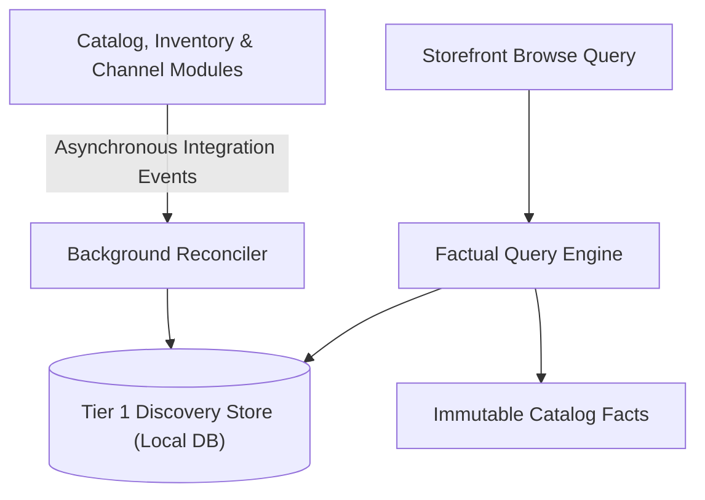
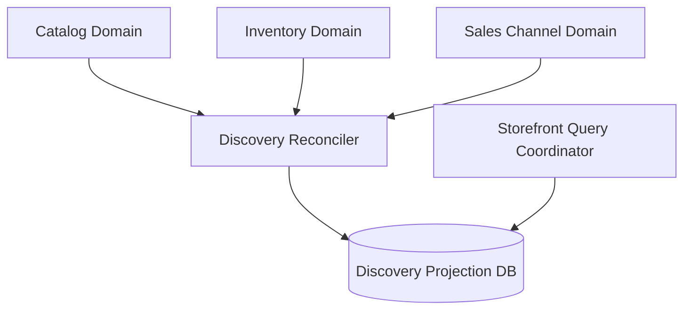
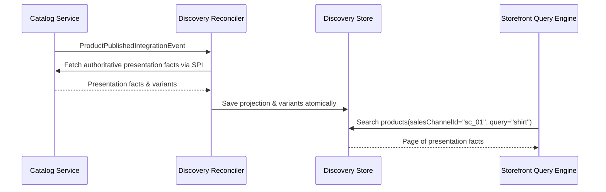

# Tech Spec: Storefront Query and Discovery Facts Boundary

- **Summary:** Establishes the factual read boundary, local projection storage guarantees, and decoupled handoff to contextual storefront composition.
- **Type:** Architecture Pattern
- **Feature Spec:** [Discovery Wiring & Projection Reconciliation](../../features/feat_006-discovery-wiring-projection-reconciliation.md)

---

## 1. Problem & Decision

### What breaks without this?

If storefront browse queries directly perform synchronous cross-module joins against transactional Catalog, Inventory, and Sales Channel databases, the system suffers severe read lock contention and cascading failures during peak shopping traffic. Furthermore, mixing background projection maintenance with customer read requests creates unpredictable browse latencies.

### Decision

| Option | Decision | Why |
|:-------|:---------|:----|
| **Local Factual CQRS Read Boundary** | Adopted | Isolates customer read queries to a dedicated, denormalized read model maintained asynchronously outside the request path. |
| Customer Reads Triggering Source Refresh | Rejected | Synchronously couples customer traffic to transactional write modules, resulting in high latency and lock contention. |
| Full Storage Reset on Schema Changes | Rejected | Drops existing production catalog data and creates unacceptable downtime during upgrades. |

### Trade-offs

| Benefits | Trade-offs |
|:-----------|:-------------|
| Fast, index-optimized factual catalog searches completely decoupled from write traffic | Asynchronous projection reconciliation means read models can briefly lag transactional write changes |
| Local referential integrity and zero runtime dependencies on external write tables | Read models must be populated via initial seed or background rebuild coordinator |

---

## 2. How It Works

### Core Concept

The Discovery module maintains a local, denormalized read projection containing presentation facts (titles, slugs, media, options, variant hierarchy, and stock status) stripped of monetary pricing. Upstream domain events update this read model asynchronously, allowing storefront browse queries to execute against local indexes without touching upstream services.

### How It Works Step by Step

| Step | What Happens | Why |
|:-----|:-------------|:----|
| 1 | Upstream services emit integration events upon catalog publication or stock movement | Alerts Discovery to dirty or updated product targets |
| 2 | Background reconciler rereads current authoritative facts via published SPI | Collects current state outside customer request flows |
| 3 | Reconciler updates local projection atomically with optimistic locking guards | Maintains local referential integrity and versioning |
| 4 | Storefront browse query requests channel products with keyword/category filters | Reads directly from local indexed projection tables |
| 5 | Engine returns immutable presentation facts without pricing or currency fields | Decouples read model from pricing rules and calculations |

---

## 3. How We Use It

### Where It Fits in Our System

### Component Responsibilities

| Component | Role | What It Does |
|:----------|:-----|:-------------|
| Factual Query Reader | Query Service | Serves indexed catalog presentation facts, filters, and pagination without price calculations. |
| Projection Reconciler | Event Consumer | Ingests domain events and reconciles projection state outside customer traffic. |
| Discovery Repository | Local Persistence SPI | Manages local projection documents, variant facts, and rebuild run metadata. |

### Runtime Flow

---

## 4. Implementation Rules

| Rule | Requirement |
|:-----|:------------|
| **R-01** | The projection database **MUST** store presentation facts and variant memberships with no monetary amount, currency, price range, or commercial buyability columns. |
| **R-02** | Storage **MUST** enforce uniqueness of `(sales_channel_id, product_id)` and non-null `(sales_channel_id, slug)` pairs plus indexed lookups by `variant_id` and `sku`. |
| **R-03** | Existing databases **MUST NOT** be automatically reset or treated as empty during application startup. |
| **R-04** | Customer factual queries **MUST** remain strictly read-only and **MUST NOT** synchronously invoke Pricing or refresh source domain tables. |
| **R-05** | Maintenance rereads **MUST** use published read SPIs under provider-owned transactions; shared events **MUST** dispatch local maintenance commands with Discovery-owned writes. |
| **R-06** | Persistence verification **MUST** execute against target-database Testcontainers asserting zero circular dependencies and query/write isolation. |
