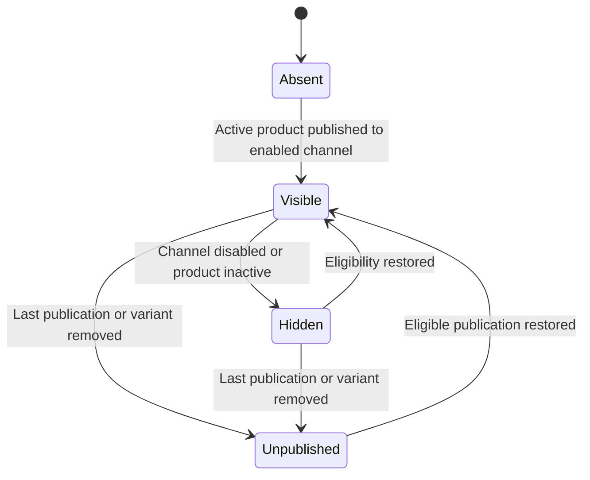
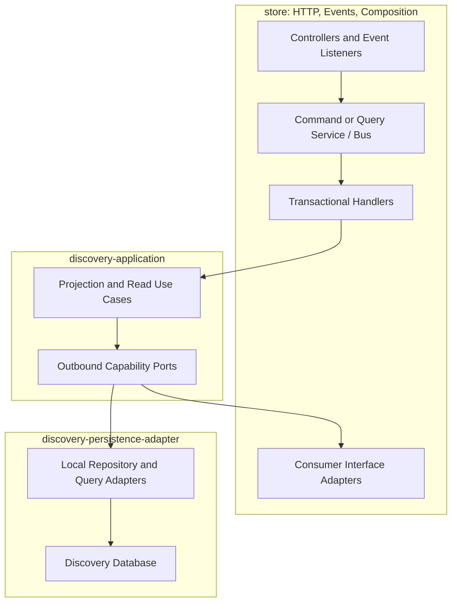
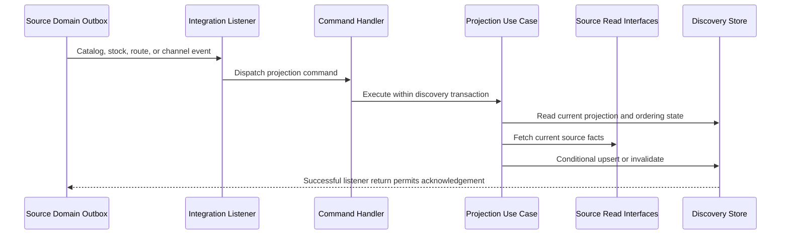

# Tech Specification: Storefront Query & Product Discovery

> **Summary:** Maintains currency-agnostic channel/product facts in Tier 1 and delegates regional prices and availability to the contextual query path.
> **Classification:** Architectural Pattern / CQRS Read Model
> **Supporting Modules:** `discovery-application` / `discovery-persistence-adapter` / `store/storefrontquery`
> **Key Lifecycle Feature:** [Sales-Channel Key Lifecycle & Authenticated Management](../../features/feat_003-sales-channel-key-lifecycle-management.md)
> **Related Features:** [DiscoveryProduct baseline](../../features/feat_002-discovery_product.md), [Discovery Wiring & Projection Reconciliation](../../features/feat_006-discovery-wiring-projection-reconciliation.md), [Storefront API Cutover & Response Contract Refactoring](../../features/feat_007-storefront-api-cutover-contract-refactoring.md)
> **Related Domain Specs:** [Product](../domain/catalog/architecture/product-domain-spec.md), [Publication](../domain/catalog/architecture/product-publication-domain-spec.md), [Inventory](../domain/inventory/architecture/inventory-item-domain-spec.md), [Sales Channel](../domain/sales-channel/architecture/sales-channel-domain-spec.md), [Pricing](../domain/pricing/architecture/pricing-domain-spec.md)
> **Related Workflow:** [Browse, Project, and Rebuild](../workflows/browse-and-discover-products-workflow.md)
> **Supporting Tech:** [Shopping Context](shopping-context-resolution-tech-spec.md), [Batch Pricing](batch-regional-pricing-tech-spec.md), [Rollout](contextual-discovery-rollout-tech-spec.md)
> **System Design:** [SSD-001](../../system-design/001-multi_regional_contextual_discovery_system_design.md)

## 1. Why We Need It

### Implementation Baseline and Contract Change

Audit date: 2026-10-23, current working tree. `ProjectDiscoveryProductService` and `RebuildDiscoveryProductsService` have empty bodies; `SearchBuyableOffersService` and `GetBuyableOfferBySlugService` return null, and their configuration constructs them without dependencies.

The entity, migration, adapters, listener, handlers, and REST scaffolding exist. The current schema and JSON variants still persist currency, price ranges, individual prices, and buyability; mocked adapter/controller tests do not establish a working runtime pipeline.

This revision defines the planned Tier 1 replacement. It supersedes the price-materialization and raw-channel-selection clauses in the baseline feature when features 006 and 007 cut over; it does not claim those features are implemented.

### Technology Decision & Alternatives

| Option | Decision | Rationale |
| :--- | :--- | :--- |
| Channel/product projection plus request-time prices | Adopt | Separates catalog and inventory refresh from regional pricing changes. |
| Document per channel/product/region/currency | Reject | Multiplies stored documents and price-driven updates. |
| Join write aggregates on every customer read | Reject | Breaks read-model isolation and module boundaries. |

Catalog and stock facts remain eventually consistent. Pricing availability and latency become part of the request path, so the previous promise of no runtime pricing coupling no longer applies.

## 2. What It Is

### Core Concept

### Projection Lifecycle

Stock depletion and missing regional prices do not change visibility. These conditions affect the contextual response according to the [availability contract](shopping-context-resolution-tech-spec.md#4-technical-specification--contracts).

## 3. How We Use It in This System

### Architecture & Layer Stacking

The repository currently has no `discovery-domain` module; the projection is an application read model, not a new business aggregate. Projection persistence remains local to discovery, and cross-module catalog/inventory/channel adapters remain in `store`.

### Runtime Flow

Listener failures propagate to outbox delivery; no source write is rolled back across module databases. Exact projection and rebuild steps are defined in the linked workflow.

## 4. Technical Specification & Contracts

### Normative Rules

- **DISC-01:** Tier 1 MUST contain at most one document per `(salesChannelId, productId)` with channel-scoped slug uniqueness; region and currency MUST NOT extend its identity.
- **DISC-02:** Documents MUST retain product presentation, options, published variant identities, SKUs, routing-dependent quantity, tracking/backorder facts and channel/product eligibility; regional currency, monetary values, contextual ranges, and contextual buyability MUST NOT be persisted in the final Tier 1 schema or variant JSON.
- **DISC-03:** Catalog, stock, routing, and channel events MUST dispatch commands through `@EventListener`; cross-module records MUST reside under `store/.../shared/events/{module}/`, and source reads MUST use published interfaces backed by inbound use cases.
- **DISC-04:** A strictly older event MUST NOT overwrite a newer document; duplicates MUST converge, and ordering checks plus save/invalidation MUST use concurrency protection with retry/re-read on conflicts rather than an unguarded read-then-save.
- **DISC-05:** Visibility MUST require an enabled channel, ACTIVE parent product, and at least one published variant; last-variant removal MUST invalidate every existing channel document and clear its offers, while stock or price absence MUST NOT hide eligible products.
- **DISC-06:** Search and PDP use cases MUST use query ports returning immutable application views; query adapters MUST use an injected search specification for pagination, with no write-repository or aggregate reads, and invisible/missing PDPs MUST raise OfferNotFound.
- **DISC-07:** Rebuild MUST enumerate current publications and existing projections in bounded batches, deduplicate product/channel pairs, repair missing/drifted facts, and invalidate orphaned rows without overwriting newer event updates; retries MUST be safe.
- **DISC-08:** Tier 1 MUST NOT subscribe to price-change events for document recalculation or call Pricing during projection/rebuild; contextual queries MUST use the batch pricing capability instead.
- **DISC-09:** New schema changes MUST be append-only migrations verified with PostgreSQL Testcontainers; existing applied V1 files MUST NOT be rewritten to achieve cutover.
- **DISC-10:** Controllers MUST inject only query/command services and assemblers; handlers and provider adapters own module transaction boundaries, and use cases alone orchestrate ports with business decisions in policies.

### Storage Contract

| Data group | Final Tier 1 content |
| :--- | :--- |
| Identity | Channel ID, product ID, seller reference, channel-scoped slug, concurrency version. |
| Presentation | Title, description, thumbnail/media and product options. |
| Eligibility | Product status, publication presence, channel status. |
| Variant facts | Variant ID, SKU, title, option values, available quantity, manage-inventory and allow-backorder facts. |
| Ordering | Event occurrence/update watermark used by guarded projection updates. |
| Excluded values | Currency, price, compare-at price, min/max prices, region-specific availability and buyability. |

Existing `InventoryPort.Availability` exposes quantity and untracked state only; preserving backorder behavior requires completing the source read contract and its mapping. Existing records under owner `events/` packages must be moved to the shared event location for affected flows.

### Endpoints and Configuration

| Surface | Target contract |
| :--- | :--- |
| `GET /api/v1/storefront-query/products` | Contextual paged representation using key-only channel resolution. |
| `GET /api/v1/storefront-query/products/{slug}` | Contextual PDP representation with explicit variant availability. |
| `storefrontquery.rebuild.on-startup` | Existing opt-in startup dispatch; a no-op until the rebuild use case is implemented. |

No operational batch-rebuild control or progress checkpoint is currently implemented. The old specification's `fallbackCurrency`, `defaultPageSize`, and `maxPageSize` entries were not verified implementation bindings; the target design forbids currency fallback and requires release measurements rather than claiming a latency guarantee.
